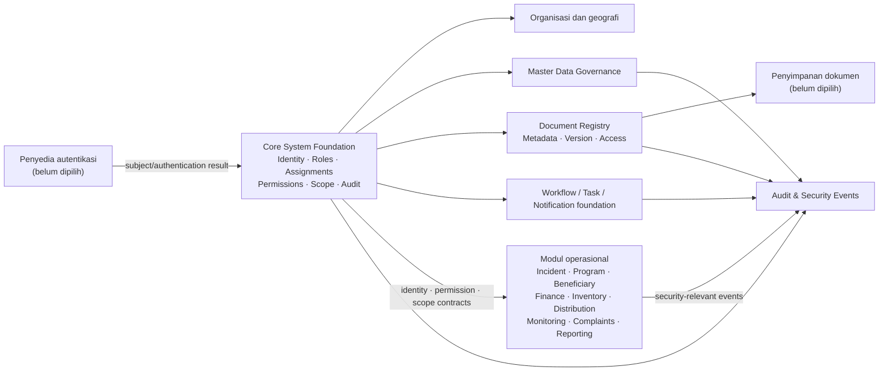

# SIM-TDB — AUDIT PROMPT 00 DAN SPESIFIKASI CORE SYSTEM FOUNDATION

**Document ID:** SIMTDB-REV05112026-AUDIT-CORE  
**Status:** Draft untuk perbandingan dan review  
**Mode:** Audit dan spesifikasi — tanpa implementasi  
**Project:** Sistem Informasi Manajemen Tanggap Darurat Bencana (SIM-TDB)  
**Organization:** Caritas Keuskupan Malang — Tim Solidaritas Kemanusiaan Keuskupan Malang (TSKKM)

---

## 1. Tujuan

Dokumen ini menyimpan hasil audit atas materi SIM-TDB yang tersedia di percakapan dan spesifikasi awal Core System Foundation.

Tujuan dokumen:

- Menyediakan baseline untuk membandingkan hasil analisis berikutnya.
- Memisahkan bukti, keputusan organisasi, usulan teknis, dan hal yang masih pending.
- Mencatat keterbatasan audit secara jelas.
- Menyediakan rancangan awal Core System Foundation tanpa menganggapnya sebagai spesifikasi final atau persetujuan implementasi.

Dokumen ini tidak mengubah SOP, tidak menyelesaikan keputusan organisasi, dan tidak mengizinkan implementasi aplikasi.

---

## 2. Kesimpulan eksekutif

**Materi belum layak ditetapkan sebagai Master Information final atau single source of truth.**

Materi yang diberikan cukup untuk menjadi dasar harmonisasi dan penyusunan **draft master untuk review**, tetapi sejumlah konflik dan kekurangan harus tetap terlihat. Menggabungkan semuanya sebagai dokumen final saat ini berisiko membuat usulan teknis atau keputusan yang masih pending tampak seolah-olah sudah disetujui.

Temuan paling penting:

1. Penomoran dan cakupan Phase 0.1B–0.1G tidak konsisten antar dokumen.
2. SOP asli, ERD aktual, data dictionary lengkap, matriks izin, dan beberapa register sumber belum tersedia untuk diverifikasi.
3. Siklus SITREP dan jalur Tidak Respons berpotensi menghasilkan pencatatan ganda atau aturan yang berbeda.
4. Beberapa kewenangan operasional dan persetujuan belum ditetapkan dengan bukti keputusan organisasi.
5. Timeline dan SLA belum dapat diotomatisasi sebelum pemicu dan maknanya dikonfirmasi.
6. Source of Truth Matrix dan Unified Entity Registry belum disahkan.
7. Issue ID lama yang diwajibkan oleh Phase 0.1F tidak memiliki pemetaan sumber dalam materi yang tersedia.
8. Database, offline architecture, dan beberapa kebijakan akses masih pending.

**Rekomendasi:** susun dokumen master hanya sebagai draft terkendali sampai sumber yang hilang tersedia, isu kritis dipetakan, dan keputusan yang memerlukan persetujuan organisasi terdokumentasi.

---

## 3. Ruang lingkup dan batasan audit

### 3.1 Materi yang ditelaah

Telaah dilakukan terhadap teks yang disampaikan untuk:

- Phase 0 — System Architecture and Database Validation.
- Phase 0.1A — Logical Data Model, ERD, and Data Relationship Design.
- Phase 0.1B — Complete Data Dictionary and Data Contract Specification.
- Phase 0.1C — Program and Beneficiary Management.
- Phase 0.1D — Procurement, Finance, and Logistics Management.
- Phase 0.1E — Monitoring, Complaints, Evaluation, and Reporting.
- Phase 0.1F — Cross-Module Integration and Data Governance.
- Correction & Harmonization Register (CHR-SIMTDB-0.1).
- Master Prompt Final SIM-TDB Caritas V1.0.
- Prompt 00 — Master Governance, Source Audit & Repository Baseline.
- Prompt 01 — Core System Foundation.
- Development Prompt Roadmap.
- Hasil audit awal yang sebelumnya disusun dalam percakapan.

### 3.2 Materi yang tidak tersedia atau belum diperiksa

Materi berikut tidak disertakan sebagai artefak yang dapat diverifikasi dalam audit ini:

- Buku SOP TSKKM asli atau scan halaman 1–95.
- ERD aktual yang telah ditinjau atau disetujui.
- Unified Entity Registry yang telah disetujui.
- Data dictionary field-level aktual untuk seluruh tabel.
- Register issue ID asli untuk ISS, BEN, PR, FN, LG, DS, ME, CP, RP, LR, dan SEC.
- Matriks role, permission, scope, serta assignment yang lengkap dan disahkan.
- Bukti keputusan/risalah persetujuan organisasi.
- Repository saat ini.
- Aplikasi, database, migrasi, atau hasil pengujian sistem.

### 3.3 Batas kesimpulan

Audit ini adalah **desk review atas konsistensi dokumen**, bukan:

- Audit kepatuhan terhadap SOP asli.
- Audit keamanan teknis.
- Audit database atau source code.
- Pengujian sistem atau migrasi.
- Pengesahan kebijakan organisasi.
- Persetujuan untuk implementasi.

---

## 4. Klasifikasi temuan

| Label | Makna |
|---|---|
| `SOP_CONFIRMED` | Didukung langsung oleh SOP asli yang telah diperiksa. |
| `ORG_DECISION_CONFIRMED` | Didukung keputusan organisasi formal yang dapat diidentifikasi. |
| `TECHNICAL_RECOMMENDATION` | Usulan teknis, bukan ketentuan SOP. |
| `PENDING_ORG_DECISION` | Memerlukan keputusan organisasi sebelum dikunci. |
| `SOURCE_CONFLICT` | Sumber yang tersedia berbeda atau belum terselaraskan. |
| `EVIDENCE_NOT_AVAILABLE` | Bukti sumber tidak tersedia untuk diperiksa. |
| `REJECTED` | Ditolak secara eksplisit oleh pihak berwenang. |
| `SUPERSEDED` | Digantikan oleh sumber baru yang disetujui. |
| `ORG_BASELINE_STATED` | Dinyatakan sebagai baseline organisasi dalam materi, tetapi bukti formal belum dilampirkan. |
| `SOP_NOT_VERIFIED` | Diklaim terkait SOP, tetapi SOP asli belum tersedia untuk pencocokan. |

---

# BAGIAN A — HASIL AUDIT PROMPT 00

## A1. Inventaris sumber

| Sumber | Status yang dapat dipastikan dari percakapan | Batas audit |
|---|---|---|
| Prompt 00 — Master Governance & Repository Audit | Teks prompt tersedia dan telah ditelaah. | Instruksi audit, bukan hasil audit repository atau sumber persetujuan. |
| Prompt 01 — Core System Foundation | Teks prompt tersedia dan telah ditelaah. | Instruksi spesifikasi, bukan spesifikasi Core yang sudah disetujui. |
| Development Prompt Roadmap | Teks roadmap tersedia dan telah ditelaah. | Roadmap adalah usulan urutan kerja, bukan bukti keputusan organisasi. |
| Phase 0 dan Phase 0.1A–0.1F | Teks prompt/spesifikasi tersedia di percakapan. | Tidak ada hasil ERD, data dictionary aktual, atau implementasi untuk diperiksa. |
| Correction & Harmonization Register | Teks CHR tersedia dan telah ditelaah. | CHR sendiri menyatakan banyak keputusan masih terbuka. |
| Master Prompt V1.0 | Teks tersedia dan telah ditelaah. | Baseline interpretasi sebelumnya; tidak menggantikan SOP atau keputusan formal. |
| SOP TSKKM halaman 1–95 | **Tidak tersedia** | Isi, nomor halaman cetak, formulir, diagram, dan catatan belum dapat diverifikasi. |
| Repository saat ini | **Tidak tersedia** | Framework, runtime, database, auth, API, file storage, tests, CI/CD, migrations, dan modul aktual belum diketahui. |
| Keputusan formal Caritas/TSKKM | **Tidak tersedia sebagai dokumen bukti** | Materi menyebut sejumlah keputusan sebagai “confirmed”, tetapi tidak melampirkan sumber, tanggal, penerbit, atau dokumen persetujuannya. |
| Register issue ID lama ISS/BEN/PR/FN/LG/DS/ME/CP/RP/LR/SEC | **Tidak tersedia** | Deskripsi dan pemetaan ID tidak dapat direkonstruksi tanpa sumber asli. |

### Dampak

- Temuan tentang repository berstatus `EVIDENCE_NOT_AVAILABLE`, bukan hasil audit kode.
- Klaim kesesuaian SOP belum dapat berstatus `SOP_CONFIRMED`.
- Kewenangan yang disebut “dikonfirmasi” dalam materi proyek diperlakukan sebagai ketentuan baseline yang dinyatakan, dengan bukti formal masih perlu dilampirkan.
- Tidak ada keputusan yang dinaikkan dari `PENDING_ORG_DECISION` menjadi disetujui.

## A2. Lima blocker paling kritis

| ID | Blocker | Alasan |
|---|---|---|
| B-01 | SOP asli tidak tersedia | Tidak mungkin memeriksa workflow, formulir, halaman, field, dan makna ketentuan secara langsung. |
| B-02 | Repository tidak tersedia | Tidak mungkin menghasilkan baseline atas teknologi, schema, autentikasi, otorisasi, tes, atau status modul yang sudah dibangun. |
| B-03 | Struktur fase dan dokumen saling berbeda | Phase 0.1B, Phase 0.1C, dan rancangan struktur Phase 0.1A–G tidak sepenuhnya selaras; CHR-001 masih terbuka. |
| B-04 | Bukti formal keputusan dan kewenangan tidak dilampirkan | Prompt menyatakan beberapa kewenangan terkonfirmasi, tetapi detail sumber formalnya tidak dapat diperiksa. |
| B-05 | Register isu dan model kanonis belum lengkap | Issue ID lama tidak memiliki pemetaan sumber; Unified Entity Registry dan ERD aktual belum tersedia. |

### Keputusan awal

- **Go** untuk menyusun draft spesifikasi Core Foundation untuk dibahas.
- **No-Go** untuk menyatakan audit repository selesai atau Core Foundation siap implementasi.
- **No-Go** untuk membuat schema, migrasi, konfigurasi akses produksi, atau akun administrator.

## A3. Temuan audit Prompt 00

| ID | Keparahan | Temuan dan bukti yang tersedia | Status / tindakan |
|---|---|---|---|
| AUD-00-01 | Kritis | Prompt 00 meminta repository audit, tetapi repository tidak diberikan dalam materi percakapan. | `EVIDENCE_NOT_AVAILABLE`; lampirkan URL/akses repository sebelum audit implementasi. |
| AUD-00-02 | Kritis | Prompt 00 meminta pembacaan SOP scan halaman 1–95, tetapi scan tidak tersedia di konteks. | `EVIDENCE_NOT_AVAILABLE`; sediakan salinan sumber asli, bukan hanya prompt atau OCR. |
| AUD-00-03 | Kritis | Prompt 00 mensyaratkan bukti keputusan organisasi; materi menyebut keputusan, tetapi bukan dokumen yang dapat diverifikasi. | `PENDING_ORG_DECISION` atau bukti belum tersedia; lengkapi sumber, tanggal, penerbit, cakupan, status. |
| AUD-00-04 | Kritis | CHR-001 mencatat konflik penomoran/cakupan fase; roadmap mengusulkan susunan berbeda sebagai urutan kerja. | `SOURCE_CONFLICT`; minta persetujuan struktur dokumen sebelum baseline final. |
| AUD-00-05 | Kritis | CHR-004 mengidentifikasi potensi duplikasi lifecycle SITREP antara SITREP #1 sebelum keputusan dan Situation Report di jalur Tidak Respons. | `PENDING_ORG_DECISION`; tetapkan lifecycle, revisi, penomoran, distribusi. |
| AUD-00-06 | Kritis | CHR-005/021 menyatakan decision gates terpisah, sementara otoritas operasional lain masih belum terpetakan. | Pertahankan tiga decision gate yang dinyatakan; jangan mengarang kewenangan lain. |
| AUD-00-07 | Kritis | CHR-006/017 menyatakan timeline dan SLA belum bisa diartikan otomatis. | `PENDING_ORG_DECISION`; timer harus tetap nonaktif sampai pemicu/makna disahkan. |
| AUD-00-08 | Tinggi | CHR-023 mengidentifikasi kandidat sumber data ganda lintas SITREP, inventory, stock request, monitoring, beneficiary, dan learning. | Registry entitas kanonis dan Source of Truth Matrix perlu disetujui. |
| AUD-00-09 | Tinggi | Issue ID yang diwajibkan Phase 0.1F tidak memiliki mapping sumber dalam CHR; CHR-025 secara eksplisit mencatat kekurangan ini. | Jangan menciptakan mapping; buat missing-source register dan cari arsip issue asli. |
| AUD-00-10 | Tinggi | Prompt 00 dan Prompt 01 meminta data governance/retention/security, tetapi periode retensi dan kebijakan offline belum ditetapkan. | Catat sebagai proposal teknis dan keputusan organisasi pending. |

## A4. Konteks yang dapat dibawa ke Prompt 01

Berikut adalah konteks yang **dinyatakan dalam materi yang diberikan**, bukan verifikasi baru terhadap SOP asli:

1. Empat role permanen yang ditetapkan dalam baseline:
   - Romo Direktur Caritas.
   - Koordinator.
   - Pelaksana Lapangan.
   - Administrasi.
2. Koordinator memvalidasi rapid assessment.
3. Romo Direktur memutuskan Respons/Tidak Respons berdasarkan mandat atau delegasi.
4. Keputusan Pastor Paroki terkait pembentukan Tim TD/PSE Paroki merupakan decision point terpisah.
5. Fungsi operasional bukan otomatis role organisasi permanen.
6. Laporan masuk, insiden, dan operasi respons harus tetap terpisah.
7. Assessment, assessment review, SITREP, dan response decision harus tetap terpisah.
8. Household, household members, dan dwellings harus tetap terpisah.
9. Procurement request, purchase order, invoice, penerimaan fisik, Goods Received Note, dan inventory posting tidak boleh dicampur.
10. Pengaduan sensitif memerlukan akses terbatas; kebijakan akses rinci belum tersedia.
11. Database dan offline architecture belum boleh dikunci tanpa keputusan/POC yang terdokumentasi.
12. Dokumen Master Information harus membedakan sumber SOP, keputusan organisasi, usulan teknis, dan pending decision.

## A5. Keputusan yang perlu diperoleh sebelum Prompt 01 dapat lulus quality gate

1. Persetujuan struktur fase dan fungsi setiap dokumen.
2. SOP halaman 1–95 yang dapat diperiksa.
3. Bukti formal atas keputusan organisasi yang diklaim telah dikonfirmasi.
4. Keputusan terkait otoritas pemberian dan pencabutan penugasan.
5. Otoritas bootstrap/admin teknis dan apakah kapabilitas tersebut diizinkan.
6. Pemilik dan pengelola master data.
7. Kebijakan data classification yang disahkan.
8. Kebijakan retensi, archival, deletion/anonymization, dan data offline.
9. Kewenangan approval selain decision gate yang sudah disebut.
10. Repository dan artefak sistem aktual.
11. Issue register asli untuk ID yang harus dipertahankan.
12. Keputusan tentang database/platform setelah perbandingan dan POC.

---

# BAGIAN B — SPESIFIKASI CORE SYSTEM FOUNDATION

## B1. Status dan klasifikasi spesifikasi

Spesifikasi berikut adalah **logical, vendor-neutral draft**. Ini bukan schema fisik, bukan keputusan vendor, bukan kebijakan final, dan bukan implementasi.

| Label | Penggunaan dalam dokumen ini |
|---|---|
| `ORG_BASELINE_STATED` | Dinyatakan sebagai ketentuan organisasi dalam materi proyek, tetapi bukti formalnya belum dilampirkan. |
| `SOP_NOT_VERIFIED` | Diklaim terkait SOP, tetapi SOP asli belum tersedia untuk pencocokan. |
| `TECHNICAL_RECOMMENDATION` | Rancangan teknis untuk memenuhi kebutuhan sistem; bukan ketentuan SOP. |
| `PENDING_ORG_DECISION` | Memerlukan keputusan organisasi sebelum dikunci. |
| `EVIDENCE_NOT_AVAILABLE` | Bukti sumber tidak tersedia untuk diperiksa. |
| `SOURCE_CONFLICT` | Ada dokumen yang berbeda atau belum terselaraskan. |

## B2. Tujuan dan batas lingkup

Core Foundation menyediakan kemampuan bersama untuk seluruh modul:

- Identitas pengguna dan lifecycle akun.
- Struktur organisasi dan wilayah.
- Empat role organisasi.
- Fungsi dan assignment operasional.
- Permission, scope, dan pemeriksaan otoritas.
- Approval/delegation registry.
- Master data governance.
- Document registry dan versioning.
- Audit/security events.
- Kerangka dasar workflow, notifikasi, task, pencarian, import/export.
- Klasifikasi, privasi, dan batas akses.

**Tidak termasuk dalam tahap ini:** business workflow insiden, procurement, finance, beneficiary, inventory, distribution, complaint case management, atau implementasi teknis.

## B3. Prinsip arsitektur

1. **Deny by default** — akses ditolak kecuali izin, scope, assignment, dan konteks membuktikan sebaliknya.
2. **Server-enforced authorization** — menu UI bukan mekanisme keamanan.
3. **Role ≠ function ≠ assignment ≠ permission ≠ authority.**
4. **Authentication dipisahkan dari profil aplikasi.**
5. **Tidak ada hard-delete** untuk identitas atau master yang dibutuhkan oleh riwayat transaksi.
6. **Dokumen final tidak ditimpa**; perubahan membentuk versi baru.
7. **Audit append-only** menjadi rancangan teknis; retensi dan pengarsipannya menunggu keputusan organisasi.
8. **Hierarki gerejawi dan administratif terpisah.**
9. **Satu fakta bisnis memiliki satu pemilik data kanonis.**
10. **Tidak mengunci teknologi database** sampai keputusan dan bukti POC tersedia.

## B4. Diagram konteks Core Foundation



**Status:** `TECHNICAL_RECOMMENDATION`; provider, storage, deployment, and integration choices pending.

## B5. Core Logical ERD

ERD ini **konseptual/logis**. Nama entitas dan atribut adalah rancangan untuk review, bukan tabel produksi yang disahkan.

```mermaid
erDiagram
    AUTH_IDENTITIES ||--|| USER_PROFILES : "maps_to"
    USER_PROFILES ||--o{ USER_ROLE_ASSIGNMENTS : "has_history"
    ORGANIZATIONAL_ROLES ||--o{ USER_ROLE_ASSIGNMENTS : "assigned_as"
    ORGANIZATION_UNITS ||--o{ USER_PROFILES : "associated_with"

    USER_PROFILES ||--o{ OPERATIONAL_ASSIGNMENTS : "receives"
    OPERATIONAL_FUNCTIONS ||--o{ OPERATIONAL_ASSIGNMENTS : "defines"
    OPERATIONAL_ASSIGNMENTS ||--o{ ASSIGNMENT_SCOPES : "limited_by"
    SCOPE_REFERENCES ||--o{ ASSIGNMENT_SCOPES : "scopes"

    PERMISSION_CATALOG ||--o{ ROLE_PERMISSION_RULES : "referenced_by"
    ORGANIZATIONAL_ROLES ||--o{ ROLE_PERMISSION_RULES : "candidate_rules"
    PERMISSION_CATALOG ||--o{ ASSIGNMENT_PERMISSION_RULES : "referenced_by"
    OPERATIONAL_ASSIGNMENTS ||--o{ ASSIGNMENT_PERMISSION_RULES : "candidate_rules"

    USER_PROFILES ||--o{ AUTHORITY_DELEGATIONS : "principal_or_delegate"
    APPROVAL_ACTION_TYPES ||--o{ AUTHORITY_DELEGATIONS : "defines"
    DOCUMENT_RECORDS ||--o{ AUTHORITY_DELEGATIONS : "evidence"

    ECCLESIASTICAL_UNITS ||--o{ ECCLESIASTICAL_UNITS : "parent_child"
    ADMINISTRATIVE_AREAS ||--o{ ADMINISTRATIVE_AREAS : "parent_child"
    ECCLESIASTICAL_UNITS ||--o{ AREA_CROSSWALKS : "mapped_unit"
    ADMINISTRATIVE_AREAS ||--o{ AREA_CROSSWALKS : "mapped_area"

    DOCUMENT_RECORDS ||--o{ DOCUMENT_VERSIONS : "versions"
    DOCUMENT_TYPES ||--o{ DOCUMENT_RECORDS : "classifies"
    USER_PROFILES ||--o{ DOCUMENT_RECORDS : "creates"

    USER_PROFILES ||--o{ AUDIT_EVENTS : "actor"
    SECURITY_RESOURCES ||--o{ AUDIT_EVENTS : "target"

    MASTER_DATA_SOURCES ||--o{ MASTER_DATA_CHANGES : "supports"
    USER_PROFILES ||--o{ MASTER_DATA_CHANGES : "actor"

    USER_PROFILES {
        id UUID PK
        auth_subject_ref STRING
        full_name STRING
        display_name STRING
        primary_email STRING
        account_status STRING
        preferred_language STRING
        timezone STRING
        organization_unit_id UUID FK
        created_at TIMESTAMP
        updated_at TIMESTAMP
    }

    ORGANIZATIONAL_ROLES {
        id UUID PK
        code STRING UNIQUE
        official_label STRING
        status STRING
        source_reference STRING
    }

    USER_ROLE_ASSIGNMENTS {
        id UUID PK
        user_id UUID FK
        role_id UUID FK
        effective_from TIMESTAMP
        effective_to TIMESTAMP
        status STRING
        decision_reference STRING
    }

    OPERATIONAL_FUNCTIONS {
        id UUID PK
        code STRING UNIQUE
        label STRING
        source_status STRING
        owner_status STRING
    }

    OPERATIONAL_ASSIGNMENTS {
        id UUID PK
        user_id UUID FK
        function_id UUID FK
        scope_type STRING
        scope_reference_id UUID
        valid_from TIMESTAMP
        valid_to TIMESTAMP
        status STRING
        assigned_by UUID FK
        assignment_evidence_id UUID FK
    }

    PERMISSION_CATALOG {
        id UUID PK
        code STRING UNIQUE
        resource STRING
        action STRING
        description STRING
        privileged BOOLEAN
        status STRING
    }

    DOCUMENT_RECORDS {
        id UUID PK
        document_type_id UUID FK
        owner_user_id UUID FK
        classification STRING
        lifecycle_status STRING
        related_resource_type STRING
        related_resource_id UUID
    }

    DOCUMENT_VERSIONS {
        id UUID PK
        document_id UUID FK
        version_number INTEGER
        storage_reference STRING
        checksum STRING
        uploaded_by UUID FK
        uploaded_at TIMESTAMP
        finalization_status STRING
    }

    AUDIT_EVENTS {
        id UUID PK
        actor_user_id UUID FK
        action_code STRING
        resource_type STRING
        resource_id UUID
        outcome STRING
        occurred_at TIMESTAMP
        correlation_id STRING
        device_reference STRING
    }
```

### Catatan ERD

- `AUTH_IDENTITIES` mewakili identitas yang dikelola provider autentikasi. Provider belum dipilih.
- `SCOPE_REFERENCES` adalah notasi konseptual untuk referensi ke tipe scope yang berbeda; tidak mengunci desain polimorfik sebagai implementasi fisik.
- `SECURITY_RESOURCES` adalah notasi konseptual untuk objek yang diaudit. Bentuk implementasinya ditentukan kemudian.
- `MASTER_DATA_CHANGES` mencatat perubahan dan asal keputusan; master data penting sebaiknya memiliki entitas bertipe sendiri, bukan dimasukkan seluruhnya ke tabel generik.
- Cardinality pada diagram adalah rancangan awal dan perlu dikonfirmasi melalui ERD terpadu.

## B6. Core Entity Registry — rancangan awal

| Entitas | Tujuan / pemilik | Key dan relasi utama | Status |
|---|---|---|---|
| `auth_identity_reference` | Referensi identitas penyedia auth; pemilik provider/platform. | Subject eksternal ↔ profil aplikasi. | `TECHNICAL_RECOMMENDATION`; provider pending. |
| `user_profiles` | Profil pengguna aplikasi; Core/IAM. | PK user; referensi auth, unit organisasi. | `TECHNICAL_RECOMMENDATION`. |
| `organizational_roles` | Katalog empat role permanen. | PK role; unique code. | Empat role dinyatakan pada baseline; bukti formal perlu dilampirkan. |
| `user_role_assignments` | Riwayat penetapan role kepada user. | FK user, role; effective dates. | Mekanisme teknis; pejabat pemberi role pending. |
| `organization_units` | Unit organisasi yang dikonfirmasi. | Parent-child; jenis unit. | Master dan owner perlu sumber resmi. |
| `operational_functions` | Katalog fungsi operasional. | Unique code; sumber/status per fungsi. | Katalog contoh bukan daftar yang telah disetujui. |
| `operational_assignments` | Penugasan user untuk fungsi dan scope tertentu. | FK user/function; masa berlaku; pemberi penugasan. | Pemberi penugasan dan approval pending. |
| `assignment_scopes` | Membatasi assignment ke sumber/area yang ditentukan. | FK assignment; jenis dan referensi scope. | Jenis scope perlu disahkan per modul. |
| `permission_catalog` | Daftar izin teknis stabil. | Unique permission code. | Katalog harus dirancang; izin belum boleh diisi berdasarkan tebakan. |
| `role_permission_rules` | Aturan role-permission yang disahkan. | FK role, permission; status dan sumber. | Semua izin rinci tanpa sumber: pending. |
| `assignment_permission_rules` | Izin yang dapat diberikan karena assignment aktif. | FK assignment, permission; scope. | Assignment tidak otomatis memberi otoritas approval. |
| `user_scope_grants` | Scope langsung jika memang diperlukan. | FK user dan referensi scope. | Perlu aturan agar tidak mengakali assignment; pending desain. |
| `approval_action_types` | Katalog jenis keputusan/approval. | Unique code; sumber authority. | Jangan masukkan authority yang belum disetujui. |
| `authority_delegations` | Mandat/delegasi, masa berlaku, scope, sumber, pencabutan. | FK principal, delegate, action, dokumen bukti. | Kebutuhan implementasi dan kewenangan pengelola pending. |
| `ecclesiastical_units` | Hierarki Keuskupan/Dekanat/Paroki/Stasi/Kapel. | Parent-child; sumber/effective dates. | Data otoritatif belum tersedia. |
| `administrative_areas` | Hierarki wilayah administratif. | Parent-child; kode hanya dari sumber resmi. | Dataset dan pengelola belum tersedia. |
| `area_crosswalks` | Pemetaan wilayah gerejawi–administratif. | Many-to-many, effective-dated. | Teknik mapping diusulkan; data aktual pending. |
| `stakeholder_organizations` | Referensi organisasi eksternal jika diperlukan lintas modul. | Identitas organisasi terpisah dari kontak individu. | Scope Core perlu disepakati. |
| `document_types` | Katalog jenis dokumen. | Unique code; sumber dan pemilik. | Jangan menyatakan template teknis sebagai form SOP. |
| `document_records` | Metadata dokumen dan relasi bisnis. | PK document; type; owner; classification. | Proposal; retention/approval pending. |
| `document_versions` | Riwayat file setiap dokumen. | FK document; version; checksum/storage ref. | Technical recommendation. |
| `audit_events` | Jejak peristiwa keamanan dan perubahan. | PK event; actor/resource/time/correlation. | Append-only disarankan; retensi dan akses pending. |
| `master_data_sources` | Referensi sumber resmi master data. | PK source; pemilik/status/version. | Dibutuhkan untuk provenance. |
| `master_data_change_records` | Riwayat perubahan master dan import. | FK sumber, aktor, perubahan, status. | Technical recommendation. |
| `system_configuration` | Parameter teknis yang disetujui. | Key, value/version, change record. | Batasi ke konfigurasi teknis; tidak menjadi tempat menyimpan kebijakan yang belum disetujui. |
| `workflow_definition_versions` | Fondasi definisi workflow berversi. | Definition/version/status. | Hanya fondasi; workflow bisnis tidak dibangun pada tahap ini. |
| `task_records` | Task lintas modul yang tertaut ke assignment/resource. | FK scope/resource/assignment. | SLA dan deadline harus berasal dari sumber disetujui. |
| `notification_records` | Pengiriman, status, retry, template. | Recipient, channel, correlation. | Kanal eksternal dan kontak resmi pending. |

## B7. User management dan lifecycle

### Entitas dan field logis yang diusulkan

`user_profiles` dapat memuat:

- `user_id` — ID internal tidak berubah.
- `auth_subject_reference` — referensi ID provider; bukan kredensial.
- `full_name`.
- `display_name`.
- `primary_email`.
- `email_verified_status`.
- `phone_number` — hanya jika kebutuhan dan persetujuan pengumpulan disahkan.
- `profile_photo_reference` — opsional, jika diperlukan dan disetujui.
- `organization_unit_id`.
- `account_status`.
- `preferred_language`.
- `timezone`.
- `created_at`, `created_by`.
- `updated_at`, `updated_by`.
- `last_login_at` — jika disediakan provider dan dibutuhkan.
- `activated_at`, `deactivated_at`.
- `deactivation_reason`.
- `security_flags` — hindari menyimpan rahasia di sini.

**Tidak mengumpulkan** nomor identitas nasional, alamat rumah, atau data sensitif tanpa tujuan organisasi dan aturan retensi yang disetujui.

### Status akun calon

Status berikut merupakan **usulan teknis**, bukan status SOP:

`INVITED → PENDING_ACTIVATION → ACTIVE → SUSPENDED / LOCKED / DEACTIVATED`

Transisi aktual, pejabat yang berwenang, syarat aktivasi, dan reaktivasi: `PENDING_ORG_DECISION`.

### Ketentuan minimum

- Tidak ada self-registration internal tanpa kontrol.
- Tidak ada password plaintext atau salinan secret provider dalam profil aplikasi.
- Deaktivasi tidak menghapus riwayat transaksi.
- Assignment yang kedaluwarsa atau dicabut tidak memberi akses.
- Reaktivasi, suspend, lock, role change, dan revoke session harus tercatat.
- MFA untuk akses sensitif/privileged adalah **proposal**, bukan keputusan final.
- Admin bootstrap tidak dibuat atau ditunjuk pada audit ini. Otoritas dan prosedurnya perlu keputusan formal.

## B8. Role, permission, scope, dan authority

### Katalog empat role

| Kode rancangan | Label | Status |
|---|---|---|
| `ROMO_DIREKTUR_CARITAS` | Romo Direktur Caritas | Dinyatakan dalam baseline proyek; bukti formal belum disertakan. |
| `KOORDINATOR` | Koordinator | Dinyatakan dalam baseline proyek; bukti formal belum disertakan. |
| `PELAKSANA_LAPANGAN` | Pelaksana Lapangan | Dinyatakan dalam baseline proyek; bukti formal belum disertakan. |
| `ADMINISTRASI` | Administrasi | Dinyatakan dalam baseline proyek; bukti formal belum disertakan. |

**Jangan menambahkan Super Admin sebagai role organisasi kelima.** Kapabilitas administrasi teknis, bila diperlukan, harus dipisahkan dari role organisasi dan tetap menunggu persetujuan Caritas.

### Matriks kewenangan yang dapat dinyatakan dari materi

| Aksi / decision gate | Romo Direktur | Koordinator | Pelaksana Lapangan | Administrasi | Status |
|---|---|---|---|---|---|
| Validasi rapid assessment | Tidak ditetapkan sebagai validator pada baseline ini | **Dapat memvalidasi** | Tidak dinyatakan | Tidak dinyatakan | `ORG_BASELINE_STATED`; bukti formal belum dilampirkan |
| Keputusan Respons/Tidak Respons | **Memutuskan** berdasarkan mandat/delegasi | Tidak mendapat otoritas otomatis | Tidak | Tidak | `ORG_BASELINE_STATED`; mandat/delegasi perlu bukti |
| Keputusan pembentukan Tim TD/PSE Paroki | Bukan pengganti keputusan Paroki | Bukan pengganti keputusan Paroki | Bukan pengganti keputusan Paroki | Bukan pengganti keputusan Paroki | Pastor Paroki adalah decision stakeholder terpisah dalam baseline |
| Approval procurement/finance/stock request | Belum dipetakan | Belum dipetakan | Belum dipetakan | Belum dipetakan | `PENDING_ORG_DECISION` |
| Pemberian/pencabutan role dan assignment | Belum dipetakan | Belum dipetakan | Belum dipetakan | Belum dipetakan | `PENDING_ORG_DECISION` |
| Akses pengaduan sensitif | Belum dipetakan per user/assignment | Belum dipetakan | Tidak boleh diasumsikan luas | Tidak boleh diasumsikan luas | `PENDING_ORG_DECISION` |
| Admin teknis / bootstrap | Tidak ditentukan | Tidak ditentukan | Tidak ditentukan | Tidak ditentukan | `PENDING_ORG_DECISION` |

### Matriks permission Core — status awal

Kode izin berikut hanya kategori rancangan. Tidak ada pemberian akses aktual yang ditetapkan.

| Permission group | Contoh kode rancangan | Role | Assignment | Scope | Status |
|---|---|---|---|---|---|
| User lifecycle | `user.read`, `user.invite`, `user.deactivate` | Belum dipetakan | Belum dipetakan | Organization/unit mungkin relevan | `PENDING` |
| Role management | `role.read`, `role.assign` | Belum dipetakan | Tidak otomatis | Organization | `PENDING` |
| Assignment management | `assignment.create`, `assignment.revoke` | Belum dipetakan | Tidak otomatis | Incident/operation/task bila relevan | `PENDING` |
| Master data | `master_data.read/create/update/deactivate` | Belum dipetakan | Belum dipetakan | Tergantung master | `PENDING` |
| Document registry | `document.read/upload/version` | Belum dipetakan | Belum dipetakan | Resource dan classification | `PENDING` |
| Audit | `audit.read` | Belum dipetakan; hak ubah tidak diberikan dalam rancangan | Tidak otomatis | Org/resource/security event | `PENDING` |
| System configuration | `system_config.read/update` | Belum dipetakan | Technical capability masih pending | Organization | `PENDING` |
| Sensitive records | Modul-spesifik | Tidak dapat disimpulkan dari role saja | Assignment khusus tidak berarti otomatis berwenang | Confidential-case scope | `PENDING` |

**Default evaluasi:** deny.

**Urutan pemeriksaan yang direkomendasikan:**

1. Autentikasi.
2. Status akun.
3. Assignment aktif.
4. Permission.
5. Scope.
6. Klasifikasi data.
7. Deny/restriction.
8. Segregation of duties.
9. Authority untuk approval.
10. Audit outcome.

Pemeriksaan approval authority harus terpisah dari izin teknis untuk membuka atau mengirim tindakan.

## B9. Assignment architecture

### Bentuk assignment logis

Setiap assignment perlu mendukung:

- User penerima.
- Fungsi operasional.
- Scope/type dan referensi scope.
- Incident/operation/task jika relevan.
- Masa berlaku.
- Status.
- Pemberi penugasan.
- Dokumen/keputusan pendukung.
- Alasan atau konteks jika diwajibkan.
- Riwayat perubahan dan pencabutan.
- Permission yang secara eksplisit dapat diturunkan dari assignment.
- Batas segregation of duties.

### Aturan

- Penugasan fungsi tidak otomatis menjadi persetujuan organisasi.
- Assignment berakhir atau dicabut harus menghentikan akses berbasis assignment.
- Satu user dapat memiliki beberapa assignment hanya jika kombinasi tersebut diizinkan.
- Satu fungsi dapat diberikan kepada beberapa user jika prosedur dan kewenangannya mengizinkan.
- Pemberi penugasan, aturan kombinasi fungsi, dan kebijakan pencabutan akses masih `PENDING_ORG_DECISION`.
- Assignment tidak boleh digunakan sebagai jalan pintas untuk memberi akses lintas insiden atau akses pengaduan sensitif tanpa keputusan akses yang eksplisit.

## B10. Organisasi dan geografi

### Dua hierarki terpisah

**Gerejawi:** Keuskupan → Dekanat → Paroki → Stasi → Kapel.  
**Administratif:** Provinsi → Kabupaten/Kota → Kecamatan → Desa/Kelurahan → Dusun, jika sumber resmi mendukung.

Model harus:

- Menyimpan kedua hierarki secara terpisah.
- Mendukung parent-child dan masa berlaku.
- Menyimpan nama resmi, alias bila disetujui, status, sumber, dan riwayat.
- Tidak menciptakan kode wilayah.
- Mendukung pemetaan many-to-many antara unit gerejawi dan wilayah administratif.
- Mendukung lokasi yang belum terpetakan dan status verifikasinya.
- Tidak menyimpulkan relasi dari kemiripan nama.

### External stakeholders

Organisasi seperti BPBD, TNI, POLRI, pemerintah, LSM, donor, APP, KARINA-KWI, Caritas Network, POSKO, serta otoritas komunitas dapat direpresentasikan sebagai referensi organisasi jika dibutuhkan lintas modul.

Kontak individu dipisahkan dari organisasi. Login sistem tidak diasumsikan untuk stakeholder eksternal.

**Pemilik master data, sumber resmi, otoritas perubahan, dan jadwal pemutakhiran:** `PENDING_ORG_DECISION`.

## B11. Master Data Governance

### Register kelompok master

| Kelompok | Pemilik domain yang diusulkan | Sumber yang perlu disahkan | Status |
|---|---|---|---|
| Role dan permission | Core/IAM | Keputusan organisasi dan spesifikasi keamanan | Role baseline disebut; permission rinci pending |
| Unit organisasi | Core | Struktur resmi organisasi | Data dan pengelola belum tersedia |
| Wilayah gerejawi | Core/master data | Dataset resmi gerejawi | Belum tersedia |
| Wilayah administratif | Core/master data | Dataset resmi yang disetujui | Belum tersedia |
| Crosswalk wilayah | Core/master data | Verifikasi organisasi/operasional | Metode teknis diusulkan; mapping pending |
| Fungsi operasional | Pemilik proses terkait + Core | SOP/mandat dan keputusan assignment | Daftar contoh bukan katalog yang disetujui |
| Jenis dokumen/form | Pemilik modul + document governance | SOP asli dan persetujuan template | Harus pisahkan dokumen resmi dan teknis |
| Classification labels | Governance/security | Kebijakan organisasi | Pending |
| Bahasa/timezone | Platform configuration | Keputusan konfigurasi proyek | `Asia/Jakarta` disebut sebagai baseline awal, bukti formal perlu dikonfirmasi |
| Unit, mata uang, sektor, kategori modul | Modul domain | SOP/master resmi | Bukan domain Core untuk menetapkan nilai tanpa sumber |

### Siklus master data yang disarankan

`Draft → Review → Approved/Active → Updated (new history) → Inactive/Archived`

Ini adalah rancangan teknis. Status “Approved” dan pejabat persetujuan perlu ditentukan oleh organisasi.

Aturan teknis yang direkomendasikan:

- Jangan hard-delete item yang telah dipakai transaksi.
- Jangan menggunakan kembali kode lama tanpa keputusan dan riwayat.
- Perubahan label mempertahankan makna historis transaksi.
- Import harus memiliki preview, validasi, laporan inserted/updated/skipped/rejected, dan jejak audit.
- Duplikasi tidak digabung otomatis berdasarkan kemiripan nama.
- Referensi eksternal hanya digunakan bila dataset dan otoritas sumber disetujui.

## B12. Document Registry dan version governance

### Metadata minimum yang direkomendasikan

- Document ID.
- Document type dan kode.
- Pemilik domain/resource terkait.
- Sumber SOP/keputusan, halaman atau bagian bila ada.
- Creator/uploader dan timestamp.
- Classification.
- Relasi ke business record.
- Status lifecycle/finalisasi.
- Version number dan hubungan versi sebelumnya.
- Storage reference privat.
- Checksum/integrity hash.
- File metadata yang tidak memuat data sensitif di nama file.
- Status retensi/archival — pending kebijakan.
- Riwayat akses/perubahan sesuai tingkat sensitivitas.

### Aturan

- Revisi membuat versi baru; file final lama tidak ditimpa diam-diam.
- Approval metadata tidak boleh menambah field tanda tangan resmi yang tidak ada pada formulir.
- Lampiran private tidak dapat diakses melalui link publik permanen.
- Batas ukuran, tipe file, scanning/quarantine, dan tanda tangan elektronik adalah keputusan implementasi/keamanan.
- Kebijakan retensi, penghapusan, legal hold, dan akses arsip: `PENDING_ORG_DECISION`.

## B13. Audit trail dan security events

### Peristiwa yang harus dipertimbangkan

- Login, login gagal, session revoke.
- Undangan, aktivasi, suspend, deactivate, reaktivasi.
- Perubahan role.
- Pembuatan, perubahan, pencabutan assignment.
- Perubahan permission, scope, atau delegation.
- Perubahan master data.
- Upload, versi baru, dan akses dokumen sesuai sensitivitas.
- Approval dan keputusan.
- Perubahan konfigurasi.
- Ekspor data.
- Akses atau penolakan akses terhadap data sensitif.
- Offline sync dan conflict resolution pada tahap yang relevan.

### Field logis

- Event ID.
- Actor user/actor type.
- Action code.
- Resource type dan resource ID.
- Scope.
- Server timestamp.
- Client timestamp jika diperlukan.
- Correlation/request ID.
- Device reference bila relevan.
- Outcome.
- Alasan/justification bila diwajibkan.
- Ringkasan perubahan yang aman.
- Source channel.
- Related document/reference.
- Integrity metadata bila diperlukan.

Jangan mencatat password, token, private key, isi lengkap pengaduan sensitif, atau data pribadi yang tidak diperlukan.

Append-only adalah **rekomendasi teknis**. Retensi, pengarsipan, akses audit, serta siapa yang boleh mengelolanya belum diputuskan.

## B14. Workflow, task, notification, search, dan data exchange

### Workflow foundation

Spesifikasi Core hanya menetapkan kemampuan bersama:

- Definisi workflow dan versi.
- State, transition, guard, permission, scope.
- Prasyarat dokumen/bukti.
- Decision record.
- Transition history.
- Idempotency dan correlation.
- Retry untuk side effects.
- Recovery status untuk event gagal.
- Deadline hanya jika sumber/pemicu telah disetujui.

Tidak boleh ada transisi bebas yang dapat diubah user tanpa kontrol. Notifikasi gagal tidak boleh menduplikasi atau membatalkan keputusan bisnis yang valid.

### Task dan notifikasi

Task harus terhubung ke sumber aktivitas, user/assignment, scope, dan riwayat. Reminder hanya aktif jika deadline resmi atau disetujui tersedia.

Provider email/SMS/WhatsApp, nomor kontak, template resmi, SLA, dan aturan eskalasi: `PENDING_ORG_DECISION`.

### Search dan export

- Search harus permission-aware.
- Pengaduan sensitif tidak masuk general search.
- Ekspor memerlukan izin, redaction sesuai klasifikasi, dan audit event.
- Tidak ada bulk export bebas untuk data penerima atau pengaduan.
- Import memiliki preview, validasi, deduplication review, dan rekonsiliasi.

### Core API contracts

Belum menetapkan endpoint atau teknologi API. Kontrak logis setiap operasi perlu memuat:

- Actor/authentication context.
- Permission dan scope yang diminta.
- Resource type/ID.
- Correlation ID.
- Idempotency key untuk operasi yang dapat diulang.
- Input validation dan classification.
- Hasil sukses atau error code yang dapat ditelusuri.
- Audit event yang dihasilkan.
- Tidak mengembalikan data yang tidak berwenang dilihat.

**Endpoint, format payload, protokol, dan versi API:** belum ditetapkan karena repository dan platform tidak tersedia.

## B15. Data classification dan privacy

Prompt 01 mengusulkan label `Public`, `Internal`, `Confidential`, dan `Highly restricted`, sementara Phase 0.1F mengusulkan `Public`, `Internal`, `Confidential`, dan `Restricted`.

**Ini adalah konflik terminologi, bukan keputusan untuk menambahkan klasifikasi kelima.** Sampai organisasi memutuskan, spesifikasi Core memakai klasifikasi sementara:

| Klasifikasi kerja | Penggunaan konseptual | Status |
|---|---|---|
| Public | Materi yang disetujui untuk publik. | Nama dan aturan perlu persetujuan. |
| Internal | Operasional internal yang bukan untuk publik. | Perlu persetujuan. |
| Confidential | Data terbatas yang membutuhkan akses berdasarkan tugas/scope. | Perlu persetujuan. |
| Restricted / Highly restricted | Data sangat sensitif, termasuk pengaduan khusus jika disahkan. | Konflik istilah; perlu keputusan. |

Kebijakan data minimal, retensi, pemusnahan, anonimasi, data pada perangkat offline, respons insiden, dan kewenangan akses: **`PENDING_ORG_DECISION`**.

## B16. Acceptance test plan Core

Seluruh tes berikut adalah **rancangan tes**, belum dijalankan.

| ID | Skenario | Hasil yang diharapkan |
|---|---|---|
| CORE-01 | Orang tanpa undangan mencoba membuat akun internal | Ditolak; ada jejak keamanan yang sesuai. |
| CORE-02 | User diundang tetapi belum aktif mengakses data terlindungi | Ditolak. |
| CORE-03 | User dinonaktifkan mencoba memakai sesi lama | Sesi tidak dapat mengakses resource terlindungi. |
| CORE-04 | Akun dengan transaksi historis dinonaktifkan | Histori tetap utuh dan dapat ditelusuri. |
| CORE-05 | Role diubah | Perubahan dan pelakunya tercatat; akses baru mengikuti perubahan. |
| CORE-06 | Assignment kedaluwarsa | Assignment tidak lagi memberikan akses. |
| CORE-07 | Assignment dicabut saat permission cache ada | Cache diinvalidasi atau evaluasi berikutnya menolak akses. |
| CORE-08 | Katalog permanent roles diperiksa | Hanya empat role baseline; fungsi operasional tidak tampil sebagai role permanen. |
| CORE-09 | User dengan assignment valid mengakses resource dalam scope | Akses hanya diberikan bila permission dan scope sesuai. |
| CORE-10 | User mengakses incident di luar scope | Ditolak. |
| CORE-11 | User membaca complaint restricted tanpa grant yang sah | Ditolak, termasuk pencarian, attachment, ekspor, dan API. |
| CORE-12 | User mencoba akses API dengan menu UI tersembunyi | API tetap menolak jika permission tidak ada. |
| CORE-13 | User mencoba menyetujui transaksi sendiri saat proses mengharuskan SoD | Ditolak sesuai aturan proses yang disahkan. |
| CORE-14 | Role atau assignment aktif tidak ada | Akses ditolak secara default. |
| CORE-15 | Hierarki gerejawi dan administratif dimuat | Tidak digabung menjadi satu parent-child hierarchy. |
| CORE-16 | Mapping parish–administrative area | Mendukung many-to-many dan masa berlaku; tidak dipaksa one-to-one. |
| CORE-17 | Master item yang sudah direferensikan dicoba dihapus | Hard delete ditolak; opsi nonaktif/arsip bergantung kebijakan. |
| CORE-18 | Import data master mengandung duplikasi | Sistem menampilkan temuan dan laporan; tidak auto-merge. |
| CORE-19 | Master data diubah | Nilai dan riwayat perubahan dapat ditelusuri. |
| CORE-20 | Dokumen final direvisi | Versi baru dibuat; versi terdahulu tidak ditimpa. |
| CORE-21 | URL dokumen privat diakses user tidak berwenang | Akses ditolak. |
| CORE-22 | User biasa mencoba mengubah audit event | Ditolak. |
| CORE-23 | Data restricted diekspor | Hanya jika diizinkan; akses dan ekspor tercatat; redaction diterapkan. |
| CORE-24 | Workflow menerima transisi tidak valid | Ditolak tanpa mengubah status bisnis. |
| CORE-25 | Command workflow dikirim ulang dengan idempotency key sama | Tidak menghasilkan transisi duplikat. |
| CORE-26 | Transisi memerlukan bukti yang belum tersedia | Diblokir dan menjelaskan prasyarat yang hilang. |
| CORE-27 | Notifikasi gagal setelah keputusan valid | Keputusan tetap tercatat; notifikasi dapat dicoba ulang tanpa menggandakan keputusan. |
| CORE-28 | Event background gagal | Dapat diulang dengan aman dan kegagalan dapat ditinjau. |
| CORE-29 | Perubahan master/permission bersamaan | Tidak ada perubahan diam-diam saling menimpa; konflik terdeteksi. |
| CORE-30 | Request dan audit event terkait | Correlation ID menghubungkan kejadian yang relevan. |
| CORE-31 | Kesalahan API | Respons tidak membocorkan secret dan menyediakan reference untuk penelusuran. |
| CORE-32 | Backup/restore | Prosedur terdokumentasi dan dapat diuji; belum dapat dinyatakan lulus tanpa bukti tes. |

## B17. Quality gate Prompt 01

| Gate | Status | Alasan |
|---|---|---|
| Semua entitas memiliki owner jelas | **CONDITIONAL / FAIL untuk final** | Pemilik beberapa master dan proses assignment belum disahkan. |
| Tidak ada sumber data ganda yang tidak dijelaskan | **FAIL untuk final** | Konflik lintas modul pada CHR-023 belum diselesaikan. |
| Relasi dan cardinality lengkap | **CONDITIONAL** | ERD konseptual disediakan; perlu verifikasi dan persetujuan model terpadu. |
| Role, function, assignment, permission, scope, authority terpisah | **CONDITIONAL PASS** | Dipisahkan dalam rancangan; kewenangan dan mapping permission masih pending. |
| Empat role dipertahankan tepat | **CONDITIONAL PASS** | Sesuai baseline materi; bukti formal belum dilampirkan. |
| Tidak ada authority tak disetujui | **PASS sebagai batas desain** | Otoritas yang belum ada ditandai pending; belum diuji pada implementasi. |
| Sumber dan owner master data terdaftar | **FAIL untuk final** | Sumber resmi dan steward belum tersedia. |
| Data sensitif punya boundary akses | **CONDITIONAL** | Prinsip ada; classification dan matriks akses belum disahkan. |
| Operasi kritis memiliki audit evidence | **CONDITIONAL** | Model audit diusulkan; kebijakan akses/retensi dan implementasi belum ada. |
| Deaktivasi user menjaga histori | **PASS sebagai requirement rancangan** | Belum diuji pada sistem. |
| Workflow punya precondition/recovery | **CONDITIONAL** | Fondasi dirancang; belum ditautkan ke workflow bisnis yang disahkan. |
| Semua unresolved matter di register pending | **FAIL untuk lengkap** | Register issue ID asli tidak tersedia. |
| Requirement dapat ditelusuri ke sumber | **CONDITIONAL** | Banyak referensi prompt ada; SOP asli dan keputusan formal belum tersedia. |
| Acceptance test positif dan negatif tersedia | **PASS sebagai rancangan** | Tes belum dijalankan dan beberapa expected outcomes menunggu keputusan organisasi. |

---

# BAGIAN C — KEPUTUSAN DAN BAHAN YANG DIPERLUKAN

Agar spesifikasi ini dapat dinaikkan dari draft ke baseline yang dapat disetujui, diperlukan:

1. Akses repository atau arsip dokumen repository untuk audit baca-saja.
2. SOP resmi halaman 1–95, termasuk scan halaman 21–28 serta formulir.
3. Bukti formal untuk kewenangan yang disebut telah dikonfirmasi.
4. Keputusan struktur Phase 0.1A–0.1G dan status Master Prompt V1.0/V1.1.
5. Register asli untuk issue ID yang diminta dipertahankan.
6. Pemilik dan steward data organisasi, geografi, fungsi, dokumen, serta konfigurasi.
7. Pejabat yang dapat mengundang user, menetapkan role, memberi assignment, dan mencabut akses.
8. Keputusan tentang technical administrator/bootstrap tanpa menambah role organisasi.
9. Matriks kewenangan untuk proses selain validasi assessment dan Respons/Tidak Respons.
10. Persetujuan klasifikasi data, termasuk apakah label yang dipakai adalah `Restricted` atau `Highly restricted`.
11. Kebijakan retensi, archival, penghapusan/anonymization, dan data offline.
12. Hasil POC dan keputusan database/platform sebelum desain fisik atau implementasi.

---

## 17. Status akhir

- **Prompt 00 audit:** belum lengkap karena SOP, repository, dan bukti keputusan tidak tersedia.
- **Core System Foundation:** draft spesifikasi untuk review, vendor-neutral, tanpa implementasi.
- **Kesiapan implementasi Core:** No-Go sampai blocker dan keputusan di atas ditangani.
- **Kepatuhan terhadap SOP asli:** belum dapat diverifikasi.
- **Persetujuan organisasi:** belum dinyatakan.