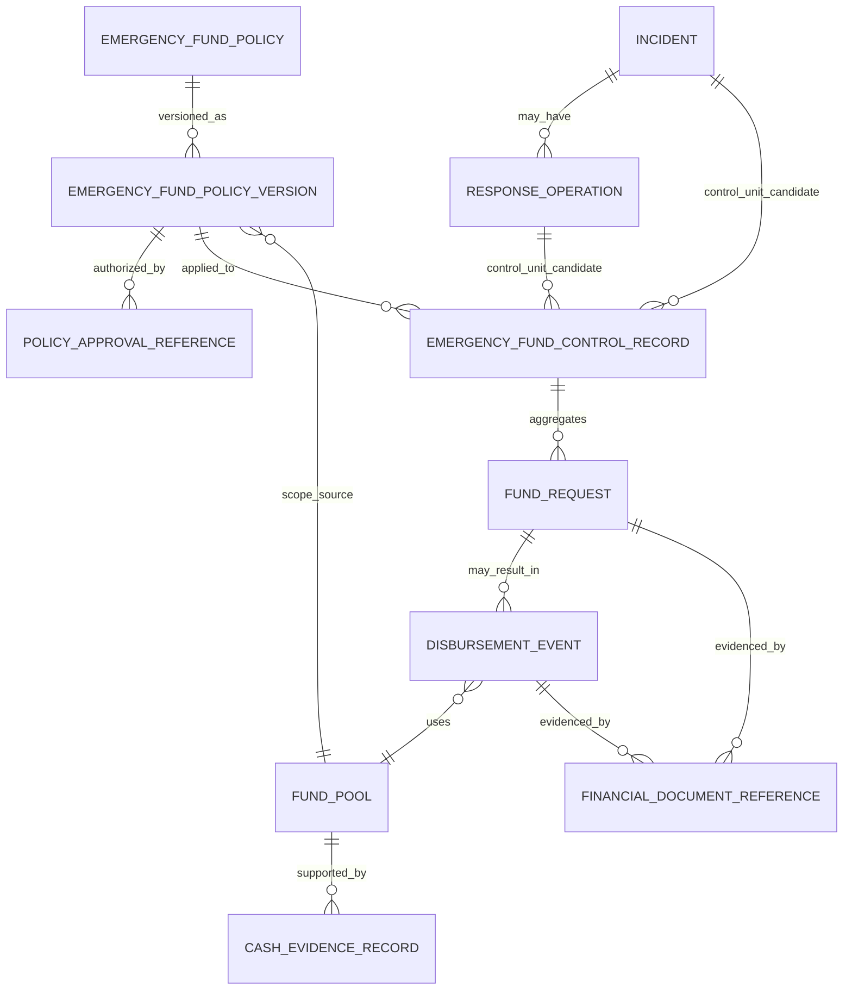

# SIM-TDB — RE-AUDIT FINANCE FOUNDATION
## Kebijakan Fleksibel melalui Setup Terkendali, Integritas Data, dan Kesiapan Logical Design

**Document ID:** SIMTDB-REV05112026-00-10-FIN  
**Filename:** `SIMTDB_REV05112026_00_10_FINANCE_FOUNDATION_REAUDIT.md`  
**Revision:** REV05112026  
**Status:** Draft untuk review pemilik proyek dan pihak berwenang  
**Mode:** Audit dokumen, policy reconciliation, logical specification, dan test design — tanpa implementasi  
**Project:** Sistem Informasi Manajemen Tanggap Darurat Bencana (SIM-TDB)  
**Organization:** Caritas Keuskupan Malang — Tim Solidaritas Kemanusiaan Keuskupan Malang (TSKKM)

---

## 1. Executive Summary

Audit ini meninjau ulang fondasi Finance SIM-TDB dengan mengacu pada:

- Klarifikasi pemilik proyek di dokumen Finance 00_02 dan 00_07.
- Prompt dan hasil audit Finance 00_03 sampai 00_09.
- Correction & Harmonization Register, khususnya CHR-020.
- Gambar SOP yang tersedia, yaitu halaman cetak 16–29.
- Arahan terbaru pemilik proyek: isu yang membutuhkan pertimbangan dapat disajikan sebagai pilihan, lalu pilihan yang disetujui dikelola melalui menu setup/data master yang terkendali.

### Kesimpulan utama

Target desain Finance bukan sekadar memasang nominal Rp50 juta, tetapi menyediakan **pengaturan kebijakan yang dapat dikendalikan** agar organisasi dapat memilih:

- Nilai plafon kebijakan yang berlaku.
- Cara agregasinya: `PER_INCIDENT` atau `GLOBAL_ALL_INCIDENTS`.
- Batas ruang lingkup kebijakan global.
- Unit kejadian/operasi yang menjadi dasar agregasi.
- Aturan kas eligible dan tahap transaksi yang menggunakan limit, setelah diputuskan.

Konfigurasi aktif harus menjadi sumber rule sistem untuk transaksi baru yang berada dalam scope kebijakan. Nilai dan mode **tidak boleh ditanam sebagai konstanta permanen dalam code**. Perubahan harus berversi, memiliki dasar persetujuan, masa berlaku, alasan, dan jejak audit.

### Prinsip kebijakan dana darurat

- Rp100.000.000 tetap **contoh ilustratif saja**, bukan cap, default, atau approval threshold.
- Rp50.000.000 adalah **nilai referensi awal** yang dijelaskan pemilik proyek sebagai maksimum awal per satu incident/response-operation control unit. Nilai ini dapat dikelola melalui policy configuration yang berwenang; bukan angka permanen yang ditanam dalam code.
- Mode `PER_INCIDENT`: nilai aktif diberlakukan kumulatif per control unit kejadian/operasi yang telah ditetapkan.
- Mode `GLOBAL_ALL_INCIDENTS`: satu nilai aktif dipakai sebagai batas bersama untuk semua kejadian dalam policy scope yang telah ditetapkan.
- Mode yang dipilih menentukan makna batas. Jangan menerapkan kedua mode sekaligus kecuali ada persetujuan eksplisit untuk mode hybrid.
- Pada kedua mode, pengeluaran tetap dibatasi kas eligible yang benar-benar tersedia dan aturan sumber dana yang berlaku.
- Pengaturan nominal tidak memberi atau mengubah kewenangan persetujuan.

### Isu kritis

Redaksi yang terlihat pada halaman SOP 23 menyebut dana darurat sebesar Rp50.000.000. Klarifikasi pemilik proyek berikutnya memaknai Rp50 juta sebagai maksimum per incident/operation, dan klarifikasi terbaru mengharuskan nilai serta mode agregasi bisa dikonfigurasi. Untuk mencegah sistem tampak mengubah SOP secara diam-diam, hubungan antara redaksi SOP dan klarifikasi pemilik proyek harus dicatat sebagai **`SOURCE_CONFLICT` sampai ada pengesahan/interpretasi formal**.

### Status kesiapan

**Kesiapan logical Finance final: `BLOCKED`.**

Desain konsep dapat disiapkan untuk review, tetapi belum boleh dikunci karena masih diperlukan keputusan tentang control unit kejadian/operasi, kas eligible, event yang mengonsumsi limit, otoritas konfigurasi/approval, funding restrictions, transaksi kanonis, dan perilaku policy version terhadap kasus aktif.

Tidak ada repository, code, database, schema, migration, seed, atau test suite yang tersedia untuk diperiksa. Tidak ada implementasi atau pengujian yang dijalankan.

---

## 2. Scope dan Evidence Availability

### 2.1 Sumber yang diperiksa

| Source ID | Sumber | Status | Batas |
|---|---|---|---|
| SRC-00-02 | `SIMTDB_REV05112026_00_02_FINANCIAL_AMOUNT_CLARIFICATION.md` | Tersedia dalam percakapan dan ditelaah | Klarifikasi awal nominal dan kebutuhan Finance; dibaca bersama klarifikasi terbaru. |
| SRC-00-03 | `SIMTDB_REV05112026_00_03_FINANCE_CLARIFICATION_REAUDIT_AND_TEST_PROMPT.md` | Tersedia dalam percakapan dan ditelaah | Prompt audit, bukan hasil test eksekusi. |
| SRC-00-04 | `SIMTDB_REV05112026_00_04_AUDIT_FINANCE_REAUDIT_PROMPT.md` | Tersedia dalam percakapan dan ditelaah | Audit prompt, bukan audit aplikasi. |
| SRC-00-05 | `SIMTDB_REV05112026_00_05_FINANCE_REAUDIT_PROMPT_R01.md` dan addendum guardrails | Tersedia dalam percakapan dan ditelaah | Instruksi re-audit dan batas read-only. |
| SRC-00-06 | `SIMTDB_REV05112026_00_06_FINANCE_CLARIFICATION_REAUDIT.md` | Tersedia dalam percakapan dan ditelaah | Hasil audit terdahulu; sebagian diperbarui di dokumen ini. |
| SRC-00-07 | `SIMTDB_REV05112026_00_07_FINANCE_OWNER_CLARIFICATION_AND_CORRECTION_PROMPT.md` | Tersedia dalam percakapan dan ditelaah | Klarifikasi bahwa Rp50m maksimum per kejadian/operasi dan kas total membatasi. |
| SRC-00-08 | `SIMTDB_REV05112026_00_08_FINANCE_CLARIFICATION_REAUDIT_CORRECTED.md` | Tersedia dalam percakapan dan ditelaah | Audit terdahulu; konflik SOP dan definisi control unit tetap perlu diproses. |
| SRC-00-09 | `SIMTDB_00_09_R01_REUPLOAD.md` / Prompt Finance policy reconciliation | Tersedia dalam percakapan dan ditelaah | Memperkenalkan dua mode agregasi configurable. |
| SRC-CHR-020 | Correction & Harmonization Register — CHR-020 | Tersedia sebelumnya dalam percakapan | Hanya diperbarui sejauh didukung klarifikasi dan bukti yang tersedia. |
| SRC-SOP-16-29 | Gambar SOP halaman cetak 16–29 | Tersedia dan telah ditelaah | Halaman 23–24 relevan untuk dana. Tidak mewakili seluruh SOP. |
| SRC-SOP-40-41 | SOP Finance halaman 40–41 | `EVIDENCE_NOT_AVAILABLE` | Tidak ada gambar halaman tersebut dalam konteks audit. |
| SRC-SOP-49 | Template APP-KWI halaman 49 | `EVIDENCE_NOT_AVAILABLE` | Struktur dan field tidak dapat diverifikasi. |
| SRC-SOP-62-69 | SOP Procurement/Finance dan dokumen terkait | `EVIDENCE_NOT_AVAILABLE` | Tidak tersedia untuk pemeriksaan langsung. |
| SRC-REPO | Repository aplikasi | `EVIDENCE_NOT_AVAILABLE` | URL, branch, commit, file, dan scope audit tidak disediakan. |
| SRC-DB | Database, schema, migration, seed | `EVIDENCE_NOT_AVAILABLE` | Tidak diakses atau diubah. |
| SRC-TEST | Test suite atau bukti hasil test | `EVIDENCE_NOT_AVAILABLE` | Tidak ada test yang dijalankan atau evidence yang diberikan. |

### 2.2 Batas audit

Audit ini:

- Tidak mengklaim bahwa seluruh SOP halaman 1–95 telah diperiksa.
- Tidak mengklaim bahwa code, schema, database, atau konfigurasi telah diaudit.
- Tidak menjalankan migration, seed, integration test, database test, atau test suite.
- Tidak membuat atau mengubah file proyek yang ada, code, konfigurasi, database, atau environment.
- Tidak mengubah isi SOP.
- Tidak mengesahkan policy organisasi.

---

## 3. Provenance dan Source Authority

### 3.1 Status yang digunakan

| Status | Penggunaan |
|---|---|
| `SOP_CONFIRMED` | Didukung langsung oleh bagian SOP yang tersedia dan terbaca. |
| `CLARIFIED_BY_PROJECT_OWNER` | Dinyatakan langsung oleh pemilik proyek dan dapat ditelusuri pada klarifikasi. |
| `ORG_DECISION_CONFIRMED` | Didukung keputusan organisasi formal yang dapat diidentifikasi. |
| `PROJECT_REQUIREMENT_STATED_IN_ADDENDUM` | Dicantumkan sebagai requirement addendum; penerimaan formal terpisah belum jelas. |
| `PENDING_OWNER_ACCEPTANCE` | Memerlukan penerimaan eksplisit pemilik proyek. |
| `TECHNICAL_RECOMMENDATION` | Rekomendasi teknis, bukan ketentuan SOP/organisasi. |
| `PENDING_DESIGN_DECISION` | Memerlukan keputusan desain domain/arsitektur. |
| `PENDING_ORG_DECISION` | Memerlukan keputusan organisasi atau policy Finance. |
| `SOURCE_CONFLICT` | Sumber tersedia mempunyai redaksi/interpretasi yang belum selaras. |
| `EVIDENCE_NOT_AVAILABLE` | Bukti tidak tersedia. |
| `TEST_DESIGNED` | Test dirancang, belum dijalankan. |
| `TEST_EXECUTED_PASS` / `TEST_EXECUTED_FAIL` | Hanya untuk test yang benar-benar dijalankan dengan evidence. |
| `BLOCKED_BY_MISSING_POLICY` | Terhalang policy yang belum disahkan. |
| `BLOCKED_BY_MISSING_SOURCE` | Terhalang sumber yang belum tersedia. |

### 3.2 Source authority per domain

- **Makna requirement proyek:** klarifikasi pemilik proyek menjadi bukti maksud desain SIM-TDB.
- **Prosedur operasional:** SOP asli tetap sumber pengendali. Klarifikasi proyek tidak diam-diam mengubah teks SOP.
- **Jabatan, mandat, dan delegasi:** keputusan organisasi formal mengendalikan pemetaan authority.
- **Accounting treatment:** pedoman Finance yang disahkan mengendalikan pengakuan nilai, kas, komitmen, dan laporan.
- **Desain teknis:** hanya menjadi rekomendasi sampai diterima.
- **Test result:** hanya bukti eksekusi aktual yang dapat menjadi status test executed.

Jika sumber berbeda, pertahankan keduanya, catat konflik secara spesifik, dan minta keputusan otoritas yang tepat.

---

## 4. Corrected Owner Clarification Register

| ID | Pernyataan | Provenance | Scope/batas |
|---|---|---|---|
| OCL-01 | Rp100.000.000 yang muncul sebagai contoh/template merupakan ilustrasi saja; bukan nilai tetap, mandatory, maksimum, global cap, default, atau approval threshold. | `CLARIFIED_BY_PROJECT_OWNER` | Tidak menjadi rule aplikasi. |
| OCL-02 | Klarifikasi awal menetapkan Rp50.000.000 sebagai maksimum untuk satu kejadian/operasi tanggap darurat. | `CLARIFIED_BY_PROJECT_OWNER` | Nilai tersebut merupakan referensi awal; bukan nominal wajib dihabiskan. |
| OCL-03 | Nilai emergency-fund ceiling dan scope agregasinya harus dapat diatur melalui controlled Finance policy/master-data setup, bukan permanen di-hardcode. | `CLARIFIED_BY_PROJECT_OWNER` | Perubahan aktif harus mengikuti otorisasi dan version control. |
| OCL-04 | Mode agregasi yang dapat dipilih mencakup `PER_INCIDENT` dan `GLOBAL_ALL_INCIDENTS`. | `CLARIFIED_BY_PROJECT_OWNER` | Mode aktif menentukan makna ceiling. |
| OCL-05 | Dalam `PER_INCIDENT`, kejadian berbeda dapat masing-masing mempunyai batas sesuai konfigurasi; total dapat melebihi nilai ceiling jika kas eligible dan approval memenuhi. | `CLARIFIED_BY_PROJECT_OWNER` | Unit kejadian/operasi yang tepat tetap perlu ditetapkan. |
| OCL-06 | Dalam `GLOBAL_ALL_INCIDENTS`, satu ceiling dibagi secara kumulatif di seluruh kejadian dalam policy scope yang ditentukan. | `CLARIFIED_BY_PROJECT_OWNER` | Batas scope, periode, dan reset tidak boleh diasumsikan. |
| OCL-07 | Untuk kedua mode, actual disbursement juga dibatasi eligible available cash pada fund pool terkait. | `CLARIFIED_BY_PROJECT_OWNER` untuk prinsip batas kas | Definisi dan formula kas eligible belum ditetapkan. |
| OCL-08 | General program/activity budget fleksibel mengikuti kebutuhan aktual; emergency-fund ceiling tidak otomatis berlaku pada program/activity yang tidak tercakup policy dana darurat. | `CLARIFIED_BY_PROJECT_OWNER` sejauh sesuai klarifikasi yang diberikan | Funding restrictions dan approval lain tetap berlaku. |
| OCL-09 | Data keuangan harus dapat ditelusuri. | `CLARIFIED_BY_PROJECT_OWNER` | Tidak mengesahkan skema, accounting model, atau source-of-truth implementation tertentu. |

### Tidak dilabeli sebagai klarifikasi langsung

Hal berikut memerlukan klasifikasi terpisah sebagai rekomendasi atau pending:

- Tahap transaksi yang mengonsumsi ceiling.
- Definisi final `incident`, `response operation`, atau `policy scope`.
- Model cash reservation dan available cash.
- Budget lifecycle teknis dan state names.
- Cardinality funding source.
- Formula remaining budget.
- Kebijakan accounting recognition.
- Approval workflow implementation.
- Penggunaan dual control atau segregation of duties tertentu.
- Entity/table names, type data, constraints, API, dan concurrency mechanism.

---

## 5. SOP Page 23 Evidence and Reconciliation

### 5.1 Redaksi yang terlihat

Pada gambar halaman cetak 23 yang diunggah, bagian pendanaan memperlihatkan teks berikut. Transkripsi ini mengikuti keterbacaan gambar yang tersedia dan bukan verifikasi OCR resmi:

> “Dana tersebut dapat diakses kapan saja sebagai dana awal untuk melakukan respon tanggap darurat dan hanya dapat dikeluarkan atas persetujuan dari ketua TSKKM.”

> “Pada tahap awal situasi darurat, TSKKM berhak mengeluarkan dana darurat sebesar Rp50.000.000 (lima puluh juta rupiah).”

Konteks sebelumnya pada halaman yang terlihat menyebut dana siaga dan dana operasional Keuskupan Malang sebagai sumber pendanaan.

### 5.2 Owner clarification terbaru

Pemilik proyek kemudian menjelaskan:

- Rp50m adalah batas maksimum pengeluaran dana darurat untuk satu incident/response operation menurut klarifikasi pemilik proyek.
- Besaran aktual tidak wajib sama dengan Rp50m.
- Nilai ceiling dan aggregation mode perlu dapat diubah melalui setup kebijakan yang terkendali.
- Mode dapat dipilih `PER_INCIDENT` atau `GLOBAL_ALL_INCIDENTS`.
- Nilai dan pengeluaran tetap dibatasi kas eligible yang benar-benar tersedia.

### 5.3 Reconciliation result

SOP menyebut nilai Rp50.000.000 “sebesar” dalam konteks dana awal. Klarifikasi pemilik proyek menafsirkan nilai tersebut sebagai maksimum per kejadian/operasi dan menghendaki konfigurasi dinamis.

Audit tidak dapat membuktikan hanya dari gambar yang tersedia bahwa kedua pernyataan itu pasti sama maknanya. Karena itu:

- Redaksi SOP tidak diubah.
- Klarifikasi pemilik proyek dicatat terpisah.
- Hubungan keduanya diberi status `SOURCE_CONFLICT` sampai pihak berwenang mengesahkan interpretasi/adopsinya.
- Dalam spesifikasi proyek, latest owner instruction menjadi arahan desain konfigurasi, tetapi sistem tidak boleh mengklaim bahwa teks SOP telah direvisi.
- Menu setup tidak boleh mengaktifkan policy yang melanggar atau menafsirkan ulang SOP tanpa persetujuan authority.

### 5.4 Konfirmasi yang diperlukan

- Apakah “sebesar Rp50.000.000” pada SOP dimaksudkan sebagai dana awal tetap, batas maksimum, atau nilai contoh?
- Apakah pemilik proyek memiliki mandat untuk menetapkan pengaturan per incident/global sebagai policy SIM-TDB?
- Apakah perubahan policy akan menjadi interpretasi resmi SOP atau aturan sistem yang disetujui organisasi?
- Siapa authority yang menyetujui konfigurasi aktif dan perubahan mode?

---

## 6. Corrected Financial Business Rule Register

| Rule ID | Business rule | Provenance | Status penerapan |
|---|---|---|---|
| FIN-BR-01 | Rp100m pada contoh/template adalah ilustrasi; bukan fixed amount, mandatory amount, maximum, global cap, default, atau approval threshold. | `CLARIFIED_BY_PROJECT_OWNER` | Dilarang menjadi rule. |
| FIN-BR-02 | Nilai ceiling dana darurat dan aggregation scope dapat dikelola melalui controlled policy setup; tidak hardcode permanen. | `CLARIFIED_BY_PROJECT_OWNER` | Setup harus dikendalikan dan berversi. |
| FIN-BR-03 | Rp50m adalah current reference/initial candidate ceiling dari klarifikasi sebelumnya, bukan nilai permanen yang wajib selalu aktif. | `CLARIFIED_BY_PROJECT_OWNER` | Aktivasi konfigurasi tetap memerlukan authority/approval yang disahkan. |
| FIN-BR-04 | Aggregation mode dapat dipilih `PER_INCIDENT` atau `GLOBAL_ALL_INCIDENTS`. | `CLARIFIED_BY_PROJECT_OWNER` | Tidak menjalankan kedua mode sekaligus. |
| FIN-BR-05 | Pada `PER_INCIDENT`, ceiling berlaku kumulatif per incident/operation control unit yang didefinisikan. | `CLARIFIED_BY_PROJECT_OWNER` | Identitas control unit masih memerlukan keputusan. |
| FIN-BR-06 | Pada `GLOBAL_ALL_INCIDENTS`, satu ceiling dibagi secara kumulatif pada incident yang termasuk policy scope. | `CLARIFIED_BY_PROJECT_OWNER` | Scope, periode, dan reset memerlukan keputusan. |
| FIN-BR-07 | Ceiling adalah batas, bukan target pengeluaran yang wajib dicapai. | `CLARIFIED_BY_PROJECT_OWNER` | Tidak menjadi target budget atau spending requirement. |
| FIN-BR-08 | Pengeluaran juga dibatasi eligible cash pada fund pool terkait. | `CLARIFIED_BY_PROJECT_OWNER` | Cash basis, reserve, dan restricted cash treatment pending. |
| FIN-BR-09 | General program/activity budget tidak otomatis terkena emergency-fund ceiling. | `CLARIFIED_BY_PROJECT_OWNER` | Klasifikasi expenditure dan kebijakan sumber dana harus dapat ditelusuri. |
| FIN-BR-10 | Funding-source restrictions dan approval authority tetap berlaku meskipun ceiling fleksibel. | Sumber proyek dan policy/SOP terkait; mapping rinci belum lengkap | Verifikasi restriction dan authority sebelum automation. |
| FIN-BR-11 | Rp50m pada halaman SOP 23 terkait dana darurat dan persetujuan Ketua TSKKM sebagaimana terbaca pada gambar. | `SOP_CONFIRMED` secara parsial | Perbedaan interpretasi per kejadian/configurable scope dengan klarifikasi dicatat `SOURCE_CONFLICT`. |
| FIN-BR-12 | Pengeluaran dana darurat memerlukan persetujuan Ketua TSKKM sebagaimana redaksi halaman 23 yang terlihat. | `SOP_CONFIRMED` secara parsial | Identitas, mandat/delegasi, dan pemetaan ke sistem perlu diverifikasi. |
| FIN-BR-13 | APP Nasional memiliki pembatasan kategori pengeluaran sebagaimana halaman 24 yang terlihat. | `SOP_CONFIRMED` secara parsial | Enforcement mode belum disahkan; jangan memperluas larangan. |
| FIN-BR-TECH-01 | Sistem mengagregasi nilai yang memakai ceiling menurut policy version dan aggregation mode aktif. | `TECHNICAL_RECOMMENDATION` | Event konsumsi ceiling harus diputuskan. |
| FIN-BR-TECH-02 | Voucher, sektor, activity, user, team, atau sub-record tidak boleh mereset limit yang berlaku. | `TECHNICAL_RECOMMENDATION` | Diterapkan setelah control unit disahkan. |
| FIN-BR-TECH-03 | Perubahan policy membuat versi baru dan tidak mengubah histori versi lama. | `TECHNICAL_RECOMMENDATION` | Prospective/effective transition harus disetujui. |
| FIN-BR-TECH-04 | Concurrent requests tidak boleh memakai cash atau ceiling yang sama lebih dari sekali. | `TECHNICAL_RECOMMENDATION` | Reservation/atomic control basis pending. |
| FIN-BR-PENDING-01 | Control unit untuk `PER_INCIDENT`: incident atau independent response operation. | `PENDING_ORG_DECISION` | Jangan memisahkan cap per sub-operation secara otomatis. |
| FIN-BR-PENDING-02 | Policy scope untuk `GLOBAL_ALL_INCIDENTS`. | `PENDING_ORG_DECISION` | Tidak mengasumsikan lifetime, calendar year, atau reset otomatis. |
| FIN-BR-PENDING-03 | Event yang mengonsumsi ceiling: approval, reservation, payment instruction, disbursement, atau lainnya. | `PENDING_ORG_DECISION` | Jangan finalkan perhitungan kumulatif. |
| FIN-BR-PENDING-04 | Eligible available cash dan perlakuan restricted/committed/reserved amounts. | `PENDING_ORG_DECISION` | Jangan menjumlahkan semua saldo organisasi. |
| FIN-BR-PENDING-05 | Transition policy version pada incident/request aktif. | `PENDING_ORG_DECISION` | Jangan menerapkan konfigurasi baru ke histori tanpa aturan. |
| FIN-BR-PENDING-06 | Approval authority policy configuration dan perubahan ceiling/mode. | `PENDING_ORG_DECISION` | Jangan beri hak setup ke user umum. |
| FIN-BR-PENDING-07 | Budget lifecycle, actual expenditure recognition, dan remaining budget formula. | `PENDING_ORG_DECISION` / `PENDING_DESIGN_DECISION` | Bukan bagian dari formula ceiling dana darurat. |

---

## 7. Emergency-Fund Policy Configuration — Master/Setup Concept

### 7.1 Tujuan setup

Menyediakan tempat terkendali untuk mengelola versi policy dana darurat, termasuk nilai ceiling dan mode agregasinya. Setup ini berbeda dari master data biasa yang dapat diubah tanpa review.

**Nama konsep sementara:** `Emergency Fund Policy Configuration`.

Nama menu, pemilik, akses, dan lifecycle final masih memerlukan persetujuan.

### 7.2 Atribut konfigurasi konseptual

| Atribut | Fungsi | Status |
|---|---|---|
| Policy ID/code | Identitas stabil policy | `TECHNICAL_RECOMMENDATION` |
| Policy name/description | Menjelaskan tujuan dan cakupan policy | `TECHNICAL_RECOMMENDATION` |
| Configured ceiling amount | Nilai batas yang akan dipakai policy | Configurable; current reference Rp50m dari klarifikasi |
| Currency | Mata uang ceiling | `PENDING_ORG_DECISION`; tidak mengasumsikan multi-currency |
| Aggregation mode | `PER_INCIDENT` atau `GLOBAL_ALL_INCIDENTS` | Pilihan policy yang diklarifikasi pemilik proyek |
| Control unit | Entitas/unit yang menjadi basis agregasi | `PENDING_ORG_DECISION` untuk mode per incident |
| Policy scope/boundary | Unit yang tercakup, terutama untuk global mode | Wajib ada; pilihan final pending |
| Applicable fund pool/source | Fund pool yang dikontrol policy | Wajib ditautkan; model fund pool pending |
| Effective-from | Waktu mulai berlaku | `TECHNICAL_RECOMMENDATION` |
| Effective-to | Akhir masa berlaku jika ada | `TECHNICAL_RECOMMENDATION` |
| Policy version | Riwayat dan versi policy | `TECHNICAL_RECOMMENDATION` |
| Lifecycle status | Draft/review/approved/scheduled/active/superseded/retired sebagai kandidat | Nama dan proses status bukan policy final |
| Approval evidence | Bukti pihak yang menyetujui konfigurasi | Wajib untuk auditability; authority pending |
| Change reason | Alasan nilai/scope/mode berubah | `TECHNICAL_RECOMMENDATION` |
| Created/updated metadata | Aktor dan timestamp | `TECHNICAL_RECOMMENDATION` |
| Audit record | Old/new amount, mode, scope, source pool, dates, actor, reason, approval | `TECHNICAL_RECOMMENDATION` |
| Policy selection rule | Menentukan policy yang berlaku untuk transaksi | Perlu keputusan efektif-date dan overlap |

### 7.3 Menu setup — prinsip desain

Menu setup tidak boleh menjadi ordinary editable lookup.

Rekomendasi kontrol:

- Policy dibuat sebagai draft; draft belum dapat mengatur transaksi.
- Policy yang aktif memiliki versi immutable.
- Perubahan menghasilkan versi baru, bukan overwrite.
- Perubahan amount/mode/scope memerlukan authority terverifikasi.
- Permission mengubah policy dipisahkan dari permission mengubah transaksi Finance.
- Pertimbangkan maker-checker untuk perubahan policy hanya jika organisasi menyetujui mekanisme tersebut.
- Setiap policy harus mengidentifikasi fund pool, scope, mode, amount, currency, dan effective period.
- Jangan izinkan active policy ambigu akibat overlap scope dan tanggal berlaku.
- Transaksi/incident harus bisa menunjukkan policy version yang digunakan.
- Perubahan policy sebaiknya prospektif; perlakuan incident/request yang telah aktif perlu keputusan.
- UI tidak boleh menawarkan mode atau status yang belum disetujui seolah-olah sudah menjadi policy aktif.

### 7.4 Validasi konfigurasi konseptual

Opsi validasi yang direkomendasikan:

- Amount harus berada dalam rentang numerik yang valid; angka nol/negatif ditolak.
- Currency dan precision mengikuti policy yang disahkan.
- `PER_INCIDENT` memerlukan definisi control unit.
- `GLOBAL_ALL_INCIDENTS` memerlukan scope boundary yang jelas.
- Policy memerlukan fund pool/source yang berlaku.
- Effective date range harus valid.
- Active policy untuk scope yang sama tidak boleh tumpang tindih tanpa aturan prioritas yang disahkan.
- `GLOBAL_ALL_INCIDENTS` tidak boleh otomatis di-reset per tahun atau per operasi tanpa scope/policy eksplisit.
- Mode tidak dapat diubah tanpa versi baru dan approval yang sah.
- Tidak ada hybrid mode kecuali disetujui secara eksplisit.

---

## 8. `PER_INCIDENT` dan `GLOBAL_ALL_INCIDENTS` Models

### 8.1 Mode A — `PER_INCIDENT`

- Configured amount menjadi ceiling kumulatif bagi masing-masing control unit.
- Incident berbeda mendapatkan ceiling terpisah.
- Sector, activity, voucher, user, team, dan transaction tidak mereset ceiling.
- Aggregate lintas incident boleh lebih besar daripada configured amount selama cash pool dan authority mengizinkan.
- Control unit harus diputuskan: satu incident dunia nyata atau independent response operation.

**Contoh konfigurasi:** amount Rp50m, mode `PER_INCIDENT`.

- Incident A: sampai Rp50m.
- Incident B: sampai Rp50m secara terpisah.
- Jika kas eligible hanya Rp80m, total pelepasan/reservasi lintas A dan B tetap tidak boleh melebihi batas kas yang dihitung menurut policy.

### 8.2 Mode B — `GLOBAL_ALL_INCIDENTS`

- Configured amount adalah ceiling bersama.
- Seluruh kejadian dalam policy scope mengonsumsi satu total.
- Nilai tidak diberikan ulang untuk setiap incident.
- Batas policy scope wajib ditentukan.
- Tidak boleh mengasumsikan reset otomatis pada pergantian tahun atau perubahan program.
- Jika mode global dipilih, jangan sekaligus menerapkan per-incident cap kecuali hybrid disetujui secara eksplisit.

**Contoh konfigurasi:** amount Rp50m, mode `GLOBAL_ALL_INCIDENTS`.

- Incident A memakai Rp20m.
- Incident B memakai Rp15m.
- Sisa ceiling global dalam scope yang sama adalah Rp15m, dengan asumsi kedua nilai sudah dihitung pada event yang disetujui policy.

### 8.3 Hybrid mode

Hybrid—ceiling per incident sekaligus ceiling global—bukan mode default dan tidak boleh dimunculkan sebagai policy aktif tanpa persetujuan eksplisit pemilik proyek/organisasi.

---

## 9. Policy Versioning, Effective Dates, Approval, and Audit Trail

### 9.1 Prinsip versioning

- Policy configuration adalah policy data, bukan konstanta aplikasi.
- Perubahan amount, aggregation mode, policy scope, fund pool, atau effective dates menghasilkan versi baru.
- Versi lama dipertahankan dan dapat dilihat sesuai hak akses.
- Policy version yang digunakan oleh request/incident/disbursement harus dapat ditelusuri.
- Perubahan baru tidak diam-diam mengubah transaksi historis.
- Scope/tanggal efektif yang bertumpang tindih tidak boleh menimbulkan pemilihan policy yang ambigu.

### 9.2 Kasus transisi yang perlu opsi dan keputusan

| Kasus | Opsi desain | Keputusan yang diperlukan |
|---|---|---|
| Policy baru berlaku sementara incident lama masih aktif | A. Incident mempertahankan policy saat mulai; B. Request baru memakai policy baru; C. Semua event setelah tanggal efektif memakai policy baru; D. Migrasi kasus aktif melalui keputusan formal | `PENDING_OWNER_DECISION` |
| Perubahan `PER_INCIDENT` → `GLOBAL_ALL_INCIDENTS` | A. Berlaku untuk incident baru; B. Berlaku bagi request baru; C. Mencakup incident aktif setelah transisi; D. Masa transisi terpisah | `PENDING_OWNER_DECISION` |
| Perubahan `GLOBAL_ALL_INCIDENTS` → `PER_INCIDENT` | Opsi serupa; harus menetapkan dasar nilai kumulatif dan unit baru | `PENDING_OWNER_DECISION` |
| Expiry/retirement policy ketika request masih terbuka | A. Request mempertahankan policy reference; B. Direview dan dipindah ke versi baru; C. Lainnya yang disahkan | `PENDING_OWNER_DECISION` |
| Dua policy cocok pada incident yang sama | A. Blokir overlap; B. Prioritas eksplisit oleh scope/version; C. Lainnya | `PENDING_DESIGN_DECISION`; rekomendasi blokir ambiguity |

### 9.3 Approval dan audit metadata

Rekomendasi pencatatan:

- Old/new amount.
- Old/new mode.
- Old/new policy scope.
- Old/new fund pool.
- Effective dates.
- Policy version.
- Actor pembuat/perubah.
- Alasan perubahan.
- Authority/approval evidence.
- Timestamp.
- Transaksi yang menggunakan versi policy tersebut.

Pejabat persetujuan dan pemisahan tugas belum ditetapkan, kecuali ada bukti formal yang menyelesaikannya. Jangan menambah role organisasi baru untuk mengelola menu policy.

---

## 10. Eligible Cash Pool and Restriction Model

### 10.1 Konsep berbeda

| Konsep | Makna | Status |
|---|---|---|
| Funding source | Sumber asal dana | Traceability diperlukan; katalog/ownership perlu keputusan. |
| Fund pool | Kumpulan dana yang dapat dikontrol bersama sesuai aturan | Definisi dan pemilik pending. |
| Bank/cash account | Rekening atau lokasi kas | SOP dan ownership perlu bukti lengkap. |
| Eligible cash | Bagian kas yang dapat dipakai untuk pengeluaran tersebut | Formula/basis pending. |
| Restricted cash | Kas dengan pembatasan sumber atau penggunaan | Harus tetap terpisah; tidak otomatis bebas digabung. |
| Reserved amount | Nilai yang dicadangkan jika policy mengatur reservation | Event dan expiry pending. |
| Outstanding payment instruction | Instruksi pembayaran yang belum selesai | Dampaknya terhadap available cash pending. |
| Actual cash release/disbursement | Dana benar-benar dikeluarkan menurut event yang ditetapkan | Event cap-consumption pending. |
| Refund/reversal | Pengembalian/koreksi transaksi asal | Treatment cash/cap pending. |
| Transfer antar-sumber/pool | Mutasi kas jika diperbolehkan | Tidak diasumsikan boleh; policy pending. |

### 10.2 Prinsip kas keseluruhan

- Jangan menjumlahkan seluruh saldo organisasi.
- Gunakan hanya cash pool dan sumber yang eligible bagi expenditure tersebut.
- Restricted funds tidak interchangeable hanya karena berada di organisasi yang sama.
- Ceiling policy bukan bukti bahwa cash tersedia.
- Cash balance tidak sama dengan approved budget atau remaining budget.
- Gunakan satu basis saldo yang konsisten dan disetujui.
- Concurrent requests tidak boleh menggunakan kas yang sama dua kali.
- Jangan menghitung reservation dua kali ketika berubah menjadi actual release.
- Aturan pelepasan reservation yang expired/cancelled memerlukan policy.

### 10.3 Opsi konfigurasi basis kas

Opsi berikut untuk dibahas, bukan dipilih otomatis:

1. **Cash-release basis:** cash dianggap digunakan saat dana dilepas.
2. **Reservation basis:** cash tersedia dikurangi saat nilai disetujui/dipesan.
3. **Hybrid event basis:** sebagian alur menggunakan reservasi lalu release mengonversi reservasi tanpa double count.
4. **Finance-ledger basis:** available cash diturunkan dari akun/ledger dan policy rekonsiliasi yang disahkan.

Pilihan basis serta treatment outstanding payment/advance/restricted cash adalah `PENDING_ORG_DECISION`.

---

## 11. Incident/Operation Identity and Decision Table

### 11.1 Alternatif control unit

| Alternatif | Operational meaning | Anti-circumvention risk | Data/report impact | Status |
|---|---|---|---|---|
| A. Satu ceiling per real-world incident | Semua operations, sectors, activities, vouchers di bawah incident yang sama diagregasi | Rendah jika duplicate incident terdeteksi; dapat terlalu membatasi bila operasi benar-benar independen | Perlu parent incident sebagai control unit | Rekomendasi konservatif; `PENDING_ORG_DECISION` |
| B. Satu ceiling per formally independent response operation | Satu incident boleh memiliki beberapa operation, masing-masing berpotensi mendapat ceiling | Risiko pemecahan operation untuk reset limit | Wajib membuktikan hubungan/independensi operation dan approval | `PENDING_ORG_DECISION` |
| C. `GLOBAL_ALL_INCIDENTS` dalam policy scope | Semua incident dalam scope yang disetujui berbagi satu ceiling | Risiko scope tidak jelas atau reset tidak disengaja | Perlu scope/policy version dan agregasi lintas incident | Mode diklarifikasi; boundary pending |
| D. Hybrid: per-incident plus global ceiling | Menerapkan dua batas sekaligus | Dapat kuat, tetapi kompleks dan dapat menolak pengeluaran tanpa pemahaman pengguna | Butuh dua agregasi dan rule reporting terpisah | Tidak boleh aktif tanpa persetujuan eksplisit |
| E. Control unit lain yang disetujui | Contoh unit agregasi ditetapkan organisasi | Bergantung definisi dan kontrol | Perlu model relasi serta audit tambahan | `PENDING_ORG_DECISION` |

### 11.2 Rekomendasi anti-splitting sementara

Untuk `PER_INCIDENT`, selama keputusan operation-level belum ada:

> Agregasikan secara konservatif pada parent real-world incident. Jangan reset ceiling melalui pembuatan sektor, activity, voucher, team, user, atau sub-record.

Ini `TECHNICAL_RECOMMENDATION` / `PENDING_ORG_DECISION`, bukan pernyataan langsung pemilik proyek.

Untuk `GLOBAL_ALL_INCIDENTS`, agregasikan seluruh incident yang masuk scope policy aktif, dengan boundary dan effective period yang secara eksplisit disahkan.

### 11.3 Duplicate incident handling

- Duplicate candidate tidak dihapus atau digabung otomatis.
- Diperlukan controlled review untuk memastikan apakah dua record merujuk kejadian yang sama.
- Bila relasi/merge disetujui, sejarah identifier dan transaksi tetap dipertahankan.
- Dampak duplicate resolution pada cap harus mengikuti policy yang disahkan dan dapat diaudit.

---

## 12. Finance Entity/Relationship Concepts — Logical Only

Belum ada physical schema atau tabel database yang ditetapkan.

### Catatan

- `EMERGENCY_FUND_CONTROL_RECORD` adalah konsep untuk agregasi, bukan persetujuan nama tabel.
- Relasi incident–operation dan control unit masih pending.
- Policy version yang digunakan harus dapat ditelusuri.
- `FUND_REQUEST` tidak otomatis sama dengan approval, reservation, cash release, atau expense recognition.
- `DISBURSEMENT_EVENT` adalah konsep pencatatan dana yang dikeluarkan; event konsumsi cap perlu disahkan.
- `CASH_EVIDENCE_RECORD` bukan formula final kas eligible.
- Entity names, FK, cardinality, lifecycle, dan transaction boundaries harus direview setelah sumber Finance lengkap.

---

## 13. Corrected Finance Data Dictionary — Logical Requirements

| Konsep | Atribut/logical field | Aturan | Provenance/status |
|---|---|---|---|
| Emergency fund policy | Policy identifier/code | Stabil dan dapat direferensikan | `TECHNICAL_RECOMMENDATION` |
| Emergency fund policy | Configured amount | Nilai ceiling yang dipilih pada policy version | Configurable; owner clarification |
| Emergency fund policy | Currency | Mata uang nilai ceiling | `PENDING_ORG_DECISION` / desain |
| Emergency fund policy | Aggregation mode | `PER_INCIDENT` atau `GLOBAL_ALL_INCIDENTS` | Opsi diklarifikasi pemilik proyek |
| Emergency fund policy | Policy scope | Boundary agregasi global atau scope lain yang disahkan | Wajib untuk pemilihan policy; detail pending |
| Emergency fund policy | Control unit type | Incident atau operation jika mode per incident | `PENDING_ORG_DECISION` |
| Emergency fund policy | Applicable fund pool/source | Mengidentifikasi kas/fund yang dikendalikan | Cardinality/ownership pending |
| Emergency fund policy | Effective dates/version | Menentukan versi dan masa berlaku | `TECHNICAL_RECOMMENDATION` |
| Emergency fund policy | Approval evidence | Bukti konfigurasi disahkan | Governance requirement; authority pending |
| Emergency fund policy | Change reason/actor/time | Menjelaskan dan mengaudit revisi policy | `TECHNICAL_RECOMMENDATION` |
| Incident/operation control | Incident reference | Mengidentifikasi kejadian yang diagregasi | Control-unit decision pending |
| Incident/operation control | Operation reference | Menghubungkan operasi jika relevan | Parent-child cardinality pending |
| Request/disbursement | Requested/approved/released amount | Menjaga tahap transaksi berbeda | Proses dan status final pending |
| Request/disbursement | Policy version reference | Menunjukkan policy yang dipakai | `TECHNICAL_RECOMMENDATION` |
| Request/disbursement | Fund pool/source reference | Menunjukkan sumber dana yang dipakai | Traceability owner clarification; model pending |
| Request/disbursement | Approval/evidence reference | Menautkan keputusan dan dokumen pendukung | Authority pending |
| Cash control | Cash basis/as-of time/source | Menyimpan basis dan waktu data kas | `PENDING_ORG_DECISION` |
| Cash control | Reserved/released/reversed amounts | Membantu control jika policy menetapkan | Event semantics pending |
| General budget | Proposed/approved/revised/actual/remaining distinction | Tidak dicampur dengan emergency-fund ceiling | Pemisahan kategori dalam dokumen/addendum; bentuk implementasi pending |
| Actual expenditure | Canonical transaction reference | Report mengambil nominal dari sumber Finance yang diakui untuk pelaporan | Nilai harus traceable; model kanonis belum tersedia |
| Remaining budget | Derived amount and basis | Jangan disajikan definitif tanpa formula yang disahkan | `PENDING_ORG_DECISION` |

Tidak ditetapkan: physical types, nullability final, constraints, indexes, table names, approval statuses resmi, atau database vendor.

---

## 14. Approval Authority and Policy Governance

### 14.1 Bukti yang tersedia

- SOP halaman 23 yang tampak menyebut pengeluaran dana darurat atas persetujuan Ketua TSKKM.
- Pemilik proyek mengklarifikasi nominal, konfigurabilitas amount/mode, dan kontrol available cash.
- Bukti formal yang menghubungkan Ketua TSKKM dengan akun/role SIM-TDB tidak disertakan.

### 14.2 Pemisahan wajib

Jangan menyamakan:

- Jabatan atau kedudukan organisasi.
- Mandat/delegasi formal.
- Akun user.
- Organizational role.
- Operational assignment.
- Technical permission.
- Approval action.
- Policy configuration authority.

### 14.3 Policy setup authority

Menu setup memerlukan governance tersendiri:

- Siapa boleh melihat policy draft?
- Siapa boleh mengusulkan perubahan amount/mode/scope?
- Siapa boleh meninjau dan mengesahkan?
- Apakah pembuat dan penyetuju harus berbeda?
- Apakah konfigurasi bisa dijadwalkan untuk tanggal mendatang?
- Bagaimana revocation atau emergency correction dilakukan?
- Siapa mengaudit perubahan dan akses setup?

Jawaban terhadap pertanyaan tersebut harus ditetapkan organisasi. Jangan menciptakan role permanen “Finance Admin” atau “Super Admin” untuk mengisi kekosongan.

---

## 15. FIN-TEST-01 through FIN-TEST-46

**Status umum:** seluruh tes di bawah belum dijalankan.  
**Actual result:** `not executed`.  
Status test mengikuti daftar yang disetujui: `TEST_DESIGNED`, `TEST_EXECUTED_PASS`, `TEST_EXECUTED_FAIL`, `BLOCKED_BY_MISSING_POLICY`, `BLOCKED_BY_MISSING_SOURCE`.

| Test ID | Domain | Tujuan / skenario | Expected result | Status |
|---|---|---|---|---|
| FIN-TEST-01 | `GENERAL_PROGRAM_BUDGET` | Proposed program/activity budget Rp25m | Tidak menerapkan emergency-fund ceiling secara otomatis; validasi umum hanya dari policy yang sah | `TEST_DESIGNED` |
| FIN-TEST-02 | `GENERAL_PROGRAM_BUDGET` | Proposed program/activity budget Rp75m | Tidak ditolak hanya karena melebihi reference Rp50m | `TEST_DESIGNED` |
| FIN-TEST-03 | `GENERAL_PROGRAM_BUDGET` | Proposed program/activity budget Rp250m | Tidak dianggap melanggar emergency-fund cap jika bukan pengeluaran dalam scope emergency policy | `TEST_DESIGNED` |
| FIN-TEST-04 | `GENERAL_PROGRAM_BUDGET` | Proposed budget berbeda dari approved budget | Nilai dan lifecycle terpisah; approval reference dapat ditelusuri | `TEST_DESIGNED` |
| FIN-TEST-05 | `GENERAL_PROGRAM_BUDGET` | Revision belum disetujui | Approved baseline tidak berubah sebelum aturan effectivity disahkan | `TEST_DESIGNED` |
| FIN-TEST-06 | `GENERAL_PROGRAM_BUDGET` | Revisi dengan nilai sebelum/sesudah, alasan, aktor, waktu, approval reference | Metadata tersedia sesuai requirement yang diterima; state resmi tidak ditebak | `TEST_DESIGNED` |
| FIN-TEST-07 | `GENERAL_PROGRAM_BUDGET` | Satu/banyak funding source dicoba sebelum cardinality diputuskan | Sistem/specification tidak menganggap valid/invalid berdasarkan asumsi | `BLOCKED_BY_MISSING_POLICY` |
| FIN-TEST-08 | `RESTRICTED_FUNDING_SOURCE` | Uji restriction yang terlihat pada SOP halaman 24 | Tidak menambah kategori; enforcement hanya setelah keputusan | `BLOCKED_BY_MISSING_POLICY` |
| FIN-TEST-09 | `CROSS_MODULE_INTEGRATION` | Report actual dari Finance source | Nilai diambil dari satu canonical source yang diakui untuk pelaporan sesuai policy | `BLOCKED_BY_MISSING_SOURCE` |
| FIN-TEST-10 | `CROSS_MODULE_INTEGRATION` | Report/reference berbeda dari transaksi sumber | Perbedaan terdeteksi, tidak di-overwrite atau disembunyikan | `TEST_DESIGNED` |
| FIN-TEST-11 | `GENERAL_PROGRAM_BUDGET` | Remaining budget dengan PO/invoice/commitment | Tidak dianggap definitif tanpa basis yang disahkan | `BLOCKED_BY_MISSING_POLICY` |
| FIN-TEST-12 | `CROSS_MODULE_INTEGRATION` | Edit permission tanpa approval authority | Approval ditolak; hak edit tidak memberi authority | `TEST_DESIGNED` |
| FIN-TEST-13 | `CROSS_MODULE_INTEGRATION` | Retry request dengan idempotency key sama | Tidak membuat revision/transaksi/disbursement duplikat | `TEST_DESIGNED` |
| FIN-TEST-14 | `GENERAL_PROGRAM_BUDGET` | Dua revision bersamaan atas baseline sama | Konflik terdeteksi; tidak silent overwrite | `TEST_DESIGNED` |
| FIN-TEST-15 | `CROSS_MODULE_INTEGRATION` | Refund/reversal terhadap transaksi asal | Record asal tetap; reversal tertaut dan treatment mengikuti policy | `BLOCKED_BY_MISSING_POLICY` |
| FIN-TEST-16 | `CROSS_MODULE_INTEGRATION` | Cari Rp50m/Rp100m dalam code/config/seed/workflow/migration/test fixture | Tidak ada penggunaan sebagai hardcoded rule; repository check baru dapat dilakukan bila tersedia | `BLOCKED_BY_MISSING_SOURCE` |
| FIN-TEST-17 | `EMERGENCY_FUND_POLICY_CONFIGURATION` | Threshold selain nilai contoh tanpa authority formal | Tidak diaktifkan sebagai policy tanpa source/authority | `BLOCKED_BY_MISSING_POLICY` |
| FIN-TEST-18 | `EMERGENCY_FUND_POLICY_CONFIGURATION` | Threshold memiliki authority, scope, version, effective date | Dipertimbangkan hanya setelah persetujuan organisasi | `BLOCKED_BY_MISSING_SOURCE` |
| FIN-TEST-19 | `EMERGENCY_FUND_POLICY_CONFIGURATION` | Multi-source allocation sebelum cardinality disetujui | Tidak dipaksakan atau ditolak berdasarkan asumsi | `BLOCKED_BY_MISSING_POLICY` |
| FIN-TEST-20 | `RESTRICTED_FUNDING_SOURCE` | Restriction belum diverifikasi | Tidak menjadi automatic block rule; status ketidakpastian terlihat | `BLOCKED_BY_MISSING_SOURCE` |
| FIN-TEST-21 | `GENERAL_PROGRAM_BUDGET` | PO terbuka dan invoice belum dibayar | Remaining budget tidak definitif tanpa basis accounting | `BLOCKED_BY_MISSING_POLICY` |
| FIN-TEST-22 | `CROSS_MODULE_INTEGRATION` | Budget terkait program/activity | Tidak ada orphan/polymorphic ambiguity setelah relasi disetujui | `BLOCKED_BY_MISSING_SOURCE` |
| FIN-TEST-23 | `CROSS_MODULE_INTEGRATION` | Laporan per funding source | Dapat direkonsiliasi ke alokasi/transaksi bila model disetujui | `BLOCKED_BY_MISSING_POLICY` |
| FIN-TEST-24 | `EMERGENCY_FUND_PER_INCIDENT` | Active policy Rp50m, satu incident meminta Rp75m, eligible cash Rp100m | Tidak boleh mengeluarkan lebih dari configured ceiling; rejection/revision process menunggu policy | `TEST_DESIGNED` |
| FIN-TEST-25 | `EMERGENCY_FUND_PER_INCIDENT` | Empat incident berbeda: Rp50m, Rp35m, Rp45m, Rp20m; cash Rp200m | Total Rp150m dapat diterima bila each per-incident limit, cash, authority terpenuhi | `TEST_DESIGNED` |
| FIN-TEST-26 | `EMERGENCY_FUND_PER_INCIDENT` | Incident meminta Rp50m, eligible cash Rp30m | Tidak boleh melebihi cash eligible; partial approval versus revision pending | `TEST_DESIGNED` |
| FIN-TEST-27 | `EMERGENCY_FUND_PER_INCIDENT` | Beberapa voucher satu incident total Rp55m | Agregat terdeteksi; voucher tidak mereset ceiling | `TEST_DESIGNED` |
| FIN-TEST-28 | `EMERGENCY_FUND_PER_INCIDENT` | Beberapa sector/activity satu incident total Rp55m | Agregat terdeteksi jika termasuk control unit yang sama | `TEST_DESIGNED` |
| FIN-TEST-29 | `EMERGENCY_FUND_PER_INCIDENT` | Dua incident masing-masing Rp50m; cash Rp80m | Per-incident cap terpenuhi, tetapi total cash control tidak boleh melebihi eligible cash | `TEST_DESIGNED` |
| FIN-TEST-30 | `CROSS_MODULE_INTEGRATION` | Satu real-world event memiliki dua Incident ID | Duplicate candidate ditandai untuk controlled review; tidak auto-merge | `TEST_DESIGNED` |
| FIN-TEST-31 | `EMERGENCY_FUND_PER_INCIDENT` | Concurrent release requests dari dua incident atas cash pool sama | Atomic control mencegah total counted amount melewati cash eligible | `TEST_DESIGNED` |
| FIN-TEST-32 | `CROSS_MODULE_INTEGRATION` | Disbursement retry setelah timeout | Tidak terjadi disbursement atau cap consumption ganda | `TEST_DESIGNED` |
| FIN-TEST-33 | `EMERGENCY_FUND_PER_INCIDENT` | Incident sudah Rp20m, kemudian meminta Rp35m tambahan | Cumulative Rp55m terdeteksi; request tidak membuat total melewati cap | `TEST_DESIGNED` |
| FIN-TEST-34 | `GENERAL_PROGRAM_BUDGET` | Program non-emergency budget Rp75m/Rp250m | Emergency-fund ceiling tidak diterapkan hanya karena nominal melewati configured amount | `TEST_DESIGNED` |
| FIN-TEST-35 | `EMERGENCY_FUND_POLICY_CONFIGURATION` | Rp100m muncul di template/dokumentasi contoh | Tidak menjadi cap, default, atau approval threshold | `TEST_DESIGNED` |
| FIN-TEST-36 | `EMERGENCY_FUND_PER_INCIDENT` | Policy Rp50m, dua incident berbeda masing-masing meminta Rp40m; cash cukup | Kedua request dapat memenuhi limit masing-masing; aggregate dapat melebihi Rp50m jika approval/cash sesuai | `TEST_DESIGNED` |
| FIN-TEST-37 | `EMERGENCY_FUND_GLOBAL_ALL_INCIDENTS` | Policy Rp50m; A meminta Rp30m, B Rp25m dalam scope yang sama | Aggregate Rp55m melampaui shared ceiling; kelebihan tidak boleh disahkan | `TEST_DESIGNED` |
| FIN-TEST-38 | `EMERGENCY_FUND_POLICY_CONFIGURATION` | Ganti policy Rp50m menjadi Rp75m dengan effective date mendatang | Versi baru dibuat; versi lama immutable; penerapan mengikuti transition rule yang disetujui | `TEST_DESIGNED` |
| FIN-TEST-39 | `EMERGENCY_FUND_POLICY_CONFIGURATION` | Mode berubah `PER_INCIDENT` menjadi `GLOBAL_ALL_INCIDENTS` | Tidak ada reinterpretasi diam-diam atas incident/request lama | `BLOCKED_BY_MISSING_POLICY` |
| FIN-TEST-40 | `EMERGENCY_FUND_POLICY_CONFIGURATION` | User tanpa policy-maintenance authority mengubah amount/scope/mode | Perubahan ditolak dan dicatat; ordinary Finance edit tidak cukup | `TEST_DESIGNED` |
| FIN-TEST-41 | `EMERGENCY_FUND_POLICY_CONFIGURATION` | Invalid amount/currency precision/date range/overlapping active scope | Konfigurasi invalid atau ambiguous tidak aktif; validasi final mengikuti aturan yang disetujui | `TEST_DESIGNED` |
| FIN-TEST-42 | `EMERGENCY_FUND_GLOBAL_ALL_INCIDENTS` | Policy scope satu response activation; activation lain dimulai | Aggregate hanya pada scope yang disetujui; tidak ada reset otomatis yang diasumsikan | `TEST_DESIGNED` |
| FIN-TEST-43 | `EMERGENCY_FUND_POLICY_CONFIGURATION` | Policy amount/mode/scope/dates direvisi | Old/new values, actor, time, reason, approval evidence, effective date dapat diaudit | `TEST_DESIGNED` |
| FIN-TEST-44 | `EMERGENCY_FUND_GLOBAL_ALL_INCIDENTS` | Dua request bersamaan memakai global ceiling dan cash pool yang sama | Combined counted amount tidak melewati shared ceiling atau eligible cash | `TEST_DESIGNED` |
| FIN-TEST-45 | `RESTRICTED_FUNDING_SOURCE` | Policy configured Rp100m tetapi eligible cash Rp30m; ada restricted fund lain | Disbursement tidak melebihi eligible cash; restricted funds tidak ditambahkan otomatis | `TEST_DESIGNED` |
| FIN-TEST-46 | `EMERGENCY_FUND_POLICY_CONFIGURATION` | Repository search pada business logic/configuration | Sistem membaca active authorized policy; contoh dokumentasi tidak dianggap rule aplikasi | `BLOCKED_BY_MISSING_SOURCE` |

### Catatan tes

- FIN-TEST-01 sampai FIN-TEST-03 harus dipakai untuk general program/activity budget, bukan emergency-fund request, kecuali skenario secara eksplisit menyatakan sebaliknya.
- Jika digunakan sebagai emergency-fund request, test harus membaca active policy version dan mode yang dipilih.
- Rp50m hanya dipakai sebagai nilai dalam test configuration yang menyatakan demikian; jangan menanamnya sebagai expected constant.
- Actual result semua tes: **not executed**.
- `TEST_DESIGNED` tidak berarti test lulus.
- Tes yang menunggu policy masih dapat memiliki test case dengan status `TEST_DESIGNED` dan dependency `PENDING_ORG_DECISION`. Gunakan `BLOCKED_BY_MISSING_POLICY` bila expected behavior tidak dapat ditentukan tanpa policy.

---

## 16. Finance–Procurement–Logistics Ownership Boundaries

| Data/proses | Pemilik data konseptual | Jangan disamakan dengan | Integrasi yang diperlukan |
|---|---|---|---|
| Emergency-fund policy configuration | Finance policy governance | Request/disbursement/cash balance | Policy version reference pada transaksi yang dicakup |
| Incident identity | Incident module | Response operation atau voucher | Incident/control-unit identity untuk agregasi |
| Response operation | Response operations | Incident identity atau program | Relasi parent incident dan decision evidence |
| Funding source/fund pool | Finance | Approved budget atau available cash otomatis | Source restrictions dan eligible cash |
| Budget proposal/approved/revision | Finance + program linkage | Cash balance, payment, atau expense | Program/activity dan approval evidence |
| Procurement request/PO | Procurement | Actual expenditure atau cash release otomatis | Budget reference; commitment hanya jika policy menyatakan |
| Invoice/payment voucher/payment | Finance | Goods receipt atau inventory posting | Referensi supplier, source docs, approval |
| Physical receipt/GRN | Warehouse/Logistics | Invoice/payment/expense recognition | Referensi PO dan stock movement |
| Inventory movement | Inventory/Warehouse | Finance expense atau cash release | Source document link bila terkait transaksi |
| Cash release/disbursement | Finance | Remaining budget atau actual expense otomatis | Emergency-fund control unit, fund pool, payment evidence |
| Financial reporting | Reporting/Finance view | Source transaction | Derive from canonical finance records and policy version |

Urutan invoice/GRN/payment, accounting recognition, dan commitment treatment tidak ditetapkan oleh audit ini.

---

## 17. Risk Register

| Risk ID | Risiko | Pencegahan | Deteksi | Recovery/response | Status |
|---|---|---|---|---|---|
| FIN-RISK-01 | Amount/mode di-hardcode sehingga policy tidak fleksibel | Policy versioned configuration; code tidak menyimpan business value permanen | Search code/config/seed/workflow ketika repository tersedia; review configuration selection | Koreksi melalui change governance; audit transaksi yang terkena rule | `BLOCKED_BY_MISSING_SOURCE` untuk repo |
| FIN-RISK-02 | User umum mengubah emergency policy | Permission policy terpisah dari Finance edit; approval authority terpisah dari permission | Negative access test dan audit policy changes | Revoke akses, review versi/transactions terdampak, jangan overwrite history | `PENDING_ORG_DECISION` |
| FIN-RISK-03 | Global mode scope tidak jelas atau reset otomatis | Scope harus wajib dan eksplisit; jangan default ke kalender | Policy overlap/scope tests | Hold activation dan minta keputusan; jangan reset data | `PENDING_ORG_DECISION` |
| FIN-RISK-04 | Per incident cap direset dengan voucher/sector/activity | Agregasi pada control unit kanonis | Tests FIN-TEST-27/28/33 | Stop/hold additional request sesuai workflow yang disahkan | Control unit pending |
| FIN-RISK-05 | Beberapa operations dalam satu incident dipakai untuk circumvention | Conservative parent-incident aggregation sampai definisi resmi | Review parent-child incident/operation | Rekonsiliasi dan minta authority decision | `PENDING_ORG_DECISION` |
| FIN-RISK-06 | Policy version baru mengubah limit transaksi historis diam-diam | Immutable policy version dan effective date; prospective behavior | Policy-version trace test | Pulihkan histori dan evaluasi transaksi terdampak melalui proses resmi | Transition rule pending |
| FIN-RISK-07 | Dua policy active overlap untuk scope yang sama | Validasi conflict/overlap sebelum activation | Policy selection ambiguity test | Hold activation sampai conflict diselesaikan | `TECHNICAL_RECOMMENDATION` |
| FIN-RISK-08 | Global ceiling terlampaui karena concurrency | Atomic policy/cash consumption control | FIN-TEST-31/44 | Hold/reconcile requests; jangan silent-adjust transaction | Cash event/basis pending |
| FIN-RISK-09 | Cash balance disamakan dengan budget/remaining budget | Modelkan sebagai fakta berbeda | Cross-ledger reconciliation | Koreksi report melalui source owner dan audit trail | `PENDING_ORG_DECISION` |
| FIN-RISK-10 | Restricted funds digabung dengan eligible pool | Fund pool/source restrictions terpisah | Test restricted cash FIN-TEST-45 | Tolak atau review sesuai policy; jangan pindahkan saldo otomatis | Restriction model pending |
| FIN-RISK-11 | Approval authority disimpulkan dari role, assignment, atau nominal | Authority registry dan evidence terpisah | Negative approval tests | Cabut hak salah dan audit tindakan yang terdampak | Authority mapping pending |
| FIN-RISK-12 | SOP dan owner clarification dipadukan tanpa decision record | Simpan keduanya sebagai provenance dan catat conflict | Traceability review halaman 23 | Minta formal interpretation; jangan rewrite SOP | `SOURCE_CONFLICT` |
| FIN-RISK-13 | Report actual amount disalin editable dan berbeda dari transaksi | Canonical source dan derived reporting | Reconciliation test | Tampilkan discrepancy dan koreksi secara sah | Model Finance aktual belum tersedia |
| FIN-RISK-14 | Retry menggandakan disbursement atau mengonsumsi ceiling dua kali | Idempotency/reference handling | FIN-TEST-13/32 | Reconcile dengan source transaction; pertahankan audit history | Rekomendasi teknis |
| FIN-RISK-15 | Policy global tersangka reset kalender/tahun tanpa persetujuan | Scope dan reset rule explicit; no implicit annual reset | Test effective date and scope | Hold and correct policy configuration prospectively | `PENDING_ORG_DECISION` |

---

## 18. Decision Register

| Decision ID | Pertanyaan/opsi | Pemilik keputusan yang perlu ditetapkan | Bukti/hasil yang diperlukan | Status |
|---|---|---|---|---|
| FIN-DEC-01 | Menegaskan hubungan makna halaman SOP 23 dengan klarifikasi per-incident/configurable | Otoritas organisasi/pemilik SOP | Interpretasi atau keputusan tertulis yang dapat ditelusuri | `SOURCE_CONFLICT` |
| FIN-DEC-02 | Nilai awal policy dan tanggal berlaku | Pihak yang memiliki authority policy | Policy record yang disetujui; Rp50m hanya candidate awal | `PENDING_ORG_DECISION` |
| FIN-DEC-03 | Pilihan `PER_INCIDENT` atau `GLOBAL_ALL_INCIDENTS` untuk policy pertama | Pihak berwenang mengesahkan Finance policy | Approved configuration dan scope | `PENDING_ORG_DECISION` |
| FIN-DEC-04 | Definisi control unit mode `PER_INCIDENT`: incident atau operation | Pemilik proses/authority terkait | Definisi kejadian, relasi parent-child, anti-splitting decision | `PENDING_ORG_DECISION` |
| FIN-DEC-05 | Boundary policy scope untuk global mode | Pemilik proses/Finance policy authority | Unit scope, tanggal berlaku, reset/supersession rules | `PENDING_ORG_DECISION` |
| FIN-DEC-06 | Tahap yang mengonsumsi ceiling | Pemilik Finance policy | Request/approval/reservation/payment/disbursement event decision | `PENDING_ORG_DECISION` |
| FIN-DEC-07 | Definisi eligible available cash | Finance authority | Pedoman fund pool, restriction, reservation, outstanding payment, advance | `PENDING_ORG_DECISION` |
| FIN-DEC-08 | Perlakuan cash reservation dan concurrent request | Finance authority dan technical owner | Policy decision plus atomic control requirement | `PENDING_ORG_DECISION` |
| FIN-DEC-09 | Policy maintenance permission dan approval | Organisasi | Siapa create, review, approve, activate, revoke | `PENDING_ORG_DECISION` |
| FIN-DEC-10 | Active incidents saat policy version berubah | Organisasi | Transition rule untuk existing incident/open request | `PENDING_OWNER_DECISION` |
| FIN-DEC-11 | Funding-source cardinality | Finance/program design owner | One source vs multiple source/allocation level | `PENDING_DESIGN_DECISION` |
| FIN-DEC-12 | APP Nasional restriction enforcement | Finance/organizational authority | Hard block, warning, manual review, atau informasi; berdasarkan SOP penuh | `PENDING_ORG_DECISION` |
| FIN-DEC-13 | Actual expenditure recognition/canonical Finance source | Finance authority | Pedoman transaksi yang diakui untuk pelaporan | `PENDING_ORG_DECISION` |
| FIN-DEC-14 | Budget–Program–Activity–Budget Line relationships | Domain owners | Approved logical relationship and cardinality | `PENDING_DESIGN_DECISION` |
| FIN-DEC-15 | Remaining budget basis dan commitment treatment | Finance authority | Formula, cut-off, PO/invoice/payment/refund/reversal treatment | `PENDING_ORG_DECISION` |
| FIN-DEC-16 | Authority Ketua TSKKM dan mapping ke account/mandate | Organisasi | Mandate/delegation dan identity evidence | `EVIDENCE_NOT_AVAILABLE` |
| FIN-DEC-17 | Threshold approval lain di luar contoh | Organisasi | Authority matrix formal, scope, version, effective date | `PENDING_ORG_DECISION` |
| FIN-DEC-18 | Currency, precision, rounding, multi-currency | Finance policy + DB/platform decision | Approved finance rules and later physical-design decision | `PENDING_ORG_DECISION` |

---

## 19. Updated CHR-020 Mapping

| Isu CHR-020 | Status terbaru | Penjelasan |
|---|---|---|
| Makna Rp100m pada template/contoh | Sebagian terselesaikan | `CLARIFIED_BY_PROJECT_OWNER`: ilustratif saja; halaman 49/template tetap `EVIDENCE_NOT_AVAILABLE`. |
| Makna Rp50m | Diperjelas pemilik proyek sebagai current reference maximum per incident/operation; konfigurasi amount/mode kini required | Perbedaan interpretasi dengan redaksi halaman SOP 23 tetap `SOURCE_CONFLICT` hingga dikonfirmasi formal. |
| Per incident versus global mode | Ada klarifikasi terbaru bahwa kedua mode boleh dipilih melalui controlled setup | Scope, authority, effective behavior, dan control unit masih pending. |
| Total lintas kejadian | Dapat lebih dari ceiling konfigurasi hanya dalam `PER_INCIDENT`; `GLOBAL_ALL_INCIDENTS` berbagi satu ceiling pada scope-nya | Jangan menerapkan mode bersamaan tanpa hybrid approval. |
| Available cash | Berlaku sebagai batas independen pada kedua mode | Definisi eligible cash, reservations, outstanding payments, restricted pool pending. |
| Otoritas dana darurat Ketua TSKKM | Halaman 23 menyebut approval Ketua TSKKM | Identity/mandate mapping belum tersedia. |
| Pembatasan APP Nasional | Halaman 24 sebagian terlihat | Verifikasi sumber lengkap dan enforcement mode tetap diperlukan. |
| Seluruh CHR-020 | **Masih terbuka sebagian** | Klarifikasi menyelesaikan/menambah makna nominal dan mode; tidak menutup seluruh sumber dana, authority, restriction, atau accounting policy. |

---

## 20. Evidence Required

Sebelum Finance logical design dinyatakan matang dan dapat masuk ke review final:

1. Scan resolusi tinggi halaman 23 untuk verifikasi redaksi lengkap.
2. Keputusan tertulis yang menjelaskan penerapan klarifikasi owner terhadap SOP halaman 23.
3. Keputusan konfigurasi awal: amount, mode, scope, fund pool, effective date, authority.
4. Definisi incident versus operation untuk mode `PER_INCIDENT`.
5. Definisi policy scope dan reset behavior untuk `GLOBAL_ALL_INCIDENTS`.
6. Keputusan event yang mengonsumsi ceiling.
7. Definisi eligible available cash, termasuk reserved, outstanding payments, advances, restricted cash, refunds, dan reversals.
8. Mandat/delegasi Ketua TSKKM dan pemetaan ke pengguna/role sistem.
9. Approval matrix dan kewenangan policy setup.
10. SOP Finance halaman 40–41, procurement/finance halaman 62–69, dan template halaman 49.
11. Pedoman Finance untuk actual expenditure recognition, remaining budget, commitment, period cut-off, currency, rounding, dan transaksi koreksi.
12. Logical model Program/Activity/Budget yang disetujui.
13. Repository/branch/commit jika audit hardcoding diminta.
14. Test environment/evidence jika tes ingin dinyatakan executed.

---

## 21. Readiness Assessment

| Area readiness | Status | Alasan |
|---|---|---|
| Owner clarification amount and modes | **READY** sebagai arahan proyek | Rp100m ilustratif; Rp50m reference awal; mode configurable. |
| SOP reconciliation page 23 | **BLOCKED** | Redaksi SOP dan klarifikasi owner perlu interpretasi/adopsi formal. |
| Authority mapping | **BLOCKED** | Ketua TSKKM, delegasi, policy maintainer, approver belum dipetakan dengan evidence. |
| Incident/operation control unit | **BLOCKED** | Per incident versus per operation belum didefinisikan. |
| Configurable amount/mode concept | **READY** sebagai logical requirement | Belum menentukan konfigurasi aktif atau policy authority. |
| Policy scope global mode | **BLOCKED** | Boundary/reset behavior belum diputuskan. |
| Policy versioning/effective-date behavior | **CONDITIONAL** | Mekanisme teknis dapat dirancang; transisi incident aktif perlu keputusan. |
| Policy maintenance and approval governance | **BLOCKED** | Siapa boleh mengubah dan menyetujui belum ditetapkan. |
| Eligible cash policy | **BLOCKED** | Basis cash pool/reservation/outstanding items belum ada. |
| Funding-source restrictions | **CONDITIONAL** | Sebagian SOP halaman 24 terlihat; enforcement dan source lengkap belum tersedia. |
| Event that consumes ceiling | **BLOCKED** | Request/approval/reservation/release event belum ditentukan. |
| Actual expenditure vs cash disbursement | **BLOCKED** | Accounting source/status model belum tersedia. |
| Program–Activity–Budget relationship | **BLOCKED** | Model dan cardinality belum disetujui. |
| Test design | **CONDITIONAL** | Skenario hingga FIN-TEST-46 dirancang; tidak dijalankan. |
| Repository/code/database audit | **BLOCKED_BY_MISSING_SOURCE** | Repository dan artefak teknis tidak tersedia. |
| Finance logical design final | **BLOCKED** | Beberapa policy-critical decisions masih terbuka. |
| Physical schema / development | **NO-GO** | Di luar mode audit dan prasyarat belum terpenuhi. |

---

## 22. Recommended Next Stage

Tahap berikutnya sebaiknya berupa **Policy Options and Decision Workshop**, bukan physical database design.

Dokumen keputusan harus meminta pemilik kebijakan memilih atau menetapkan:

1. Policy pertama menggunakan `PER_INCIDENT` atau `GLOBAL_ALL_INCIDENTS`.
2. Untuk `PER_INCIDENT`, apakah unit cap adalah parent incident atau independent response operation.
3. Untuk `GLOBAL_ALL_INCIDENTS`, batas scope (misalnya satu activation, periode respons, program, atau unit lain) dan aturan reset/supersession.
4. Nilai awal dan tanggal efektif; Rp50m diperlakukan sebagai reference candidate sampai disahkan.
5. Event yang menggunakan/mengonsumsi ceiling.
6. Dasar eligible cash dan perlakuan reservations/outstanding payments/restricted funds.
7. Siapa yang mengusulkan, meninjau, menyetujui, mengaktifkan, dan mencabut policy configuration.
8. Perlakuan incident dan request yang masih aktif saat policy berubah.
9. Cara formal merekonsiliasi klarifikasi pemilik proyek dengan redaksi SOP halaman 23.
10. Authority approval transaksi dan perubahan policy berdasarkan bukti organisasi.

Setelah keputusan dicatat, lakukan:
- Update traceability dan CHR.
- Revisi Source of Truth Matrix.
- Finalisasi entity registry dan logical relationships.
- Review cross-module contracts Finance–Procurement–Program–Inventory.
- Jalankan review skenario terhadap policy terpilih.
- Baru setelah approval, pertimbangkan physical schema dan development dalam fase terpisah.

---

## 23. Final Statement

Target SIM-TDB adalah aplikasi yang fleksibel tanpa kehilangan kontrol, integritas data, dan akuntabilitas. Untuk Finance, itu berarti:

- Nilai dana darurat dan mode agregasi dikelola sebagai policy configuration terkendali, bukan konstanta code.
- Mode `PER_INCIDENT` dan `GLOBAL_ALL_INCIDENTS` mempunyai perilaku yang berbeda dan harus dipilih secara eksplisit.
- Batas kas eligible berlaku terpisah dari ceiling policy.
- Restricted funds tidak dicampur otomatis dengan kas yang eligible.
- Incident, operation, program, activity, budget, request, approval, reservation, disbursement, payment, expense recognition, dan laporan tidak dipertukarkan sebagai konsep yang sama.
- Policy version yang berlaku pada transaksi dapat ditelusuri.
- Perubahan policy tidak menulis ulang histori transaksi.
- Tidak ada kewenangan approval yang diciptakan melalui menu setup atau permission teknis.
- Konflik antara teks SOP dan klarifikasi proyek tetap terlihat sampai diselesaikan pihak yang berwenang.

**Status dokumen:** Draft audit dan logical-design readiness untuk review.  
**Status implementasi:** Tidak dilakukan.  
**Status test:** Seluruh test belum dijalankan.  
**Status SOP:** Audit parsial atas gambar halaman cetak 16–29; bukan audit seluruh SOP.  
**Status repository/database:** Tidak diperiksa karena sumber tidak tersedia.  
**Finance logical design final:** `BLOCKED` sampai keputusan kritis dan evidence tersedia.