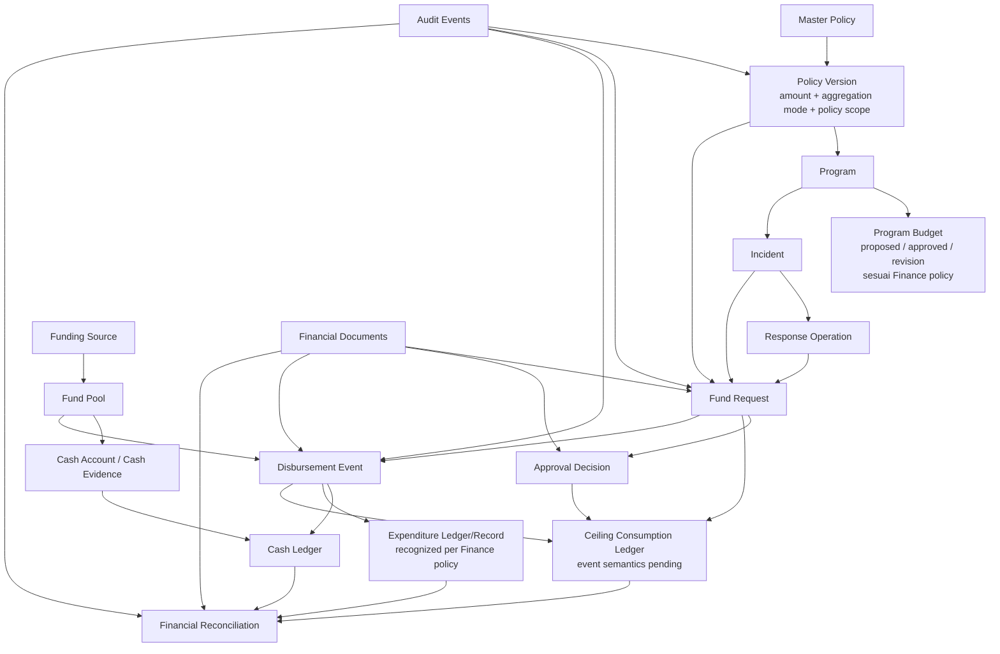

# SIM-TDB — FINANCE DECISION REGISTER
## Correction & Harmonization R01

**Document ID:** SIMTDB-REV05112026-00-13-FIN-R01  
**Filename:** `SIMTDB_REV05112026_00_13_FINANCE_DECISION_REGISTER_CORRECTION_HARMONIZATION_R01.md`  
**Revision:** REV05112026-R01  
**Status:** Draft untuk review pemilik proyek dan organisasi  
**Mode:** Audit, decision-register correction, requirement harmonization, dan logical-design planning — tanpa implementasi  
**Project:** Sistem Informasi Manajemen Tanggap Darurat Bencana (SIM-TDB)  
**Organization:** Caritas Keuskupan Malang — Tim Solidaritas Kemanusiaan Keuskupan Malang (TSKKM)

---

## 1. Tujuan dan status dokumen

Dokumen ini memperbarui dan mengharmonisasikan register keputusan Finance sebelumnya, terutama dokumen 00.13 awal, dengan menjaga:

- Keputusan governance pemilik proyek yang sudah ditetapkan.
- Redaksi dan bukti SOP yang tersedia.
- Keputusan organisasi formal yang belum dibuktikan.
- Keputusan desain yang masih perlu diputuskan.
- Histori audit dan seluruh test ID terdahulu.

Dokumen ini **tidak**:

- Mengubah keputusan pemilik proyek yang sudah berstatus disetujui.
- Mengubah atau menafsirkan ulang SOP secara sepihak.
- Membuat keputusan organisasi atau menetapkan pejabat baru.
- Membuat code, schema, tabel, migration, seed, API, atau konfigurasi.
- Menyatakan test yang belum dijalankan sebagai lulus.

### Readiness saat ini

- **Finance decision register:** dapat digunakan sebagai draft untuk klarifikasi dan pencatatan keputusan.
- **Finance logical design final:** belum siap dinyatakan final; keputusan kritis dan bukti masih diperlukan.
- **Physical database design:** `NO_GO`.
- **Implementation:** `NO_GO`.

---

## 2. Riwayat dan hubungan dengan dokumen sebelumnya

Dokumen ini merupakan R01 dari register keputusan Finance 00.13.

| Dokumen | Peran dalam rangkaian | Perlakuan dalam R01 |
|---|---|---|
| `SIMTDB_REV05112026_00_02_FINANCIAL_AMOUNT_CLARIFICATION.md` | Klarifikasi awal nilai ilustratif dan fleksibilitas nominal | Dipertahankan sebagai histori dan sumber klarifikasi sesuai ruang lingkupnya. |
| `SIMTDB_REV05112026_00_03_FINANCE_CLARIFICATION_REAUDIT_AND_TEST_PROMPT.md` | Prompt re-audit Finance awal | Dipertahankan sebagai histori; bukan bukti test dijalankan. |
| `SIMTDB_REV05112026_00_04_AUDIT_FINANCE_REAUDIT_PROMPT.md` | Audit atas prompt Finance terdahulu | Dipertahankan sebagai histori. |
| `SIMTDB_REV05112026_00_05_FINANCE_REAUDIT_PROMPT_R01.md` | Prompt re-audit dan read-only guardrails | Dipertahankan sebagai rujukan audit. |
| `SIMTDB_REV05112026_00_06_FINANCE_CLARIFICATION_REAUDIT.md` | Hasil audit Finance sebelumnya | Temuan yang masih valid dipertahankan; temuan yang diperbarui ditandai. |
| `SIMTDB_REV05112026_00_07_FINANCE_OWNER_CLARIFICATION_AND_CORRECTION_PROMPT.md` | Klarifikasi owner tentang dana darurat per kejadian | Dipertahankan; dibaca bersama klarifikasi mode konfigurasi setelahnya. |
| `SIMTDB_REV05112026_00_08_FINANCE_CLARIFICATION_REAUDIT_CORRECTED.md` | Re-audit koreksi Finance | Dipertahankan sebagai histori. |
| `SIMTDB_00_09_R01_REUPLOAD.md` / Finance policy reconciliation prompt | Klarifikasi opsi `PER_INCIDENT` dan `GLOBAL_ALL_INCIDENTS` | Dipertahankan. |
| `SIMTDB_REV05112026_00_10_FINANCE_FOUNDATION_REAUDIT.md` | Audit Finance foundation dan test plan FIN-TEST-01–46 | Test ID dan histori dipertahankan. |
| Prompt 00.11 R00 | Prompt governance dan transaction-control awal | Digantikan untuk pekerjaan selanjutnya oleh R01; histori R00 tidak dihapus. |
| `SIMTDB_REV05112026_00_12_AUDIT_PROMPT_00_11.md` | Audit atas Prompt 00.11 R00 | Temuan yang masih relevan dipertahankan; provenance governance dikoreksi melalui klarifikasi owner. |
| Prompt 00.11 R01 | Prompt governance yang telah diperbarui | Digunakan sebagai rujukan utama untuk governance dan test requirements pada tahap ini. |
| Dokumen 00.13 awal | Finance Decision Register dan Logical Design Plan | Dikoreksi dan diharmonisasikan oleh dokumen R01 ini; bukan dihapus. |
| Gambar SOP halaman cetak 16–29 | Evidence SOP parsial | Halaman 23–24 dipakai untuk konteks sumber dana dan pembatasan yang terlihat. |

### Status test

FIN-TEST-01 sampai FIN-TEST-92 tetap merupakan ID historis. Seluruh test yang belum memiliki bukti eksekusi nyata tetap berstatus belum dijalankan. R01 tidak mengklaim test telah lulus dan tidak menghapus atau menomori ulang test terdahulu.

---

## 3. Evidence availability dan batas audit

### 3.1 Sumber yang tersedia dalam konteks audit

| Sumber | Status | Batas |
|---|---|---|
| Klarifikasi pemilik proyek dan Prompt 00.11 R01 | Tersedia dalam percakapan dan telah ditelaah | Menjadi sumber project-owner requirements yang tercantum eksplisit. |
| Audit Prompt 00.12 | Tersedia dalam percakapan dan telah ditelaah | Audit terhadap Prompt 00.11 versi sebelumnya; findings dipertahankan atau diperbarui, bukan dianggap sebagai keputusan kebijakan. |
| Dokumen Finance 00.02–00.10 dan 00.13 awal | Tersedia dalam rangkaian percakapan | Working specifications dan audit historis; bukan pengganti SOP atau bukti organisasi formal. |
| Gambar SOP halaman cetak 16–29 | Tersedia dan telah ditelaah | Audit SOP parsial; halaman 23–24 relevan dengan pendanaan. |
| SOP halaman 1–15 dan 30–95 | `EVIDENCE_NOT_AVAILABLE` dalam konteks audit ini | Tidak boleh dianggap telah diperiksa. |
| SOP Finance halaman 40–41, halaman 49, dan halaman 62–69 | `EVIDENCE_NOT_AVAILABLE` dalam konteks audit ini | Detail dan template terkait belum dapat diverifikasi. |
| Repository, branch, commit, code, schema, migration, seed | `EVIDENCE_NOT_AVAILABLE` | Tidak diperiksa. |
| Dokumen SK, mandat/delegasi, approval matrix, dan bukti closure formal | `EVIDENCE_NOT_AVAILABLE` | Tidak tersedia untuk verifikasi. |
| Test execution evidence | `EVIDENCE_NOT_AVAILABLE` | Tidak ada test yang dijalankan dalam audit ini. |

### 3.2 Prinsip pencatatan

- Klaim “sudah diperiksa” hanya berlaku untuk sumber yang benar-benar tersedia dan ditelaah.
- Jangan menyalin detail SOP yang tidak terbaca atau tidak tersedia.
- Jangan menggunakan ringkasan lama sebagai pengganti dokumen SOP asli apabila gambar aslinya dapat diperiksa.
- Jangan menyebut keputusan organisasi formal tanpa dokumen evidence yang dapat diverifikasi.
- Status test harus membedakan rancangan dari eksekusi.

---

## 4. Provenance dan source authority

| Label | Makna |
|---|---|
| `SOP_CONFIRMED` | Didukung oleh bagian SOP yang tersedia dan terbaca langsung. |
| `CLARIFIED_BY_PROJECT_OWNER` | Klarifikasi kebijakan atau requirement proyek yang dinyatakan pemilik proyek. |
| `PROJECT_OWNER_GOVERNANCE_REQUIREMENT` | Governance requirement sistem yang secara eksplisit ditetapkan pemilik proyek. |
| `ORG_DECISION_CONFIRMED` | Keputusan organisasi formal yang dokumennya tersedia dan telah diverifikasi. |
| `PENDING_ORG_DECISION` | Memerlukan keputusan organisasi, authority, atau pedoman Finance yang belum tersedia. |
| `PENDING_DESIGN_DECISION` | Memerlukan keputusan desain logical model yang tidak boleh diasumsikan. |
| `TECHNICAL_RECOMMENDATION` | Rekomendasi teknis, bukan ketentuan SOP atau keputusan organisasi. |
| `SOURCE_CONFLICT` | Terdapat perbedaan antara sumber atau interpretasi yang belum diselesaikan. |
| `EVIDENCE_NOT_AVAILABLE` | Sumber bukti tidak tersedia untuk diperiksa. |
| `TEST_DESIGNED` | Test dirancang, tetapi belum dijalankan. |
| `TEST_EXECUTED_PASS` | Test benar-benar dijalankan dan evidence tersedia. |
| `TEST_EXECUTED_FAIL` | Test benar-benar dijalankan dan evidence tersedia. |
| `BLOCKED_BY_MISSING_POLICY` | Keputusan test/desain terhalang policy yang belum disahkan. |
| `BLOCKED_BY_MISSING_SOURCE` | Keputusan test/desain terhalang sumber yang belum tersedia. |

`PROJECT_OWNER_GOVERNANCE_REQUIREMENT` tidak sama dengan `ORG_DECISION_CONFIRMED`. Approval pemilik proyek terhadap desain sistem tidak membuktikan bahwa SK, mandat, signatory, atau authority organisasi tertentu telah diterbitkan dan diverifikasi.

---

## 5. GOV-01 sampai GOV-09 — status dipertahankan

**Status persetujuan GOV-01 sampai GOV-09 tidak diubah oleh dokumen ini.** Kesembilan item tetap `PROJECT_OWNER_GOVERNANCE_REQUIREMENT`.

| ID | Governance requirement | Status dipertahankan |
|---|---|---|
| GOV-01 | Master Policy harus ditetapkan sebelum program operasional dimulai. | `PROJECT_OWNER_GOVERNANCE_REQUIREMENT` |
| GOV-02 | Tidak ada program operasional yang boleh aktif tanpa policy yang berlaku. | `PROJECT_OWNER_GOVERNANCE_REQUIREMENT` |
| GOV-03 | Policy setup/amendment terkunci saat ada program yang berjalan atau belum resmi ditutup. | `PROJECT_OWNER_GOVERNANCE_REQUIREMENT` |
| GOV-04 | Policy amendment juga terkunci sampai program dan seluruh keuangan terkait selesai. | `PROJECT_OWNER_GOVERNANCE_REQUIREMENT` |
| GOV-05 | Hanya kapabilitas SuperAdmin yang dapat melakukan setup awal dan amendment yang memenuhi syarat. | `PROJECT_OWNER_GOVERNANCE_REQUIREMENT` |
| GOV-06 | Setiap amendment memerlukan SK Pengaturan terlampir dengan detail yang dapat ditelusuri. | `PROJECT_OWNER_GOVERNANCE_REQUIREMENT` |
| GOV-07 | SK Pengaturan tidak membypass program/financial closure gate. | `PROJECT_OWNER_GOVERNANCE_REQUIREMENT` |
| GOV-08 | Tidak ada SuperAdmin override saat policy terkunci. | `PROJECT_OWNER_GOVERNANCE_REQUIREMENT` |
| GOV-09 | Amendment menghasilkan versi policy baru; histori policy dan transaksi tidak ditimpa diam-diam. | `PROJECT_OWNER_GOVERNANCE_REQUIREMENT` |

### Batas interpretasi

GOV-01 sampai GOV-09 tidak menetapkan dengan sendirinya:

- Status program yang menjadi terminal.
- Sumber data otoritatif setiap financial blocker.
- Pejabat yang mengesahkan financial closure.
- Nomor, tanggal, penerbit, atau isi SK tertentu.
- Model incident/operation atau mode agregasi ceiling.
- Definisi kas eligible.
- Event transaksi yang mengonsumsi ceiling.

Butir-butir tersebut tetap membutuhkan sumber, pemetaan, atau keputusan tersendiri.

---

## 6. Kebijakan Rp50 juta dan mekanisme multi-insiden

### 6.1 Nilai dan status kebijakan

| Pernyataan | Status | Perlakuan |
|---|---|---|
| Rp100.000.000 yang muncul dalam contoh/template adalah nilai ilustratif; bukan default, mandatory amount, ceiling, atau approval threshold. | `CLARIFIED_BY_PROJECT_OWNER` | Jangan hardcode atau gunakan sebagai rule. |
| Rp50.000.000 adalah nilai referensi awal yang pernah diklarifikasi pemilik proyek untuk batas dana darurat. | `CLARIFIED_BY_PROJECT_OWNER` | Nilai konfigurasi awal tetap memerlukan pengesahan sebelum aktif. |
| Nilai ceiling emergency fund dapat diatur sebagai policy configuration, bukan konstanta permanen di code. | `CLARIFIED_BY_PROJECT_OWNER` | Perubahan mengikuti GOV-03–GOV-09. |
| Mode ceiling dapat dipilih antara `PER_INCIDENT` dan `GLOBAL_ALL_INCIDENTS`. | `CLARIFIED_BY_PROJECT_OWNER` | Mode aktif harus ditentukan dan tersimpan dalam policy version. |
| Mode dan nilai yang dipilih menentukan cara agregasi. | `CLARIFIED_BY_PROJECT_OWNER` | Jangan menggabungkan mode secara otomatis atau menyimpulkan hybrid. |

### 6.2 `PER_INCIDENT`

Dalam mode ini, configured ceiling diberlakukan kumulatif per control unit kejadian/operasi yang ditetapkan policy.

- Kejadian berbeda dapat masing-masing memiliki batas sesuai konfigurasi.
- Aggregate pengeluaran lintas kejadian dapat lebih tinggi daripada ceiling per kejadian.
- Total kas yang dipakai tetap tunduk pada eligible cash dan restriction sumber dana.
- Voucher, sektor, activity, user, team, atau sub-record tidak boleh otomatis membuat batas baru.
- Identitas control unit—parent incident atau operation yang sah—belum diputuskan.

Status identitas control unit: `PENDING_ORG_DECISION` atau `PENDING_DESIGN_DECISION`.

### 6.3 `GLOBAL_ALL_INCIDENTS`

Dalam mode ini, satu configured ceiling dibagi secara kumulatif di antara kejadian-kejadian yang berada dalam policy scope yang disetujui.

- Ceiling tidak diberikan ulang untuk setiap incident.
- Semua transaksi dalam scope mengonsumsi batas bersama sesuai event semantics yang disahkan.
- Batas scope, masa berlaku, keanggotaan incident, dan reset/supersession harus ditentukan secara eksplisit.
- Tidak boleh diasumsikan reset otomatis tahunan, per program, atau per incident.
- Multi-insiden hanya boleh berbagi ceiling ketika masuk scope policy yang sama.

Status scope dan reset: `PENDING_ORG_DECISION`.

### 6.4 Jangan mencampur limit dengan cash

Baik mode `PER_INCIDENT` maupun `GLOBAL_ALL_INCIDENTS` tetap memiliki kontrol kas eligible terpisah:

- Ceiling policy tidak membuktikan ketersediaan uang.
- Kas yang restricted tidak otomatis eligible.
- Saldo kas lintas sumber tidak dijumlahkan tanpa dasar.
- Budget tidak sama dengan kas.
- Remaining budget tidak sama dengan eligible cash.

Formula operasional final tidak ditetapkan oleh dokumen ini.

---

## 7. Policy freeze scope versus ceiling aggregation scope

Kedua scope ini adalah dimensi yang berbeda dan harus dimodelkan secara terpisah.

### 7.1 Policy freeze scope

**Freeze scope mengikuti GOV-03 dan GOV-04:**

- Policy setup/amendment dikunci selama masih ada program SIM-TDB yang running atau belum secara formal ditutup.
- Setelah program ditutup, policy tetap terkunci sampai seluruh financial obligations, transactions, accountability, dan reconciliation terkait selesai.
- SK Pengaturan tidak menghapus atau membypass lock.
- Tidak ada SuperAdmin override.

Ini adalah governance requirement yang berstatus `PROJECT_OWNER_GOVERNANCE_REQUIREMENT`.

Freeze scope mengatur **kapan Master Policy boleh diubah**. Ia tidak menentukan bagaimana limit transaksi diagregasi.

### 7.2 Ceiling aggregation scope

Aggregation scope ditentukan oleh policy version:

- `PER_INCIDENT`: ceiling diterapkan per control unit yang ditetapkan.
- `GLOBAL_ALL_INCIDENTS`: ceiling diterapkan kumulatif pada incident yang tercakup dalam policy scope.
- Hybrid mode tidak digunakan kecuali ada persetujuan eksplisit yang menjadi requirement baru.

Aggregation scope mengatur **kejadian/transaksi mana yang berbagi ceiling**. Ia tidak mempersempit atau memperluas program/financial closure gate.

### 7.3 Matriks pemisahan scope

| Dimensi | Pertanyaan yang dijawab | Sumber aturan | Status |
|---|---|---|---|
| Policy freeze scope | Kapan policy setup/amendment terkunci? | GOV-03 dan GOV-04 | `PROJECT_OWNER_GOVERNANCE_REQUIREMENT` |
| Ceiling aggregation scope | Transaksi/kejadian mana berbagi batas dana? | Active policy version: mode dan scope | Mode diklarifikasi; detail scope pending |
| Fund-pool eligibility scope | Kas/sumber mana eligible bagi pengeluaran? | Funding policy dan restriction yang disahkan | `PENDING_ORG_DECISION` |
| Financial reporting scope | Nilai mana masuk laporan program/sumber dana? | Finance/accounting policy dan canonical records | `PENDING_ORG_DECISION` |

### 7.4 Implikasi penting

- Satu policy freeze system-wide tidak berarti seluruh kejadian berbagi satu global ceiling.
- Mode `PER_INCIDENT` tidak berarti policy boleh diubah per incident selama program berjalan.
- `GLOBAL_ALL_INCIDENTS` hanya menggunakan scope yang dikonfigurasi dan disahkan; tidak otomatis mencakup semua kas atau semua program.
- Financial blocker pada freeze gate ditentukan berdasarkan program/keuangan terkait, bukan semata-mata oleh ceiling aggregation mode.

---

## 8. SOP halaman 23–24: sumber dana dan pembatasan yang tersedia

### 8.1 Evidence ledger

Ringkasan berikut berasal dari gambar SOP halaman cetak 23–24 yang tersedia. Ini bukan transkripsi legal/OCR terverifikasi untuk seluruh halaman; detail perlu dicocokkan dengan scan berkualitas tinggi sebelum dijadikan rule otomatis.

| Halaman | Isi yang tampak pada SOP | Implikasi yang dapat dicatat | Batas |
|---|---|---|---|
| 23 | Sumber pendanaan mencakup dana siaga dan dana operasional Keuskupan Malang, dana APP Nasional, dan bantuan umat. | Sumber dana perlu dapat dibedakan dan dilacak. | Kategori master, rekening, dan rule accounting rinci belum lengkap. |
| 23 | Dana siaga merupakan sumber untuk kebutuhan respons awal; dana operasional yang berasal dari bunga bank atas dana siaga dapat digunakan untuk operasional TSKKM sesuai ketentuan yang dirujuk. | Dana siaga dan dana operasional tidak boleh disamakan tanpa validasi policy sumber. | Mekanisme penghitungan bunga/transfer dan batas penggunaan belum diperiksa pada sumber lengkap. |
| 23 | Pengeluaran dana darurat memerlukan persetujuan Ketua TSKKM. | Approval evidence perlu dapat dicatat dan ditelusuri. | Identitas, delegation, dan pemetaan ke sistem belum dibuktikan. |
| 23 | Halaman menampilkan angka Rp50.000.000 pada konteks dana awal tanggap darurat. | Angka historis tetap dicatat sebagai SOP evidence. | Makna relatif terhadap klarifikasi configurable/per-incident harus direkonsiliasi, bukan ditulis ulang. |
| 24 | Dana darurat APP Nasional bersumber dari Keuskupan dan diakses melalui KARINA-KWI dengan SITREP dan rencana penggunaan anggaran. | Dokumen sumber yang disebut perlu dapat ditautkan jika proses tersebut diterapkan. | Workflow lengkap dan template belum seluruhnya diperiksa. |
| 24 | Halaman menyebut dana APP Nasional tidak digunakan untuk menutupi kategori biaya administrasi/operasional kantor yang tercantum. | Daftar pembatasan harus dipertahankan sebagai evidence SOP. | Pemetaan kategori biaya dan enforcement mode belum disahkan. |
| 24 | Pada bencana skala besar, terdapat kemungkinan asistensi program/dana Caritas Internationalis yang difasilitasi melalui KARINA-KWI. | Sumber pendanaan tambahan perlu dicatat terpisah bila berlaku. | Definisi skala besar dan approval belum diselesaikan. |
| 24 | Sumbangan pihak ketiga dapat diterima dengan syarat tidak terikat dan sesuai nilai Gereja Katolik. | Sumber donasi dan kondisi penerimaannya harus dapat ditelusuri. | Pemeriksaan penerimaan dan otoritas proses belum lengkap. |

### 8.2 Kategori biaya APP Nasional yang terlihat pada halaman 24

Gambar halaman 24 memuat kategori yang tidak digunakan untuk menutup administrasi/operasional kantor, antara lain:

- Gaji staf.
- Perawatan gedung.
- Perlengkapan dan alat tulis kantor.
- Perawatan harian kendaraan kantor.
- Komunikasi harian kantor dan staf.
- Alkohol/minuman keras, rokok, dan minuman suplemen.

**Perlakuan:** `SOP_CONFIRMED` secara parsial untuk isi yang terlihat. Sebelum menjadikan daftar ini sebagai hard-block dalam aplikasi:

1. Verifikasi teks lengkap dengan scan yang lebih jelas.
2. Petakan istilah SOP ke kategori Finance tanpa menambah larangan.
3. Dapatkan interpretasi/approval atas aturan enforcement.
4. Jangan menyimpulkan pengecualian atau kategori tambahan yang tidak tertulis.

### 8.3 Rp50 juta: SOP evidence dan owner interpretation

- Halaman SOP 23 yang terlihat mencantumkan Rp50.000.000 dalam konteks dana awal.
- Klarifikasi pemilik proyek menafsirkan Rp50m sebagai reference maximum yang dapat dikonfigurasi dan mengatur aggregation mode.
- Prompt 00.11 R01 mempertahankan perbedaan antara SOP evidence dan project-owner governance requirement.

**Status rekonsiliasi:** `SOURCE_CONFLICT` atau `PENDING_ORG_DECISION` sampai interpretasi tertulis dari authority yang berwenang tersedia. Jangan mengubah redaksi SOP; jangan pula mengabaikan klarifikasi pemilik proyek dalam desain sistem.

---

## 9. FIN-DEC-33 — authority persetujuan pengeluaran dana darurat

| Field | Isi |
|---|---|
| Decision ID | `FIN-DEC-33` |
| Judul | Otoritas persetujuan pengeluaran dana darurat TSKKM |
| Pertanyaan | Siapa yang memiliki kewenangan formal untuk menyetujui pengeluaran dana darurat, bagaimana mandat/delegasinya berlaku, dan bagaimana authority tersebut dipetakan ke user/account SIM-TDB? |
| Evidence tersedia | SOP halaman 23 yang terlihat menyatakan pengeluaran dana darurat memerlukan persetujuan Ketua TSKKM. |
| Belum diketahui | Identitas pemegang jabatan pada waktu operasi, mandat/delegation, substitusi/acting authority, cakupan persetujuan, serta pemetaan ke role atau user sistem. |
| Opsi pembahasan | A. Ketua TSKKM menyetujui langsung; B. delegate yang memiliki mandat tertulis; C. kombinasi sesuai kondisi dan dokumen formal; D. opsi lain yang ditetapkan organisasi. Opsi ini bukan keputusan. |
| Implikasi | Permission teknis, assignment, posisi user, atau status SuperAdmin tidak otomatis memberikan approval authority. |
| Evidence yang dibutuhkan | Dokumen mandat/delegation atau keputusan organisasi yang berlaku; identifikasi authority; scope, effective period, dan prosedur pengganti bila relevan. |
| Pemilik keputusan | `OWNER TO BE DESIGNATED` sesuai struktur kewenangan organisasi. |
| Status | `PENDING_ORG_DECISION`; SOP text halaman 23 memiliki evidence parsial. |
| Menghambat logical design? | **Ya**, untuk approval workflow final dan transaksi yang memerlukan persetujuan. |

**Pemisahan wajib:** FIN-DEC-33 membahas otoritas **pengeluaran dana darurat**. Ia tidak mengubah GOV-05 tentang SuperAdmin sebagai pelaksana setup/amendment policy. SuperAdmin tidak otomatis menjadi approver pengeluaran dana.

---

## 10. Relasi konseptual Finance yang diklarifikasi

### 10.1 Konsep yang tidak boleh disamakan

| Konsep | Menjawab pertanyaan | Bukan sinonim dari |
|---|---|---|
| Master Policy | Aturan policy yang berlaku, termasuk nilai/mode/scope ceiling | Budget, fund pool, cash balance, expenditure |
| Policy Version | Versi policy yang berlaku pada periode/scope tertentu | Transaction record atau budget revision |
| Program Budget | Anggaran rencana/disetujui untuk program/kegiatan menurut policy Finance yang berlaku | Kas nyata, emergency ceiling, payment, atau expenditure |
| Fund Source | Asal/sumber dana dan restriction terkait | Budget allocation atau saldo kas |
| Fund Pool | Kumpulan dana yang ditangani sebagai pool untuk kontrol eligible cash, bila disetujui | Seluruh dana organisasi |
| Cash Ledger | Record pergerakan/posisi kas sesuai sumber otoritatif yang dipilih | Ceiling consumption atau expense recognition |
| Emergency Ceiling Consumption Ledger | Record konsumsi/reservasi ceiling menurut event semantics yang disetujui | Cash movement ledger atau accounting ledger |
| Expenditure Ledger/Record | Record expenditure yang diakui untuk pelaporan sesuai Finance policy | Cash disbursement otomatis |
| Disbursement Event | Dana yang dikeluarkan/dibayarkan menurut proses yang ditetapkan | Approved budget atau expense recognition otomatis |
| Financial Reconciliation | Proses mencocokkan record, dokumen, cash, expenditure, dan kewajiban | Mengubah/menimpa source records |

### 10.2 Logical relationship map

**Diagram status:** konseptual/logical, bukan schema fisik. Garis hubungan menunjukkan kandidat keterkaitan; cardinality, ownership, dan event semantics yang belum didukung sumber tetap pending.

### 10.3 Batas relasi Master Policy dan Program Budget

- Master Policy menentukan governance dan parameter policy dana darurat, termasuk mode ceiling yang telah dipilih.
- Program Budget menyatakan rencana/alokasi anggaran program/kegiatan menurut proses Finance yang disahkan.
- Program Budget tidak membuktikan kas tersedia.
- Ceiling policy tidak otomatis menjadi batas seluruh program budget.
- Emergency fund ceiling tidak otomatis menjadi program budget.
- Budget tidak mengubah fund-source restriction.
- Relasi Program Policy Binding harus menautkan policy version yang berlaku tanpa menyimpan salinan policy amount/mode yang dapat diedit secara terpisah di modul Program.

### 10.4 Batas relasi Fund Pool dan Cash Ledger

- Fund Source mengidentifikasi sumber asal dan restriction.
- Fund Pool adalah konsep pengelompokan dana untuk kontrol yang disahkan; satu pool tidak otomatis mencakup seluruh rekening/sumber.
- Cash Ledger merekam cash movement/balance berdasarkan canonical source yang belum ditetapkan.
- Cash eligible tidak dapat dihitung dengan menjumlahkan seluruh pool tanpa memperhatikan restriction.
- Policy Version dapat merujuk satu atau beberapa pool hanya setelah cardinality dan eligibility disetujui.
- Saldo cash tidak otomatis sama dengan budget remaining.

### 10.5 Batas relasi Cash Ledger, Ceiling Consumption Ledger, dan Expenditure Ledger

Ketiga catatan harus dipisahkan:

1. **Cash Ledger**
   - Mencatat penerimaan, pengeluaran, transfer, dan pergerakan kas sesuai Finance source-of-truth yang disetujui.
   - Menjadi dasar evaluasi available cash hanya setelah definisinya disahkan.

2. **Emergency Ceiling Consumption Ledger**
   - Mencatat event yang menghitung penggunaan/reservasi ceiling policy.
   - Event yang mengonsumsi ceiling masih `PENDING_ORG_DECISION`.
   - Tidak boleh menghitung reservation dan disbursement dua kali.

3. **Expenditure Ledger/Record**
   - Mencatat expenditure yang diakui untuk pelaporan sesuai Finance/accounting policy.
   - Tidak boleh diasumsikan selalu identik dengan cash disbursement.
   - Sumber canonical actual expenditure harus ditetapkan oleh Finance.

Satu peristiwa dapat menimbulkan hubungan ke ketiga ledger, tetapi nilai, makna, status, dan waktu bisnisnya tidak boleh disatukan menjadi satu status atau satu editable total.

---

## 11. Keputusan Finance yang masih terbuka — register koreksi

Prioritas keputusan disusun berdasarkan kebutuhan agar sistem aman di lapangan, dapat diuji, dan tidak mengunci policy yang belum disahkan.

### Priority 0 — Sumber dan kewenangan pengendali

| ID | Keputusan/sumber | Status | Menghambat |
|---|---|---|---|
| FIN-DEC-01 | Rekonsiliasi resmi redaksi SOP halaman 23 dengan interpretasi configurable/per-incident dari pemilik proyek. | `SOURCE_CONFLICT` / `PENDING_ORG_DECISION` | Logical policy final dan approval traceability |
| FIN-DEC-33 | Authority persetujuan pengeluaran dana darurat, termasuk mandat/delegasi Ketua TSKKM. | `PENDING_ORG_DECISION` | Approval workflow final |
| FIN-DEC-19 | Siapa memverifikasi SK Pengaturan dan cakupan verifikasi. | `PENDING_ORG_DECISION` | Policy amendment activation |
| FIN-DEC-20 | Provisioning, recovery, dan revocation SuperAdmin. | `PENDING_ORG_DECISION` | Policy setup operation |
| FIN-DEC-21 | Governing source untuk initial Master Policy setup. | `PENDING_ORG_DECISION` | Program activation pertama |

### Priority 1 — Policy semantics yang mengendalikan ceiling

| ID | Keputusan | Status | Menghambat |
|---|---|---|---|
| FIN-DEC-02 | Nilai dan effective date policy awal; Rp50m hanya reference candidate sampai disahkan. | `PENDING_ORG_DECISION` | Policy activation |
| FIN-DEC-03 | Mode awal `PER_INCIDENT` atau `GLOBAL_ALL_INCIDENTS`. | `PENDING_ORG_DECISION` | Policy activation |
| FIN-DEC-04 | Control unit untuk `PER_INCIDENT`. | `PENDING_ORG_DECISION` | Aggregate ceiling calculation |
| FIN-DEC-05 | Scope boundary untuk `GLOBAL_ALL_INCIDENTS`. | `PENDING_ORG_DECISION` | Aggregate ceiling calculation |
| FIN-DEC-06 | Reset/supersession behavior untuk global scope. | `PENDING_ORG_DECISION` | Multi-incident policy continuity |
| FIN-DEC-07 | Event yang mengonsumsi ceiling. | `PENDING_ORG_DECISION` | Ceiling ledger semantics |

### Priority 2 — Cash, funding, dan accounting facts

| ID | Keputusan | Status | Menghambat |
|---|---|---|---|
| FIN-DEC-08 | Definisi eligible available cash dan canonical source. | `PENDING_ORG_DECISION` | Cash control |
| FIN-DEC-09 | Reservation, outstanding payment, advance, dan cash encumbrance treatment. | `PENDING_ORG_DECISION` | Cash availability/concurrency |
| FIN-DEC-10 | Funding-source/fund-pool cardinality. | `PENDING_DESIGN_DECISION` / `PENDING_ORG_DECISION` | Logical fund/cash model |
| FIN-DEC-11 | Restriction dan eligibility mapping terhadap fund sources. | `PENDING_ORG_DECISION` | Automated eligibility |
| FIN-DEC-12 | Actual expenditure recognition/canonical source. | `PENDING_ORG_DECISION` | Financial reporting |
| FIN-DEC-13 | Formula remaining budget dan commitment/cut-off treatment. | `PENDING_ORG_DECISION` | Definitive remaining-budget reporting |
| FIN-DEC-31 | Refund/reversal/correction/advance/dispute treatment. | `PENDING_ORG_DECISION` | Ledgers and financial closure |
| FIN-DEC-32 | Reservation expiry/cancellation treatment. | `PENDING_ORG_DECISION` | Ceiling and cash release |

### Priority 3 — Closure gates dan cross-module relationships

| ID | Keputusan | Status | Menghambat |
|---|---|---|---|
| FIN-DEC-16 | Kategori kewajiban keuangan yang menjadi blockers dan canonical source masing-masing. | `PENDING_ORG_DECISION` / `PENDING_DESIGN_DECISION` | Policy lock evaluation |
| FIN-DEC-17 | Program status vocabulary dan status yang menandakan formal closure. | `PENDING_DESIGN_DECISION` | Program closure gate |
| FIN-DEC-18 | Authority dan evidence untuk mengesahkan financial closure. | `PENDING_ORG_DECISION` | Financial closure gate |
| FIN-DEC-23 | Policy version yang berlaku untuk program/incident/request aktif setelah amendment. | `PENDING_ORG_DECISION` | Version transition |
| FIN-DEC-24 | Future-dated amendment jika program baru mulai sebelum effective date. | `PENDING_ORG_DECISION` / `PENDING_DESIGN_DECISION` | Program activation gate |
| FIN-DEC-27 | Cardinality Program–Incident–Response Operation. | `PENDING_DESIGN_DECISION` | Policy binding and aggregation |
| FIN-DEC-28 | Apakah satu scope dapat mencakup beberapa program. | `PENDING_DESIGN_DECISION` | Freeze vs aggregation mapping |
| FIN-DEC-29 | Perilaku lock gate ketika source module unavailable/stale. | `PENDING_DESIGN_DECISION` | Fail-safe policy amendment gate |
| FIN-DEC-30 | Akses dan data minimization untuk lock eligibility report. | `PENDING_ORG_DECISION` | Secure lock report |

### Priority 4 — Platform-dependent rules untuk tahap berikutnya

| ID | Keputusan | Status | Menghambat |
|---|---|---|---|
| FIN-DEC-14 | Relasi Program–Activity–Budget–Budget Line. | `PENDING_DESIGN_DECISION` | Logical budget model |
| FIN-DEC-15 | Budget revision lifecycle dan state vocabulary. | `PENDING_ORG_DECISION` | Budget workflow final |
| FIN-DEC-22 | Apakah ada verifikator terpisah untuk SK selain SuperAdmin. | `PENDING_ORG_DECISION` | Separation-of-duties design |
| FIN-DEC-25 | Offline authority untuk request, approval, dan disbursement. | `PENDING_ORG_DECISION` | Offline workflow final |
| FIN-DEC-26 | Currency, precision, rounding, exchange rate, dan accounting cut-off. | `PENDING_ORG_DECISION` | Physical design dan reporting |

### Hubungan antara freeze scope dan aggregate scope dalam register

- FIN-DEC-03 sampai FIN-DEC-07 mengatur **ceiling aggregation**.
- GOV-03 dan GOV-04 mengatur **policy freeze gate** dan tidak dibuka ulang.
- FIN-DEC-16 sampai FIN-DEC-18 menyediakan pemetaan data/authority untuk mengimplementasikan closure gate, bukan membatalkan prinsip GOV-03/GOV-04.
- FIN-DEC-28 menilai apakah beberapa program berbagi ceiling scope; itu bukan keputusan tentang apakah policy boleh diubah saat salah satu program masih aktif.

---

## 12. Urutan penyelesaian berdasarkan kesiapan

### Tahap 1 — Tutup gap evidence dan authority

Kumpulkan/verifikasi:

- SOP halaman 23–24 dengan scan yang jelas dan konteks lengkap.
- SOP Finance/procurement yang belum tersedia.
- Dokumen awal policy dan dasar penerapan.
- Mandat/delegasi Ketua TSKKM untuk approval dana darurat.
- Prosedur SuperAdmin provisioning dan SK verification.
- Approval/closure authority yang formal.

**Gate:** jangan mengklaim `ORG_DECISION_CONFIRMED` tanpa evidence.

### Tahap 2 — Tetapkan policy configuration awal

Putuskan dan dokumentasikan:

- Amount awal.
- Mode awal.
- Scope mode global jika dipilih.
- Control unit per incident jika dipilih.
- Fund pool dan restriction yang berlaku.
- Effective date dan governing source.

**Gate:** tidak ada program aktif sebelum policy yang berlaku telah dikonfigurasi sesuai GOV-01/GOV-02.

### Tahap 3 — Tetapkan Finance transaction semantics

Tentukan:

- Event yang mengonsumsi ceiling.
- Eligibility cash dan cash source.
- Reservation/outstanding payment treatment.
- Actual expenditure canonical source.
- Refund, reversal, correction, advance, dan dispute treatment.
- Remaining budget policy.

**Gate:** setiap konsep memiliki owner, source-of-truth, event semantics, dan expected result yang dapat diuji.

### Tahap 4 — Finalisasi closure-gate contracts

Untuk setiap program/financial blocker, dokumentasikan:

- Source module.
- Canonical entity/record.
- Status yang dibaca.
- Evidence yang menutup blocker.
- Owner module.
- Closure authority.
- Freshness.
- Scope dampak.
- Behavior jika source tidak tersedia.

**Gate:** policy lock evaluation tidak boleh menyatakan eligible karena missing/stale data.

### Tahap 5 — Finalisasi logical Finance relationships

Harmonisasikan:

- Master Policy/Policy Version.
- Program/Program Budget.
- Incident/Response Operation.
- Policy Scope Instance.
- Fund Source/Fund Pool.
- Cash Ledger.
- Ceiling Consumption Ledger.
- Expenditure Ledger/Record.
- Fund Request/Approval/Disbursement.
- Reconciliation/Document/Audit.

**Gate:** tidak ada relationship polimorfik atau cardinality yang dipaksakan tanpa keputusan; tidak ada duplikasi source of truth.

### Tahap 6 — Test specification review

- Pertahankan FIN-TEST-01 sampai FIN-TEST-92.
- Tambahkan test ID baru hanya untuk kebutuhan yang belum tercakup.
- Tandai semua test yang belum dijalankan `TEST_DESIGNED` atau status blocked.
- Tidak ada klaim lulus tanpa bukti execution.
- Uji kontrol policy freeze terpisah dari agregasi ceiling.

### Tahap 7 — Final logical design review

Review lintas domain:

- Finance.
- Program Management.
- Incident/Response Operations.
- Procurement.
- Logistics/Inventory.
- Core/IAM.
- Document and Audit Governance.

**Gate:** hanya setelah keputusan kritis dan source evidence tersedia, logical Finance design dapat disahkan sebagai final. Physical schema dan development tetap merupakan tahap terpisah setelah approval.

---

## 13. Relasi data yang harus dipertahankan dalam logical design

| Dari | Ke | Hubungan konseptual | Hal yang belum diputuskan |
|---|---|---|---|
| Master Policy | Policy Version | Satu policy mempunyai banyak versi. | Lifecycle/activation details tetap perlu desain. |
| Policy Version | Program binding | Program merujuk versi yang berlaku pada waktu aktivasi. | Perilaku transisi untuk program lama/new policy pending. |
| Policy Version | Policy Scope | Versi policy memiliki mode, ceiling, fund scope, dan effective period. | Cardinality dan scope details pending. |
| Program | Program Budget | Budget terpisah dari emergency ceiling. | Program/activity/budget-line cardinality pending. |
| Program | Incident/Response Operation | Berelasi sesuai model operasi yang disetujui. | Cardinality pending; jangan equate program dengan incident. |
| Incident/Response Operation | Fund Request | Request perlu konteks incident/operation sesuai mode. | Control unit per incident/operation pending. |
| Fund Request | Approval Decision | Request dapat memiliki decision/history records. | Authority approval dana pending FIN-DEC-33. |
| Fund Request | Ceiling Consumption Ledger | Request/events dapat dirujuk ledger jika event semantics diputuskan. | Event yang mengonsumsi ceiling pending. |
| Fund Source | Fund Pool | Pool mengelompokkan sumber yang eligible sesuai policy. | One/multiple source cardinality pending. |
| Fund Pool | Cash Ledger | Cash movement/balance ditelusuri ke pool/account/source. | Canonical cash source dan eligibility pending. |
| Disbursement | Cash Ledger | Disbursement menghasilkan cash movement sesuai Finance policy. | Status/event model pending. |
| Disbursement | Expenditure Ledger/Record | Dapat terkait expense yang diakui sesuai Finance policy. | Tidak selalu identik; accounting recognition pending. |
| Refund/Reversal | Original transaction/event | Harus berelasi dengan sumber asal; histori tidak dihapus. | Treatment cap/cash/expenditure pending. |
| Finance records | Financial Reconciliation | Reconciliation membaca canonical records; tidak overwrite otomatis. | Closure criteria pending. |
| Policy Amendment | SK Pengaturan/Document | Amendment mengacu pada SK yang diwajibkan. | Verifier/authority evidence pending. |
| Semua transaksi kritis | Audit/Event/Correlation | Source, actor, policy version, and causal relationship dapat ditelusuri. | Technical implementation kemudian. |

---

## 14. Test ID history — tidak dihapus atau dinomori ulang

### 14.1 Status historis

Semua ID berikut dipertahankan dari rangkaian audit terdahulu. Dokumen ini tidak mengklaim hasil eksekusi.

| Rentang | Sumber histori | Perlakuan R01 |
|---|---|---|
| FIN-TEST-01–FIN-TEST-23 | 00_07/00_08/00_10 Finance audit materials | Tetap dipertahankan; tujuan dan domain asal tidak dinomori ulang. |
| FIN-TEST-24–FIN-TEST-35 | 00_07 owner clarification/test requirements dan 00_10 | Tetap dipertahankan; menguji per incident, multi-incident, cash, anti-splitting, dan scope non-emergency. |
| FIN-TEST-36–FIN-TEST-46 | Prompt 00_09 R01 / 00_10 report | Tetap dipertahankan; menguji configurable mode, policy version, scope, access, cash, dan hardcoding. |
| FIN-TEST-47–FIN-TEST-80 | Prompt 00.11 R00/R01 | Tetap dipertahankan; governance lock, SK, concurrency, ledger, offline, dan transaction control. |
| FIN-TEST-81–FIN-TEST-92 | Prompt 00.11 R01 | Tetap dipertahankan; closure gates, SK, offline source availability, effective date, dan concurrent activation. |

### 14.2 Test status

- Actual result untuk test yang belum dijalankan: **not executed**.
- Status default untuk skenario belum dieksekusi: `TEST_DESIGNED`.
- Gunakan `BLOCKED_BY_MISSING_SOURCE` atau `BLOCKED_BY_MISSING_POLICY` jika test tidak dapat memiliki expected result definitif tanpa source/policy.
- `TEST_EXECUTED_PASS` atau `TEST_EXECUTED_FAIL` hanya boleh dicatat dengan environment, input, output, dan evidence yang dapat ditinjau.
- Jika daftar detail test 01–46 atau 47–92 tidak tersedia pada workspace saat pekerjaan selanjutnya, catat `EVIDENCE_NOT_AVAILABLE`; jangan mengarang detail untuk menggantikan sumber tersebut.

### 14.3 Test tambahan yang dapat ditambahkan tanpa mengganti histori

Jika diperlukan untuk menegaskan pemisahan scope, gunakan ID baru, bukan mengubah ID lama:

| ID baru | Tujuan | Expected result | Status |
|---|---|---|---|
| FIN-TEST-93 | Satu program aktif pada incident berbeda sementara policy mode `PER_INCIDENT` | Policy freeze tetap aktif menurut governance system-wide; ceiling tetap diagregasi per control unit sesuai mode. | `TEST_DESIGNED` |
| FIN-TEST-94 | Beberapa incident berbeda dalam satu `GLOBAL_ALL_INCIDENTS` scope | Penggunaan ceiling terakumulasi hanya dalam scope yang sama; ini tidak mengubah freeze gate. | `TEST_DESIGNED` |
| FIN-TEST-95 | Incident berbeda di scope global berbeda yang telah disetujui | Tidak dijumlahkan lintas scope tanpa policy rule yang menyatakannya. | `TEST_DESIGNED` |
| FIN-TEST-96 | Program belum formally closed tetapi tidak sedang aktif menjalankan kegiatan | Policy setup/amendment tetap terkunci sesuai GOV-03. | `TEST_DESIGNED` |
| FIN-TEST-97 | Semua program close, tetapi financial blocker belum selesai | Policy setup/amendment tetap terkunci sesuai GOV-04. | `TEST_DESIGNED` |
| FIN-TEST-98 | Cash Ledger menunjukkan saldo tetapi sumbernya restricted untuk expenditure yang diminta | Saldo tersebut tidak dianggap eligible tanpa aturan sumber yang disahkan. | `TEST_DESIGNED` |
| FIN-TEST-99 | Disbursement masuk ke Cash Ledger tetapi belum diakui sebagai expenditure | Sistem tidak menyamakan cash movement dengan expense recognition; treatment mengikuti Finance policy. | `TEST_DESIGNED` |

Test tambahan tersebut tidak menggantikan atau mengubah FIN-TEST-01–92.

---

## 15. Koreksi terhadap 00.13 awal dan disposition temuan 00.12

| Area temuan | Perlakuan dalam R01 |
|---|---|
| GOV-01 sampai GOV-09 | Dipertahankan seluruhnya; status `PROJECT_OWNER_GOVERNANCE_REQUIREMENT` tidak diubah. |
| Temuan 00.12 bahwa freeze/SK/SuperAdmin belum disetujui owner | Diperbarui: high-level requirements tersebut kini berstatus project-owner-approved; actual SK/authority evidence masih pending. |
| Penamaan SK dan authority formal | SK Pengaturan amendment mandatory sesuai requirement; identitas/issuer/signatory/verifier nyata tetap memerlukan evidence. |
| SuperAdmin override | Dilarang oleh governance requirement; account provisioning dan lifecycle tetap perlu prosedur organisasi. |
| Freeze scope | Diklarifikasi sebagai system-wide policy setup/amendment gate selama program atau finance terkait belum closed. |
| Ceiling aggregation scope | Dipisahkan dari freeze scope; dikendalikan oleh mode policy aktif. |
| Rp50m | Reference ceiling yang dapat dikonfigurasi; tidak hardcoded. Per-incident mode mengagregasi per control unit; global mode membagi ceiling di dalam policy scope. |
| Rp100m | Tetap ilustrasi, tidak digunakan sebagai default/ceiling/threshold. |
| SOP halaman 23 | Tidak ditimpa; perbedaan interpretasi dengan owner clarification tetap dicatat dan perlu rekonsiliasi. |
| Dana sumber dan restrictions halaman 23–24 | Dicantumkan dengan provenance parsial; tidak dipromosikan menjadi auto-block rules tanpa verifikasi/enforcement decision. |
| FIN-TEST-01–92 | Dipertahankan tanpa deletion/renumber; semuanya belum dijalankan kecuali evidence aktual tersedia. |
| Finance/source-of-truth | Cash Ledger, Ceiling Consumption Ledger, dan Expenditure Ledger dipisahkan secara konseptual; canonical records dan accounting treatment masih pending. |

---

## 16. Risiko utama setelah harmonisasi

| Risk ID | Risiko | Kontrol yang dipersyaratkan | Hal yang masih pending |
|---|---|---|---|
| R-01 | Freeze scope disamakan dengan global ceiling scope | Definisikan dua dimensi terpisah; test FIN-TEST-93–97 | Source status mapping |
| R-02 | Rp50m menjadi hardcoded atau global cap tanpa mode | Policy version configurable; test FIN-TEST-16/35/36–46 | Active policy approval |
| R-03 | Multi-incident expenditure melewati global policy ceiling | Aggregate sesuai mode dan scope, terpisah dari cash pool control | Global scope boundary |
| R-04 | Beberapa voucher/activity mereset per-incident cap | Aggregate ke canonical control unit | Incident vs operation identity |
| R-05 | Ketua TSKKM authority diasumsikan dari permission atau title | Simpan authority evidence dan pisahkan approval permission | FIN-DEC-33 |
| R-06 | SOP page 23 diubah melalui implementasi | Simpan evidence SOP dan clarification terpisah | Formal reconciliation |
| R-07 | Restricted APP Nasional funds dianggap eligible | Funding source/pool restriction ditelusuri | Rule mapping/enforcement |
| R-08 | Program Budget disamakan dengan policy ceiling | Relasi terpisah dan report provenance jelas | Budget/activity model |
| R-09 | Cash balance disamakan dengan expenditure atau remaining budget | Cash Ledger dan Expenditure Ledger dipisahkan | Accounting policy |
| R-10 | Reservation dan disbursement terhitung ganda | Ceiling event ledger, source event, idempotency, conversion invariant | Event semantics |
| R-11 | Program “closed” tetapi finance belum selesai | Dua closure gates independen | Program/Finance state mapping |
| R-12 | Lock gate clear karena source module unavailable/stale | Unavailable/stale tidak dianggap “no blocker”; fail-safe evaluation | Freshness/failure rule |
| R-13 | Policy amendment mengubah histori | Immutable version dan explicit policy binding | Transition behavior |
| R-14 | Test tidak dijalankan namun diklaim lulus | Semua test status/evidence ditelusuri | Test environment |

---

## 17. Readiness berdasarkan prioritas

| Tahap | Status | Penjelasan |
|---|---|---|
| GOV-01–GOV-09 | `READY` sebagai project-owner requirements | Status persetujuan dipertahankan; tidak berarti semua data/authority operasional tersedia. |
| Policy amount/mode configuration concept | `READY` untuk logical requirement | Active value/mode belum ditetapkan. |
| Freeze scope vs ceiling aggregation scope | `READY` sebagai pembedaan konseptual | Status source mapping dan lock details masih pending. |
| SOP page 23 reconciliation | `BLOCKED_BY_MISSING_SOURCE` / `SOURCE_CONFLICT` | Perlu konfirmasi formal terhadap interpretasi; SOP tidak diubah. |
| FIN-DEC-33 emergency-fund approval authority | `BLOCKED` | SOP menyebut Ketua TSKKM; mandate/delegation dan mapping sistem belum tersedia. |
| Program Budget–Policy relationship | `CONDITIONAL` | Konsep terpisah sudah jelas; data relationships/cardinality perlu review. |
| Fund Pool–Cash Ledger–Expenditure Ledger | `CONDITIONAL` | Pemisahan logical diperlukan; canonical data source dan accounting treatment pending. |
| Per-incident control unit | `BLOCKED` | Incident vs response operation belum diputuskan. |
| Global ceiling policy scope | `BLOCKED` | Scope/reset/supersession belum ditetapkan. |
| Available cash/event semantics | `BLOCKED` | Cash source, reservation, and ceiling consumption event belum diputuskan. |
| FIN-TEST-01–92 history | `READY` untuk dipertahankan | Semua test yang belum dijalankan tetap belum executed; evidence belum tersedia. |
| Logical Finance design final | `BLOCKED` | Keputusan kritis dan canonical source mapping masih pending. |
| Physical database design | `NO_GO` | Belum ada persetujuan final logical design dan policy semantics. |
| Implementation | `NO_GO` | Tidak dilakukan dan tetap dilarang pada tahap ini. |

---

## 18. Rekomendasi urutan tindak lanjut

1. **Selesaikan evidence dan authority**
   - Verifikasi SOP halaman 23–24 dan sumber Finance lain.
   - Dapatkan dasar/mandat untuk FIN-DEC-33.
   - Petakan authority policy setup, SK verification, dan financial closure tanpa menciptakan role.

2. **Putuskan ceiling policy awal**
   - Nilai.
   - Mode.
   - Effective date.
   - Control unit atau global scope.
   - Fund pool/source yang berlaku.
   - Event yang mengonsumsi ceiling.

3. **Tetapkan closure source contracts**
   - Program status dan closure evidence.
   - Financial obligation canonical sources.
   - Financial closure authority.
   - Freshness dan unavailable-source behavior.

4. **Tentukan pemisahan Finance ledgers**
   - Cash Ledger.
   - Ceiling Consumption Ledger.
   - Expenditure Ledger/Record.
   - Budget records.
   - Reconciliation and source documents.

5. **Finalisasi logical relationships**
   - Program Budget tidak disamakan dengan emergency ceiling.
   - Fund Pool tidak disamakan dengan cash balance.
   - Cash movement tidak disamakan dengan expenditure recognition.
   - Freeze scope tidak disamakan dengan ceiling aggregation scope.

6. **Konsolidasikan test history**
   - Pertahankan FIN-TEST-01–92.
   - Tambahkan FIN-TEST-93–99 sebagai test baru untuk scope separation dan ledger distinctions.
   - Tidak ada test pass tanpa evidence.

7. **Lakukan review lintas modul dan persetujuan logical design**
   - Finance, Program, Incident/Response Operation, Procurement, Logistics/Inventory, Core/IAM, Document, Audit.
   - Setelah persetujuan logical design barulah tahap physical database design dapat dipertimbangkan.

---

## 19. Pernyataan akhir

R01 ini mempertahankan keputusan pemilik proyek GOV-01 sampai GOV-09 tanpa perubahan status, sekaligus memisahkan dua konsep penting:

- **Policy freeze scope:** kapan setup/amendment terkunci berdasarkan program dan financial closure.
- **Ceiling aggregation scope:** kejadian/transaksi mana yang berbagi configured ceiling menurut mode policy.

Sumber dana dan pembatasan yang terlihat pada SOP halaman 23–24 dicatat sebagai evidence parsial dan tidak dikembangkan menjadi policy enforcement baru tanpa pemeriksaan serta keputusan yang diperlukan.

Relasi Master Policy, Program Budget, Fund Pool, Cash Ledger, Ceiling Consumption Ledger, dan Expenditure Ledger dijelaskan sebagai konsep yang berbeda. Source-of-truth dan cardinality yang belum dibuktikan tetap pending.

Seluruh histori dan test ID FIN-TEST-01–92 dipertahankan; test baru menggunakan ID FIN-TEST-93–99. Tidak ada test yang diklaim telah lulus tanpa evidence eksekusi.

**Status akhir:**
- Dokumen keputusan Finance R01: **Draft untuk review**.
- Logical Finance design final: **BLOCKED** sampai keputusan/evidence kritis tersedia.
- Physical database design: **NO_GO**.
- Code/database/migration/seed: **tidak diubah atau dibuat**.
- Implementasi: **tidak dilakukan**.