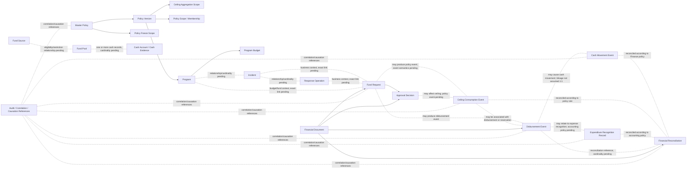

# SIM-TDB — FINANCE DECISION REGISTER
## Correction & Harmonization R02

**Document ID:** SIMTDB-REV05112026-00-13-FIN-R02  
**Filename:** `SIMTDB_REV05112026_00_13_FINANCE_DECISION_REGISTER_CORRECTION_HARMONIZATION_R02.md`  
**Revision:** REV05112026-R02  
**Status:** Draft working document untuk review pemilik proyek dan organisasi  
**Mode:** Read-only document audit, correction, and harmonization — tanpa implementasi  
**Project:** Sistem Informasi Manajemen Tanggap Darurat Bencana (SIM-TDB)  
**Organization:** Caritas Keuskupan Malang — Tim Solidaritas Kemanusiaan Keuskupan Malang (TSKKM)

---

## 1. Executive Summary

R02 mengoreksi dan mengharmonisasikan Finance Decision Register R01 dengan mempertahankan seluruh keputusan governance pemilik proyek, sumber SOP yang tersedia, decision ID, dan test ID historis.

### Hasil utama

1. **GOV-01 sampai GOV-09 dipertahankan tanpa perubahan status.** Semuanya tetap `PROJECT_OWNER_GOVERNANCE_REQUIREMENT`.
2. **Rp50.000.000 ditegaskan sebagai batas maksimum pengeluaran dana darurat untuk satu kejadian/operasi respons berdasarkan klarifikasi pemilik proyek sebelumnya.** Nilai ini bukan nilai wajib yang harus dihabiskan, bukan cap global semua kejadian, dan tidak boleh menjadi konstanta permanen di code.
3. **Rp100.000.000 tetap nilai ilustratif**, bukan nilai baku, default, cap, atau approval threshold.
4. Nilai ceiling dan mode penerapannya dikelola melalui **Master Policy** yang telah ditetapkan dan diaktifkan sebelum program operasional dimulai.
5. `PER_INCIDENT` membatasi kumulatif pada control unit yang ditetapkan; `GLOBAL_ALL_INCIDENTS` menerapkan satu batas bersama dalam policy scope yang ditetapkan. Definisi control unit dan global scope tetap pending.
6. **Policy freeze scope dibedakan dari ceiling aggregation scope.** Freeze mengendalikan kapan policy boleh diamendemen; aggregation mode menentukan kejadian/transaksi mana yang berbagi ceiling.
7. Sumber dana dan kategori penggunaan dana APP Nasional yang terlihat pada SOP halaman 23–24 dicatat sebagai evidence parsial. Kategori halaman 24 dinyatakan netral sebagai **“Kategori penggunaan dana APP Nasional yang dibatasi sebagaimana tercantum dalam SOP.”**
8. FIN-DEC-33 dipertahankan untuk otoritas persetujuan pengeluaran dana darurat. SOP halaman 23 menyebut persetujuan Ketua TSKKM; identitas, mandat, dan pemetaan ke sistem belum terverifikasi.
9. Master Policy, Program Budget, Fund Pool, Cash Ledger, Ceiling Consumption Ledger, Expenditure Ledger, dan Financial Reconciliation diperlakukan sebagai konsep berbeda. Hubungan dan event semantics yang belum didukung bukti tidak dipaksakan menjadi relasi satu-ke-satu.
10. FIN-TEST-01 sampai FIN-TEST-99 dipertahankan. FIN-TEST-100 sampai FIN-TEST-105 ditambahkan untuk authority, mandate, delegation, validity period, revocation, dan audit trail.
11. Tidak ada code, database, schema, migration, seed, API, atau test suite yang diubah atau dijalankan.

### Readiness

- Finance Decision Register: **dapat digunakan sebagai working document**.
- Finance Logical Design Final: **belum boleh disahkan** selama keputusan kritis masih pending.
- Physical Database Design: **`NO_GO`**.
- Implementation: **`NO_GO`**.

---

## 2. Document History

| Versi | Dokumen | Perubahan utama | Status |
|---|---|---|---|
| 00.10 | Finance Foundation Re-audit | Mengidentifikasi konfigurasi ceiling, mode agregasi, cash eligibility, ledger, dan pending decisions. | Histori dipertahankan |
| 00.11 R00 | Finance Logical Integrity and Transaction Control Prompt | Menambahkan policy freeze, SK, SuperAdmin, ledger, concurrency, dan test requirements. | Histori dipertahankan; bukan sumber baru yang mengganti keputusan |
| 00.12 | Audit Prompt 00.11 | Mengoreksi provenance yang belum didukung saat itu. | Temuan relevan dipertahankan dan direkonsiliasi |
| 00.11 R01 | Revised Finance Governance Prompt | Memuat governance requirements yang kemudian diklarifikasi pemilik proyek. | Rujukan kerja untuk governance |
| 00.13 awal | Finance Decision Register and Logical Design Plan | Menginventarisasi pertanyaan keputusan Finance. | Dikoreksi dan diharmonisasikan oleh R01/R02 |
| 00.13 R01 | Finance Decision Register Correction & Harmonization | Memisahkan governance, mode ceiling, source, ledger, dan keputusan pending. | Histori dipertahankan |
| **00.13 R02** | **Dokumen ini** | **Menegaskan Rp50m per incident/operation sesuai klarifikasi owner; membedakan freeze dan aggregation scope; merevisi wording SOP halaman 24 secara netral; memperjelas relasi; menambah FIN-DEC-33 dan test authority.** | **Draft untuk review** |

R02 tidak menghapus atau menimpa isi dokumen sebelumnya. Perbedaan status atau interpretasi dicatat, bukan diselesaikan dengan asumsi.

---

## 3. Evidence Availability

### 3.1 Sumber yang diperiksa

| Source ID | Sumber | Status | Batas |
|---|---|---|---|
| SRC-00-02 | `SIMTDB_REV05112026_00_02_FINANCIAL_AMOUNT_CLARIFICATION.md` | Tersedia dalam percakapan dan ditelaah | Klarifikasi nilai ilustratif dan fleksibilitas anggaran; dibaca bersama klarifikasi berikutnya. |
| SRC-00-03 | `SIMTDB_REV05112026_00_03_FINANCE_CLARIFICATION_REAUDIT_AND_TEST_PROMPT.md` | Tersedia dalam percakapan dan ditelaah | Prompt audit, bukan hasil test eksekusi. |
| SRC-00-04 | `SIMTDB_REV05112026_00_04_AUDIT_FINANCE_REAUDIT_PROMPT.md` | Tersedia dalam percakapan dan ditelaah | Audit prompt, bukan pemeriksaan code. |
| SRC-00-05 | `SIMTDB_REV05112026_00_05_FINANCE_REAUDIT_PROMPT_R01.md` dan guardrails | Tersedia dalam percakapan dan ditelaah | Read-only dan provenance controls. |
| SRC-00-06 | `SIMTDB_REV05112026_00_06_FINANCE_CLARIFICATION_REAUDIT.md` | Tersedia dalam percakapan dan ditelaah | Audit Finance historis. |
| SRC-00-07 | `SIMTDB_REV05112026_00_07_FINANCE_OWNER_CLARIFICATION_AND_CORRECTION_PROMPT.md` | Tersedia dalam percakapan dan ditelaah | Klarifikasi owner tentang Rp50m per incident/operation dan available cash. |
| SRC-00-08 | `SIMTDB_REV05112026_00_08_FINANCE_CLARIFICATION_REAUDIT_CORRECTED.md` | Tersedia dalam percakapan dan ditelaah | Hasil audit historis. |
| SRC-00-09 | Finance Policy Reconciliation prompt R01 | Tersedia dalam percakapan dan ditelaah | Klarifikasi configurable amount dan mode agregasi. |
| SRC-00-10 | `SIMTDB_REV05112026_00_10_FINANCE_FOUNDATION_REAUDIT.md` | Tersedia dalam percakapan dan ditelaah | Register test awal dan finance findings. |
| SRC-00-11-R01 | `SIMTDB_REV05112026_00_11_FINANCE_LOGICAL_INTEGRITY_AND_TRANSACTION_CONTROL_PROMPT_R01.md` | Tersedia dalam percakapan dan ditelaah | Governance dan transaction-control requirements. |
| SRC-00-12 | `SIMTDB_REV05112026_00_12_AUDIT_PROMPT_00_11.md` | Tersedia dalam percakapan dan ditelaah | Audit prompt R00; findings direkonsiliasi dengan klarifikasi owner berikutnya. |
| SRC-00-13-R01 | `SIMTDB_REV05112026_00_13_FINANCE_DECISION_REGISTER_CORRECTION_HARMONIZATION_R01.md` | Tersedia dalam percakapan dan ditelaah | Decision register yang dikoreksi melalui dokumen ini. |
| SRC-SOP-16-29 | Gambar SOP halaman cetak 16–29 | Tersedia dan ditelaah | Halaman 23–24 relevan untuk pendanaan; audit tidak mencakup semua halaman. |
| SRC-SOP-40-41 | SOP Finance halaman 40–41 | `EVIDENCE_NOT_AVAILABLE` | Tidak ada gambar dalam konteks audit. |
| SRC-SOP-49 | Template APP-KWI halaman 49 | `EVIDENCE_NOT_AVAILABLE` | Struktur dan field template tidak diverifikasi. |
| SRC-SOP-62-69 | SOP Procurement/Finance dan dokumen terkait | `EVIDENCE_NOT_AVAILABLE` | Tidak tersedia untuk pemeriksaan langsung. |
| SRC-REPO | Repository, branch, dan commit | `EVIDENCE_NOT_AVAILABLE` | Tidak ada repository access atau URL yang diperiksa. |
| SRC-DB | Database, schema, migrations, seeds | `EVIDENCE_NOT_AVAILABLE` | Tidak diakses atau diubah. |
| SRC-TEST | Test suite dan execution report | `EVIDENCE_NOT_AVAILABLE` | Tidak ada test yang dijalankan pada audit ini. |
| SRC-AUTH | SK, mandat, delegation, approval matrix, dan bukti closure | `EVIDENCE_NOT_AVAILABLE` | Tidak tersedia untuk verifikasi formal. |

### 3.2 Batas evidence

Audit ini tidak menyatakan seluruh SOP halaman 1–95 telah diperiksa. Pernyataan mengenai halaman 23–24 dibatasi pada gambar yang tersedia dan keterbacaannya.

Audit ini tidak menyatakan source code, database, schema, atau test suite telah diperiksa. FIN-TEST yang dicantumkan merupakan test design, bukan test execution.

---

## 4. Source Authority dan Provenance

| Label | Makna |
|---|---|
| `SOP_CONFIRMED` | Didukung langsung oleh bagian SOP yang tersedia dan terbaca. |
| `CLARIFIED_BY_PROJECT_OWNER` | Klarifikasi project owner tentang policy/nominal yang dapat ditelusuri. |
| `PROJECT_OWNER_GOVERNANCE_REQUIREMENT` | Governance requirement sistem yang secara eksplisit telah ditetapkan pemilik proyek. |
| `ORG_DECISION_CONFIRMED` | Keputusan organisasi formal dengan bukti yang tersedia dan diverifikasi. |
| `PENDING_ORG_DECISION` | Memerlukan keputusan organisasi, mandat, atau policy Finance. |
| `PENDING_DESIGN_DECISION` | Memerlukan pilihan desain logical/domain yang tidak dapat diasumsikan. |
| `TECHNICAL_RECOMMENDATION` | Rekomendasi teknis, bukan ketentuan SOP atau keputusan organisasi. |
| `SOURCE_CONFLICT` | Terdapat perbedaan antara redaksi sumber dan interpretasi yang belum direkonsiliasi. |
| `EVIDENCE_NOT_AVAILABLE` | Bukti tidak tersedia untuk diperiksa. |
| `TEST_DESIGNED` | Test dirancang tetapi belum dijalankan. |
| `TEST_EXECUTED_PASS` | Test benar-benar dijalankan dan memiliki evidence. |
| `TEST_EXECUTED_FAIL` | Test benar-benar dijalankan dan memiliki evidence. |
| `BLOCKED_BY_MISSING_POLICY` | Terhalang policy yang belum disahkan. |
| `BLOCKED_BY_MISSING_SOURCE` | Terhalang sumber yang belum tersedia. |

`PROJECT_OWNER_GOVERNANCE_REQUIREMENT` tidak berarti SK tertentu, signatory, delegation, atau organizational decision tertentu telah diverifikasi.

---

## 5. GOV-01–GOV-09 — status dipertahankan

Seluruh GOV-01 sampai GOV-09 dipertahankan dengan status yang sama. R02 tidak mengubah, menurunkan, menaikkan, atau membuka ulang status persetujuannya.

| ID | Governance requirement | Status |
|---|---|---|
| GOV-01 | Master Policy harus ditetapkan sebelum program operasional dimulai. | `PROJECT_OWNER_GOVERNANCE_REQUIREMENT` |
| GOV-02 | Tidak ada program operasional yang boleh aktif tanpa policy yang berlaku. | `PROJECT_OWNER_GOVERNANCE_REQUIREMENT` |
| GOV-03 | Policy setup/amendment terkunci saat ada program yang berjalan atau belum resmi ditutup. | `PROJECT_OWNER_GOVERNANCE_REQUIREMENT` |
| GOV-04 | Policy amendment juga terkunci sampai program dan seluruh keuangan terkait selesai. | `PROJECT_OWNER_GOVERNANCE_REQUIREMENT` |
| GOV-05 | Hanya kapabilitas SuperAdmin yang dapat melakukan setup awal dan amendment yang memenuhi syarat. | `PROJECT_OWNER_GOVERNANCE_REQUIREMENT` |
| GOV-06 | Setiap amendment memerlukan SK Pengaturan terlampir dengan detail yang dapat ditelusuri. | `PROJECT_OWNER_GOVERNANCE_REQUIREMENT` |
| GOV-07 | SK Pengaturan tidak membypass program/financial closure gate. | `PROJECT_OWNER_GOVERNANCE_REQUIREMENT` |
| GOV-08 | Tidak ada SuperAdmin override saat policy terkunci. | `PROJECT_OWNER_GOVERNANCE_REQUIREMENT` |
| GOV-09 | Amendment menghasilkan versi policy baru; histori policy dan transaksi tidak ditimpa diam-diam. | `PROJECT_OWNER_GOVERNANCE_REQUIREMENT` |

### Batas yang tetap memerlukan evidence

GOV-01–GOV-09 tidak menetapkan otomatis:

- Vocabulary status program atau sumber canonical record.
- Detail financial closure.
- Authority yang menyertifikasi closure.
- SK tertentu atau signatory tertentu.
- Control unit dan scope ceiling.
- Definisi eligible cash atau event transaksi yang mengonsumsi ceiling.
- Model source-of-truth Finance.

---

## 6. Finance Policy Amount and Aggregation

### 6.1 Penegasan Rp50 juta

Berdasarkan klarifikasi pemilik proyek sebelumnya:

> Rp50.000.000 merupakan batas maksimum pengeluaran dana darurat untuk satu kejadian/operasi respons menurut klarifikasi pemilik proyek. Ini bukan nilai wajib yang harus dihabiskan dan tidak boleh menjadi konstanta permanen di application code.

Status: `CLARIFIED_BY_PROJECT_OWNER`.

R02 tidak melemahkan ketentuan ini menjadi sekadar angka contoh.

### 6.2 Penegasan Rp100 juta

Rp100.000.000 yang muncul dalam contoh/template adalah nilai ilustratif saja; bukan:

- Nilai baku.
- Nilai wajib.
- Maksimum.
- Default.
- Cap global.
- Approval threshold.

Status: `CLARIFIED_BY_PROJECT_OWNER`.

### 6.3 Master Policy configuration

Ceiling amount dan aggregation mode adalah data policy yang harus:

- Diatur melalui Master Policy setup yang terkendali.
- Memiliki versi dan histori.
- Ditetapkan sebelum kegiatan operasional sesuai GOV-01/GOV-02.
- Tidak di-hardcode sebagai konstanta permanen.
- Hanya diubah melalui amendment sesuai GOV-03–GOV-09.
- Tetap tunduk pada eligible cash dan source restrictions.

Nilai aktif awal belum disahkan dalam evidence yang tersedia. Rp50m adalah reference candidate sesuai klarifikasi; bukan policy aktif secara otomatis.

### 6.4 Mode agregasi

#### `PER_INCIDENT`

- Configured ceiling berlaku kumulatif bagi setiap control unit yang secara formal didefinisikan.
- Kejadian berbeda dapat mempunyai ceiling masing-masing.
- Aggregate lintas kejadian dapat melebihi Rp50m/reference ceiling jika cash eligible dan approval memenuhi.
- Voucher, sector, activity, user, team, dan sub-record tidak boleh otomatis mereset limit.
- Apakah control unit berarti satu real-world incident atau satu formally independent response operation tetap pending.

#### `GLOBAL_ALL_INCIDENTS`

- Satu configured ceiling dibagi secara kumulatif di antara incident yang masuk policy scope.
- Ceiling tidak diberikan kembali kepada setiap incident.
- Scope boundary, masa berlaku, membership, dan reset/supersession harus ditetapkan.
- Tidak ada reset otomatis yang boleh diasumsikan.
- Beberapa incident hanya memakai ceiling bersama bila termasuk scope policy yang sama.

### 6.5 Eligible cash sebagai batas independen

Baik `PER_INCIDENT` maupun `GLOBAL_ALL_INCIDENTS` tetap dibatasi oleh kas eligible yang benar-benar tersedia pada source/fund pool yang berlaku.

- Ceiling policy tidak membuktikan cash tersedia.
- Restricted cash tidak otomatis eligible.
- Saldo semua sumber organisasi tidak boleh dijumlahkan tanpa aturan.
- Budget, cash, commitment, payment, disbursement, expenditure recognition, dan remaining budget adalah konsep berbeda.

### 6.6 Conflict dengan SOP halaman 23

Gambar SOP halaman 23 yang tersedia menampilkan nominal Rp50.000.000 dalam konteks dana awal, serta persetujuan Ketua TSKKM. Klarifikasi pemilik proyek kemudian menetapkan Rp50m sebagai batas maksimum per kejadian/operasi dan menghendaki amount/mode dapat dikonfigurasi.

R02:

- Tidak mengubah redaksi SOP.
- Tidak menghapus klarifikasi pemilik proyek.
- Tidak menyatakan bahwa interpretasi tersebut sudah menjadi perubahan formal SOP.
- Mempertahankan `SOURCE_CONFLICT`/rekonsiliasi pending sampai authority yang berwenang mengesahkan interpretasi/adopsinya.

---

## 7. Policy Freeze Scope vs Ceiling Aggregation Scope

Keduanya merupakan dimensi berbeda.

| Scope | Fungsi | Rule/status |
|---|---|---|
| Policy Freeze Scope | Menentukan kapan Master Policy setup/amendment terkunci. | GOV-03/GOV-04; `PROJECT_OWNER_GOVERNANCE_REQUIREMENT` |
| Ceiling Aggregation Scope | Menentukan kejadian/transaksi mana berbagi configured ceiling. | `PER_INCIDENT` atau `GLOBAL_ALL_INCIDENTS`; detail control unit/scope pending |
| Fund Pool Eligibility Scope | Menentukan sumber/pool kas yang eligible untuk expenditure. | Funding restrictions/cash policy; pending |
| Financial Reporting Scope | Menentukan record yang masuk laporan dan bagaimana angka ditelusuri. | Finance/accounting policy; pending |

### Implikasi

- Policy freeze system-wide tidak berarti seluruh kejadian berbagi satu global ceiling.
- Mode `PER_INCIDENT` tidak memberi izin mengubah policy per incident selama program berjalan.
- `GLOBAL_ALL_INCIDENTS` hanya mencakup incident yang masuk policy scope yang disetujui.
- Financial blockers pada freeze gate harus berasal dari program/financial records yang canonical dan relevan.
- Tidak boleh menggunakan mode ceiling sebagai pengganti closure criteria.

---

## 8. SOP Funding Evidence — halaman 23–24

### 8.1 Halaman 23

Gambar halaman cetak 23 memperlihatkan ringkasan berikut:

- Sumber dana yang disebut meliputi dana siaga dan dana operasional Keuskupan Malang, dana APP Nasional, serta bantuan umat.
- Dana siaga digunakan untuk respons awal.
- Pengeluaran dana darurat memerlukan persetujuan Ketua TSKKM.
- Nominal Rp50.000.000 tercantum pada konteks dana awal tanggap darurat.

Status evidence: `SOP_CONFIRMED` secara parsial untuk teks yang tampak pada gambar. Scan yang lebih jelas dan dokumen lengkap tetap diperlukan untuk transkripsi dan interpretasi final.

### 8.2 Halaman 24 — wording netral

Gunakan deskripsi netral berikut:

> **“Kategori penggunaan dana APP Nasional yang dibatasi sebagaimana tercantum dalam SOP.”**

Gambar halaman 24 yang tersedia memuat daftar kategori berikut:

- Gaji staf.
- Perawatan gedung.
- Perlengkapan dan alat tulis kantor.
- Perawatan harian kendaraan kantor.
- Komunikasi harian kantor dan staf.
- Alkohol/minuman keras, rokok, dan minuman suplemen.

R02 tidak mengelompokkan semua item tersebut sebagai “seluruh biaya administrasi/operasional kantor”. Daftar dipertahankan sebagai kategori penggunaan dana yang dibatasi sebagaimana tercantum di SOP.

**Batas:** audit hanya mencatat item yang terbaca pada gambar. Tidak menambahkan kategori larangan, pengecualian, atau enforcement behavior. Sebelum automated block, verifikasi wording dan pemetaan kategori dari sumber yang lebih jelas.

### 8.3 Sumber dana lainnya yang tampak

Halaman 24 juga menyebut akses dana APP Nasional melalui KARINA-KWI dengan SITREP dan rencana penggunaan anggaran, kemungkinan asistensi program/dana Caritas Internationalis pada skala bencana besar, dan sumbangan pihak ketiga yang tidak terikat serta sesuai nilai Gereja Katolik.

Detail workflow, approval, dan accounting treatment belum lengkap dari gambar yang tersedia.

---

## 9. FIN-DEC-01 sampai FIN-DEC-33

Decision owner hanya dicantumkan bila evidence mendukung. Jika tidak, gunakan `OWNER TO BE DESIGNATED`.

### 9.1 Prioritas 0 — sumber dan authority

| ID | Pertanyaan yang harus diputuskan | Sumber/evidence | Decision owner | Status | Dampak logical design | Prasyarat penyelesaian |
|---|---|---|---|---|---|---|
| FIN-DEC-01 | Bagaimana redaksi SOP halaman 23 direkonsiliasi dengan klarifikasi owner bahwa Rp50m adalah maksimum per kejadian/operasi dan dapat diatur sebagai policy? | Gambar SOP p.23 parsial; owner clarification; full governing decision belum tersedia | `OWNER TO BE DESIGNATED` | `SOURCE_CONFLICT` / `PENDING_ORG_DECISION` | Menentukan traceability policy dan bagaimana aplikasi mereferensikan SOP | Scan jelas dan interpretasi/decision tertulis |
| FIN-DEC-19 | Siapa memverifikasi isi, relevansi, dan authority SK Pengaturan; bukti verifikasi apa yang disimpan? | GOV-06 mensyaratkan SK; actual SK/verification procedure belum tersedia | `OWNER TO BE DESIGNATED` | `PENDING_ORG_DECISION` | Menentukan verification evidence dan policy amendment activation gate | Prosedur verifikasi dan authority source |
| FIN-DEC-20 | Bagaimana SuperAdmin diprovision, dipulihkan, dan dicabut aksesnya? | GOV-05 menetapkan capability; account governance evidence belum tersedia | `OWNER TO BE DESIGNATED` | `PENDING_ORG_DECISION` | Menentukan IAM lifecycle untuk policy setup | Prosedur account-management yang sah |
| FIN-DEC-21 | Apa governing source untuk initial Master Policy setup sebelum program pertama? | GOV-01; sumber awal policy belum dilampirkan | `OWNER TO BE DESIGNATED` | `PENDING_ORG_DECISION` | Menentukan policy initial activation evidence | SOP/policy/decision basis yang diadopsi |
| FIN-DEC-22 | Apakah SK verification memerlukan checker/approver terpisah dari SuperAdmin, atau SuperAdmin hanya memeriksa kelengkapan administratif dan pihak lain memverifikasi substansi? | GOV-05/GOV-06; role/authority matrix belum tersedia | `OWNER TO BE DESIGNATED` | `PENDING_ORG_DECISION` | Menentukan separation-of-duties dan activation workflow; tidak menentukan siapa memverifikasi isi (itu FIN-DEC-19) | Authority matrix dan prosedur verifikasi |

**Perbedaan FIN-DEC-19 vs FIN-DEC-22:**

- **FIN-DEC-19**: menetapkan tanggung jawab, cakupan, dan bukti **verifikasi substansi/authority SK**.
- **FIN-DEC-22**: menentukan apakah perlu **pemisahan pelaksana dan checker/approver** dalam workflow, termasuk hubungan checker dengan SuperAdmin.
- Keduanya tidak duplikat: satu menetapkan apa/siapa yang memverifikasi; satu menetapkan apakah verification memerlukan role/actor terpisah.

### 9.2 Prioritas 1 — ceiling policy semantics

| ID | Pertanyaan yang harus diputuskan | Sumber/evidence | Decision owner | Status | Dampak logical design | Prasyarat penyelesaian |
|---|---|---|---|---|---|---|
| FIN-DEC-02 | Berapa nilai dan effective date policy awal? | Owner menetapkan Rp50m sebagai reference maximum; policy aktif belum disetujui | `OWNER TO BE DESIGNATED` | `PENDING_ORG_DECISION` | Menentukan Policy Version pertama | Keputusan nilai dan effective date |
| FIN-DEC-03 | Mode awal apa yang dipilih: `PER_INCIDENT` atau `GLOBAL_ALL_INCIDENTS`? | Owner menyetujui pilihan mode; initial selection belum ada | `OWNER TO BE DESIGNATED` | `PENDING_ORG_DECISION` | Menentukan agregasi ceiling | Decision basis sebelum program |
| FIN-DEC-04 | Apa control unit untuk `PER_INCIDENT`: real-world incident atau formally independent response operation? | Owner menyatakan per kejadian/operasi; identitas unit belum diselesaikan | `OWNER TO BE DESIGNATED` | `PENDING_ORG_DECISION` | Menentukan aggregate key dan anti-splitting | Definisi incident/operation dan hubungan parent-child |
| FIN-DEC-05 | Apa boundary `GLOBAL_ALL_INCIDENTS` scope? | Owner menyetujui global mode; scope belum ditetapkan | `OWNER TO BE DESIGNATED` | `PENDING_ORG_DECISION` | Menentukan anggota ceiling global | Scope unit, periode, activation/incident membership |
| FIN-DEC-06 | Bagaimana global scope diakhiri, disupersede, atau dimulai ulang? | Tidak ada reset rule terverifikasi | `OWNER TO BE DESIGNATED` | `PENDING_ORG_DECISION` | Menentukan lifetime dan histori global consumption | Rule reset/supersession formal |
| FIN-DEC-07 | Event apa yang mengonsumsi ceiling: request, approval, reservation, payment instruction, atau cash release? | Event semantics belum ditetapkan | `OWNER TO BE DESIGNATED` | `PENDING_ORG_DECISION` | Menentukan Ceiling Consumption Ledger | Finance workflow/policy |

### 9.3 Prioritas 2 — funding, cash, dan expenditure

| ID | Pertanyaan yang harus diputuskan | Sumber/evidence | Decision owner | Status | Dampak logical design | Prasyarat penyelesaian |
|---|---|---|---|---|---|---|
| FIN-DEC-08 | Apa definisi eligible available cash dan canonical source-nya? | Owner mensyaratkan kas tersedia; cash model belum tersedia | `OWNER TO BE DESIGNATED` | `PENDING_ORG_DECISION` | Menentukan cash control | Finance cash policy dan source records |
| FIN-DEC-09 | Bagaimana reservation, outstanding payment instruction, dan approved unpaid amounts mempengaruhi cash available? | Belum ada treatment yang disahkan | `OWNER TO BE DESIGNATED` | `PENDING_ORG_DECISION` | Mencegah overcommit/overspend | Finance policy |
| FIN-DEC-10 | Satu policy boleh menggunakan satu atau beberapa fund source/fund pool? | SOP menyebut beberapa sumber; allocation cardinality belum ditetapkan | `OWNER TO BE DESIGNATED` | `PENDING_DESIGN_DECISION` / `PENDING_ORG_DECISION` | Menentukan fund/source relationships | Funding policy dan kebutuhan pelaporan |
| FIN-DEC-11 | Bagaimana restricted cash dan kategori usage restrictions dipetakan terhadap eligible expenditure? | SOP p.24 parsial; full policy dan enforcement belum ada | `OWNER TO BE DESIGNATED` | `PENDING_ORG_DECISION` | Menentukan eligibility controls | Full source, category mapping, enforcement decision |
| FIN-DEC-12 | Apa canonical source dan pengakuan actual expenditure? | Finance model dan accounting guidance tidak tersedia | `OWNER TO BE DESIGNATED` | `PENDING_ORG_DECISION` | Menentukan Expenditure Ledger/financial reports | Finance policy |
| FIN-DEC-13 | Bagaimana remaining budget dihitung; apakah commitment, PO, invoice, advances, reversal, dan cut-off termasuk? | Formula tidak ditetapkan | `OWNER TO BE DESIGNATED` | `PENDING_ORG_DECISION` | Menentukan laporan saldo anggaran | Accounting/Finance policy |
| FIN-DEC-31 | Bagaimana refund, reversal, correction, advance, dan disputed transactions mempengaruhi cash, ceiling, expenditure, dan closure? | Tidak tersedia treatment lengkap | `OWNER TO BE DESIGNATED` | `PENDING_ORG_DECISION` | Mempengaruhi ledger, cap, dan closure gate | Policy Finance dan transactional rules |
| FIN-DEC-32 | Bagaimana reservation yang dibatalkan/kedaluwarsa melepaskan ceiling/cash capacity? | Reservation semantics belum disahkan | `OWNER TO BE DESIGNATED` | `PENDING_ORG_DECISION` | Mempengaruhi available ceiling dan kas | Reservation policy |

### 9.4 Prioritas 3 — closure gates dan cross-module relationships

| ID | Pertanyaan yang harus diputuskan | Sumber/evidence | Decision owner | Status | Dampak logical design | Prasyarat penyelesaian |
|---|---|---|---|---|---|---|
| FIN-DEC-16 | Kewajiban finansial apa yang memblokir amendment, dan canonical record apa yang membuktikan statusnya? | GOV-04 mengharuskan finance selesai; kategori detail belum mapped | `OWNER TO BE DESIGNATED` | `PENDING_ORG_DECISION` | Menentukan financial lock blockers | Finance closure process dan source ownership |
| FIN-DEC-17 | Status program apa yang menandakan running, paused, closing, dan formally closed? | Governance menetapkan konsep running/closed; vocabulary belum tersedia | `OWNER TO BE DESIGNATED` | `PENDING_DESIGN_DECISION` | Menentukan program freeze gate | Program state model yang disetujui |
| FIN-DEC-18 | Siapa yang mengesahkan program dan financial closure serta bukti apa yang dipakai? | GOV-04; closure authority belum tersedia | `OWNER TO BE DESIGNATED` | `PENDING_ORG_DECISION` | Menentukan unlock gate evidence | Mandat/delegation dan closure procedure |
| FIN-DEC-23 | Policy version mana berlaku pada program/incident/request yang sudah aktif saat amendment eligible? | GOV-09 menjaga histori; transition rule belum diputuskan | `OWNER TO BE DESIGNATED` | `PENDING_ORG_DECISION` | Menentukan policy binding dan effective version | Policy transition rule |
| FIN-DEC-24 | Apa yang terjadi pada amendment future-dated jika program dimulai sebelum effective date? | Effective-date interaction belum ditentukan | `OWNER TO BE DESIGNATED` | `PENDING_ORG_DECISION` / `PENDING_DESIGN_DECISION` | Mencegah policy ambigu saat program activation | Effective-date and activation policy |
| FIN-DEC-27 | Bagaimana cardinality Program–Incident–Response Operation? | Baseline melarang penggabungan; cardinality tidak disediakan | `OWNER TO BE DESIGNATED` | `PENDING_DESIGN_DECISION` | Menentukan policy scope dan request links | Logical entity definitions |
| FIN-DEC-28 | Dapatkah satu policy scope mencakup beberapa program? | Belum ada keputusan | `OWNER TO BE DESIGNATED` | `PENDING_DESIGN_DECISION` | Memisahkan freeze scope dari ceiling scope | Policy scope rule |
| FIN-DEC-29 | Bagaimana lock gate bertindak bila source module unavailable atau datanya stale? | Data freshness/failure policy belum ada | `OWNER TO BE DESIGNATED` | `PENDING_DESIGN_DECISION` | Menentukan fail-safe result | Cross-module service contract |
| FIN-DEC-30 | Siapa yang dapat melihat Policy Lock Eligibility Report dan blocker details? | Access matrix belum tersedia | `OWNER TO BE DESIGNATED` | `PENDING_ORG_DECISION` | Menentukan security/data minimization | Classification and permission matrix |

### 9.5 Prioritas 4 — model budget, offline, dan representasi data

| ID | Pertanyaan yang harus diputuskan | Sumber/evidence | Decision owner | Status | Dampak logical design | Prasyarat penyelesaian |
|---|---|---|---|---|---|---|
| FIN-DEC-14 | Bagaimana Budget berelasi dengan Program, Activity, dan Budget Line? | Phase 0.1C dan 0.1D belum membentuk model terpadu yang disahkan | `OWNER TO BE DESIGNATED` | `PENDING_DESIGN_DECISION` | Menentukan Budget ERD/roll-up | Approved Program/Activity model |
| FIN-DEC-15 | Apa lifecycle budget revision dan kapan revisi menjadi effective? | Workflow Finance belum tersedia lengkap | `OWNER TO BE DESIGNATED` | `PENDING_ORG_DECISION` | Menentukan revision data/history | Finance workflow/policy |
| FIN-DEC-22 | Apakah dibutuhkan checker/approver terpisah untuk verifikasi amendment/SK selain SuperAdmin? | Role/authority matrix belum tersedia | `OWNER TO BE DESIGNATED` | `PENDING_ORG_DECISION` | Menentukan SoD/verification workflow | Keputusan organisasi |
| FIN-DEC-25 | Apa yang diizinkan secara offline untuk request, approval, dan disbursement? | Offline operational policy belum tersedia | `OWNER TO BE DESIGNATED` | `PENDING_ORG_DECISION` | Menentukan synchronization contract | Offline policy |
| FIN-DEC-26 | Apa currency, precision, rounding, exchange rate, dan accounting cut-off yang berlaku? | Pedoman Finance/physical database belum tersedia | `OWNER TO BE DESIGNATED` | `PENDING_ORG_DECISION` | Mempengaruhi amount integrity dan reporting | Finance policy dan DBMS decision |

### 9.6 Prioritas penyelesaian bukan perubahan status governance

Prioritas di atas menentukan urutan kerja, bukan status persetujuan GOV-01–GOV-09. Seluruh high-level governance tetap disetujui pemilik proyek, sementara detail implementasi yang belum ditetapkan tetap pending.

---

## 10. Logical Relationship Map

### 10.1 Konsep Finance yang harus dibedakan

| Konsep | Tujuan | Tidak boleh disamakan dengan |
|---|---|---|
| Master Policy | Menetapkan policy version, ceiling, mode, scope, serta sumber governance | Program Budget atau cash balance |
| Policy Version | Menyimpan versi aturan dan tanggal/scope berlakunya | Transaction record |
| Program Budget | Anggaran program/activity sesuai proses Finance | Emergency ceiling, cash, atau expenditure aktual |
| Fund Source | Identitas asal dana dan restrictions | Fund Pool atau cash account |
| Fund Pool | Pool kas/fund yang dapat dikontrol berdasarkan kebijakan | Seluruh dana organisasi |
| Cash Ledger | Record pergerakan/posisi kas sesuai canonical Finance source | Ceiling consumption atau expenditure recognition |
| Ceiling Consumption Ledger | Record event yang mempengaruhi ceiling menurut policy semantics | Cash movement atau general accounting ledger |
| Expenditure Ledger/Record | Record expense yang diakui untuk pelaporan sesuai Finance policy | Cash release otomatis |
| Disbursement Event | Record pelepasan/pembayaran dana sesuai transaction process | Approved budget atau expense recognition otomatis |
| Financial Reconciliation | Membandingkan sumber, transaksi, kas, expenditure, dan evidence | Mengubah/menimpa source records |

### 10.2 Logical diagram — tidak menetapkan cardinality 1:1

**Catatan diagram:**

- Garis putus-putus menunjukkan relasi konseptual atau kandidat, bukan kardinalitas yang disahkan.
- Diagram tidak menyatakan `Disbursement Event` harus selalu berhubungan 1:1 dengan Cash Movement, Ceiling Consumption, Expenditure Recognition, atau Reconciliation.
- Satu business event dapat memicu beberapa record berbeda, atau tidak memicu semuanya, sesuai Finance policy.
- `Correlation ID`, causation reference, dan source transaction identity adalah mekanisme traceability konseptual. Diagram tidak menentukan implementasi teknis.
- Policy freeze scope tidak sama dengan ceiling aggregation scope.

### 10.3 Hubungan event, correlation, dan source transaction

Untuk setiap event yang relevan, logical design perlu dapat menunjukkan:

- Event/source transaction yang memicu perubahan.
- Policy version yang berlaku.
- Fund source/pool jika transaksi memakai dana tertentu.
- Incident/operation/program context jika ditetapkan.
- Correlation reference untuk menghubungkan langkah satu workflow.
- Causation/source-event reference untuk menjelaskan mengapa event terjadi.
- Reversal/correction reference bila ada.
- Hasil reconciliation yang menghubungkan record tanpa menimpa sumber.

Tidak boleh mengandalkan nama display atau free-text sebagai satu-satunya cara menemukan parent transaction.

---

## 11. Financial Ledger Separation

### 11.1 Cash movement

Mencatat perpindahan atau posisi kas berdasarkan canonical Finance source yang kelak disahkan.

Belum ditetapkan:

- Sumber saldo kanonis.
- Aturan reconciliation rekening/kas.
- Apakah reservation mempengaruhi cash balance.
- Treatment restricted cash.
- Treatment outstanding payment/advance.

### 11.2 Ceiling reservation/consumption

Mencatat perubahan penggunaan atau reservasi ceiling berdasarkan event semantics Master Policy.

Belum ditetapkan:

- Apakah request, approval, reservation, payment instruction, atau actual disbursement mengonsumsi ceiling.
- Cara reservation beralih menjadi disbursement tanpa double count.
- Bagaimana cancellation, expiry, refund, reversal, dan correction memengaruhi ceiling.
- Cara menghitung konsumsi retrospektif terhadap policy version tertentu.

### 11.3 Expenditure recognition

Mencatat expenditure yang diakui untuk financial reporting sesuai pedoman Finance yang disahkan.

Tidak diasumsikan sama dengan:

- Cash movement.
- Payment instruction.
- Disbursement.
- Invoice.
- Goods receipt.
- Program budget.

Canonical source dan accounting status vocabulary tetap pending.

### 11.4 Financial reconciliation

Reconciliation harus:

- Membaca canonical records dari domain yang relevan.
- Mencatat sumber, perbedaan, hasil, actor/process, waktu, dan evidence.
- Menampilkan discrepancy tanpa overwrite sumber.
- Menjaga link antara correction/reversal dan record asal.
- Mendukung rekonstruksi posisi pada waktu tertentu.

Satu reconciliation dapat mencakup lebih dari satu transaksi, dan transaksi dapat muncul dalam lebih dari satu reconciliation jika policy mengharuskan. Cardinality ini tidak ditetapkan oleh audit ini.

### 11.5 Hubungan event — bukan relasi wajib 1:1

| Event/kondisi | Cash Ledger | Ceiling Consumption Ledger | Expenditure Ledger | Financial Reconciliation |
|---|---|---|---|---|
| Fund request diajukan | Tidak otomatis berubah | Hanya jika policy memilih request sebagai event konsumsi | Tidak otomatis berubah | Dapat menjadi input pemeriksaan, tetapi tidak otomatis reconciliation record |
| Approval diberikan | Tidak otomatis sama dengan cash movement | Dapat mempengaruhi ceiling bila policy menetapkan | Tidak otomatis menjadi expense | Dapat direkonsiliasi sesuai process |
| Reservation dibuat | Perlakuan cash bergantung Finance policy | Dapat mempengaruhi ceiling jika dipilih sebagai event | Tidak otomatis expense | Dapat menjadi item rekonsiliasi |
| Payment instruction dikirim | Belum tentu cash bergerak | Dapat mempengaruhi ceiling sesuai policy | Tidak otomatis recognized expense | Perlu status/outcome reference |
| Cash release/disbursement | Dapat menghasilkan cash movement record | Dapat mempengaruhi ceiling jika itu event yang dipilih | Tidak otomatis menentukan expense recognition | Dapat direkonsiliasi ke bukti pembayaran |
| Expense recognition | Tidak harus mengubah kas | Tidak harus mengubah ceiling | Mengubah record expense menurut policy | Dapat direkonsiliasi ke source transaction/document |
| Refund/reversal/correction | Mungkin menghasilkan cash event | Perlakuan ceiling pending | Perlakuan expenditure pending | Harus tertaut ke event asal dan dicatat |
| Reconciliation close | Tidak menulis ulang cash source | Tidak menghapus ledger event | Tidak mengubah actual source secara diam-diam | Mencatat hasil cocok/selisih dan evidence |

Semua treatment final menunggu Finance policy dan decision records terkait.

---

## 12. FIN-DEC-33 — Authority persetujuan dana darurat

| Field | Isi |
|---|---|
| Decision ID | `FIN-DEC-33` |
| Pertanyaan | Siapa yang memiliki kewenangan formal untuk menyetujui pengeluaran dana darurat; bagaimana mandate/delegation berlaku; dan bagaimana authority tersebut dipetakan ke user/account SIM-TDB? |
| Evidence tersedia | SOP halaman 23 yang terlihat menyatakan pengeluaran dana darurat memerlukan persetujuan Ketua TSKKM. |
| Evidence belum tersedia | Identitas pemegang jabatan pada waktu operasi, mandate/delegation, scope persetujuan, masa berlaku, acting authority, dan mapping user/account. |
| Opsi diskusi | Persetujuan oleh Ketua TSKKM; persetujuan oleh delegate dengan mandate tertulis; atau model lain berdasarkan keputusan organisasi. Opsi bukan keputusan. |
| Decision owner | `OWNER TO BE DESIGNATED` berdasarkan struktur authority organisasi. |
| Status | `PENDING_ORG_DECISION`; SOP text memiliki evidence parsial. |
| Dampak logical design | Approval Decision harus dapat menunjuk authority evidence tanpa menjadikan permission/assignment sebagai authority otomatis. |
| Prasyarat | Dokumen mandate/delegation dan prosedur approval yang dapat diverifikasi. |
| Menghambat | Approval workflow final untuk pengeluaran dana darurat. |

**Pemisahan:** FIN-DEC-33 mengatur approval pengeluaran dana darurat, bukan policy setup. SuperAdmin yang menjalankan policy amendment tidak otomatis menjadi financial approver.

---

## 13. FIN-TEST-01 sampai FIN-TEST-99 — histori dipertahankan

### 13.1 Aturan preservasi

- Semua test ID FIN-TEST-01 sampai FIN-TEST-99 tetap dipertahankan.
- Tidak ada ID dihapus atau dinomori ulang.
- Semua test yang belum dieksekusi tetap memiliki actual result **“Not Executed”**.
- Test yang detail sumbernya tidak tersedia tidak direkonstruksi dengan asumsi.
- Daftar historis lengkap pada dokumen sumber yang tersedia tidak seluruhnya dapat diverifikasi sebagai test execution evidence; nama/skenario yang tidak tersedia harus dicatat `EVIDENCE_NOT_AVAILABLE`.
- Tidak ada test yang dinyatakan `TEST_EXECUTED_PASS` atau `TEST_EXECUTED_FAIL` pada R02.

### 13.2 Rentang dan cakupan test historis

| Test ID | Cakupan yang dapat ditelusuri | Status hasil |
|---|---|---|
| FIN-TEST-01–03 | General program/activity budget pada nilai berbeda; tidak menerapkan emergency ceiling secara otomatis | `TEST_DESIGNED`; belum dijalankan |
| FIN-TEST-04–06 | Pemisahan proposal, approved budget, revision, serta metadata perubahan | `TEST_DESIGNED`; belum dijalankan |
| FIN-TEST-07–08 | Funding-source cardinality dan restrictions | `TEST_DESIGNED` atau blocked sesuai policy/evidence |
| FIN-TEST-09–15 | Canonical actual, reconciliation discrepancy, remaining budget, authority, idempotency, concurrency, refund/reversal | Belum dijalankan; policy/source dependencies tetap |
| FIN-TEST-16–23 | Hardcoding search, approval threshold, allocation, restriction, PO/invoice, Program/Activity relationship, per-source reporting | Repository/policy/source dependencies; belum dijalankan |
| FIN-TEST-24–35 | Per-incident cap, multi-incident, cash limit, multi-voucher/sector, duplicate incident, retry, unrelated program budget, Rp100m example | `TEST_DESIGNED`; belum dijalankan |
| FIN-TEST-36–46 | Configurable amount/mode, global ceiling, version change, mode change, SuperAdmin access, invalid policy, scope, concurrency, restricted cash, hardcoding search | `TEST_DESIGNED` atau blocked; belum dijalankan |
| FIN-TEST-47–60 | Policy lock, program/finance closure blockers, SK evidence, authorization, immutable version, race, no active policy, lock report | `TEST_DESIGNED`; belum dijalankan |
| FIN-TEST-61–73 | Global scope membership, policy change, per-incident aggregation, idempotency, reservation conversion, cancellation, partial disbursement, refund/reversal, concurrency, duplicate incident | `TEST_DESIGNED`; belum dijalankan |
| FIN-TEST-74–80 | Historical policy binding, program start/amendment, locked UI/backend, unsettled obligations, SK vs lock, offline synchronization | `TEST_DESIGNED`; belum dijalankan |
| FIN-TEST-81–92 | Paused program, pending reconciliation, valid amendment, non-SuperAdmin access, no policy, SK lock, unresolved obligations, hidden menu/API, missing source module, effective-date conflict, race | `TEST_DESIGNED`; belum dijalankan |
| FIN-TEST-93–99 | Freeze scope versus ceiling aggregation; multi-incident global/per-incident; scope membership; closure and cash/expenditure distinction | `TEST_DESIGNED`; belum dijalankan |

### 13.3 Coverage note

R02 mempertahankan ID dan tujuan yang terlihat pada materi 00.10, Prompt 00.11 R01, dan 00.13 R01. Untuk audit test-by-test berikutnya, lampirkan test register sumber dengan preconditions/data/steps lengkap jika diperlukan. R02 tidak mengarang test detail yang tidak dapat diverifikasi dari bahan tersedia.

---

## 14. Test tambahan FIN-TEST-100 onward

Semua test berikut adalah rancangan. Actual result: **Not Executed**.

| Test ID | Objective / scenario | Preconditions | Expected result | Actual result | Evidence requirement | Status |
|---|---|---|---|---|---|---|
| FIN-TEST-100 | Menguji pemisahan SuperAdmin dan financial approver | SuperAdmin capability dan financial authority matrix tersedia sebagai test fixture yang disahkan | SuperAdmin dapat melakukan policy setup/amendment bila seluruh governance gate terpenuhi, tetapi tidak otomatis mendapat approval authority untuk pengeluaran dana | Not Executed | Authorization decision logs; policy/financial approval actor records | `TEST_DESIGNED`; authority mapping pending |
| FIN-TEST-101 | Menguji validitas mandate approver | Mandate/delegation test data resmi atau synthetic fixture yang jelas diberi label test tersedia | Approval hanya diterima jika aktor memiliki authority evidence yang valid dan sesuai scope | Not Executed | Mandate reference, scope, effective date, approval event | `BLOCKED_BY_MISSING_POLICY` jika rule belum disahkan |
| FIN-TEST-102 | Menguji delegasi kewenangan | Delegation relationship dan batasnya ditetapkan untuk test | Delegate hanya dapat menyetujui tindakan yang berada dalam scope dan masa berlaku delegasinya | Not Executed | Delegation evidence, actor identity, decision log | `BLOCKED_BY_MISSING_POLICY` |
| FIN-TEST-103 | Menguji masa berlaku mandate | Mandate memiliki effective-from/effective-to yang terverifikasi | Approval di luar masa berlaku ditolak; histori masa berlaku tetap dapat ditelusuri | Not Executed | Mandate document, timestamps, denial log | `BLOCKED_BY_MISSING_SOURCE` bila mandate tidak tersedia |
| FIN-TEST-104 | Menguji revocation dan perubahan authority | Terdapat authority version lama dan revocation/change record | Authority yang dicabut tidak dapat dipakai untuk approval baru; keputusan historis tidak dihapus atau ditafsirkan ulang | Not Executed | Revocation evidence, audit history, access result | `BLOCKED_BY_MISSING_POLICY` |
| FIN-TEST-105 | Menguji audit trail keputusan persetujuan | Test approval action dengan actor, source request, policy/version, dan evidence reference | Approval memiliki actor, authority basis, timestamp, scope, decision, source, dan correlation/cause reference; tidak ada test yang menganggap role sama dengan authority | Not Executed | Audit event and linked approval evidence | `TEST_DESIGNED`; format authority evidence pending |

### Kriteria eksekusi

Status dapat menjadi `TEST_EXECUTED_PASS` atau `TEST_EXECUTED_FAIL` hanya jika tersedia:

- Lingkungan dan versi/build/commit.
- Test input dan preconditions.
- Langkah eksekusi.
- Expected dan actual result.
- Log/evidence.
- Konfirmasi tidak menggunakan data produksi.
- Review traceability terhadap policy/source yang berlaku.

---

## 15. Risk Register

| Risk ID | Risiko | Preventive/detective control | Recovery/response | Evidence yang diperlukan | Status |
|---|---|---|---|---|---|
| R-01 | Rp50m dianggap cap global meskipun mode `PER_INCIDENT` | Policy version memuat mode; test lintas incident | Koreksi policy melalui amendment yang sah; histori tetap ada | Active policy version dan aggregation tests | `TECHNICAL_RECOMMENDATION` |
| R-02 | `GLOBAL_ALL_INCIDENTS` scope tidak jelas atau reset tanpa authority | Scope dan reset rule wajib di decision record | Tahan activation jika scope ambigu | Approved scope/period decision | `PENDING_ORG_DECISION` |
| R-03 | Per-incident limit di-reset melalui voucher/sector/activity | Agregasi ke control unit kanonis | Hold/review request yang berpotensi split | Incident/operation identity dan ledger references | `PENDING_DESIGN_DECISION` |
| R-04 | Freeze scope tertukar dengan ceiling aggregation scope | Pisahkan konsep, policy fields, dan tests | Koreksi logical model dan laporan dengan versioned decision | Policy/freeze test matrix | `TECHNICAL_RECOMMENDATION` |
| R-05 | Program active/paused salah dipetakan sehingga amendment dibuka | Source status map dan closure gate dua bagian | Kembalikan lock; audit policy actions terkait | Program state vocabulary dan closure evidence | `PENDING_DESIGN_DECISION` |
| R-06 | Program dianggap selesai saat finance masih unresolved | Program closure dan financial closure independen | Tetap kunci policy sampai finance closure sah | Canonical financial blockers | `PENDING_ORG_DECISION` |
| R-07 | Kas restricted dianggap eligible | Fund Source/Fund Pool restriction dipisah | Hold transaction dan rekonsiliasi; jangan pindahkan dana otomatis | SOP/policy restrictions dan cash source | `PENDING_ORG_DECISION` |
| R-08 | Cash Ledger dianggap sama dengan expenditure | Ledger/record type dipisah | Koreksi laporan melalui canonical source dan audit trail | Finance accounting policy | `PENDING_ORG_DECISION` |
| R-09 | Disbursement dianggap selalu 1:1 dengan ceiling event/expenditure/reconciliation | Tidak paksakan cardinality; gunakan source/correlation links | Reconcile event chain; simpan discrepancy | Logical relationship decision | `PENDING_DESIGN_DECISION` |
| R-10 | Reservation dan disbursement double count | Event semantics dan conversion rule | Buat linked correction event; jangan delete history | Ceiling/cash ledger event evidence | `PENDING_ORG_DECISION` |
| R-11 | FIN-DEC-33 authority ditebak dari role atau assignment | Approval authority terpisah dari permission/role | Tolak approval tanpa mandate; audit attempted action | Mandate/delegation evidence | `PENDING_ORG_DECISION` |
| R-12 | SOP halaman 23 dan owner clarification digabung tanpa explanation | Simpan evidence SOP dan clarification terpisah | Minta formal reconciliation; tidak mengubah SOP | Scan page 23 dan decision record | `SOURCE_CONFLICT` |
| R-13 | Restriction APP Nasional diperluas melebihi teks SOP | Gunakan neutral wording dan hanya kategori yang terlihat | Nonaktifkan rule yang tidak memiliki source; review records terdampak | Full source and enforcement approval | `SOP_CONFIRMED` parsial; enforcement pending |
| R-14 | Policy/version atau transaksi historis ditimpa | Immutable version, append-only logical history | Versioned correction; no silent overwrite | Audit and historical reference | `PROJECT_OWNER_GOVERNANCE_REQUIREMENT` |
| R-15 | Retry/offline sync menggandakan request/disbursement | Idempotency, correlation, source-event identity | Reconcile unknown outcome; jangan kirim ulang effect baru tanpa checking | Sync and transaction evidence | `TECHNICAL_RECOMMENDATION` |
| R-16 | Concurrent requests melebihi ceiling atau cash | Atomic logical validation and serialized commit requirement | Hold conflicting request and reconcile | Concurrency test evidence | `TECHNICAL_RECOMMENDATION` |
| R-17 | Missing/stale source module dianggap membuktikan closure | Missing/stale state must not be interpreted as clear | Keep gate blocked or unresolved | Source freshness and lock report | `PENDING_DESIGN_DECISION` |
| R-18 | Test design diklaim sebagai test pass | Status taxonomy dan execution evidence gate | Koreksi report; simpan audit history | Build/test report | `EVIDENCE_NOT_AVAILABLE` |
| R-19 | Financial approver dan SuperAdmin tercampur | Separate technical capability and financial authority | Revoke incorrect authority; review affected actions | FIN-TEST-100–105 evidence | `PENDING_ORG_DECISION` |

Tidak digunakan skor numerik risiko karena metodologi scoring belum ditetapkan.

---

## 16. Readiness Assessment

| Area | Status | Alasan |
|---|---|---|
| GOV-01–GOV-09 | `READY` sebagai project-owner governance requirements | Status dipertahankan tanpa perubahan. |
| Rp50m per kejadian/operasi sesuai klarifikasi owner | `READY` sebagai owner clarification | Control-unit detail dan SOP reconciliation masih pending. |
| Rp100m sebagai ilustrasi | `READY` sebagai owner clarification | Tidak ada aplikasi logic atau test execution yang diverifikasi. |
| Configurable amount/mode Master Policy | `READY` sebagai logical requirement | Initial active configuration belum disahkan. |
| Policy Freeze Scope | `READY` sebagai prinsip governance | Status vocabulary dan canonical sources masih perlu dipetakan. |
| Ceiling Aggregation Scope | `CONDITIONAL` | Mode disetujui sebagai opsi; control unit/global scope belum ditentukan. |
| SOP page 23 reconciliation | `BLOCKED` / `SOURCE_CONFLICT` | Memerlukan penjelasan formal tanpa perubahan SOP sepihak. |
| SOP page 24 restrictions | `CONDITIONAL` | Kategori yang terlihat dicatat; full text/enforcement belum lengkap. |
| FIN-DEC-33 financial approver authority | `BLOCKED` | Mandate/delegation dan mapping ke account belum tersedia. |
| Program Budget relationship | `CONDITIONAL` | Didefinisikan terpisah dari policy ceiling; cardinality/program model belum lengkap. |
| Fund Pool/Cash Ledger | `BLOCKED` | Canonical cash sources, restriction, reservation, dan eligibility basis belum ditetapkan. |
| Ceiling Consumption Ledger | `BLOCKED` | Event semantics belum diputuskan. |
| Expenditure Ledger | `BLOCKED` | Actual expenditure recognition/source belum diverifikasi. |
| Financial Reconciliation | `CONDITIONAL` | Prinsip discrepancy visibility tersedia; closure criteria dan cardinality pending. |
| FIN-TEST-01–99 history | `READY` sebagai histori/test design | Tidak ada test execution yang diklaim. |
| FIN-TEST-100–105 | `TEST_DESIGNED` | Authority policy/evidence masih pending. |
| Finance Decision Register | `READY` sebagai working document | Bukan keputusan final; daftar pending tetap harus dibawa ke pemilik/authority. |
| Finance Logical Design Final | `BLOCKED` | Keputusan kritis mengenai authority, scope, cash, event semantics, dan relationships belum selesai. |
| Physical Database Design | `NO_GO` | Logical design belum final. |
| Implementation | `NO_GO` | Tidak termasuk tahap ini. |
| Repository/code/database audit | `BLOCKED_BY_MISSING_SOURCE` | Tidak tersedia untuk diperiksa. |

---

## 17. Outstanding Evidence

Untuk melanjutkan ke final logical design, diperlukan:

1. Scan SOP halaman 23–24 dengan resolusi memadai dan konteks paragraf lengkap.
2. SOP Finance halaman 40–41, procurement/finance halaman 62–69, dan template halaman 49.
3. Formal reconciliation/interpretation atas Rp50m pada SOP halaman 23 dan owner clarification.
4. Mandate/delegation resmi untuk persetujuan dana darurat Ketua TSKKM.
5. Policy/decision basis untuk initial Master Policy amount, mode, scope, dan effective date.
6. Definisi incident/response operation sebagai control unit `PER_INCIDENT`.
7. Batas policy scope serta reset/supersession untuk `GLOBAL_ALL_INCIDENTS`.
8. Finance policy tentang eligible cash, reservations, outstanding payments, restricted funds, advance, refund, dan reversal.
9. Canonical source Finance untuk cash movement dan expenditure recognition.
10. Program state vocabulary dan evidence formal closure.
11. Financial closure procedure dan authority yang mengesahkan closure.
12. Program–Incident–Response Operation relationship model.
13. Approval matrix dan SuperAdmin account governance.
14. SK Pengaturan nyata hanya ketika amendment tertentu dilakukan; tidak boleh diciptakan sebagai contoh keputusan.
15. Repository/database/test evidence jika audit implementation atau test execution diminta kemudian.

---

## 18. Final Recommendation

### Langkah berikutnya

1. Gunakan FIN-DEC-01 sampai FIN-DEC-33 sebagai working decision register untuk klarifikasi dan pencatatan.
2. Pertahankan GOV-01 sampai GOV-09 sebagai project-owner governance requirements.
3. Prioritaskan:
   - FIN-DEC-01: rekonsiliasi SOP halaman 23.
   - FIN-DEC-33: authority approval pengeluaran dana darurat.
   - FIN-DEC-02–07: konfigurasi dan aggregation semantics.
   - FIN-DEC-08–13/31–32: eligible cash, ledger, expenditure, dan correction treatment.
   - FIN-DEC-16–18: program/financial closure sources dan authority.
4. Setelah bukti dan keputusan tersedia, finalisasi logical relationships dan test cases lintas Finance, Program, Incident, Procurement, dan Logistics.
5. Jangan beralih ke physical database design sampai readiness gate menunjukkan seluruh critical Finance policy, authority, source-of-truth, transaction semantics, dan cardinality sudah didukung bukti dan disetujui.
6. Jangan melakukan development atau perubahan database pada tahap ini.

### Prinsip penutup

Aplikasi harus mengikuti aturan organisasi. Untuk menjaga prinsip itu:

- Keputusan owner yang sudah jelas dipertahankan.
- Redaksi SOP tidak diubah oleh developer/AI.
- Konflik sumber dijelaskan dan dibawa ke authority yang tepat.
- Asumsi teknis tidak dinaikkan menjadi kebijakan.
- Relasi data dicatat sesuai evidence dan tidak dipaksa menjadi satu-ke-satu.
- Cash movement, ceiling consumption, expenditure recognition, dan reconciliation tetap terpisah.
- Seluruh test historis dipertahankan dan tidak diklaim berhasil tanpa execution evidence.
- Tidak ada code, database, migration, seed, API, atau test yang dibuat atau diubah.

**Status dokumen:** Draft R02 untuk review.  
**Finance Decision Register:** Working document.  
**Finance Logical Design Final:** Belum disahkan.  
**Physical Database Design:** `NO_GO`.  
**Implementation:** `NO_GO`.