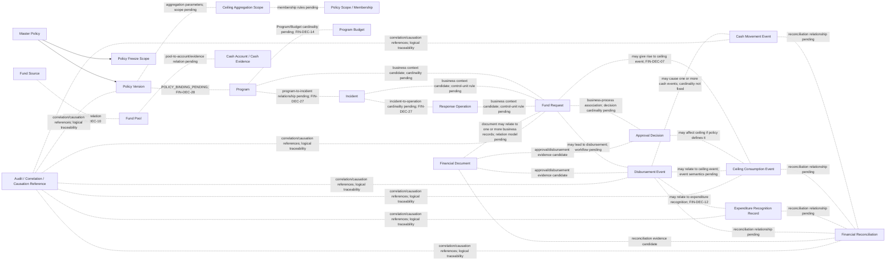
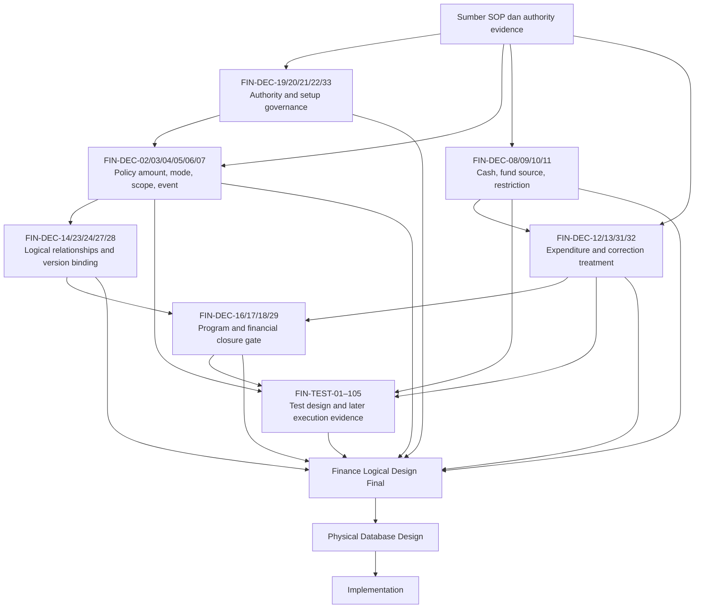

# SIM-TDB — FINANCE DECISION REGISTER
## Final Precision Audit, Decision Register Integrity & Logical Relationship Correction R03

**Document ID:** SIMTDB-REV05112026-00-13-FIN-R03  
**Filename:** `SIMTDB_REV05112026_00_13_FINANCE_DECISION_REGISTER_FINAL_AUDIT_R03.md`  
**Revision:** REV05112026-R03  
**Status:** Working document untuk review pemilik proyek dan organisasi  
**Mode:** Read-only document audit dan harmonization — tanpa implementasi  
**Project:** Sistem Informasi Manajemen Tanggap Darurat Bencana (SIM-TDB)  
**Organization:** Caritas Keuskupan Malang — Tim Solidaritas Kemanusiaan Keuskupan Malang (TSKKM)

---

## 1. Executive Summary

R03 melakukan pemeriksaan ketepatan provenance, decision register, hubungan logical, dan histori test Finance berdasarkan R02 serta materi sebelumnya yang tersedia dalam percakapan.

### Kesimpulan utama

1. **GOV-01 sampai GOV-09 dipertahankan tanpa perubahan substansi atau status.** Semua tetap `PROJECT_OWNER_GOVERNANCE_REQUIREMENT`.
2. **Rp50.000.000 tetap merupakan batas maksimum pengeluaran dana darurat untuk satu kejadian/operasi respons berdasarkan klarifikasi pemilik proyek sebelumnya.** Nilai ini bukan nilai wajib yang harus dihabiskan dan tidak boleh menjadi konstanta permanen di code.
3. **Rp100.000.000 tetap nilai ilustratif**, bukan default, cap, atau approval threshold.
4. Nilai ceiling dan mode agregasinya harus berada pada Master Policy yang terkendali. `PER_INCIDENT` dan `GLOBAL_ALL_INCIDENTS` memiliki makna agregasi berbeda.
5. **Policy freeze scope dan ceiling aggregation scope adalah dua dimensi berbeda.** Freeze mengatur kapan policy setup/amendment boleh dilakukan; aggregation scope mengatur kejadian/transaksi mana yang berbagi ceiling.
6. Gambar SOP halaman 23–24 merupakan evidence parsial. Hubungan klarifikasi pemilik proyek dengan redaksi halaman 23 masih perlu direkonsiliasi tanpa mengubah isi SOP.
7. Kategori penggunaan dana APP Nasional pada halaman 24 ditulis secara netral sebagai **“Kategori penggunaan dana APP Nasional yang dibatasi sebagaimana tercantum dalam SOP.”** Tidak dibuat larangan baru atau enforcement otomatis.
8. FIN-DEC-01 sampai FIN-DEC-33 tetap tersedia; tidak ada Decision ID yang hilang atau duplikat. FIN-DEC-22 dicantumkan **satu kali saja**, pada Prioritas 0.
9. FIN-TEST-01 sampai FIN-TEST-105 dicantumkan per ID. Detail historis diringkas hanya sejauh dapat ditelusuri dari materi terdahulu; keterbatasan yang tersisa dijelaskan dan tidak direka.
10. Semua tes berstatus `TEST_DESIGNED` atau blocked; **tidak ada test yang diklaim telah dijalankan atau lulus**.
11. Finance Decision Register dapat dipakai sebagai working document. Finance Logical Design Final belum dapat disahkan; physical design dan implementation tetap `NO_GO`.

### Validasi konsistensi akhir

- GOV-01–GOV-09: dipertahankan.
- FIN-DEC-01–FIN-DEC-33: lengkap; tidak ada ID duplikat; FIN-DEC-22 hanya sekali.
- FIN-TEST-01–FIN-TEST-105: seluruh ID dicantumkan satu kali.
- Test execution: tidak diklaim.
- Physical schema/database/code: tidak dibuat atau diubah.
- Logical relationships: garis solid hanya untuk konsep yang memiliki dasar cukup; relasi yang cardinality atau semantics-nya pending ditampilkan sebagai kandidat/garis putus-putus.

---

## 2. Document History

| Versi | Dokumen | Perubahan/kontribusi yang relevan bagi R03 |
|---|---|---|
| 00.02 | Financial Amount Clarification | Klarifikasi nilai ilustratif dan fleksibilitas jumlah. |
| 00.07 | Finance Owner Clarification and Correction Prompt | Klarifikasi Rp50m sebagai batas maksimum per kejadian/operasi dan kas tersedia sebagai batas independen. |
| 00.09 R01 | Finance Policy Reconciliation prompt | Opsi konfigurasi `PER_INCIDENT` dan `GLOBAL_ALL_INCIDENTS`. |
| 00.10 | Finance Foundation Re-audit | Finance findings dan test design FIN-TEST-01–46. |
| 00.11 R00 | Finance Logical Integrity prompt | Menambahkan governance, ledger, concurrency, dan test coverage. |
| 00.12 | Audit Prompt 00.11 | Mengoreksi provenance governance R00 berdasarkan evidence yang tersedia pada waktu audit itu. |
| 00.11 R01 | Revised governance prompt | Memuat governance requirements yang kemudian diklarifikasi pemilik proyek. |
| 00.13 awal | Finance Decision Register and Logical Design Plan | Decision register awal FIN-DEC-01–32. |
| 00.13 R01 | Finance Decision Register Correction & Harmonization | Mempertahankan GOV-01–09, menambahkan FIN-DEC-33, membedakan freeze dan ceiling scope, serta mempertahankan FIN-TEST-01–99. |
| **00.13 R02** | **Finance Decision Register Correction & Harmonization R02** | **Memperbaiki wording halaman 24, FIN-DEC-22, relationship map, dan test coverage summary.** |
| **00.13 R03** | **Dokumen ini** | **Menetapkan satu FIN-DEC-22, memisahkan status evidence dan keputusan, memperbaiki diagram relasi, menampilkan test ID per test, dan menyelaraskan readiness serta prioritas.** |

R03 menggunakan kata **dipertahankan**, **diperjelas**, **diharmonisasikan**, dan **dikoreksi** sesuai perubahan yang benar-benar dilakukan. R02 bukan sumber pertama FIN-DEC-33; FIN-DEC-33 telah tercantum dalam rangkaian sebelumnya dan dipertahankan pada R03.

---

## 3. Evidence Availability

| Source ID | Sumber | Status | Batas |
|---|---|---|---|
| SRC-00-02 | `SIMTDB_REV05112026_00_02_FINANCIAL_AMOUNT_CLARIFICATION.md` | Tersedia dalam percakapan; dibaca | Klarifikasi nominal awal, dibaca bersama klarifikasi berikutnya. |
| SRC-00-07 | `SIMTDB_REV05112026_00_07_FINANCE_OWNER_CLARIFICATION_AND_CORRECTION_PROMPT.md` | Tersedia dalam percakapan; dibaca | Klarifikasi pemilik proyek mengenai Rp50m per kejadian/operasi dan cash availability. |
| SRC-00-09 | Finance Policy Reconciliation prompt R01 | Tersedia dalam percakapan; dibaca | Clarification konfigurasi amount dan mode aggregation. |
| SRC-00-10 | `SIMTDB_REV05112026_00_10_FINANCE_FOUNDATION_REAUDIT.md` | Isinya disampaikan dalam percakapan; dibaca | Sumber test design FIN-TEST-01–46; test belum dijalankan. |
| SRC-00-11-R01 | `SIMTDB_REV05112026_00_11_FINANCE_LOGICAL_INTEGRITY_AND_TRANSACTION_CONTROL_PROMPT_R01.md` | Isinya disampaikan dalam percakapan; dibaca | Sumber governance dan test requirements FIN-TEST-47 onward. |
| SRC-00-12 | `SIMTDB_REV05112026_00_12_AUDIT_PROMPT_00_11.md` | Isinya disampaikan dalam percakapan; dibaca | Audit prompt R00; findings diselaraskan dengan owner clarifications setelahnya. |
| SRC-00-13-R02 | `SIMTDB_REV05112026_00_13_FINANCE_DECISION_REGISTER_CORRECTION_HARMONIZATION_R02.md` | Isinya disampaikan dalam percakapan; dibaca | Sumber langsung untuk koreksi R03. |
| SRC-SOP-16-29 | Gambar SOP halaman cetak 16–29 | Tersedia dan telah ditelaah | Halaman 23–24 relevan; sebagian gambar membatasi transkripsi detail. |
| SRC-SOP-40-41 | SOP Finance halaman 40–41 | `EVIDENCE_NOT_AVAILABLE` | Tidak tersedia sebagai gambar dalam konteks audit. |
| SRC-SOP-49 | Template APP-KWI halaman 49 | `EVIDENCE_NOT_AVAILABLE` | Struktur dan field tidak dapat diverifikasi. |
| SRC-SOP-62-69 | SOP Procurement/Finance dan dokumen terkait | `EVIDENCE_NOT_AVAILABLE` | Tidak tersedia untuk pemeriksaan langsung. |
| SRC-AUTH | SK, mandat/delegasi, approval matrix, dan bukti closure | `EVIDENCE_NOT_AVAILABLE` | Tidak tersedia untuk verifikasi formal. |
| SRC-REPO | Repository, branch, commit, code | `EVIDENCE_NOT_AVAILABLE` | Tidak ada repository yang diperiksa. |
| SRC-DB | Database, schema, migration, seed | `EVIDENCE_NOT_AVAILABLE` | Tidak diakses atau diubah. |
| SRC-TEST | Test run, test environment, execution report | `EVIDENCE_NOT_AVAILABLE` | Tidak ada test yang dijalankan dalam audit ini. |

### Batas audit

- Audit SOP terbatas pada gambar halaman cetak 16–29.
- R03 tidak menyatakan seluruh SOP halaman 1–95 sudah diperiksa.
- R03 tidak menyatakan code, database, schema, migration, atau repository telah diaudit.
- Test ID adalah rancangan atau histori; bukan bukti test execution.
- SK dan authority formal tidak dianggap ada tanpa dokumen yang tersedia dan diverifikasi.

---

## 4. Source Authority and Provenance

| Label | Makna |
|---|---|
| `SOP_CONFIRMED` | Didukung oleh bagian SOP yang tersedia dan terbaca langsung. |
| `CLARIFIED_BY_PROJECT_OWNER` | Klarifikasi owner mengenai makna/arah proyek yang dapat ditelusuri. |
| `PROJECT_OWNER_GOVERNANCE_REQUIREMENT` | Governance requirement sistem yang secara eksplisit ditetapkan pemilik proyek. |
| `ORG_DECISION_CONFIRMED` | Keputusan organisasi formal dengan evidence tersedia dan terverifikasi. |
| `SOURCE_CONFLICT` | Terdapat perbedaan antara redaksi sumber atau interpretasi yang belum direkonsiliasi. |
| `EVIDENCE_NOT_AVAILABLE` | Evidence yang dibutuhkan tidak tersedia. |
| `PENDING_ORG_DECISION` | Memerlukan keputusan organisasi, authority, atau Finance policy. |
| `PENDING_DESIGN_DECISION` | Memerlukan keputusan logical/design yang tidak dapat diasumsikan. |
| `TECHNICAL_RECOMMENDATION` | Rekomendasi teknis, bukan ketentuan SOP atau keputusan organisasi. |
| `TEST_DESIGNED` | Test dirancang, belum dijalankan. |
| `TEST_EXECUTED_PASS` | Test dijalankan dan memiliki bukti hasil yang dapat ditinjau. |
| `TEST_EXECUTED_FAIL` | Test dijalankan dan memiliki bukti hasil yang dapat ditinjau. |
| `BLOCKED_BY_MISSING_POLICY` | Expected result atau desain bergantung policy yang belum disahkan. |
| `BLOCKED_BY_MISSING_SOURCE` | Expected result atau desain bergantung sumber yang belum tersedia. |

Status evidence dan status keputusan dicatat pada kolom terpisah. Satu item dapat memiliki evidence status `EVIDENCE_NOT_AVAILABLE` dan decision status `PENDING_ORG_DECISION`; keduanya tidak digabung menjadi satu label yang ambigu.

---

## 5. GOV-01–GOV-09

Seluruh GOV-01 sampai GOV-09 dipertahankan **tanpa perubahan substansi dan status**.

| ID | Governance requirement | Status |
|---|---|---|
| GOV-01 | Master Policy harus ditetapkan sebelum program operasional dimulai. | `PROJECT_OWNER_GOVERNANCE_REQUIREMENT` |
| GOV-02 | Tidak ada program operasional yang boleh aktif tanpa policy yang berlaku. | `PROJECT_OWNER_GOVERNANCE_REQUIREMENT` |
| GOV-03 | Policy setup/amendment terkunci saat ada program yang berjalan atau belum resmi ditutup. | `PROJECT_OWNER_GOVERNANCE_REQUIREMENT` |
| GOV-04 | Policy amendment juga terkunci sampai program dan seluruh keuangan terkait selesai. | `PROJECT_OWNER_GOVERNANCE_REQUIREMENT` |
| GOV-05 | Hanya kapabilitas SuperAdmin yang dapat melakukan setup awal dan amendment yang memenuhi syarat. | `PROJECT_OWNER_GOVERNANCE_REQUIREMENT` |
| GOV-06 | Setiap amendment memerlukan SK Pengaturan terlampir dengan detail yang dapat ditelusuri. | `PROJECT_OWNER_GOVERNANCE_REQUIREMENT` |
| GOV-07 | SK Pengaturan tidak membypass program/financial closure gate. | `PROJECT_OWNER_GOVERNANCE_REQUIREMENT` |
| GOV-08 | Tidak ada SuperAdmin override saat policy terkunci. | `PROJECT_OWNER_GOVERNANCE_REQUIREMENT` |
| GOV-09 | Amendment menghasilkan versi policy baru; histori policy dan transaksi tidak ditimpa diam-diam. | `PROJECT_OWNER_GOVERNANCE_REQUIREMENT` |

GOV-01–GOV-09 tidak menetapkan otomatis status vocabulary, canonical source records, closure certifier, actual SK, signatory, policy mode awal, atau ceiling-consumption event. Hal-hal itu tetap mengikuti decision register.

---

## 6. Finance Policy Amount and Aggregation

### 6.1 Rp50.000.000

Berdasarkan klarifikasi pemilik proyek sebelumnya:

> Rp50.000.000 merupakan batas maksimum pengeluaran dana darurat untuk satu kejadian/operasi respons.

Status: `CLARIFIED_BY_PROJECT_OWNER`.

Ketentuan:

- Bukan jumlah wajib yang harus dihabiskan.
- Bukan cap global semua kejadian TSKKM.
- Nilai referensi tersebut harus direpresentasikan melalui Master Policy dan tidak hardcode permanen.
- Nilai aktif dan effective date tetap memerlukan konfigurasi yang sah.
- Control unit per incident/operation belum ditetapkan.

### 6.2 Rp100.000.000

Rp100.000.000 pada contoh/template adalah nilai ilustratif saja. Bukan fixed amount, mandatory amount, maximum, default, global cap, atau approval threshold.

Status: `CLARIFIED_BY_PROJECT_OWNER`.

### 6.3 Mode

| Mode | Makna | Keputusan yang masih diperlukan |
|---|---|---|
| `PER_INCIDENT` | Ceiling berlaku kumulatif per control unit kejadian/operasi yang ditetapkan policy. Kejadian berbeda dapat memiliki batas tersendiri, dengan syarat kas dan approval memenuhi. | Apakah control unit adalah real-world incident atau formally independent response operation. |
| `GLOBAL_ALL_INCIDENTS` | Satu ceiling dipakai bersama secara kumulatif oleh kejadian yang masuk policy scope. | Batas scope, masa berlaku, membership, dan reset/supersession. |

Jangan menggunakan kedua mode bersamaan atau menganggap ada mode hybrid tanpa requirement baru yang disetujui.

### 6.4 Ceiling dan kas

- Ceiling mengatur batas policy.
- Kas eligible menentukan sumber dana yang benar-benar tersedia.
- Budget, ceiling, cash, commitment, disbursement, expenditure recognition, dan remaining budget adalah konsep berbeda.
- Kas restricted tidak otomatis eligible.
- Tidak ada formula kas atau remaining budget final dalam R03.

### 6.5 Konflik SOP halaman 23

Gambar SOP halaman 23 menampilkan Rp50.000.000 dalam konteks dana awal dan persetujuan Ketua TSKKM. Klarifikasi owner kemudian menetapkan Rp50m sebagai maximum per kejadian/operasi dengan konfigurasi amount/mode.

R03:

- Tidak mengubah SOP.
- Tidak menurunkan klarifikasi owner menjadi nilai contoh.
- Tidak menyebut klarifikasi tersebut sebagai revisi formal SOP.
- Mempertahankan rekonsiliasi sumber sebagai `SOURCE_CONFLICT` sampai tersedia keputusan/interpretasi formal yang sesuai.

---

## 7. Policy Freeze vs Ceiling Scope

| Dimensi | Fungsi | Status |
|---|---|---|
| Policy Freeze Scope | Menentukan kapan policy setup/amendment dilarang berdasarkan program dan financial closure. | Diatur oleh GOV-03/GOV-04; `PROJECT_OWNER_GOVERNANCE_REQUIREMENT` |
| Ceiling Aggregation Scope | Menentukan kejadian/transaksi mana berbagi ceiling menurut mode policy. | Mode tersedia; detail scope/control unit pending |
| Fund Pool Eligibility Scope | Menentukan sumber/pool kas yang dapat dipakai untuk pengeluaran tertentu. | Pending Finance policy |
| Financial Reporting Scope | Menentukan record yang masuk laporan dan basis pengakuan. | Pending Finance/accounting policy |

Freeze scope tidak menentukan apakah ceiling bersifat per kejadian atau global. Ceiling scope tidak membatasi atau mengganti freeze gate.

---

## 8. SOP Funding Evidence

### 8.1 Halaman 23

Pada gambar halaman cetak 23 yang tersedia, bagian pendanaan tampak menyebut:

- Dana siaga dan dana operasional Keuskupan Malang.
- Dana APP Nasional.
- Bantuan umat.
- Persetujuan Ketua TSKKM untuk pengeluaran dana darurat.
- Rp50.000.000 dalam konteks dana awal tanggap darurat.

Status: `SOP_CONFIRMED` secara parsial untuk teks yang terlihat.

Batas:

- Scan lebih jelas tetap diperlukan untuk transkripsi utuh.
- Identitas/mandat Ketua TSKKM dan mapping ke sistem belum tersedia.
- Interpretasi nominal Rp50m tetap harus direkonsiliasi terhadap klarifikasi pemilik proyek.
- R03 tidak mengubah wording SOP.

### 8.2 Halaman 24

Wording netral yang dipakai:

> **Kategori penggunaan dana APP Nasional yang dibatasi sebagaimana tercantum dalam SOP.**

Daftar yang terbaca pada gambar:

- Gaji staf.
- Perawatan gedung.
- Perlengkapan dan alat tulis kantor.
- Perawatan harian kendaraan kantor.
- Komunikasi harian kantor dan staf.
- Alkohol/minuman keras, rokok, dan minuman suplemen.

Status: `SOP_CONFIRMED` secara parsial untuk kategori yang tampak.

Tidak ditambahkan:

- Larangan baru.
- Pengecualian baru.
- Automated hard block.
- Interpretasi biaya yang tidak disebut dalam teks.

Pemetaan kategori dan enforcement harus menunggu sumber lengkap serta keputusan yang relevan.

---

## 9. FIN-DEC-01–FIN-DEC-33

Decision owner yang belum didukung evidence ditulis `OWNER TO BE DESIGNATED`. Setiap baris memisahkan sumber/evidence, evidence status, decision status, dampak, dependency, dan resolusi yang diperlukan.

### Prioritas 0 — Authority dan governing sources

| ID | Decision Question | Source/Evidence | Evidence Status | Decision Owner | Decision Status | Logical Design Impact | Dependency | Required Resolution |
|---|---|---|---|---|---|---|---|---|
| FIN-DEC-01 | Bagaimana redaksi SOP halaman 23 direkonsiliasi dengan klarifikasi owner bahwa Rp50m adalah batas maksimum per kejadian/operasi dan dapat diatur? | Gambar SOP p.23 parsial; owner clarification tersedia | `SOURCE_CONFLICT` | `OWNER TO BE DESIGNATED` | `PENDING_ORG_DECISION` | Menentukan provenance policy dan cara system rule ditautkan ke SOP | Scan p.23 jelas dan authority interpretation | Terbitkan interpretasi/decision tertulis tanpa mengubah SOP secara sepihak |
| FIN-DEC-19 | Siapa memverifikasi isi, relevansi, dan authority SK Pengaturan; bukti verifikasi apa yang disimpan? | GOV-06 mensyaratkan SK; actual SK/procedure tidak tersedia | `EVIDENCE_NOT_AVAILABLE` | `OWNER TO BE DESIGNATED` | `PENDING_ORG_DECISION` | Menentukan verification evidence untuk amendment | Prosedur dan authority verification | Tetapkan verifier/authority dan evidence record |
| FIN-DEC-20 | Bagaimana SuperAdmin diprovision, dipulihkan, dan dicabut aksesnya? | GOV-05 menetapkan capability; account-governance evidence belum tersedia | `EVIDENCE_NOT_AVAILABLE` | `OWNER TO BE DESIGNATED` | `PENDING_ORG_DECISION` | Menentukan IAM lifecycle bagi policy setup | Prosedur account management | Tetapkan provisioning, recovery, dan revocation process |
| FIN-DEC-21 | Apa governing source untuk initial Master Policy setup sebelum program pertama? | GOV-01; policy source awal belum dilampirkan | `EVIDENCE_NOT_AVAILABLE` | `OWNER TO BE DESIGNATED` | `PENDING_ORG_DECISION` | Menentukan initial activation evidence | SOP/policy/decision basis yang diadopsi | Identifikasi source, version, scope, effective date |
| FIN-DEC-22 | Apakah verifikasi amendment/SK memerlukan checker atau approver terpisah dari SuperAdmin, atau SuperAdmin menjalankan fungsi administratif saja? | GOV-05/GOV-06; authority matrix tidak tersedia | `EVIDENCE_NOT_AVAILABLE` | `OWNER TO BE DESIGNATED` | `PENDING_ORG_DECISION` | Menentukan separation-of-duties dan activation workflow; tidak menentukan substansi/authority verifier (FIN-DEC-19) | Authority matrix dan prosedur SK verification | Putuskan apakah actor terpisah diperlukan dan ruang lingkupnya |

**FIN-DEC-19 dan FIN-DEC-22 berbeda:**

- FIN-DEC-19 menentukan **siapa/bukti apa yang memverifikasi substansi dan authority SK**.
- FIN-DEC-22 menentukan **apakah verifier/checker harus berbeda dari SuperAdmin dan bagaimana pemisahan tugas diterapkan**.

FIN-DEC-22 hanya dicantumkan di sini; tidak ada duplikasi di prioritas lain.

### Prioritas 1 — Policy ceiling semantics

| ID | Decision Question | Source/Evidence | Evidence Status | Decision Owner | Decision Status | Logical Design Impact | Dependency | Required Resolution |
|---|---|---|---|---|---|---|---|---|
| FIN-DEC-02 | Berapa nilai dan effective date policy awal? | Owner menetapkan Rp50m sebagai reference maximum; active policy belum disetujui | Owner clarification tersedia; approval source tidak tersedia | `OWNER TO BE DESIGNATED` | `PENDING_ORG_DECISION` | Menentukan Policy Version pertama | Decision authority dan governing source | Catat amount, currency, scope, dan effective date yang disahkan |
| FIN-DEC-03 | Mode awal apa yang dipilih: `PER_INCIDENT` atau `GLOBAL_ALL_INCIDENTS`? | Owner menyetujui mode sebagai pilihan; initial selection belum ada | `CLARIFIED_BY_PROJECT_OWNER` untuk opsi; selection evidence tidak tersedia | `OWNER TO BE DESIGNATED` | `PENDING_ORG_DECISION` | Menentukan cara aggregation ceiling | Policy approval sebelum program aktif | Pilih satu mode dan dokumentasikan decision basis |
| FIN-DEC-04 | Apa control unit `PER_INCIDENT`: real-world incident atau formally independent response operation? | Klarifikasi owner menggunakan incident/operation; exact unit belum didefinisikan | `EVIDENCE_NOT_AVAILABLE` untuk definisi formal | `OWNER TO BE DESIGNATED` | `PENDING_ORG_DECISION` | Menentukan aggregate key dan anti-splitting | Incident/operation definitions | Tetapkan control unit dan relasi parent/child |
| FIN-DEC-05 | Apa boundary `GLOBAL_ALL_INCIDENTS` policy scope? | Owner menyetujui opsi global; boundary belum ditentukan | `EVIDENCE_NOT_AVAILABLE` | `OWNER TO BE DESIGNATED` | `PENDING_ORG_DECISION` | Menentukan incident membership dalam shared ceiling | Scope/effective period decision | Tetapkan scope identifier, inclusion criteria, periode |
| FIN-DEC-06 | Bagaimana global scope diakhiri, disupersede, atau dimulai ulang? | Tidak ada reset rule terverifikasi | `EVIDENCE_NOT_AVAILABLE` | `OWNER TO BE DESIGNATED` | `PENDING_ORG_DECISION` | Menentukan lifetime dan cumulative history | FIN-DEC-05 | Tetapkan reset/supersession rule; tanpa keputusan tidak ada implicit reset |
| FIN-DEC-07 | Event apa yang mengonsumsi ceiling: request, approval, reservation, payment instruction, cash release, atau event lain? | Event semantics belum diputuskan | `EVIDENCE_NOT_AVAILABLE` | `OWNER TO BE DESIGNATED` | `PENDING_ORG_DECISION` | Menentukan Ceiling Consumption Ledger semantics | Finance workflow/policy | Tentukan event dan reversal/cancellation handling |

### Prioritas 2 — Funding, cash, expenditure

| ID | Decision Question | Source/Evidence | Evidence Status | Decision Owner | Decision Status | Logical Design Impact | Dependency | Required Resolution |
|---|---|---|---|---|---|---|---|---|
| FIN-DEC-08 | Apa definisi eligible available cash dan canonical source-nya? | Owner mensyaratkan cash availability; sumber cash model tidak tersedia | Owner requirement tersedia; canonical-source evidence tidak ada | `OWNER TO BE DESIGNATED` | `PENDING_ORG_DECISION` | Menentukan global cash control | Finance cash policy dan source records | Tetapkan formula/basis, source, timestamp, eligible scope |
| FIN-DEC-09 | Bagaimana reservation, outstanding payment instruction, dan approved unpaid amounts mempengaruhi cash available? | Tidak ada treatment yang disahkan | `EVIDENCE_NOT_AVAILABLE` | `OWNER TO BE DESIGNATED` | `PENDING_ORG_DECISION` | Mencegah overcommit dan double allocation | FIN-DEC-08 | Tetapkan reservation/encumbrance treatment |
| FIN-DEC-10 | Satu policy boleh menggunakan satu atau beberapa funding source/fund pool? | SOP menyebut beberapa sumber; allocation cardinality belum ditetapkan | SOP evidence parsial; cardinality tidak tersedia | `OWNER TO BE DESIGNATED` | `PENDING_DESIGN_DECISION` | Menentukan fund/source relationship | Source restrictions dan reporting needs | Pilih model single/multi-source atau allocation-level |
| FIN-DEC-11 | Bagaimana restricted cash dan kategori usage restrictions dipetakan terhadap eligible expenditure? | SOP halaman 24 parsial | `SOP_CONFIRMED` parsial; enforcement evidence tidak tersedia | `OWNER TO BE DESIGNATED` | `PENDING_ORG_DECISION` | Menentukan eligibility control | Full SOP context dan enforcement decision | Verifikasi kategori dan putuskan warning/block/review |
| FIN-DEC-12 | Apa canonical source dan pengakuan actual expenditure? | Finance model/accounting guidance tidak tersedia | `EVIDENCE_NOT_AVAILABLE` | `OWNER TO BE DESIGNATED` | `PENDING_ORG_DECISION` | Menentukan Expenditure Ledger/report lineage | Finance accounting policy | Tetapkan source dan recognition criteria |
| FIN-DEC-13 | Bagaimana remaining budget dihitung; apakah commitment, PO, invoice, advances, reversal, dan cut-off termasuk? | Formula tidak ditetapkan | `EVIDENCE_NOT_AVAILABLE` | `OWNER TO BE DESIGNATED` | `PENDING_ORG_DECISION` | Menentukan definitive budget reporting | FIN-DEC-12 dan Finance policy | Sahkan formula, components, period, corrections |
| FIN-DEC-31 | Bagaimana refund, reversal, correction, advance, dan disputed transactions mempengaruhi cash, ceiling, expenditure, dan closure? | Treatment tidak tersedia lengkap | `EVIDENCE_NOT_AVAILABLE` | `OWNER TO BE DESIGNATED` | `PENDING_ORG_DECISION` | Mempengaruhi ledgers dan lock gate | Finance policy/transaction rules | Tetapkan link ke original event dan treatment per ledger |
| FIN-DEC-32 | Bagaimana reservation yang dibatalkan/kedaluwarsa melepaskan ceiling/cash capacity? | Reservation semantics belum disahkan | `EVIDENCE_NOT_AVAILABLE` | `OWNER TO BE DESIGNATED` | `PENDING_ORG_DECISION` | Menentukan released capacity | FIN-DEC-07, FIN-DEC-09 | Tetapkan cancellation/expiry event dan audit |

### Prioritas 3 — Closure gates dan cross-module relationships

| ID | Decision Question | Source/Evidence | Evidence Status | Decision Owner | Decision Status | Logical Design Impact | Dependency | Required Resolution |
|---|---|---|---|---|---|---|---|---|
| FIN-DEC-16 | Kewajiban finansial apa yang memblokir amendment dan canonical record apa yang membuktikannya? | GOV-04 mewajibkan financial completion; detail blockers belum dipetakan | Owner governance requirement tersedia; source mapping tidak tersedia | `OWNER TO BE DESIGNATED` | `PENDING_ORG_DECISION` | Menentukan financial lock blockers | Finance closure process/source owners | Daftar kewajiban, owner module, source, clearing event |
| FIN-DEC-17 | Status program apa yang menandakan running, paused, closing, dan formally closed? | GOV-03 mengatur running/not closed; status vocabulary tidak tersedia | `EVIDENCE_NOT_AVAILABLE` | `OWNER TO BE DESIGNATED` | `PENDING_DESIGN_DECISION` | Menentukan program freeze gate | Program workflow/state register | Map actual status ke gate; paused/closing bukan closed |
| FIN-DEC-18 | Siapa mengesahkan program dan financial closure dan evidence apa yang dipakai? | GOV-04 mensyaratkan dua closure gate; certifier belum diketahui | `EVIDENCE_NOT_AVAILABLE` | `OWNER TO BE DESIGNATED` | `PENDING_ORG_DECISION` | Menentukan unlock gate evidence | Mandate/delegation dan closure procedure | Tetapkan authority dan closure proof |
| FIN-DEC-23 | Policy version mana berlaku pada program/incident/request aktif saat amendment eligible? | GOV-09 menjaga histori; transition rule belum diputuskan | `EVIDENCE_NOT_AVAILABLE` | `OWNER TO BE DESIGNATED` | `PENDING_ORG_DECISION` | Policy binding/effective version | Policy transition rule | Tetapkan existing-scope version retention/adoption |
| FIN-DEC-24 | Apa yang terjadi pada amendment future-dated jika program dimulai sebelum effective date? | Effective-date interaction belum ditentukan | `EVIDENCE_NOT_AVAILABLE` | `OWNER TO BE DESIGNATED` | `PENDING_DESIGN_DECISION` | Mencegah activation tanpa policy yang tepat | FIN-DEC-23 dan program activation rule | Tetapkan hold/old-version/new-version behavior |
| FIN-DEC-27 | Bagaimana cardinality Program–Incident–Response Operation? | Baseline memisahkan entitas; cardinality tidak tersedia | `EVIDENCE_NOT_AVAILABLE` | `OWNER TO BE DESIGNATED` | `PENDING_DESIGN_DECISION` | Menentukan policy binding/request context | Model Program/Incident/Operation | Sahkan relationship alternatives |
| FIN-DEC-28 | Dapatkah satu policy scope mencakup beberapa program? | Belum ada decision evidence | `EVIDENCE_NOT_AVAILABLE` | `OWNER TO BE DESIGNATED` | `PENDING_DESIGN_DECISION` | Menentukan aggregation membership, bukan freeze scope | FIN-DEC-05 dan Program model | Tetapkan scope membership |
| FIN-DEC-29 | Bagaimana lock gate bertindak bila source module unavailable atau datanya stale? | Data freshness/failure policy tidak tersedia | `EVIDENCE_NOT_AVAILABLE` | `OWNER TO BE DESIGNATED` | `PENDING_DESIGN_DECISION` | Menentukan safe gate evaluation | Cross-module contracts | Tetapkan freshness dan blocked/unresolved behavior |
| FIN-DEC-30 | Siapa dapat melihat Policy Lock Eligibility Report dan blocker details? | Access matrix tidak tersedia | `EVIDENCE_NOT_AVAILABLE` | `OWNER TO BE DESIGNATED` | `PENDING_ORG_DECISION` | Menentukan security dan data minimization | Data classification/permission matrix | Tetapkan scope, access, redaction |

### Prioritas 4 — Budget model, offline, representation

| ID | Decision Question | Source/Evidence | Evidence Status | Decision Owner | Decision Status | Logical Design Impact | Dependency | Required Resolution |
|---|---|---|---|---|---|---|---|---|
| FIN-DEC-14 | Bagaimana Budget berelasi dengan Program, Activity, dan Budget Line? | Phase 0.1C/0.1D membutuhkan rekonsiliasi logical | Spesifikasi parsial tersedia; model terpadu tidak ada | `OWNER TO BE DESIGNATED` | `PENDING_DESIGN_DECISION` | FK/cardinality, roll-up, revision | Program/Activity model | Pilih logical relationship yang valid |
| FIN-DEC-15 | Apa lifecycle budget revision dan kapan revisi menjadi effective? | Workflow Finance lengkap tidak tersedia | `EVIDENCE_NOT_AVAILABLE` | `OWNER TO BE DESIGNATED` | `PENDING_ORG_DECISION` | Revision/history workflow | Finance policy/workflow | Tetapkan status dan effectivity |
| FIN-DEC-25 | Apa yang diizinkan secara offline untuk request, approval, dan disbursement? | Offline operating policy tidak tersedia | `EVIDENCE_NOT_AVAILABLE` | `OWNER TO BE DESIGNATED` | `PENDING_ORG_DECISION` | Offline authorization/synchronization | Offline policy | Tetapkan allowed actions dan authority |
| FIN-DEC-26 | Apa currency, precision, rounding, exchange rate, dan accounting cut-off? | Finance guidance dan DBMS decision tidak tersedia | `EVIDENCE_NOT_AVAILABLE` | `OWNER TO BE DESIGNATED` | `PENDING_ORG_DECISION` | Amount integrity/reporting | Finance policy dan platform decision | Tetapkan finance rules sebelum physical design |

### Decision ID integrity

- FIN-DEC-01 sampai FIN-DEC-33 tercantum masing-masing satu kali.
- FIN-DEC-22 hanya ada pada Prioritas 0.
- FIN-DEC-19 tetap khusus verifikasi substantif SK.
- FIN-DEC-22 tetap khusus pemisahan pelaksana/checker.
- FIN-DEC-33 dipertahankan dari decision register sebelumnya; R02/R03 tidak mengklaim menambahkannya pertama kali.

---

## 10. Logical Relationship Map

### 10.1 Konsep yang dibedakan

| Konsep | Fungsi | Tidak disamakan dengan |
|---|---|---|
| Master Policy | Menetapkan aturan policy termasuk ceiling/mode/scope | Budget, cash, atau transaction |
| Policy Version | Menyimpan versi aturan dan effective reference | Program budget atau event ledger |
| Policy Freeze Scope | Menentukan kapan amendment terkunci | Ceiling aggregation scope |
| Program Budget | Anggaran program/activity | Emergency ceiling, cash, actual expenditure |
| Fund Source | Identitas sumber dan restrictions | Fund Pool atau Cash Account |
| Fund Pool | Kelompok kas yang dapat dikontrol menurut rule | Seluruh dana organisasi |
| Cash Ledger | Record cash movement/position | Ceiling Consumption Ledger |
| Ceiling Consumption Ledger | Record event yang mempengaruhi ceiling menurut policy semantics | Cash movement atau expenditure |
| Expenditure Ledger/Record | Record expense yang diakui untuk reporting | Cash release otomatis |
| Disbursement Event | Record pelepasan/pembayaran dana | Approved budget atau expenditure recognition |
| Financial Reconciliation | Mencocokkan record, dokumen, cash, dan expenditure | Overwrite source records |

### 10.2 Logical diagram — kandidat, bukan physical schema

### 10.3 Diagram rules

- Solid lines only show high-level conceptual ownership/containment that is supported at this level.
- Dotted lines explicitly mark candidate or pending relationships.
- `POLICY_BINDING_PENDING` is used between Policy Version and Program while FIN-DEC-28 remains unresolved.
- Program and Program Budget are not shown as a finalized one-to-one or one-to-many relationship while FIN-DEC-14 is pending.
- Fund Request and Approval Decision show process association, not a finalized cardinality.
- Financial Document may relate to multiple records; no 1:1 document-to-transaction constraint is implied.
- Disbursement may relate to cash movement, ceiling consumption, expenditure recognition, and reconciliation through separate links; no 1:1 relationship is implied.
- Correlation ID, causation reference, and source transaction identity are logical traceability concepts, not final technical implementation choices.

---

## 11. Financial Ledger Separation

### 11.1 Cash Movement

Record of cash/bank movement according to the future approved canonical Finance source.

Open items: balance source, eligible cash basis, restriction, reservation, outstanding payment, and reconciliation method.

### 11.2 Ceiling Reservation/Consumption

Record of events that change or reserve usage against the Master Policy ceiling.

Open item: event that consumes the ceiling—request, approval, reservation, payment instruction, cash release, or another approved event—remains FIN-DEC-07.

### 11.3 Expenditure Recognition

Record of expenditure recognized for reporting under the approved Finance/accounting policy.

It is not assumed to be identical to:

- Cash movement.
- Payment instruction.
- Disbursement.
- Invoice.
- Purchase order.
- Goods receipt.

Canonical source and recognition criteria remain FIN-DEC-12.

### 11.4 Financial Reconciliation

Reconciliation compares source records, documents, cash movement, ceiling events, expenditure recognition, and obligations. It must surface discrepancy without silently overwriting source data.

### 11.5 Event mapping — no forced cardinality

| Business event | Cash Movement | Ceiling Consumption | Expenditure Recognition | Financial Reconciliation |
|---|---|---|---|---|
| Fund request | No cash effect assumed | Depends on FIN-DEC-07 | No expense assumed | May be referenced in later reconciliation |
| Approval | No cash movement assumed | Only if policy says approval consumes ceiling | No expense assumed | Evidence may be reconciled |
| Reservation | Cash impact depends on FIN-DEC-09 | May reserve ceiling if event selected | No expenditure recognition assumed | May be reconciled as an obligation |
| Payment instruction | Cash movement not assumed until evidence | Ceiling treatment pending | Expense recognition pending | May be linked to outcome evidence |
| Disbursement/cash release | May result in one or more cash records | May affect ceiling according to event semantics | Does not automatically prove recognized expenditure | May be included in reconciliation |
| Expense recognition | Not necessarily a cash event | Not necessarily a ceiling event | Records expenditure under Finance policy | Reconciles to underlying records |
| Refund/reversal/correction | May create cash movement | Ceiling treatment pending | Expenditure treatment pending | Must link to original and correction records |
| Reconciliation | Reads source records | Reads ceiling events | Reads recognized expenditure | Records match/discrepancy outcome; does not replace sources |

This table describes possible logical effects, not mandatory 1:1 links.

---

## 12. FIN-TEST-01–FIN-TEST-105

### 12.1 Status convention

- **Actual Result:** `Not Executed` untuk seluruh test dalam R03.
- **Status:** `TEST_DESIGNED` kecuali dependency policy/source menyebabkan `BLOCKED_BY_MISSING_POLICY` atau `BLOCKED_BY_MISSING_SOURCE`.
- Tidak ada `TEST_EXECUTED_PASS` atau `TEST_EXECUTED_FAIL`.
- Test summaries di bawah menjaga ID dan intent dari materi yang tersedia; detail historis yang tidak tersedia tidak direkonstruksi dengan asumsi.

### 12.2 FIN-TEST-01–FIN-TEST-23

| ID | Objective / scenario | Expected result | Actual result | Evidence/dependency | Status |
|---|---|---|---|---|---|
| FIN-TEST-01 | General program/activity proposal Rp25m | Tidak menerapkan emergency ceiling secara otomatis; validasi lain harus bersumber policy yang sah | Not Executed | Finance model and approved validation | `TEST_DESIGNED` |
| FIN-TEST-02 | General program/activity proposal Rp75m | Tidak ditolak hanya karena melebihi reference Rp50m | Not Executed | Budget type and policy classification | `TEST_DESIGNED` |
| FIN-TEST-03 | General program/activity proposal Rp250m | Tidak terkena emergency rule bila bukan expense dalam cakupan policy | Not Executed | Classification rules | `TEST_DESIGNED` |
| FIN-TEST-04 | Proposed budget berbeda dari approved budget | Nilai proposal dan approved value terpisah dan approval dapat ditelusuri | Not Executed | Authority/model belum final | `TEST_DESIGNED` |
| FIN-TEST-05 | Revision belum disetujui | Approved baseline tidak berubah | Not Executed | Revision workflow | `TEST_DESIGNED` |
| FIN-TEST-06 | Revision lengkap | Menyimpan before/after, reason, actor, time, approval reference sesuai requirement | Not Executed | Revision lifecycle pending | `TEST_DESIGNED` |
| FIN-TEST-07 | Satu versus banyak funding source | Tidak memaksakan cardinality berdasarkan asumsi | Not Executed | FIN-DEC-10 | `BLOCKED_BY_MISSING_POLICY` |
| FIN-TEST-08 | Restriction funding source yang didukung SOP | Tidak menambah restriction; enforcement mengikuti keputusan | Not Executed | SOP context/enforcement pending | `BLOCKED_BY_MISSING_POLICY` |
| FIN-TEST-09 | Report actual dari Finance source | Angka berasal dari canonical source yang diakui untuk reporting | Not Executed | FIN-DEC-12 | `BLOCKED_BY_MISSING_SOURCE` |
| FIN-TEST-10 | Report/reference berbeda dari transaction source | Selisih terdeteksi; tidak overwrite atau disembunyikan | Not Executed | Canonical transaction model | `TEST_DESIGNED` |
| FIN-TEST-11 | Remaining budget dengan PO/invoice/commitment | Tidak dinyatakan definitif tanpa basis yang disahkan | Not Executed | FIN-DEC-13 | `BLOCKED_BY_MISSING_POLICY` |
| FIN-TEST-12 | Edit permission tanpa approval authority | Approval ditolak | Not Executed | FIN-DEC-33 | `TEST_DESIGNED` |
| FIN-TEST-13 | Retry dengan idempotency key sama | Tidak membuat transaksi/revision/disbursement ganda | Not Executed | Technical design | `TEST_DESIGNED` |
| FIN-TEST-14 | Dua revision bersamaan | Conflict terdeteksi; tidak silent overwrite | Not Executed | Concurrency design | `TEST_DESIGNED` |
| FIN-TEST-15 | Refund/reversal | Original tetap ada; reversal link dan Finance treatment mengikuti policy | Not Executed | FIN-DEC-31 | `BLOCKED_BY_MISSING_POLICY` |
| FIN-TEST-16 | Cari hardcoded nominal pada repository | Tidak ada Rp50m/Rp100m sebagai cap/default/threshold logic | Not Executed | Repository unavailable | `BLOCKED_BY_MISSING_SOURCE` |
| FIN-TEST-17 | Threshold tanpa authority source | Tidak diaktifkan sebagai policy | Not Executed | Authority policy | `BLOCKED_BY_MISSING_POLICY` |
| FIN-TEST-18 | Threshold dengan formal authority | Dipertimbangkan hanya setelah authority, scope, version, dates, and approval valid | Not Executed | Formal source unavailable | `BLOCKED_BY_MISSING_SOURCE` |
| FIN-TEST-19 | Multi-source allocation sebelum cardinality decision | Tidak dianggap valid/invalid berdasarkan asumsi | Not Executed | FIN-DEC-10 | `BLOCKED_BY_MISSING_POLICY` |
| FIN-TEST-20 | Restriction belum terverifikasi | Tidak menjadi automatic block rule; uncertainty terlihat | Not Executed | Source/enforcement pending | `BLOCKED_BY_MISSING_SOURCE` |
| FIN-TEST-21 | PO terbuka dan invoice belum dibayar | Remaining budget tidak definitif tanpa commitment policy | Not Executed | FIN-DEC-13 | `BLOCKED_BY_MISSING_POLICY` |
| FIN-TEST-22 | Program/Activity/Budget relationship | Tidak ada orphan/ambiguous relationship setelah model disetujui | Not Executed | FIN-DEC-14 | `BLOCKED_BY_MISSING_SOURCE` |
| FIN-TEST-23 | Report per funding source | Dapat direkonsiliasi ke allocation/transaction tanpa double count jika model disetujui | Not Executed | FIN-DEC-10/12 | `BLOCKED_BY_MISSING_POLICY` |

### 12.3 FIN-TEST-24–FIN-TEST-46

| ID | Objective / scenario | Expected result | Actual result | Evidence/dependency | Status |
|---|---|---|---|---|---|
| FIN-TEST-24 | Satu incident meminta Rp75m dengan eligible cash Rp100m, policy Rp50m per control unit | Pengeluaran dana darurat tidak melebihi ceiling; workflow penolakan/revisi mengikuti policy | Not Executed | Mode/control unit/event pending | `TEST_DESIGNED` |
| FIN-TEST-25 | Empat incident berbeda: Rp50m, Rp35m, Rp45m, Rp20m; cash Rp200m, mode per incident | Setiap unit dalam batas; total dapat melebihi Rp50m jika cash/approval sesuai | Not Executed | FIN-DEC-04/08 | `TEST_DESIGNED` |
| FIN-TEST-26 | Satu incident meminta Rp50m; eligible cash Rp30m | Disbursement tidak melebihi eligible cash; partial/revision workflow tidak diasumsikan | Not Executed | FIN-DEC-08/09 | `TEST_DESIGNED` |
| FIN-TEST-27 | Beberapa voucher satu incident total Rp55m | Agregat terdeteksi; voucher tidak mereset ceiling | Not Executed | FIN-DEC-04/07 | `TEST_DESIGNED` |
| FIN-TEST-28 | Beberapa sector/activity satu incident total Rp55m | Agregat pada control unit; child record tidak mereset cap | Not Executed | FIN-DEC-04/07 | `TEST_DESIGNED` |
| FIN-TEST-29 | Dua incident masing-masing Rp50m; cash Rp80m | Per-unit ceiling dapat terpenuhi, tetapi total cash tidak melebihi eligible cash | Not Executed | FIN-DEC-08/09 | `TEST_DESIGNED` |
| FIN-TEST-30 | Satu real-world event memiliki dua Incident ID | Duplicate candidate ditandai untuk review; tidak auto-merge | Not Executed | Incident duplicate process | `TEST_DESIGNED` |
| FIN-TEST-31 | Request berbeda bersamaan dari cash pool sama | Atomic control mencegah cash allocation ganda | Not Executed | Cash/transaction design | `TEST_DESIGNED` |
| FIN-TEST-32 | Disbursement retry setelah timeout | Tidak ada duplicate disbursement atau ceiling/cash consumption | Not Executed | Idempotency design | `TEST_DESIGNED` |
| FIN-TEST-33 | Incident sudah Rp20m lalu meminta Rp35m tambahan | Cumulative Rp55m terdeteksi; tidak melewati configured limit | Not Executed | FIN-DEC-04/07 | `TEST_DESIGNED` |
| FIN-TEST-34 | Non-emergency program budget Rp75m/Rp250m | Emergency ceiling tidak diterapkan hanya karena nilainya melebihi Rp50m | Not Executed | Classification rule | `TEST_DESIGNED` |
| FIN-TEST-35 | Rp100m muncul dalam contoh/template | Tidak menjadi cap, default, atau approval threshold | Not Executed | Owner clarification | `TEST_DESIGNED` |
| FIN-TEST-36 | Policy Rp50m, `PER_INCIDENT`, dua incident meminta Rp40m masing-masing; cash cukup | Setiap incident dapat lolos per-unit ceiling; aggregate boleh lebih dari Rp50m | Not Executed | FIN-DEC-04/08 | `TEST_DESIGNED` |
| FIN-TEST-37 | Policy Rp50m, `GLOBAL_ALL_INCIDENTS`; A Rp30m dan B Rp25m dalam scope sama | Shared total Rp55m melebihi ceiling; excess tidak diotorisasi | Not Executed | FIN-DEC-05/07 | `TEST_DESIGNED` |
| FIN-TEST-38 | Policy Rp50m diganti Rp75m dengan future effective date | Versi baru dibuat; lama tetap immutable; transition mengikuti policy | Not Executed | FIN-DEC-23/24 | `TEST_DESIGNED` |
| FIN-TEST-39 | Mode berubah `PER_INCIDENT` ke `GLOBAL_ALL_INCIDENTS` | Tidak ada reinterpretasi diam-diam pada incident/request aktif | Not Executed | Transition rule | `BLOCKED_BY_MISSING_POLICY` |
| FIN-TEST-40 | Non-authorized user mengubah policy amount/scope/mode | Perubahan ditolak dan dicatat; Finance edit tidak cukup | Not Executed | Policy permission model | `TEST_DESIGNED` |
| FIN-TEST-41 | Invalid amount/currency/date range/overlap policy scope | Policy invalid/ambiguous tidak aktif; validasi detail mengikuti aturan sah | Not Executed | Configuration validation decision | `TEST_DESIGNED` |
| FIN-TEST-42 | Global scope satu response activation; activation lain dimulai | Aggregate hanya pada scope yang disetujui; tidak ada reset implisit | Not Executed | FIN-DEC-05/06 | `TEST_DESIGNED` |
| FIN-TEST-43 | Policy amount/mode/scope/dates direvisi | Old/new values, actor, reason, approval, effective date diaudit | Not Executed | GOV-06/GOV-09 | `TEST_DESIGNED` |
| FIN-TEST-44 | Dua request global bersamaan menggunakan ceiling/cash sama | Shared ceiling dan cash tidak dikonsumsi dua kali | Not Executed | FIN-DEC-07/08 | `TEST_DESIGNED` |
| FIN-TEST-45 | Policy configured Rp100m; eligible cash Rp30m; ada restricted fund lain | Maximum release dibatasi eligible cash; restricted funds tidak otomatis ditambahkan | Not Executed | FIN-DEC-08/11 | `TEST_DESIGNED` |
| FIN-TEST-46 | Repository search untuk hardcoded Rp50m/Rp100m | Rule mengambil policy aktif; contoh dokumentasi tidak dianggap logic | Not Executed | Repository unavailable | `BLOCKED_BY_MISSING_SOURCE` |

### 12.4 FIN-TEST-47–FIN-TEST-80

| ID | Objective / scenario | Expected result | Actual result | Evidence/dependency | Status |
|---|---|---|---|---|---|
| FIN-TEST-47 | SuperAdmin mengubah policy saat program aktif | Ditolak; tidak ada override | Not Executed | GOV-03/GOV-08; program state mapping | `TEST_DESIGNED` |
| FIN-TEST-48 | Policy change saat program paused/suspended/on hold | Ditolak karena belum formally closed | Not Executed | Program status mapping | `TEST_DESIGNED` |
| FIN-TEST-49 | Program complete tetapi finance obligation terbuka | Ditolak karena financial gate belum clear | Not Executed | FIN-DEC-16/18 | `TEST_DESIGNED` |
| FIN-TEST-50 | Policy amendment tanpa SK number | Ditolak | Not Executed | GOV-06 | `TEST_DESIGNED` |
| FIN-TEST-51 | SK number ada tetapi date/issuer/subject/attachment tidak lengkap | Tidak dapat aktivasi | Not Executed | SK field/verification rules | `TEST_DESIGNED` |
| FIN-TEST-52 | SK terlampir tetapi verification pending/rejected | Amendment tidak aktif | Not Executed | FIN-DEC-19/22 | `TEST_DESIGNED` |
| FIN-TEST-53 | Non-SuperAdmin memanggil amendment action secara langsung | Ditolak backend dan dicatat | Not Executed | GOV-05 | `TEST_DESIGNED` |
| FIN-TEST-54 | SuperAdmin memakai hidden/alternate route saat lock aktif | Ditolak backend | Not Executed | GOV-03/GOV-08 | `TEST_DESIGNED` |
| FIN-TEST-55 | Semua gate clear dan amendment valid | Versi baru dibuat; versi lama immutable | Not Executed | GOV-09; SK evidence | `TEST_DESIGNED` |
| FIN-TEST-56 | Amendment lengkap dengan before/after dan SK reference | Audit evidence lengkap | Not Executed | GOV-06 | `TEST_DESIGNED` |
| FIN-TEST-57 | Edit/delete historical policy version | Ditolak; history retained | Not Executed | GOV-09 | `TEST_DESIGNED` |
| FIN-TEST-58 | Policy amendment bersamaan dengan program activation | Satu hasil konsisten; tidak ada mixed state | Not Executed | Concurrency design | `TEST_DESIGNED` |
| FIN-TEST-59 | Program activation tanpa active valid policy | Activation diblokir | Not Executed | GOV-01/GOV-02 | `TEST_DESIGNED` |
| FIN-TEST-60 | Policy lock eligibility report dibuat | Blockers/source references derived dan traceable | Not Executed | Source module contracts/access | `TEST_DESIGNED` |
| FIN-TEST-61 | Global policy scope mencakup beberapa incident | Hanya incident yang included dalam scope mengonsumsi ceiling | Not Executed | FIN-DEC-05 | `TEST_DESIGNED` |
| FIN-TEST-62 | Global scope boundary berubah | Perubahan hanya melalui versi baru; tidak ada silent reset | Not Executed | FIN-DEC-06 | `TEST_DESIGNED` |
| FIN-TEST-63 | Per-incident unit berisi banyak voucher/sector/activity | Tidak ada artificial reset | Not Executed | FIN-DEC-04 | `TEST_DESIGNED` |
| FIN-TEST-64 | Source event retry dengan idempotency identity sama | Hasil awal direferensikan; tidak ada duplicate ledger effect | Not Executed | Idempotency design | `TEST_DESIGNED` |
| FIN-TEST-65 | Disbursement retry setelah timeout | Tidak ada duplicate cash release/ceiling consumption | Not Executed | Idempotency and outcome lookup | `TEST_DESIGNED` |
| FIN-TEST-66 | Reservation dikonversi ke disbursement | Tidak double count; conversion mengikuti event semantics | Not Executed | FIN-DEC-07/09 | `TEST_DESIGNED` |
| FIN-TEST-67 | Reservation dibatalkan sebelum disbursement | Release treatment mengikuti policy; history dipertahankan | Not Executed | FIN-DEC-32 | `TEST_DESIGNED` |
| FIN-TEST-68 | Partial disbursement terhadap request lebih besar | Hanya nilai yang sesuai event rule mempengaruhi tiap ledger | Not Executed | FIN-DEC-07/08/12 | `TEST_DESIGNED` |
| FIN-TEST-69 | Refund/reversal dicatat | Compensating event tertaut; source event tidak dihapus | Not Executed | FIN-DEC-31 | `TEST_DESIGNED` |
| FIN-TEST-70 | Dua request bersamaan memakai global ceiling sama | Atomic control mencegah over-consumption | Not Executed | FIN-DEC-05/07 | `TEST_DESIGNED` |
| FIN-TEST-71 | Dua request bersamaan memakai per-incident ceiling sama | Atomic control mencegah over-consumption | Not Executed | FIN-DEC-04/07 | `TEST_DESIGNED` |
| FIN-TEST-72 | Dua request bersamaan memakai eligible cash pool sama | Cash tidak dialokasikan dua kali | Not Executed | FIN-DEC-08/09 | `TEST_DESIGNED` |
| FIN-TEST-73 | Duplicate incident candidates ditemukan | Tidak auto-merge; controlled resolution preserves IDs/links | Not Executed | Incident duplicate process | `TEST_DESIGNED` |
| FIN-TEST-74 | Policy version berubah setelah program terdahulu closed | Program/transaksi historis tetap refer ke versi sebelumnya | Not Executed | GOV-09/FIN-DEC-23 | `TEST_DESIGNED` |
| FIN-TEST-75 | Program baru mulai saat amendment pending | Start/amendment gate mencegah incompatible activation | Not Executed | GOV-01–04; concurrency | `TEST_DESIGNED` |
| FIN-TEST-76 | Policy editor locked; read-only view tersedia | Tidak ada edit path; read-only data akurat | Not Executed | GOV-03/05/08 | `TEST_DESIGNED` |
| FIN-TEST-77 | Program administrative close tetapi advance/payment/reconciliation belum selesai | Policy tetap terkunci | Not Executed | GOV-04/FIN-DEC-16 | `TEST_DESIGNED` |
| FIN-TEST-78 | SK valid tetapi program/finance closure gate tidak clear | Amendment ditolak; SK tidak bypass lock | Not Executed | GOV-07 | `TEST_DESIGNED` |
| FIN-TEST-79 | Semua obligations closed tetapi SK tidak valid/ada | Amendment ditolak | Not Executed | GOV-06/FIN-DEC-19 | `TEST_DESIGNED` |
| FIN-TEST-80 | Offline request disinkronkan setelah reconnect | Idempotent; server-side policy tetap authoritative | Not Executed | Offline policy pending | `TEST_DESIGNED` |

### 12.5 FIN-TEST-81–FIN-TEST-99

| ID | Objective / scenario | Expected result | Actual result | Evidence/dependency | Status |
|---|---|---|---|---|---|
| FIN-TEST-81 | Tidak ada program sedang aktif, tetapi ada program paused/suspended/on hold yang belum close | Policy amendment tetap diblokir | Not Executed | Program status mapping | `TEST_DESIGNED` |
| FIN-TEST-82 | Semua program closed, tetapi reconciliation finance masih pending | Policy amendment tetap diblokir | Not Executed | FIN-DEC-16/18 | `TEST_DESIGNED` |
| FIN-TEST-83 | Program dan finance closed, SK valid, SuperAdmin memulai amendment | Amendment dapat masuk controlled validation/version creation | Not Executed | SK and closure evidence | `TEST_DESIGNED` |
| FIN-TEST-84 | Semua gate clear dan SK valid, non-SuperAdmin mencoba amendment | Ditolak backend | Not Executed | GOV-05 | `TEST_DESIGNED` |
| FIN-TEST-85 | Tidak ada active policy saat program akan diaktifkan | Program activation diblokir | Not Executed | GOV-01/GOV-02 | `TEST_DESIGNED` |
| FIN-TEST-86 | SK valid dilampirkan saat program masih aktif | Amendment tetap diblokir | Not Executed | GOV-03/GOV-07 | `TEST_DESIGNED` |
| FIN-TEST-87 | Program/finance closed tetapi SK missing/revoked/expired/unrelated | Amendment diblokir | Not Executed | GOV-06/FIN-DEC-19 | `TEST_DESIGNED` |
| FIN-TEST-88 | Program closed tetapi advance/payment/refund unresolved | Amendment diblokir | Not Executed | FIN-DEC-16/31 | `TEST_DESIGNED` |
| FIN-TEST-89 | Policy menu/API diakses saat ada program/finance blocker | Editing tidak tersedia; direct backend action ditolak | Not Executed | GOV-03/04/08 | `TEST_DESIGNED` |
| FIN-TEST-90 | Source module yang diperlukan untuk closure unavailable/stale | Gate tidak dianggap clear | Not Executed | FIN-DEC-29 | `TEST_DESIGNED` |
| FIN-TEST-91 | SK effective date bertentangan dengan proposed activation date | Amendment ditahan sampai diperbaiki | Not Executed | Effective-date policy | `TEST_DESIGNED` |
| FIN-TEST-92 | Policy amendment dan program activation terjadi bersamaan setelah gate awalnya clear | Atomic re-check menghasilkan satu state konsisten | Not Executed | Concurrency design | `TEST_DESIGNED` |
| FIN-TEST-93 | Satu program aktif pada incident berbeda sementara mode `PER_INCIDENT` | Freeze tetap sesuai GOV-03/04; ceiling tetap diagregasi per control unit | Not Executed | FIN-DEC-04; program state mapping | `TEST_DESIGNED` |
| FIN-TEST-94 | Beberapa incident dalam satu `GLOBAL_ALL_INCIDENTS` scope | Ceiling terakumulasi hanya dalam scope yang sama; freeze tetap independen | Not Executed | FIN-DEC-05/06 | `TEST_DESIGNED` |
| FIN-TEST-95 | Incident berada di global policy scopes berbeda | Tidak dijumlahkan lintas scope tanpa policy rule yang disahkan | Not Executed | FIN-DEC-05 | `TEST_DESIGNED` |
| FIN-TEST-96 | Program tidak sedang menjalankan aktivitas tetapi belum formal closed | Policy amendment tetap terkunci | Not Executed | GOV-03/FIN-DEC-17 | `TEST_DESIGNED` |
| FIN-TEST-97 | Semua program closed tetapi satu finance blocker masih terbuka | Policy amendment tetap terkunci | Not Executed | GOV-04/FIN-DEC-16 | `TEST_DESIGNED` |
| FIN-TEST-98 | Cash balance ada tetapi fund source restricted untuk request | Restricted balance tidak dianggap eligible tanpa rule | Not Executed | FIN-DEC-08/11 | `TEST_DESIGNED` |
| FIN-TEST-99 | Disbursement tercatat tetapi belum ada expenditure recognition | Cash movement tidak otomatis disamakan dengan expenditure | Not Executed | FIN-DEC-12 | `TEST_DESIGNED` |

### 12.6 FIN-TEST-100–FIN-TEST-105

| ID | Objective / scenario | Expected result | Actual result | Evidence/dependency | Status |
|---|---|---|---|---|---|
| FIN-TEST-100 | Pisahkan SuperAdmin dari financial approver | SuperAdmin tidak memperoleh approval authority hanya karena policy setup capability | Not Executed | SuperAdmin capability dan authority matrix | `TEST_DESIGNED` |
| FIN-TEST-101 | Validitas mandat approver | Approval hanya diterima jika authority evidence valid dan scope-nya sesuai | Not Executed | Mandate/delegation record | `BLOCKED_BY_MISSING_POLICY` |
| FIN-TEST-102 | Delegasi kewenangan | Delegate bertindak hanya dalam scope dan batas mandate | Not Executed | Delegation evidence and rule | `BLOCKED_BY_MISSING_POLICY` |
| FIN-TEST-103 | Masa berlaku mandate | Approval di luar effective period ditolak; histori tidak dihapus | Not Executed | Verified mandate dates | `BLOCKED_BY_MISSING_SOURCE` |
| FIN-TEST-104 | Revocation/perubahan authority | Authority yang dicabut tidak dipakai untuk approval baru; histori approval lama dipertahankan | Not Executed | Revocation evidence | `BLOCKED_BY_MISSING_POLICY` |
| FIN-TEST-105 | Audit trail keputusan persetujuan | Mencatat actor, authority basis, scope, decision, source, timestamp, correlation dan evidence | Not Executed | Approved audit/access specification | `TEST_DESIGNED` |

---

## 13. Risk Register

| Risk ID | Scenario | Rationale | Prevention/detection | Recovery | Evidence/status |
|---|---|---|---|---|---|
| R-01 | Rp50m diperlakukan sebagai cap global di mode `PER_INCIDENT` | Mengubah owner clarification dan menahan response lintas kejadian | Active policy version dan aggregation tests | Perbaiki policy melalui amendment sah; histori tetap | Owner clarification tersedia |
| R-02 | Global ceiling scope/reset tidak jelas | Dapat mengakibatkan double allocation atau implicit reset | Scope membership/effective-date validation | Hold activation dan rekonsiliasi | FIN-DEC-05/06 pending |
| R-03 | Incident cap reset melalui voucher/sector/activity | Membuka circumvention | Agregasi pada control unit canonical | Review request dan preserve history | FIN-DEC-04/07 pending |
| R-04 | Freeze scope disamakan dengan ceiling aggregation scope | Membuat policy freeze/limit salah | Pisahkan scope dan uji FIN-TEST-93–97 | Koreksi logical model dan document traceability | Rekomendasi teknis |
| R-05 | Program belum formal closed tetapi gate dianggap clear | Policy berubah selama program lifecycle | Status mapping dan closure evidence | Kunci kembali dan review amendment | FIN-DEC-17 pending |
| R-06 | Financial blocker tidak terlihat lintas modul | Amendment terbuka padahal kewajiban belum selesai | Canonical blocker sources, freshness, fail-safe evaluation | Tahan amendment; rekonsiliasi record | FIN-DEC-16/18/29 pending |
| R-07 | Restricted fund dianggap eligible | Dana digunakan melanggar restriction | Source/pool eligibility check | Hold dan review; jangan transfer saldo otomatis | SOP p.24 parsial; enforcement pending |
| R-08 | Cash movement dianggap expenditure | Laporan actual salah | Ledger separation dan provenance | Koreksi laporan lewat source owner | FIN-DEC-12 pending |
| R-09 | Disbursement dipaksakan 1:1 dengan ledgers/reconciliation | Menyebabkan orphan/duplicate relation assumptions | Candidate links; explicit event/correlation identity | Reconcile using traceable references | FIN-DEC-07/12 pending |
| R-10 | Reservation dan disbursement double count | Ceiling/cash terhitung ganda | Explicit conversion and causation links | Linked correction event; no delete | FIN-DEC-07/09 pending |
| R-11 | Approval authority disimpulkan dari permission/role | Approval tidak sah | FIN-DEC-33 mapping; separate authority evidence | Reject/review affected action; retain audit | FIN-DEC-33 pending |
| R-12 | SOP halaman 23 diubah melalui asumsi aplikasi | Digitalisasi mengubah policy organisasi | Preserve source wording and conflict record | Obtain formal interpretation | `SOURCE_CONFLICT` |
| R-13 | Daftar APP Nasional diperluas menjadi larangan lain | Sistem menciptakan policy baru | Neutral wording; source-to-category traceability | Remove unsupported rule via governed correction | SOP p.24 partial |
| R-14 | Policy version/transaksi historis ditimpa | Hilang accountability | Immutable versioning and linked correction | Restore history through audited event | GOV-09 |
| R-15 | Retry/offline sync menggandakan request/disbursement | Double financial effect | Idempotency/correlation logical controls | Reconcile unknown outcome before new action | Test design; not executed |
| R-16 | Concurrency melampaui ceiling atau cash | Oversubscription | Atomic policy/cash decision boundary | Hold conflicting actions and reconcile | Technical design pending |
| R-17 | Missing/stale source dianggap “clear” | False unlock | Unavailable/stale state cannot prove closure | Keep gate unresolved/blocked | FIN-DEC-29 pending |
| R-18 | Test design diklaim pass | False assurance | Require execution evidence | Correct report and preserve audit history | No test executed |
| R-19 | SuperAdmin dianggap financial approver | Authority leakage | Separate technical capability and financial authority | Revoke/deny and audit actions | FIN-DEC-33, FIN-TEST-100–105 |

Tidak ada angka likelihood/impact atau risk score yang digunakan karena metode scoring belum ditetapkan.

---

## 14. Readiness Assessment

### 14.1 Definisi status

| Status | Makna |
|---|---|
| `READY` | Bukti dan keputusan yang dibutuhkan telah tersedia; tidak ada blocker untuk scope yang dinilai. |
| `CONDITIONAL` | Dapat digunakan sebagai draft/work product, tetapi masih memerlukan kondisi tertentu sebelum disahkan. |
| `BLOCKED` | Tidak dapat diselesaikan karena policy/decision yang diperlukan belum ditetapkan. |
| `NO_GO` | Tahap tersebut tidak boleh dimulai saat ini, baik karena prasyarat belum terpenuhi maupun karena tidak termasuk scope. |
| `TEST_DESIGNED` | Test belum dieksekusi. |
| `BLOCKED_BY_MISSING_SOURCE` | Sumber yang diperlukan tidak tersedia. |
| `BLOCKED_BY_MISSING_POLICY` | Policy yang diperlukan belum disahkan. |

### 14.2 Readiness terpisah

| Area readiness | Status | Alasan |
|---|---|---|
| Document R03 integrity | `CONDITIONAL` | Decision ID/test ID diperiksa; source files/repository penuh tidak tersedia untuk independent workspace verification. |
| Finance Decision Register | `READY` sebagai working document | Register dapat digunakan untuk review dan pengambilan keputusan; bukan keputusan final. |
| GOV-01–GOV-09 | `READY` sebagai project-owner requirements | Status dipertahankan. |
| Finance Logical Design Final | `BLOCKED` | Control unit, global scope, cash, event semantics, authority, dan relationships masih pending. |
| Physical Database Design | `NO_GO` | Logical Finance design belum disahkan dan beberapa policy-critical details belum selesai. |
| Implementation | `NO_GO` | Tidak termasuk tahap ini; tidak ada implementasi yang dilakukan. |
| Test design | `CONDITIONAL` | Test IDs terdaftar per test; beberapa test detail historis tidak dapat diverifikasi dari evidence yang tersedia. |
| Test execution | `BLOCKED_BY_MISSING_SOURCE` | Tidak ada repository/test environment/execution evidence. |
| Repository/code/database audit | `BLOCKED_BY_MISSING_SOURCE` | Repository dan artefak teknis tidak tersedia. |
| SOP reconciliation | `BLOCKED` | Halaman yang tersedia parsial; conflict interpretasi halaman 23 masih perlu resolution. |

### 14.3 Status akhir readiness

- **Finance Decision Register:** working document.
- **Finance Logical Design Final:** menunggu penyelesaian keputusan kritis.
- **Physical Database Design:** `NO_GO`.
- **Implementation:** `NO_GO`.

---

## 15. Outstanding Evidence

Untuk melanjutkan ke logical design final, diperlukan:

1. Scan SOP halaman 23–24 yang jelas dan konteks lengkap.
2. SOP Finance halaman 40–41, procurement/finance halaman 62–69, dan template halaman 49.
3. Formal interpretation/reconciliation untuk halaman 23 dan owner clarification Rp50m.
4. Mandate/delegation untuk persetujuan pengeluaran dana darurat.
5. Policy amount, mode, effective date, scope, dan governing source awal yang disetujui.
6. Definisi control unit `PER_INCIDENT`.
7. Boundary/membership/reset policy scope `GLOBAL_ALL_INCIDENTS`.
8. Event yang mengonsumsi ceiling.
9. Canonical source dan policy eligible available cash.
10. Funding-source/fund-pool restrictions dan enforcement method.
11. Actual expenditure recognition/canonical Finance source.
12. Program status vocabulary dan evidence formal closure.
13. Financial obligation blockers dan canonical source records.
14. Authority untuk mengesahkan program dan financial closure.
15. SuperAdmin provisioning/recovery/revocation process.
16. Prosedur verification SK Pengaturan dan kebutuhan actor checker terpisah.
17. Logical Program–Activity–Budget–Incident–Operation relationship model.
18. Repository/test environment jika code audit atau test execution diminta kelak.
19. Detail test register historis jika pemilik proyek meminta data precondition/steps penuh untuk semua FIN-TEST-01–99.

---

## 16. Decision Priority and Dependency

### Prioritas 0 — authority dan source reconciliation

- FIN-DEC-01: rekonsiliasi SOP halaman 23 dan klarifikasi owner.
- FIN-DEC-19: authority/substansi verifikasi SK.
- FIN-DEC-20: provisioning/recovery/revocation SuperAdmin.
- FIN-DEC-21: governing source untuk initial setup.
- FIN-DEC-22: apakah checker terpisah diperlukan.
- FIN-DEC-33: authority approval pengeluaran dana darurat.

### Prioritas 1 — policy ceiling

- FIN-DEC-02: initial amount/effective date.
- FIN-DEC-03: mode awal.
- FIN-DEC-04: control unit `PER_INCIDENT`.
- FIN-DEC-05: `GLOBAL_ALL_INCIDENTS` scope.
- FIN-DEC-06: reset/supersession.
- FIN-DEC-07: ceiling-consumption event.

### Prioritas 2 — cash/funding/expenditure

- FIN-DEC-08–13.
- FIN-DEC-31–32.

### Prioritas 3 — lock gate dan cross-module relationships

- FIN-DEC-16–18.
- FIN-DEC-23–24.
- FIN-DEC-27–30.

### Prioritas 4 — budget/offline/data representation

- FIN-DEC-14–15.
- FIN-DEC-25–26.

Prioritas menentukan urutan kerja, bukan status persetujuan. Tidak satu pun GOV-01–GOV-09 berubah akibat urutan ini.

### Dependency map

Physical database design dan implementation tetap bergantung pada logical design yang disahkan dan tahap persetujuan berikutnya.

---

## 17. Final Recommendation

1. Gunakan R03 sebagai **working Finance decision register**, bukan sebagai keputusan organisasi final.
2. Selesaikan seluruh Prioritas 0 terlebih dahulu—terutama FIN-DEC-01 dan FIN-DEC-33—karena menyangkut rekonsiliasi sumber dan authority.
3. Setelah itu putuskan initial policy mode, amount, control unit/scope, dan ceiling-consumption event.
4. Tetapkan canonical source dan rules untuk cash, restriction, expenditure, corrections, dan closure.
5. Finalisasi logical relationships hanya setelah FIN-DEC-14, FIN-DEC-27, dan FIN-DEC-28 memiliki dasar yang dapat dipertanggungjawabkan.
6. Pertahankan FIN-TEST-01–105 sebagai test design. Jangan menandai tes lulus tanpa execution evidence.
7. Jangan memulai physical database design sampai keputusan kritis dan logical relationships disahkan.
8. Jangan memulai implementation atau mengubah database pada tahap ini.

### Prinsip penutup

> Sistem harus mengikuti aturan organisasi. Rancangan teknis boleh membantu organisasi memilih dan menjalankan aturan secara konsisten, tetapi tidak boleh menciptakan aturan, authority, atau accounting treatment yang belum disahkan.

---

## 18. Final Validation Checklist

| Pemeriksaan | Hasil |
|---|---|
| GOV-01–GOV-09 seluruhnya dipertahankan | **Lulus pada dokumen** |
| FIN-DEC-01–FIN-DEC-33 seluruhnya tercantum | **Lulus pada register R03** |
| Tidak ada duplicate Decision ID | **Lulus; FIN-DEC-22 hanya satu kali** |
| FIN-TEST-01–FIN-TEST-99 dipertahankan | **Lulus pada ID; detail historis dibatasi evidence yang tersedia** |
| FIN-TEST-100–FIN-TEST-105 dipertahankan | **Lulus pada ID** |
| Tidak ada duplicate Test ID dalam R03 | **Lulus pada daftar R03** |
| Test tidak diklaim executed/pass | **Lulus; seluruh actual result “Not Executed”** |
| Status provenance/evidence/decision dipisahkan | **Lulus pada tabel keputusan R03** |
| Relasi pending tidak disajikan sebagai cardinality final | **Lulus pada Logical Relationship Map** |
| Hubungan disbursement dan ledger tidak dipaksakan 1:1 | **Lulus pada diagram dan tabel event mapping** |
| SOP tidak diubah atau ditulis ulang sebagai policy baru | **Lulus; konflik halaman 23 tetap terbuka** |
| Repository/code/database telah diaudit | **Tidak; `EVIDENCE_NOT_AVAILABLE`** |
| Physical schema, migration, seed, API, atau code dibuat/diubah | **Tidak** |
| Finance Logical Design Final siap disahkan | **Belum; `BLOCKED`** |
| Physical Database Design dan Implementation | **`NO_GO`** |

**Status dokumen:** R03 working document untuk review.  
**Finance Logical Design Final:** belum disahkan.  
**Physical Database Design:** `NO_GO`.  
**Implementation:** `NO_GO`.