# SIM-TDB — FINANCE DECISION REGISTER
## Final Decision Register Restoration, Logical Relationship Completeness & Test Readiness Harmonization R04

**Document ID:** SIMTDB-REV05112026-00-13-FIN-R04  
**Filename:** `SIMTDB_REV05112026_00_13_FINANCE_DECISION_REGISTER_FINAL_AUDIT_R04.md`  
**Revision:** REV05112026-R04  
**Status:** Working audit document untuk review  
**Mode:** Read-only audit and document harmonization — tanpa implementasi  
**Project:** Sistem Informasi Manajemen Tanggap Darurat Bencana (SIM-TDB)  
**Organization:** Caritas Keuskupan Malang — Tim Solidaritas Kemanusiaan Keuskupan Malang (TSKKM)

---

## 1. Executive Summary

R04 memperbaiki dan melengkapi R03 dengan:

- Memulihkan FIN-DEC-33 dalam tabel utama, tepat satu kali.
- Mempertahankan FIN-DEC-01 sampai FIN-DEC-32 dan GOV-01 sampai GOV-09.
- Mengharmonisasikan evidence status dan decision status dalam kolom terpisah.
- Melengkapi logical relationship map untuk policy scope, program budget, authority, funding allocation, cash movement, ledgers, dokumen, dan closure gates.
- Mempertahankan FIN-TEST-01 sampai FIN-TEST-105 tanpa penghapusan atau penomoran ulang.
- Memisahkan **Test Design Status** dari **Execution Readiness**.
- Menjaga seluruh actual test result sebagai **Not Executed**.
- Menandai expected result yang bergantung pada keputusan pending sebagai conditional, bukan policy yang disahkan.
- Menegaskan bahwa hubungan diagram adalah logical/candidate relationships; tidak ada physical schema atau cardinality yang dipaksakan tanpa bukti.

### Readiness summary

| Area | Status |
|---|---|
| Finance Decision Register | Working document |
| Finance Logical Design Final | `BLOCKED` sampai keputusan kritis selesai |
| Physical Database Design | `NO_GO` |
| Implementation | `NO_GO` |
| Test design | Tersedia untuk review; sebagian detail bergantung pada policy/source |
| Test execution | Tidak dilakukan; seluruh actual result `Not Executed` |

Tidak ada source code, database, schema, migration, seed, API, atau test suite yang diubah atau dijalankan.

---

## 2. Document History

| Versi | Kontribusi |
|---|---|
| 00.10 | Finance foundation re-audit dan test design FIN-TEST-01–46. |
| 00.11 R00 | Prompt transaction-control dan Master Policy governance awal. |
| 00.12 | Audit prompt R00; provenance governance dikoreksi berdasarkan evidence yang tersedia pada waktu itu. |
| 00.11 R01 | Memuat governance requirements yang kemudian diklarifikasi pemilik proyek. |
| 00.13 R01 | Decision register; mempertahankan GOV-01–GOV-09, membedakan freeze dan ceiling scope, serta mempertahankan test history. |
| 00.13 R02 | Mengharmonisasikan wording SOP halaman 24, FIN-DEC-22, logical relationships, dan coverage test. FIN-DEC-33 telah tersedia sebelum R02. |
| 00.13 R03 | Menampilkan decision register dan test ID secara terstruktur; R03 memiliki gap berupa FIN-DEC-33 tidak tampil sebagai satu baris dalam tabel utama serta incomplete relationships/status harmonization. |
| **00.13 R04** | **Memulihkan FIN-DEC-33 ke tabel utama; menyelaraskan evidence/decision statuses; melengkapi logical relationship map; memisahkan test design dan execution readiness.** |

R04 mengoreksi dan mengharmonisasikan dokumen R03. R04 **bukan** pengesahan Finance Policy atau Logical Architecture Final.

---

## 3. Evidence Availability

| Source | Evidence status | Batas |
|---|---|---|
| Klarifikasi pemilik proyek mengenai Rp50m, Rp100m, mode, dan Master Policy governance | Tersedia dalam percakapan dan ditelaah | Bukan bukti bahwa SK, mandat, atau authority organisasi tertentu telah diterbitkan. |
| R02 dan R03 Finance decision register | Tersedia dalam percakapan dan ditelaah | Working documents; bukan pengganti SOP atau keputusan formal. |
| Gambar SOP halaman cetak 16–29 | Tersedia dan ditelaah | Halaman 23–24 relevan; sebagian gambar membatasi transkripsi detail. |
| SOP halaman 1–15 dan 30–95 | `EVIDENCE_NOT_AVAILABLE` | Tidak dinyatakan telah diperiksa. |
| SOP Finance halaman 40–41, halaman 49, dan halaman 62–69 | `EVIDENCE_NOT_AVAILABLE` | Template dan detail prosedur belum dapat diverifikasi. |
| SK, mandate/delegation, approval matrix, dan bukti closure | `EVIDENCE_NOT_AVAILABLE` | Tidak tersedia untuk verifikasi formal. |
| Repository, branch, commit, code, database, schema, migrations, seeds | `EVIDENCE_NOT_AVAILABLE` | Tidak diperiksa. |
| Test run, test environment, execution report | `EVIDENCE_NOT_AVAILABLE` | Tidak ada test yang dijalankan. |

### Batas audit

- Audit SOP terbatas pada gambar halaman cetak 16–29 yang telah diunggah.
- R04 tidak mengklaim repository, source code, database, atau test suite telah diperiksa.
- Test matrix adalah rancangan/test history, bukan bukti eksekusi.
- Keputusan organisasi dan SK tidak diasumsikan tersedia.

---

## 4. Source Authority and Provenance

### 4.1 Evidence Status vocabulary

Evidence Status pada decision register hanya menggunakan satu label utama dari daftar berikut:

- `SOP_CONFIRMED`
- `CLARIFIED_BY_PROJECT_OWNER`
- `PROJECT_OWNER_GOVERNANCE_REQUIREMENT`
- `ORG_DECISION_CONFIRMED`
- `SOURCE_CONFLICT`
- `EVIDENCE_NOT_AVAILABLE`
- `TECHNICAL_RECOMMENDATION`

Jika terdapat beberapa kondisi evidence, pilih status utama yang paling menggambarkan evidence pokok dan jelaskan sumber tambahan pada kolom **Source/Evidence** atau **Evidence Note**. Jangan menggabungkan beberapa status dalam satu kolom.

### 4.2 Decision Status vocabulary

Decision Status dicatat terpisah dari Evidence Status. Nilai yang digunakan antara lain:

- `PENDING_ORG_DECISION`
- `PENDING_DESIGN_DECISION`
- `RESOLVED_AS_PROJECT_OWNER_REQUIREMENT`
- `ORG_DECISION_CONFIRMED` — hanya jika bukti keputusan formal tersedia dan diverifikasi.

`EVIDENCE_NOT_AVAILABLE` bukan Decision Status. Ia menunjukkan status evidence, bukan siapa yang harus memutuskan.

### 4.3 Test statuses

- Test Design Status: `TEST_DESIGNED`, `DESIGN_INCOMPLETE`, atau `EVIDENCE_NOT_AVAILABLE`.
- Execution Readiness: `READY_FOR_EXECUTION`, `CONDITIONAL`, `BLOCKED_BY_MISSING_POLICY`, atau `BLOCKED_BY_MISSING_SOURCE`.
- Actual Result: `Not Executed` kecuali terdapat evidence execution yang dapat ditinjau.

---

## 5. GOV-01–GOV-09

Seluruh governance requirement berikut dipertahankan tanpa perubahan substansi dan status.

| ID | Governance requirement | Status |
|---|---|---|
| GOV-01 | Master Policy harus ditetapkan sebelum program operasional dimulai. | `PROJECT_OWNER_GOVERNANCE_REQUIREMENT` |
| GOV-02 | Tidak ada program operasional yang boleh aktif tanpa policy yang berlaku. | `PROJECT_OWNER_GOVERNANCE_REQUIREMENT` |
| GOV-03 | Policy setup/amendment terkunci saat ada program yang berjalan atau belum resmi ditutup. | `PROJECT_OWNER_GOVERNANCE_REQUIREMENT` |
| GOV-04 | Policy amendment juga terkunci sampai program dan seluruh keuangan terkait selesai. | `PROJECT_OWNER_GOVERNANCE_REQUIREMENT` |
| GOV-05 | Hanya kapabilitas SuperAdmin yang dapat melakukan setup awal dan amendment yang memenuhi syarat. | `PROJECT_OWNER_GOVERNANCE_REQUIREMENT` |
| GOV-06 | Setiap amendment memerlukan SK Pengaturan terlampir dengan detail yang dapat ditelusuri. | `PROJECT_OWNER_GOVERNANCE_REQUIREMENT` |
| GOV-07 | SK Pengaturan tidak membypass program/financial closure gate. | `PROJECT_OWNER_GOVERNANCE_REQUIREMENT` |
| GOV-08 | Tidak ada SuperAdmin override saat policy terkunci. | `PROJECT_OWNER_GOVERNANCE_REQUIREMENT` |
| GOV-09 | Amendment menghasilkan versi policy baru; histori policy dan transaksi tidak ditimpa diam-diam. | `PROJECT_OWNER_GOVERNANCE_REQUIREMENT` |

GOV-01–GOV-09 tidak menetapkan otomatis status program, canonical closure records, financial closure authority, policy mode awal, eligible-cash formula, atau ceiling-consumption event. Hal-hal itu tetap masuk decision register.

---

## 6. Finance Policy Amount and Aggregation

### 6.1 Nilai kebijakan

- **Rp50.000.000:** batas maksimum pengeluaran dana darurat untuk satu kejadian/operasi respons berdasarkan klarifikasi pemilik proyek sebelumnya. Bukan jumlah wajib untuk dihabiskan dan bukan nilai permanen yang di-hardcode.
- **Rp100.000.000:** nilai ilustratif saja; bukan default, ceiling, global cap, maximum, atau approval threshold.
- Nilai aktif, mode, scope, dan effective date merupakan bagian dari Master Policy dan tunduk pada GOV-01–GOV-09.

Status Rp50m dan Rp100m: `CLARIFIED_BY_PROJECT_OWNER`.

### 6.2 Aggregation mode

| Mode | Logical behavior | Pending detail |
|---|---|---|
| `PER_INCIDENT` | Configured ceiling diakumulasi per control unit kejadian/operasi yang ditetapkan dalam policy. Kejadian berbeda dapat memiliki ceiling terpisah, dengan syarat cash dan approval rules dipenuhi. | Apakah control unit berarti real-world incident atau formally independent response operation: FIN-DEC-04. |
| `GLOBAL_ALL_INCIDENTS` | Satu configured ceiling dipakai bersama oleh incident dalam policy scope yang ditetapkan. | Scope boundary, incident membership, effective period, dan reset/supersession: FIN-DEC-05/06. |

Mode yang aktif harus ditentukan di Master Policy. Tidak ada mode hybrid yang diasumsikan.

### 6.3 Ceiling, cash, budget, dan expenditure

- Ceiling mengatur batas policy.
- Eligible cash mengatur dana yang benar-benar dapat digunakan.
- Program Budget mengatur anggaran program/activity sesuai Finance policy.
- Disbursement mencatat dana yang dilepas.
- Expenditure Recognition mencatat pengeluaran yang diakui untuk pelaporan sesuai accounting policy.
- Financial Reconciliation mencocokkan record dan bukti.

Tidak ada konsep tersebut yang boleh disamakan tanpa dasar policy.

### 6.4 SOP halaman 23

Gambar SOP halaman 23 yang tersedia menampilkan Rp50.000.000 dalam konteks dana awal dan persetujuan Ketua TSKKM. Klarifikasi pemilik proyek menafsirkan Rp50m sebagai batas maksimum per kejadian/operasi dan menghendaki policy yang dapat dikonfigurasi.

Redaksi SOP tidak diubah. Hubungan antara redaksi tersebut dan klarifikasi owner tetap dicatat sebagai `SOURCE_CONFLICT` sampai ada rekonsiliasi/interpretasi formal yang sesuai.

---

## 7. Policy Freeze Scope vs Ceiling Aggregation Scope

| Dimensi | Fungsi | Status |
|---|---|---|
| Policy Freeze Scope | Menentukan kapan Master Policy setup/amendment terkunci karena program atau financial closure belum selesai. | GOV-03/GOV-04: `PROJECT_OWNER_GOVERNANCE_REQUIREMENT` |
| Ceiling Aggregation Scope | Menentukan kejadian/transaksi mana berbagi configured ceiling berdasarkan `PER_INCIDENT` atau `GLOBAL_ALL_INCIDENTS`. | Mode tersedia; control unit/scope pending |
| Fund Pool Eligibility Scope | Menentukan kas/sumber dana yang eligible untuk expenditure. | Pending Finance policy |
| Financial Reporting Scope | Menentukan record yang masuk laporan dan accounting basis. | Pending Finance policy |

Freeze scope **tidak** berarti semua kejadian berbagi satu ceiling. Aggregation scope **tidak** mempersempit atau mengganti freeze gate.

---

## 8. SOP Funding Evidence

### 8.1 Halaman 23

Gambar SOP halaman cetak 23 yang tersedia memperlihatkan sumber dana termasuk dana siaga dan operasional Keuskupan Malang, dana APP Nasional, dan bantuan umat. Halaman tersebut juga menyebut persetujuan Ketua TSKKM untuk pengeluaran dana darurat dan memuat nominal Rp50.000.000 dalam konteks dana awal.

Status evidence: `SOP_CONFIRMED` secara parsial untuk teks yang terlihat. Full SOP dan evidence authority belum tersedia.

### 8.2 Halaman 24

Gunakan deskripsi netral:

> **Kategori penggunaan dana APP Nasional yang dibatasi sebagaimana tercantum dalam SOP.**

Daftar yang terbaca pada gambar:

- Gaji staf.
- Perawatan gedung.
- Perlengkapan dan alat tulis kantor.
- Perawatan harian kendaraan kantor.
- Komunikasi harian kantor dan staf.
- Alkohol/minuman keras, rokok, dan minuman suplemen.

Tidak ditambahkan kategori larangan, pengecualian, atau automatic blocking rule. Pemetaan biaya dan enforcement menunggu verifikasi source serta keputusan yang relevan.

---

## 9. FIN-DEC-01–FIN-DEC-33

Decision owner yang belum didukung evidence ditulis `OWNER TO BE DESIGNATED`. Kolom **Evidence Status** dan **Decision Status** dipisahkan.

### Prioritas 0 — Authority dan governing sources

| Decision ID | Decision Question | Source/Evidence | Evidence Status | Decision Owner | Decision Status | Logical Design Impact | Dependency | Required Resolution |
|---|---|---|---|---|---|---|---|---|
| FIN-DEC-01 | Bagaimana redaksi SOP halaman 23 direkonsiliasi dengan klarifikasi owner bahwa Rp50m adalah batas maksimum per kejadian/operasi dan dapat diatur? | Gambar SOP p.23 parsial; owner clarification tersedia. | `SOURCE_CONFLICT` | `OWNER TO BE DESIGNATED` | `PENDING_ORG_DECISION` | Menentukan provenance dan dasar policy. | Scan jelas dan authority interpretation. | Decision/interpretation tertulis; SOP tidak diubah sepihak. |
| FIN-DEC-19 | Siapa memverifikasi substansi, relevansi, dan authority SK Pengaturan; bukti verifikasi apa disimpan? | GOV-06; prosedur/SK nyata tidak tersedia. | `EVIDENCE_NOT_AVAILABLE` | `OWNER TO BE DESIGNATED` | `PENDING_ORG_DECISION` | Menentukan verification evidence untuk amendment. | Prosedur dan authority verification. | Tetapkan verifier, scope pemeriksaan, serta evidence. |
| FIN-DEC-20 | Bagaimana SuperAdmin diprovision, dipulihkan, dan dicabut aksesnya? | GOV-05 menetapkan capability; account-governance evidence tidak tersedia. | `EVIDENCE_NOT_AVAILABLE` | `OWNER TO BE DESIGNATED` | `PENDING_ORG_DECISION` | Menentukan IAM lifecycle policy setup. | Account-management procedure. | Tetapkan provisioning, recovery, dan revocation. |
| FIN-DEC-21 | Apa governing source untuk initial Master Policy setup sebelum program pertama? | GOV-01; policy source awal belum dilampirkan. | `EVIDENCE_NOT_AVAILABLE` | `OWNER TO BE DESIGNATED` | `PENDING_ORG_DECISION` | Menentukan initial activation evidence. | SOP/policy/decision basis yang diadopsi. | Identifikasi source, version, scope, dan effective date. |
| FIN-DEC-22 | Apakah SK verification memerlukan checker/approver terpisah dari SuperAdmin, atau SuperAdmin menjalankan fungsi administratif saja? | GOV-05/GOV-06; authority matrix tidak tersedia. | `EVIDENCE_NOT_AVAILABLE` | `OWNER TO BE DESIGNATED` | `PENDING_ORG_DECISION` | Menentukan separation-of-duties workflow. | Authority matrix dan prosedur verifikasi. | Putuskan kebutuhan actor terpisah; tidak menggantikan FIN-DEC-19. |
| FIN-DEC-33 | Siapa memiliki authority formal untuk menyetujui pengeluaran dana darurat; bagaimana mandate/delegation berlaku dan authority dipetakan ke user/account SIM-TDB? | SOP p.23 yang terlihat menyatakan pengeluaran dana darurat memerlukan persetujuan Ketua TSKKM; mandate/delegation tidak tersedia. | `SOP_CONFIRMED` | `OWNER TO BE DESIGNATED` | `PENDING_ORG_DECISION` | Approval Decision harus menunjuk authority evidence; permission/assignment tidak menjadi authority otomatis. | Mandate/delegation dan prosedur approval yang dapat diverifikasi. | Tetapkan approver, batas, masa berlaku, delegasi, acting authority, dan mapping user/account. |

**FIN-DEC-19/22/33 memiliki ruang lingkup berbeda:**

- FIN-DEC-19: siapa memverifikasi substansi dan authority SK.
- FIN-DEC-22: apakah checker/verifier harus terpisah dari SuperAdmin.
- FIN-DEC-33: siapa yang memiliki authority menyetujui pengeluaran dana darurat.

### Prioritas 1 — Policy ceiling semantics

| Decision ID | Decision Question | Source/Evidence | Evidence Status | Decision Owner | Decision Status | Logical Design Impact | Dependency | Required Resolution |
|---|---|---|---|---|---|---|---|---|
| FIN-DEC-02 | Berapa nilai dan effective date policy awal? | Owner menetapkan Rp50m sebagai reference maximum; active policy belum disetujui. | `CLARIFIED_BY_PROJECT_OWNER` | `OWNER TO BE DESIGNATED` | `PENDING_ORG_DECISION` | Menentukan Policy Version pertama. | Decision authority dan governing source. | Sahkan amount, currency, scope, dan effective date. |
| FIN-DEC-03 | Mode awal apa yang dipilih: `PER_INCIDENT` atau `GLOBAL_ALL_INCIDENTS`? | Owner menyetujui pilihan mode; initial selection tidak tersedia. | `CLARIFIED_BY_PROJECT_OWNER` | `OWNER TO BE DESIGNATED` | `PENDING_ORG_DECISION` | Menentukan aggregation. | Policy decision sebelum program aktif. | Pilih satu mode dan dokumentasikan basisnya. |
| FIN-DEC-04 | Apa control unit `PER_INCIDENT`: real-world incident atau formally independent response operation? | Klarifikasi owner memakai incident/operation; exact unit belum didefinisikan. | `CLARIFIED_BY_PROJECT_OWNER` | `OWNER TO BE DESIGNATED` | `PENDING_ORG_DECISION` | Menentukan aggregation key dan anti-splitting. | Incident/operation definitions. | Tetapkan control unit serta parent/child relationship. |
| FIN-DEC-05 | Apa boundary `GLOBAL_ALL_INCIDENTS` scope? | Owner menyetujui global mode; boundary belum ditetapkan. | `CLARIFIED_BY_PROJECT_OWNER` | `OWNER TO BE DESIGNATED` | `PENDING_ORG_DECISION` | Menentukan incident membership dalam shared ceiling. | Scope/effective-period decision. | Tetapkan policy scope, inclusion criteria, periode. |
| FIN-DEC-06 | Bagaimana global scope diakhiri, disupersede, atau dimulai ulang? | Reset rule tidak tersedia. | `EVIDENCE_NOT_AVAILABLE` | `OWNER TO BE DESIGNATED` | `PENDING_ORG_DECISION` | Menentukan cumulative history dan scope lifecycle. | FIN-DEC-05. | Sahkan reset/supersession; tidak ada implicit reset. |
| FIN-DEC-07 | Event apa yang mengonsumsi ceiling: request, approval, reservation, payment instruction, cash release, atau event lain? | Event semantics belum diputuskan. | `EVIDENCE_NOT_AVAILABLE` | `OWNER TO BE DESIGNATED` | `PENDING_ORG_DECISION` | Menentukan Ceiling Consumption Ledger. | Finance workflow. | Tetapkan event dan reversal/cancellation handling. |

### Prioritas 2 — Funding, cash, expenditure

| Decision ID | Decision Question | Source/Evidence | Evidence Status | Decision Owner | Decision Status | Logical Design Impact | Dependency | Required Resolution |
|---|---|---|---|---|---|---|---|---|
| FIN-DEC-08 | Apa definisi eligible available cash dan canonical source-nya? | Owner mensyaratkan kas tersedia; model sumber belum tersedia. | `CLARIFIED_BY_PROJECT_OWNER` | `OWNER TO BE DESIGNATED` | `PENDING_ORG_DECISION` | Menentukan global cash control. | Finance cash policy/source records. | Tetapkan basis, sumber, timestamp, eligible scope. |
| FIN-DEC-09 | Bagaimana reservation, outstanding payment instruction, dan approved unpaid amounts mempengaruhi cash available? | Treatment tidak tersedia. | `EVIDENCE_NOT_AVAILABLE` | `OWNER TO BE DESIGNATED` | `PENDING_ORG_DECISION` | Mencegah overcommit/double allocation. | FIN-DEC-08. | Tetapkan reservation/encumbrance treatment. |
| FIN-DEC-10 | Satu policy boleh menggunakan satu atau beberapa funding source/fund pool? | SOP menyebut beberapa sumber; allocation cardinality belum ditetapkan. | `SOP_CONFIRMED` | `OWNER TO BE DESIGNATED` | `PENDING_DESIGN_DECISION` | Menentukan funding allocation relationship. | Restrictions dan reporting needs. | Putuskan single/multi-source serta allocation level. |
| FIN-DEC-11 | Bagaimana restricted cash dan kategori usage restrictions dipetakan ke eligible expenditure? | SOP halaman 24 parsial; enforcement belum diputuskan. | `SOP_CONFIRMED` | `OWNER TO BE DESIGNATED` | `PENDING_ORG_DECISION` | Menentukan eligibility controls. | Full source dan enforcement decision. | Verifikasi kategori; tentukan warning/block/review. |
| FIN-DEC-12 | Apa canonical source dan pengakuan actual expenditure? | Finance model/accounting guidance tidak tersedia. | `EVIDENCE_NOT_AVAILABLE` | `OWNER TO BE DESIGNATED` | `PENDING_ORG_DECISION` | Menentukan Expenditure Ledger/report lineage. | Finance accounting policy. | Tetapkan source dan recognition criteria. |
| FIN-DEC-13 | Bagaimana remaining budget dihitung, termasuk commitment, PO, invoice, advance, reversal, dan cut-off? | Formula tidak ditetapkan. | `EVIDENCE_NOT_AVAILABLE` | `OWNER TO BE DESIGNATED` | `PENDING_ORG_DECISION` | Menentukan definitive budget reporting. | FIN-DEC-12 dan Finance policy. | Sahkan formula, components, period, corrections. |
| FIN-DEC-31 | Bagaimana refund, reversal, correction, advance, dan disputed transactions mempengaruhi cash, ceiling, expenditure, dan closure? | Treatment lengkap tidak tersedia. | `EVIDENCE_NOT_AVAILABLE` | `OWNER TO BE DESIGNATED` | `PENDING_ORG_DECISION` | Mempengaruhi ledgers dan lock gate. | Finance policy/transaction rules. | Tetapkan link ke original event dan treatment per ledger. |
| FIN-DEC-32 | Bagaimana reservation dibatalkan/kedaluwarsa dan melepaskan ceiling/cash capacity? | Reservation semantics belum disahkan. | `EVIDENCE_NOT_AVAILABLE` | `OWNER TO BE DESIGNATED` | `PENDING_ORG_DECISION` | Menentukan capacity release. | FIN-DEC-07/09. | Tetapkan event, waktu, dan audit trail. |

### Prioritas 3 — Closure gates dan cross-module relationships

| Decision ID | Decision Question | Source/Evidence | Evidence Status | Decision Owner | Decision Status | Logical Design Impact | Dependency | Required Resolution |
|---|---|---|---|---|---|---|---|---|
| FIN-DEC-16 | Kewajiban finansial apa memblokir amendment dan canonical record apa membuktikannya? | GOV-04 mewajibkan finance completion; blocker mapping belum tersedia. | `PROJECT_OWNER_GOVERNANCE_REQUIREMENT` | `OWNER TO BE DESIGNATED` | `PENDING_ORG_DECISION` | Menentukan financial lock blockers. | Finance closure process/source owners. | Daftar obligation, owner, source, clearing event. |
| FIN-DEC-17 | Status program apa yang berarti running, paused, closing, dan formally closed? | GOV-03 menetapkan freeze sampai formal closure; status vocabulary tidak tersedia. | `PROJECT_OWNER_GOVERNANCE_REQUIREMENT` | `OWNER TO BE DESIGNATED` | `PENDING_DESIGN_DECISION` | Menentukan program freeze gate. | Program state register. | Map source statuses; paused/closing bukan closed. |
| FIN-DEC-18 | Siapa mengesahkan program dan financial closure serta bukti apa dipakai? | GOV-04 mensyaratkan dua gate; certifier belum diketahui. | `PROJECT_OWNER_GOVERNANCE_REQUIREMENT` | `OWNER TO BE DESIGNATED` | `PENDING_ORG_DECISION` | Menentukan unlock gate evidence. | Mandate/delegation dan closure procedure. | Tetapkan authority serta closure proof. |
| FIN-DEC-23 | Policy version mana berlaku pada program/incident/request aktif ketika amendment eligible? | GOV-09 menjaga histori; transition rule belum diputuskan. | `PROJECT_OWNER_GOVERNANCE_REQUIREMENT` | `OWNER TO BE DESIGNATED` | `PENDING_ORG_DECISION` | Menentukan policy binding. | Policy transition rule. | Tetapkan existing-scope version retention/adoption. |
| FIN-DEC-24 | Apa yang terjadi pada amendment future-dated jika program dimulai sebelum effective date? | Effective-date interaction tidak tersedia. | `EVIDENCE_NOT_AVAILABLE` | `OWNER TO BE DESIGNATED` | `PENDING_DESIGN_DECISION` | Mencegah policy ambiguity saat activation. | FIN-DEC-23 dan program activation rule. | Tetapkan hold/old/new version behavior. |
| FIN-DEC-27 | Bagaimana cardinality Program–Incident–Response Operation? | Baseline memisahkan entities; cardinality tidak tersedia. | `EVIDENCE_NOT_AVAILABLE` | `OWNER TO BE DESIGNATED` | `PENDING_DESIGN_DECISION` | Menentukan policy binding dan request context. | Domain relationship model. | Sahkan relationship alternatives. |
| FIN-DEC-28 | Dapatkah satu policy scope mencakup beberapa program? | Belum ada decision evidence. | `EVIDENCE_NOT_AVAILABLE` | `OWNER TO BE DESIGNATED` | `PENDING_DESIGN_DECISION` | Menentukan aggregation membership, bukan freeze scope. | FIN-DEC-05 dan Program model. | Tetapkan policy scope membership. |
| FIN-DEC-29 | Bagaimana lock gate bertindak bila source module unavailable atau datanya stale? | Freshness/failure rule tidak tersedia. | `EVIDENCE_NOT_AVAILABLE` | `OWNER TO BE DESIGNATED` | `PENDING_DESIGN_DECISION` | Menentukan safe gate evaluation. | Cross-module contracts. | Tetapkan freshness dan blocked/unresolved behavior. |
| FIN-DEC-30 | Siapa dapat melihat Policy Lock Eligibility Report dan blocker details? | Access matrix tidak tersedia. | `EVIDENCE_NOT_AVAILABLE` | `OWNER TO BE DESIGNATED` | `PENDING_ORG_DECISION` | Menentukan security/data minimization. | Classification and permission matrix. | Tetapkan scope, access, redaction. |

### Prioritas 4 — Budget model, offline, representation

| Decision ID | Decision Question | Source/Evidence | Evidence Status | Decision Owner | Decision Status | Logical Design Impact | Dependency | Required Resolution |
|---|---|---|---|---|---|---|---|---|
| FIN-DEC-14 | Bagaimana Budget berelasi dengan Program, Activity, dan Budget Line? | Phase 0.1C/0.1D menyediakan input parsial; model terpadu belum disetujui. | `EVIDENCE_NOT_AVAILABLE` | `OWNER TO BE DESIGNATED` | `PENDING_DESIGN_DECISION` | Menentukan relationship/roll-up. | Approved Program/Activity model. | Pilih logical relationship. |
| FIN-DEC-15 | Apa lifecycle budget revision dan kapan revisi menjadi effective? | Finance workflow lengkap tidak tersedia. | `EVIDENCE_NOT_AVAILABLE` | `OWNER TO BE DESIGNATED` | `PENDING_ORG_DECISION` | Menentukan baseline/version behavior. | Finance workflow/policy. | Sahkan state dan effectivity. |
| FIN-DEC-25 | Apa tindakan Finance yang boleh dilakukan offline? | Offline operating policy tidak tersedia. | `EVIDENCE_NOT_AVAILABLE` | `OWNER TO BE DESIGNATED` | `PENDING_ORG_DECISION` | Menentukan offline authorization/sync. | Offline policy. | Tetapkan allowed actions dan authority. |
| FIN-DEC-26 | Apa currency, precision, rounding, exchange rate, dan accounting cut-off yang berlaku? | Finance guidance dan platform decision tidak tersedia. | `EVIDENCE_NOT_AVAILABLE` | `OWNER TO BE DESIGNATED` | `PENDING_ORG_DECISION` | Mempengaruhi amount integrity/reporting. | Finance policy dan platform decision. | Tetapkan rules sebelum physical design. |

### Decision ID Integrity Report

- FIN-DEC-01–FIN-DEC-33: masing-masing tercantum tepat satu kali dalam tabel utama.
- FIN-DEC-22: hanya satu baris, di Prioritas 0.
- FIN-DEC-33: dipulihkan di tabel utama dengan evidence SOP parsial dan decision pending.
- FIN-DEC-19, FIN-DEC-22, dan FIN-DEC-33: ruang lingkup dibedakan.
- Tidak ada keputusan organisasi baru yang dibuat.

---

## 10. Logical Relationship Map

### 10.1 Konsep

- Master Policy dan Policy Version.
- Policy Freeze Scope.
- Ceiling Aggregation Scope dan Policy Scope Membership.
- Program, Activity, Program Budget, Budget Line.
- Incident dan Response Operation.
- Fund Source, Funding Allocation, Fund Pool, Cash Account.
- Fund Request, Approval Decision, dan authority evidence.
- Ceiling Consumption Event.
- Cash Movement Event dan Cash Ledger.
- Disbursement Event.
- Expenditure Recognition dan Expenditure Ledger.
- Financial Reconciliation.
- Financial Document.
- Audit Reference, correlation ID, causation/source transaction.

### 10.2 Logical diagram — non-physical, tanpa cardinality final

```mermaid
flowchart LR
    MP["Master Policy"]
    PV["Policy Version"]
    PFS["Policy Freeze Scope"]
    CAS["Ceiling Aggregation Scope"]
    PSM["Policy Scope Membership"]

    P["Program"]
    PST["Program State"]
    PCE["Program Closure Evidence"]
    ACT["Activity"]
    PB["Program Budget"]
    BL["Budget Line"]

    I["Incident"]
    RO["Response Operation"]

    FS["Fund Source"]
    FA["Funding Allocation"]
    FP["Fund Pool"]
    CA["Cash Account"]
    CM["Cash Movement Event"]
    CL["Cash Ledger"]

    FR["Fund Request"]
    ACTOR["Actor / User Account"]
    PERM["System Permission / Role Assignment"]
    SA["SuperAdmin Capability"]
    AUTH["Financial Approval Authority"]
    AE["Authority Evidence"]
    MD["Mandate / Delegation"]
    AD["Approval Decision"]

    CC["Ceiling Consumption Event"]
    DE["Disbursement Event"]
    ER["Expenditure Recognition"]
    EL["Expenditure Ledger"]
    FO["Financial Obligation / Blocker"]
    FCE["Financial Closure Evidence"]
    CAUTH["Closure Authority"]
    RC["Financial Reconciliation"]

    DOC["Financial Document"]
    AUD["Audit Reference"]
    CORR["Correlation / Causation / Source Transaction"]

    MP --> PV
    MP --> PFS
    PV -. "POLICY_BINDING_PENDING; FIN-DEC-28" .- P
    PV -. "selects/defines" .- CAS
    CAS -. "membership rules pending" .- PSM
    PSM -. "candidate membership" .- P
    PSM -. "candidate membership" .- I
    PSM -. "candidate membership" .- RO

    P -. "relationship/cardinality pending; FIN-DEC-27" .- I
    I -. "parent/operation cardinality pending; FIN-DEC-27" .- RO

    P -. "Program/Budget structure pending; FIN-DEC-14" .- PB
    P -. "Program/Activity relation pending; FIN-DEC-14" .- ACT
    ACT -. "Activity/Budget relation pending; FIN-DEC-14" .- PB
    PB -. "Budget Line relation pending; FIN-DEC-14" .- BL
    ACT -. "possible line context; pending" .- BL

    P --> PST
    PST -. "formal closure mapping pending; FIN-DEC-17" .- PCE
    PCE -. "closure gate candidate" .- PFS
    FO -. "financial closure blockers; FIN-DEC-16" .- FCE
    FCE -. "closure gate candidate" .- PFS
    CAUTH -. "closure authority pending; FIN-DEC-18" .- FCE
    PFS -. "controls amendment eligibility" .- MP

    FS -. "source/pool cardinality pending; FIN-DEC-10" .- FA
    FA -. "allocation target pending" .- FR
    FA -. "allocation target pending" .- PB
    FA -. "source allocation pending" .- FS
    FS -. "eligibility/restriction mapping pending; FIN-DEC-11" .- FP
    FP -. "account membership pending" .- CA
    CA -. "cash event source" .- CM
    CM -. "contributes to cash records" .- CL

    P -. "business context candidate" .- FR
    I -. "business context candidate; control-unit rule pending" .- FR
    RO -. "business context candidate; control-unit rule pending" .- FR
    FR -. "approval process association; cardinality pending" .- AD

    ACTOR --> PERM
    ACTOR --> SA
    ACTOR -. "may act only with authority evidence" .- AUTH
    AUTH -. "authority basis" .- AE
    AUTH -. "delegation basis, if applicable" .- MD
    AD -. "decision references authority" .- AUTH
    AD -. "decision records actor" .- ACTOR
    AD -. "decision references source request" .- FR
    AE -. "document/evidence reference" .- DOC
    MD -. "document/evidence reference" .- DOC

    FR -. "may generate ceiling event; FIN-DEC-07" .- CC
    AD -. "may generate ceiling event if rule selects it" .- CC
    DE -. "may generate ceiling event if rule selects it" .- CC
    CC -. "scope/control-unit reference pending" .- CAS
    CC -. "incident/control unit reference pending" .- I
    CC -. "operation/control unit reference pending" .- RO
    CC -. "source request/event reference" .- FR
    CC -. "may reference approval" .- AD
    CC -. "may reference disbursement" .- DE

    FR -. "may result in disbursement; workflow pending" .- DE
    DE -. "may result in cash event; not 1:1" .- CM
    DE -. "may be recognized as expenditure under policy; not 1:1" .- ER
    ER -. "canonical amount/source pending; FIN-DEC-12" .- EL

    CM -. "reconciliation input; cardinality pending" .- RC
    CC -. "reconciliation input; cardinality pending" .- RC
    DE -. "reconciliation input; cardinality pending" .- RC
    ER -. "reconciliation input; cardinality pending" .- RC
    CL -. "cash source for reconciliation" .- RC
    RC -. "closure evidence candidate" .- FCE
    FO -. "obligation status source" .- RC

    DOC -. "may relate to request" .- FR
    DOC -. "may relate to decision" .- AD
    DOC -. "may relate to disbursement" .- DE
    DOC -. "may support expenditure" .- ER
    DOC -. "may support reconciliation" .- RC

    AUD -. "actor/action/resource evidence" .- MP
    AUD -. "actor/action/resource evidence" .- AD
    AUD -. "actor/action/resource evidence" .- CC
    AUD -. "actor/action/resource evidence" .- CM
    AUD -. "actor/action/resource evidence" .- DE
    AUD -. "actor/action/resource evidence" .- ER
    AUD -. "actor/action/resource evidence" .- RC

    CORR -. "source/correlation/causation links" .- FR
    CORR -. "source/correlation/causation links" .- AD
    CORR -. "source/correlation/causation links" .- CC
    CORR -. "source/correlation/causation links" .- CM
    CORR -. "source/correlation/causation links" .- DE
    CORR -. "source/correlation/causation links" .- ER
    CORR -. "source/correlation/causation links" .- RC
```

### 10.3 Relationship validation notes

1. **Policy Version–Program:** dotted and labeled `POLICY_BINDING_PENDING` because FIN-DEC-28 remains open.
2. **Program–Program Budget–Activity–Budget Line:** candidate relationships only; FIN-DEC-14 controls final cardinality.
3. **Fund Request–Approval Decision:** represents a business-process association, not an asserted 1:1/1:N database constraint.
4. **Financial Document:** may support or relate to multiple business records where allowed; no one-document/one-transaction rule is assumed.
5. **Disbursement–Cash Ledger:** a disbursement may cause cash movement, but number/cardinality of resulting records is not specified.
6. **Disbursement–Ceiling Consumption:** relation depends on FIN-DEC-07; not assumed mandatory or 1:1.
7. **Disbursement–Expenditure Recognition:** separate financial meanings; FIN-DEC-12 determines accounting treatment.
8. **Reconciliation:** can inspect several records and may be repeated; no forced cardinality is set.
9. **Authority:** system permission, role assignment, SuperAdmin capability, and financial approval authority are separate concepts.
10. **Policy freeze:** candidate gate uses program state, program closure evidence, financial blockers, financial closure evidence, and closure authority; exact source/status mapping remains pending.
11. **Correlation/source transaction:** conceptual links for traceability; not a physical implementation design.
12. No important node is standalone: every node is connected to its candidate owner/process or has a pending dependency stated.

---

## 11. Financial Record and Ledger Separation

| Record/ledger | Logical responsibility | Not the same as |
|---|---|---|
| Cash Movement Event / Cash Ledger | Record movement/position of cash under the approved Finance source. | Ceiling use, approved budget, or expenditure recognition. |
| Ceiling Consumption Event | Record event counted against the active policy ceiling. | Cash movement or expense recognition. |
| Disbursement Event | Record release/payment of funds under the relevant process. | Automatic proof of expense recognition or reconciliation completion. |
| Expenditure Recognition / Expenditure Ledger | Record expenditure recognized under approved Finance policy. | Cash release, invoice, or goods receipt automatically. |
| Financial Reconciliation | Compare canonical financial records and supporting evidence; record match/discrepancy. | An editable replacement for the source records. |
| Financial Document | Evidence associated with one or more requests, decisions, disbursements, expenditure records, or reconciliations, subject to document relationship rules. | A guaranteed one-to-one transaction record. |

No 1:1 relationship is assumed among these records. Correlation ID, causation reference, and source transaction identity should allow the related event chain to be traced without merging different accounting meanings.

---

## 12. FIN-TEST-01–FIN-TEST-105

### 12.1 Status and completeness rules

- Every listed Actual Result is **Not Executed**.
- Test Design Status and Execution Readiness are separate.
- A pending policy may make execution readiness blocked even when a test scenario is adequately designed.
- No expected result below is intended to settle pending policy.
- No test is marked `TEST_EXECUTED_PASS` or `TEST_EXECUTED_FAIL`.

Columns:

1. Test ID.
2. Test Objective.
3. Scenario.
4. Preconditions.
5. Expected Result.
6. Actual Result.
7. Test Design Status.
8. Execution Readiness.
9. Blocking Decision/Evidence.

### 12.2 FIN-TEST-01–FIN-TEST-23

| Test ID | Test Objective | Scenario | Preconditions | Expected Result | Actual Result | Test Design Status | Execution Readiness | Blocking Decision/Evidence |
|---|---|---|---|---|---|---|---|---|
| FIN-TEST-01 | General budget flexibility | General program/activity proposal Rp25m | Budget type is explicitly general, not emergency-fund expenditure | Emergency ceiling is not applied merely due to amount | Not Executed | `TEST_DESIGNED` | `CONDITIONAL` | Budget classification/model |
| FIN-TEST-02 | General budget flexibility | General program/activity proposal Rp75m | Same | No rejection solely because amount exceeds Rp50m reference | Not Executed | `TEST_DESIGNED` | `CONDITIONAL` | Budget validation policy |
| FIN-TEST-03 | General budget flexibility | General program/activity proposal Rp250m | Same | Emergency ceiling is not applied absent emergency-policy scope | Not Executed | `TEST_DESIGNED` | `CONDITIONAL` | Expenditure classification |
| FIN-TEST-04 | Separate proposed/approved values | Proposal differs from approved budget | Approved value has valid authority evidence in test setup | Values remain distinct and traceable | Not Executed | `TEST_DESIGNED` | `BLOCKED_BY_MISSING_POLICY` | Approval workflow |
| FIN-TEST-05 | Revision does not replace baseline prematurely | Revision is unapproved | Revision lifecycle available | Approved baseline remains unchanged | Not Executed | `TEST_DESIGNED` | `BLOCKED_BY_MISSING_POLICY` | FIN-DEC-15 |
| FIN-TEST-06 | Revision audit metadata | Revision with before/after, reason, actor, time, approval reference | Requirement and workflow mapped | Required metadata retained; effective status not inferred | Not Executed | `TEST_DESIGNED` | `CONDITIONAL` | Revision workflow/evidence |
| FIN-TEST-07 | Funding-source cardinality | Attempt single/multiple source allocation | No cardinality decision | Design must not force valid/invalid outcome by assumption | Not Executed | `TEST_DESIGNED` | `BLOCKED_BY_MISSING_POLICY` | FIN-DEC-10 |
| FIN-TEST-08 | Funding restriction | Test a restriction visible in SOP page 24 | Source/category mapping verified | No restriction beyond verified wording; enforcement follows approved rule | Not Executed | `TEST_DESIGNED` | `BLOCKED_BY_MISSING_POLICY` | FIN-DEC-11/full source |
| FIN-TEST-09 | Actual expenditure provenance | Generate report from Finance records | Canonical recognized-expenditure source defined | Report derives from that source | Not Executed | `TEST_DESIGNED` | `BLOCKED_BY_MISSING_SOURCE` | FIN-DEC-12 |
| FIN-TEST-10 | Detect report discrepancy | Report/reference differs from transaction source | Canonical source available | Difference is visible and not silently overwritten | Not Executed | `TEST_DESIGNED` | `CONDITIONAL` | Correction/reconciliation process |
| FIN-TEST-11 | Remaining budget treatment | Include PO/invoice/commitment in calculation | Formula not finalized | No definitive remaining balance asserted before policy approval | Not Executed | `TEST_DESIGNED` | `BLOCKED_BY_MISSING_POLICY` | FIN-DEC-13 |
| FIN-TEST-12 | Separate edit from approval authority | User has edit permission but lacks approval authority | Authority model available | Approval is denied; edit permission does not imply authority | Not Executed | `TEST_DESIGNED` | `BLOCKED_BY_MISSING_SOURCE` | FIN-DEC-33 |
| FIN-TEST-13 | Idempotent retry | Repeat request using same idempotency identity | Idempotency rule defined | Original result is referenced; no duplicate effect | Not Executed | `TEST_DESIGNED` | `CONDITIONAL` | Technical design |
| FIN-TEST-14 | Concurrent revision integrity | Two revisions target same baseline | Concurrency model defined | Conflict/stale version detected; no silent overwrite | Not Executed | `TEST_DESIGNED` | `CONDITIONAL` | Concurrency design |
| FIN-TEST-15 | Refund/reversal history | Reverse/refund a source transaction | Finance treatment defined | Original remains; correction links to source | Not Executed | `TEST_DESIGNED` | `BLOCKED_BY_MISSING_POLICY` | FIN-DEC-31 |
| FIN-TEST-16 | Detect hardcoding | Search repository for Rp50m/Rp100m use | Repository read access available | No use as permanent cap/default/threshold | Not Executed | `TEST_DESIGNED` | `BLOCKED_BY_MISSING_SOURCE` | Repository |
| FIN-TEST-17 | Threshold authority | Threshold lacks formal authority source | Policy setup available | Threshold is not activated as policy | Not Executed | `TEST_DESIGNED` | `BLOCKED_BY_MISSING_POLICY` | Authority policy |
| FIN-TEST-18 | Valid formal threshold | Threshold has verified source/scope/version/date | Formal evidence available | Considered only after approved authority is verified | Not Executed | `TEST_DESIGNED` | `BLOCKED_BY_MISSING_SOURCE` | Formal policy evidence |
| FIN-TEST-19 | Multi-source allocation pending | Multi-source allocation requested before decision | Cardinality remains unresolved | No assumed valid/invalid outcome is encoded | Not Executed | `TEST_DESIGNED` | `BLOCKED_BY_MISSING_POLICY` | FIN-DEC-10 |
| FIN-TEST-20 | Unverified restriction | Request might violate an unverified restriction | Full source unavailable | No automatic rule is invented; uncertainty remains visible | Not Executed | `TEST_DESIGNED` | `BLOCKED_BY_MISSING_SOURCE` | Full restriction source |
| FIN-TEST-21 | Open PO/invoice and remaining budget | Compute remaining budget with open items | Accounting basis not approved | No definitive balance asserted | Not Executed | `TEST_DESIGNED` | `BLOCKED_BY_MISSING_POLICY` | FIN-DEC-13 |
| FIN-TEST-22 | Program/Activity references | Link budget to program/activity | Logical entities approved | No orphan or unsupported polymorphic relationship | Not Executed | `TEST_DESIGNED` | `BLOCKED_BY_MISSING_SOURCE` | FIN-DEC-14 |
| FIN-TEST-23 | Per-funding-source report | Report allocation by funding source | Allocation model approved | Values reconcile without double counting | Not Executed | `TEST_DESIGNED` | `BLOCKED_BY_MISSING_POLICY` | FIN-DEC-10/12 |

### 12.3 FIN-TEST-24–FIN-TEST-46

| Test ID | Test Objective | Scenario | Preconditions | Expected Result | Actual Result | Test Design Status | Execution Readiness | Blocking Decision/Evidence |
|---|---|---|---|---|---|---|---|---|
| FIN-TEST-24 | Per-unit ceiling | One incident/control unit requests Rp75m with cash Rp100m | Active mode/control unit/event defined | Cannot exceed configured ceiling; handling excess follows approved workflow | Not Executed | `TEST_DESIGNED` | `BLOCKED_BY_MISSING_POLICY` | FIN-DEC-04/07 |
| FIN-TEST-25 | Multi-incident per-incident mode | Four distinct units request Rp50m, Rp35m, Rp45m, Rp20m; cash Rp200m | `PER_INCIDENT` active and units approved | Per-unit checks and aggregate cash control are evaluated separately; allowance remains subject to approvals | Not Executed | `TEST_DESIGNED` | `CONDITIONAL` | FIN-DEC-04/08 |
| FIN-TEST-26 | Cash below ceiling | One unit requests Rp50m; eligible cash Rp30m | Eligible cash basis defined | Disbursement cannot exceed eligible cash; partial/revision result remains policy-dependent | Not Executed | `TEST_DESIGNED` | `BLOCKED_BY_MISSING_POLICY` | FIN-DEC-08/09 |
| FIN-TEST-27 | Multiple vouchers aggregate | Same unit has vouchers totaling Rp55m | Control unit/event semantics defined | Aggregate use is checked; voucher splitting does not reset limit | Not Executed | `TEST_DESIGNED` | `BLOCKED_BY_MISSING_POLICY` | FIN-DEC-04/07 |
| FIN-TEST-28 | Multiple sectors/activities aggregate | Same unit has sector/activity amounts totaling Rp55m | Control unit defined | Child records do not create an unapproved separate ceiling | Not Executed | `TEST_DESIGNED` | `BLOCKED_BY_MISSING_POLICY` | FIN-DEC-04/07 |
| FIN-TEST-29 | Per-unit ceiling plus shared cash | Two units request Rp50m each; cash Rp80m | Cash pool/available basis defined | Ceiling and cash assertions are separate; aggregate release/reservation cannot exceed eligible cash under approved event rule | Not Executed | `TEST_DESIGNED` | `BLOCKED_BY_MISSING_POLICY` | FIN-DEC-08/09 |
| FIN-TEST-30 | Duplicate incident candidate | Same real-world event has two incident identifiers | Duplicate review process defined | Candidate flagged; no automatic merge | Not Executed | `TEST_DESIGNED` | `CONDITIONAL` | Incident duplicate procedure |
| FIN-TEST-31 | Concurrent requests against same cash pool | Two units request simultaneously | Atomicity/validation boundary defined | Same eligible cash is not allocated twice | Not Executed | `TEST_DESIGNED` | `CONDITIONAL` | FIN-DEC-08/09 |
| FIN-TEST-32 | Timeout retry | Retry disbursement after unknown outcome | Idempotency key and outcome check available | No duplicate release or ceiling consumption | Not Executed | `TEST_DESIGNED` | `CONDITIONAL` | Idempotency design |
| FIN-TEST-33 | Cumulative per-unit request | Prior amount Rp20m, additional request Rp35m | Mode, unit, and event defined | Cumulative amount is evaluated; no unsupported partial/reject semantics assumed | Not Executed | `TEST_DESIGNED` | `BLOCKED_BY_MISSING_POLICY` | FIN-DEC-04/07 |
| FIN-TEST-34 | Non-emergency budget above reference | Program budget Rp75m/Rp250m | Classified outside emergency policy scope | No automatic emergency ceiling application | Not Executed | `TEST_DESIGNED` | `CONDITIONAL` | Scope classification |
| FIN-TEST-35 | Rp100m example | Rp100m appears in sample document | Source value is marked illustrative | Not treated as cap/default/threshold | Not Executed | `TEST_DESIGNED` | `READY_FOR_EXECUTION` | Test fixture/source |
| FIN-TEST-36 | Two distinct incidents under per-incident mode | Configured Rp50m; each requests Rp40m; cash sufficient | Policy configuration and control units defined | Each unit tested separately; aggregate may exceed Rp50m subject to cash/approval | Not Executed | `TEST_DESIGNED` | `BLOCKED_BY_MISSING_POLICY` | FIN-DEC-03/04/08 |
| FIN-TEST-37 | Shared global ceiling | Configured Rp50m; A Rp30m, B Rp25m same scope | Global scope and consumption event defined | Combined amount evaluated against one shared ceiling; no excess authorized under approved event rule | Not Executed | `TEST_DESIGNED` | `BLOCKED_BY_MISSING_POLICY` | FIN-DEC-05/07 |
| FIN-TEST-38 | Future-dated policy amount | Change Rp50m to Rp75m prospectively | Amendment gate and effective-date rules defined | New version created; previous version/history retained | Not Executed | `TEST_DESIGNED` | `BLOCKED_BY_MISSING_POLICY` | FIN-DEC-23/24 |
| FIN-TEST-39 | Mode transition | Change `PER_INCIDENT` to `GLOBAL_ALL_INCIDENTS` | Existing scopes/requests identified | No silent reinterpretation; transition follows approved rule | Not Executed | `TEST_DESIGNED` | `BLOCKED_BY_MISSING_POLICY` | FIN-DEC-23/24 |
| FIN-TEST-40 | Unauthorized policy edit | User lacks policy-maintenance capability | Authorization model available | Change denied and audited | Not Executed | `TEST_DESIGNED` | `CONDITIONAL` | SuperAdmin/IAM governance |
| FIN-TEST-41 | Invalid configuration | Invalid amount, currency precision, dates, or overlapping scope | Validation criteria approved | Invalid/ambiguous policy cannot activate; exact validation follows approved criteria | Not Executed | `TEST_DESIGNED` | `CONDITIONAL` | Currency/scope rules |
| FIN-TEST-42 | Scope membership | New activation and existing global scope | Scope boundary approved | Aggregation follows membership rules; no implicit reset | Not Executed | `TEST_DESIGNED` | `BLOCKED_BY_MISSING_POLICY` | FIN-DEC-05/06 |
| FIN-TEST-43 | Policy change audit | Amount/mode/scope/date revised | Amendment governance valid | Before/after, actor, reason, evidence, effective date recorded | Not Executed | `TEST_DESIGNED` | `CONDITIONAL` | GOV-06/09; FIN-DEC-19 |
| FIN-TEST-44 | Concurrent global requests | Two requests use same scope and cash pool | Scope/event/cash basis defined | No double consumption; conflict handled without silent overwrite | Not Executed | `TEST_DESIGNED` | `BLOCKED_BY_MISSING_POLICY` | FIN-DEC-05/07/08 |
| FIN-TEST-45 | Restricted source and eligible cash | Configured amount exceeds eligible cash; other funds restricted | Source restriction and pool membership known | Restricted balance is not treated as eligible; amount ceiling alone does not establish cash | Not Executed | `TEST_DESIGNED` | `BLOCKED_BY_MISSING_POLICY` | FIN-DEC-08/11 |
| FIN-TEST-46 | Repository hardcoding search | Search code/config/seed/workflow if repository exists | Read-only repo access | Identify hardcoded business rule vs illustrative documentation; no claim absent repo | Not Executed | `TEST_DESIGNED` | `BLOCKED_BY_MISSING_SOURCE` | Repository |

### 12.4 FIN-TEST-47–FIN-TEST-80

| Test ID | Test Objective | Scenario | Preconditions | Expected Result | Actual Result | Test Design Status | Execution Readiness | Blocking Decision/Evidence |
|---|---|---|---|---|---|---|---|---|
| FIN-TEST-47 | Policy freeze | SuperAdmin attempts change while program active | Program source/status mapped | Blocked; no override | Not Executed | `TEST_DESIGNED` | `CONDITIONAL` | FIN-DEC-17 |
| FIN-TEST-48 | Non-terminal program status | Program paused/suspended/on hold | Status mapping available | Remains blocked unless formally closed under approved rules | Not Executed | `TEST_DESIGNED` | `BLOCKED_BY_MISSING_SOURCE` | FIN-DEC-17 |
| FIN-TEST-49 | Financial gate | Program complete with open financial obligation | Blocker source mapped | Policy change blocked | Not Executed | `TEST_DESIGNED` | `BLOCKED_BY_MISSING_POLICY` | FIN-DEC-16/18 |
| FIN-TEST-50 | Missing SK number | Amendment submitted without SK number | SK workflow defined | Amendment cannot activate | Not Executed | `TEST_DESIGNED` | `CONDITIONAL` | GOV-06; SK validation |
| FIN-TEST-51 | Incomplete SK metadata | Number exists but date/issuer/subject/attachment incomplete | Required SK fields verified against approved process | Incomplete record cannot activate; field rules are not assumed beyond approved requirement | Not Executed | `TEST_DESIGNED` | `BLOCKED_BY_MISSING_POLICY` | FIN-DEC-19/22 |
| FIN-TEST-52 | SK verification pending/rejected | SK attached; verification not complete or rejected | Verification process approved | Amendment not activated pending required verification | Not Executed | `TEST_DESIGNED` | `BLOCKED_BY_MISSING_POLICY` | FIN-DEC-19/22 |
| FIN-TEST-53 | Non-SuperAdmin direct action | Non-SuperAdmin calls amendment action | SuperAdmin authorization available | Denied server-side and audited | Not Executed | `TEST_DESIGNED` | `CONDITIONAL` | GOV-05 |
| FIN-TEST-54 | Alternate/hidden route | SuperAdmin uses alternate route while locked | Lock sources available | Denied server-side; no bypass | Not Executed | `TEST_DESIGNED` | `CONDITIONAL` | GOV-03/04/08 |
| FIN-TEST-55 | Eligible amendment | Gate passes; valid amendment evidence | Gate and SK verification complete | New version created; old version retained | Not Executed | `TEST_DESIGNED` | `BLOCKED_BY_MISSING_SOURCE` | Closure/SK evidence |
| FIN-TEST-56 | Amendment audit completeness | Amendment with before/after fields | Approved audit requirements available | Required evidence captured without inventing fields beyond approved requirement | Not Executed | `TEST_DESIGNED` | `CONDITIONAL` | Document/audit governance |
| FIN-TEST-57 | Historical version protection | Attempt edit/delete prior version | Versioning model exists | Historical policy version cannot be silently edited/deleted | Not Executed | `TEST_DESIGNED` | `CONDITIONAL` | GOV-09 |
| FIN-TEST-58 | Policy/program race | Amendment and activation concurrent | Concurrency invariant defined | Only a consistent operation commits; no mixed policy/program state | Not Executed | `TEST_DESIGNED` | `CONDITIONAL` | Logical transaction boundary |
| FIN-TEST-59 | No policy at activation | Program activation without active policy | Program gate defined | Activation blocked | Not Executed | `TEST_DESIGNED` | `CONDITIONAL` | GOV-01/02 |
| FIN-TEST-60 | Lock eligibility report | Generate blocker report | Canonical records and access model available | Blockers/source references derived; unavailable source not interpreted as clear | Not Executed | `TEST_DESIGNED` | `BLOCKED_BY_MISSING_SOURCE` | FIN-DEC-16/17/18/29/30 |
| FIN-TEST-61 | Global scope membership | Several incidents in a global scope | Membership rule approved | Only incidents included under approved policy scope consume ceiling | Not Executed | `TEST_DESIGNED` | `BLOCKED_BY_MISSING_POLICY` | FIN-DEC-05 |
| FIN-TEST-62 | Global scope change | Scope boundary changes | New policy version/decision valid | No implicit reset; prior consumption remains traceable | Not Executed | `TEST_DESIGNED` | `BLOCKED_BY_MISSING_POLICY` | FIN-DEC-06 |
| FIN-TEST-63 | Per-unit child records | Multiple vouchers/sectors/activities same unit | Control unit/event rule defined | Child records do not reset ceiling | Not Executed | `TEST_DESIGNED` | `BLOCKED_BY_MISSING_POLICY` | FIN-DEC-04/07 |
| FIN-TEST-64 | Idempotent source event | Retry same event identity | Idempotency model available | Original outcome is referenced; no duplicate effect | Not Executed | `TEST_DESIGNED` | `CONDITIONAL` | Technical design |
| FIN-TEST-65 | Disbursement timeout | Retry after unknown outcome | Outcome inquiry and idempotency available | No duplicate cash release or ceiling effect | Not Executed | `TEST_DESIGNED` | `CONDITIONAL` | External payment/process evidence |
| FIN-TEST-66 | Reservation conversion | Reservation changes to disbursement | Reservation semantics approved | No double counting; effect follows approved ledger policy | Not Executed | `TEST_DESIGNED` | `BLOCKED_BY_MISSING_POLICY` | FIN-DEC-07/09 |
| FIN-TEST-67 | Reservation cancellation | Cancel before disbursement | Cancellation/expiry rule available | Release follows approved rule; history retained | Not Executed | `TEST_DESIGNED` | `BLOCKED_BY_MISSING_POLICY` | FIN-DEC-32 |
| FIN-TEST-68 | Partial disbursement | Disburse less than approved/request amount | Partial-payment process approved | Each ledger records only effect defined by policy | Not Executed | `TEST_DESIGNED` | `BLOCKED_BY_MISSING_POLICY` | FIN-DEC-07/12 |
| FIN-TEST-69 | Refund/reversal | Reverse a disbursement | Finance treatment defined | New linked compensating record; original remains | Not Executed | `TEST_DESIGNED` | `BLOCKED_BY_MISSING_POLICY` | FIN-DEC-31 |
| FIN-TEST-70 | Concurrent global ceiling | Two requests same global scope | Scope/event/transaction rule defined | Shared ceiling not over-consumed | Not Executed | `TEST_DESIGNED` | `BLOCKED_BY_MISSING_POLICY` | FIN-DEC-05/07 |
| FIN-TEST-71 | Concurrent per-unit ceiling | Two requests same control unit | Control unit/event rule defined | Per-unit ceiling not over-consumed | Not Executed | `TEST_DESIGNED` | `BLOCKED_BY_MISSING_POLICY` | FIN-DEC-04/07 |
| FIN-TEST-72 | Concurrent cash pool | Two requests same eligible pool | Cash availability rule defined | Same cash is not allocated twice | Not Executed | `TEST_DESIGNED` | `BLOCKED_BY_MISSING_POLICY` | FIN-DEC-08/09 |
| FIN-TEST-73 | Duplicate incident | Duplicate candidates | Controlled review process available | No auto-merge; IDs/history retained | Not Executed | `TEST_DESIGNED` | `CONDITIONAL` | Incident duplicate process |
| FIN-TEST-74 | Historical policy binding | New version after earlier program closure | Version binding defined | Historical program/transaction reference stays traceable | Not Executed | `TEST_DESIGNED` | `CONDITIONAL` | FIN-DEC-23 |
| FIN-TEST-75 | Activation during pending amendment | New program starts while amendment pending | Policy/program transaction boundary defined | No incompatible activation; result follows approved gate | Not Executed | `TEST_DESIGNED` | `CONDITIONAL` | FIN-DEC-24 |
| FIN-TEST-76 | Locked menu and read-only view | Policy locked during program/finance activity | Access model defined | Edit paths unavailable; read-only view limited by permission | Not Executed | `TEST_DESIGNED` | `CONDITIONAL` | FIN-DEC-30 |
| FIN-TEST-77 | Admin closure but finance unresolved | Advance/payment/reconciliation remains | Financial blocker sources mapped | Policy remains locked | Not Executed | `TEST_DESIGNED` | `BLOCKED_BY_MISSING_POLICY` | FIN-DEC-16/18 |
| FIN-TEST-78 | SK versus closure gate | SK valid but program/finance gate blocked | Lock logic available | SK does not bypass lock | Not Executed | `TEST_DESIGNED` | `CONDITIONAL` | GOV-07 |
| FIN-TEST-79 | Missing/invalid SK after closure | Gates clear but SK invalid/missing | SK verification process defined | Amendment cannot activate | Not Executed | `TEST_DESIGNED` | `BLOCKED_BY_MISSING_POLICY` | FIN-DEC-19/22 |
| FIN-TEST-80 | Offline sync | Queued request reconnects | Offline operating rules defined | Idempotent server processing; server policy authoritative | Not Executed | `TEST_DESIGNED` | `BLOCKED_BY_MISSING_POLICY` | FIN-DEC-25 |

### 12.5 FIN-TEST-81–FIN-TEST-99

| Test ID | Test Objective | Scenario | Preconditions | Expected Result | Actual Result | Test Design Status | Execution Readiness | Blocking Decision/Evidence |
|---|---|---|---|---|---|---|---|---|
| FIN-TEST-81 | Freeze with paused program | Program paused/suspended/on hold, not formally closed | Program status mapping | Amendment remains blocked under GOV-03 | Not Executed | `TEST_DESIGNED` | `BLOCKED_BY_MISSING_SOURCE` | FIN-DEC-17 |
| FIN-TEST-82 | Freeze with pending reconciliation | Programs closed; reconciliation open | Financial blocker source mapped | Amendment remains blocked under GOV-04 | Not Executed | `TEST_DESIGNED` | `BLOCKED_BY_MISSING_POLICY` | FIN-DEC-16/18 |
| FIN-TEST-83 | Eligible amendment | Programs/finance closed, SK valid, SuperAdmin initiates | Closure and SK verified | Controlled amendment may proceed; no policy auto-change before validation | Not Executed | `TEST_DESIGNED` | `BLOCKED_BY_MISSING_SOURCE` | Closure/SK authority evidence |
| FIN-TEST-84 | Unauthorized amendment | Non-SuperAdmin attempts after gate clear | Authorization rules available | Denied server-side | Not Executed | `TEST_DESIGNED` | `CONDITIONAL` | GOV-05 |
| FIN-TEST-85 | Program without policy | No active policy at program activation | Initial policy gate available | Activation blocked under GOV-01/02 | Not Executed | `TEST_DESIGNED` | `CONDITIONAL` | Initial policy evidence |
| FIN-TEST-86 | SK during active program | Valid SK attached but program active | Lock state known | Amendment remains blocked under GOV-07 | Not Executed | `TEST_DESIGNED` | `CONDITIONAL` | GOV-03/07 |
| FIN-TEST-87 | Invalid SK after closure | Missing/revoked/expired/unrelated evidence | SK validation rule established | Amendment blocked; exact document checks follow approved verification process | Not Executed | `TEST_DESIGNED` | `BLOCKED_BY_MISSING_POLICY` | FIN-DEC-19 |
| FIN-TEST-88 | Financial obligation remains | Advance/payment/refund unresolved | Financial blocker source mapped | Amendment remains blocked | Not Executed | `TEST_DESIGNED` | `BLOCKED_BY_MISSING_POLICY` | FIN-DEC-16/31 |
| FIN-TEST-89 | Direct editing while locked | UI/API attempted with blocker | Backend gate available | Edit path denied; UI hiding alone is insufficient | Not Executed | `TEST_DESIGNED` | `CONDITIONAL` | GOV-03/04/08 |
| FIN-TEST-90 | Source module missing/stale | Closure source unavailable or stale | Source freshness/failure rule defined | Missing/stale data is not treated as clear; exact blocked/unresolved state follows approved design | Not Executed | `TEST_DESIGNED` | `BLOCKED_BY_MISSING_POLICY` | FIN-DEC-29 |
| FIN-TEST-91 | SK/effective-date conflict | SK effective date conflicts with proposed activation date | Date/authority rules defined | Amendment held for resolution; no assumed date override | Not Executed | `TEST_DESIGNED` | `BLOCKED_BY_MISSING_POLICY` | FIN-DEC-23/24 |
| FIN-TEST-92 | Race after initial clear check | Program activation and amendment simultaneous | Atomic logical boundary defined | Only consistent commit allowed; no stale lock check | Not Executed | `TEST_DESIGNED` | `CONDITIONAL` | Concurrency design |
| FIN-TEST-93 | Freeze vs per-incident ceiling | Program active under `PER_INCIDENT`; incident differs | Program gate and mode/control unit known | Policy remains frozen; ceiling is tested separately per approved control unit | Not Executed | `TEST_DESIGNED` | `BLOCKED_BY_MISSING_POLICY` | FIN-DEC-04/17 |
| FIN-TEST-94 | Global aggregation vs freeze | Multiple incidents within one global scope | Global membership defined | Ceiling aggregates within scope; freeze remains governed by program/finance gates | Not Executed | `TEST_DESIGNED` | `BLOCKED_BY_MISSING_POLICY` | FIN-DEC-05/17 |
| FIN-TEST-95 | Different global scopes | Incidents in distinct policy scopes | Scope rules approved | No cross-scope aggregation unless policy says so | Not Executed | `TEST_DESIGNED` | `BLOCKED_BY_MISSING_POLICY` | FIN-DEC-05/06 |
| FIN-TEST-96 | No activity but not formally closed | Program dormant/paused but not terminal | Status mapping exists | Amendment remains blocked under GOV-03 | Not Executed | `TEST_DESIGNED` | `BLOCKED_BY_MISSING_SOURCE` | FIN-DEC-17 |
| FIN-TEST-97 | Program closed, finance incomplete | Outstanding financial item remains | Finance blocker source available | Amendment remains blocked under GOV-04 | Not Executed | `TEST_DESIGNED` | `BLOCKED_BY_MISSING_POLICY` | FIN-DEC-16/18 |
| FIN-TEST-98 | Restricted cash eligibility | Cash exists but source restriction may prohibit use | Funding restriction mapping available | Restricted amount is not assumed eligible | Not Executed | `TEST_DESIGNED` | `BLOCKED_BY_MISSING_POLICY` | FIN-DEC-08/11 |
| FIN-TEST-99 | Cash vs expenditure separation | Disbursement exists without expenditure recognition | Finance recognition policy available | Cash movement does not automatically equal expenditure recognition | Not Executed | `TEST_DESIGNED` | `BLOCKED_BY_MISSING_POLICY` | FIN-DEC-12 |

### 12.6 FIN-TEST-100–FIN-TEST-105

| Test ID | Test Objective | Scenario | Preconditions | Expected Result | Actual Result | Test Design Status | Execution Readiness | Blocking Decision/Evidence |
|---|---|---|---|---|---|---|---|---|
| FIN-TEST-100 | Pisahkan SuperAdmin dari financial approver | SuperAdmin setup capability, financial approval authority | Authority model available | SuperAdmin capability alone does not authorize fund expenditure approval | Not Executed | `TEST_DESIGNED` | `BLOCKED_BY_MISSING_SOURCE` | FIN-DEC-33 |
| FIN-TEST-101 | Validitas mandate approver | Actor submits approval using mandate evidence | Mandate and scope criteria established | Approval accepted only when mandate is valid and in scope | Not Executed | `TEST_DESIGNED` | `BLOCKED_BY_MISSING_POLICY` | FIN-DEC-33 |
| FIN-TEST-102 | Delegasi kewenangan | Delegate acts under documented delegation | Delegation rules/evidence available | Delegate acts only within approved scope and validity | Not Executed | `TEST_DESIGNED` | `BLOCKED_BY_MISSING_POLICY` | FIN-DEC-33 |
| FIN-TEST-103 | Masa berlaku mandate | Approval attempted outside mandate effective dates | Effective dates verified | Out-of-period approval denied; history retained | Not Executed | `TEST_DESIGNED` | `BLOCKED_BY_MISSING_SOURCE` | Mandate evidence/FIN-DEC-33 |
| FIN-TEST-104 | Revocation/change authority | Mandate revoked or changed | Revocation and effective time documented | Revoked authority cannot approve new actions; historical decisions remain traceable | Not Executed | `TEST_DESIGNED` | `BLOCKED_BY_MISSING_POLICY` | FIN-DEC-33 |
| FIN-TEST-105 | Approval audit trail | Record a financial approval | Actor, authority, source, scope, decision, time, correlation requirements defined | Approval trace links to authority evidence and source request; no role-to-authority assumption | Not Executed | `TEST_DESIGNED` | `CONDITIONAL` | FIN-DEC-19/22/33 |

### 12.7 Test ID Integrity Report

- FIN-TEST-01 sampai FIN-TEST-105 tercantum masing-masing satu kali pada test register R04.
- Tidak ada test ID dihapus atau dinomori ulang.
- FIN-TEST-100–105 dipertahankan.
- Seluruh Actual Result adalah `Not Executed`.
- FIN-TEST-01–99 mempertahankan tujuan yang dapat ditelusuri dari R02/R03; detail yang tidak tersedia tidak direkonstruksi sebagai fakta.
- Test design status dan execution readiness dipisahkan.
- Tidak ada status `TEST_EXECUTED_PASS` atau `TEST_EXECUTED_FAIL`.

---

## 13. Risk Register

| Risk ID | Scenario | Preventive/detective control | Recovery | Evidence/status |
|---|---|---|---|---|
| R-01 | Rp50m digunakan sebagai cap global saat mode per incident dipilih | Policy version memuat mode; test multi-incident | Koreksi melalui amendment sah; histori tetap | Owner clarification tersedia |
| R-02 | Global scope/reset tidak didefinisikan | Scope boundary wajib dan versioned | Tahan activation bila scope ambigu | FIN-DEC-05/06 pending |
| R-03 | Voucher/sector/activity digunakan untuk mereset cap | Agregasi pada approved control unit | Hold/review transaksi; tidak menghapus history | FIN-DEC-04/07 pending |
| R-04 | Freeze scope disamakan dengan aggregation scope | Pisahkan policy fields dan tests | Koreksi logical model melalui review | Technical control |
| R-05 | Program belum formal closed tetapi amendment dibuka | Program state mapping dan closure evidence | Kunci kembali dan audit amendment attempt | FIN-DEC-17 pending |
| R-06 | Program closed tetapi financial blocker belum clear | Dua closure gates independen | Block amendment dan reconcile blocker | FIN-DEC-16/18 pending |
| R-07 | Restricted funds dianggap eligible | Funding source/pool restriction mapping | Hold/review; no automatic transfer | FIN-DEC-08/11 pending |
| R-08 | Cash movement disamakan dengan expenditure recognition | Ledger separation | Koreksi laporan dari canonical records | FIN-DEC-12 pending |
| R-09 | Disbursement memaksakan relasi 1:1 ke ledger/reconciliation | Dotted candidate relationships; explicit event links | Trace via source/correlation references | FIN-DEC-07/12 pending |
| R-10 | Reservation dan disbursement double count | Event semantics dan conversion rule | Linked correction event; retain original | FIN-DEC-07/09 pending |
| R-11 | Financial approval authority disimpulkan dari role/permission | Authority evidence terpisah; negative tests | Deny/review unauthorized approval | FIN-DEC-33 pending |
| R-12 | SOP halaman 23 berubah melalui interpretasi aplikasi | Preserve SOP wording and record conflict | Obtain formal interpretation | `SOURCE_CONFLICT` |
| R-13 | APP Nasional restrictions diperluas melebihi SOP | Neutral category wording; source traceability | Remove unsupported rule via governed correction | SOP p.24 partial |
| R-14 | Policy version/history ditimpa | Immutable version and linked correction | Restore through audited record | GOV-09 |
| R-15 | Retry/offline sync menggandakan financial effect | Idempotency/source-event links | Reconcile unknown outcome before retry | Test design; not executed |
| R-16 | Concurrency melewati ceiling/cash | Atomic logical validation boundary | Hold conflicting actions and reconcile | Technical design pending |
| R-17 | Source unavailable dianggap gate clear | Missing/stale cannot prove closure | Keep gate unresolved/blocked per approved behavior | FIN-DEC-29 pending |
| R-18 | Test design dilaporkan lulus | Separate design/readiness/execution status | Correct report and retain history | No test executed |
| R-19 | SuperAdmin dianggap financial approver | Separate capability and financial authority | Deny and audit action | FIN-DEC-33 pending |

Tidak ada skor risiko numerik karena metode scoring belum ditetapkan.

---

## 14. Readiness Assessment

### 14.1 Status definitions

- `READY`: evidence dan keputusan yang diperlukan tersedia untuk scope yang dinilai.
- `CONDITIONAL`: dapat dilanjutkan untuk review dengan kondisi yang dinyatakan.
- `BLOCKED`: policy/decision yang diperlukan belum ditetapkan.
- `NO_GO`: tahap tidak boleh dimulai saat ini.
- `TEST_DESIGNED`: test dirancang tetapi tidak dieksekusi.
- `BLOCKED_BY_MISSING_SOURCE`: sumber tidak tersedia.
- `BLOCKED_BY_MISSING_POLICY`: policy yang diperlukan belum disahkan.

### 14.2 Readiness by area

| Area | Status | Alasan |
|---|---|---|
| Document R04 | `CONDITIONAL` | Dokumen telah diharmonisasikan terhadap materi yang tersedia; repository/SOP lengkap tidak diverifikasi. |
| Decision Register | `READY` sebagai working document | FIN-DEC-01–33 lengkap; keputusan belum semuanya dibuat. |
| GOV-01–GOV-09 | `READY` sebagai project-owner requirements | Status dipertahankan. |
| Rp50m/Rp100m clarification | `READY` sebagai owner clarification | Control-unit/SOP reconciliation tetap pending. |
| SOP page 23 reconciliation | `BLOCKED` | Perbedaan interpretasi belum memiliki resolution evidence. |
| Ceiling aggregation scope | `BLOCKED` | Initial mode, control unit, global scope/reset belum diputuskan. |
| FIN-DEC-33 authority | `BLOCKED` | Mandate/delegation dan mapping user/account belum tersedia. |
| Cash/funding/expenditure semantics | `BLOCKED` | Canonical sources dan accounting treatment belum ditetapkan. |
| Closure gate mapping | `BLOCKED` | Status vocabulary, blockers, sources, dan authority belum lengkap. |
| Logical Relationship Map | `CONDITIONAL` | Kandidat lengkap ditampilkan; dotted/pending relations belum disahkan. |
| Test design | `CONDITIONAL` | FIN-TEST-01–105 tercantum; historical detailed sources sebagian tidak tersedia. |
| Test execution | `BLOCKED_BY_MISSING_SOURCE` | Tidak ada test environment/run evidence. |
| Repository/code/database audit | `BLOCKED_BY_MISSING_SOURCE` | Repository dan artefak teknis tidak tersedia. |
| Finance Logical Design Final | `BLOCKED` | Keputusan kritis dan canonical relationships belum diselesaikan. |
| Physical Database Design | `NO_GO` | Logical Finance design belum disahkan. |
| Implementation | `NO_GO` | Tidak termasuk tahap ini. |

---

## 15. Outstanding Evidence

Sebelum Finance logical design final:

1. Scan SOP halaman 23–24 berkualitas tinggi dan konteks lengkap.
2. SOP Finance halaman 40–41, halaman 49, dan halaman 62–69.
3. Resolution formal antara SOP halaman 23 dan owner clarification Rp50m.
4. Mandate/delegation untuk approval dana darurat dan bukti kewenangan.
5. Initial Master Policy amount/mode/scope/effective date.
6. Definition of `PER_INCIDENT` control unit.
7. `GLOBAL_ALL_INCIDENTS` scope, membership, period, reset/supersession.
8. Event yang mengonsumsi ceiling.
9. Eligible cash canonical source dan restriction treatment.
10. Funding Source/Fund Pool cardinality dan allocation level.
11. Actual expenditure recognition/canonical Finance source.
12. Program status vocabulary dan formal closure evidence.
13. Financial obligations yang mengunci amendment serta canonical source tiap blocker.
14. Authority yang mengesahkan program/financial closure.
15. SuperAdmin provisioning/recovery/revocation process.
16. SK verification process dan pemisahan checker bila disyaratkan.
17. Logical Program–Activity–Budget–Incident–Response Operation relationships.
18. Offline request/approval/disbursement policy.
19. Historical test-detail sources apabila test-by-test evidence dan preconditions lengkap dibutuhkan.
20. Repository/test environment jika code audit atau test execution diminta kemudian.

---

## 16. Decision Priority and Dependency

### Prioritas 0 — Governing sources dan authority

- FIN-DEC-01: rekonsiliasi SOP p.23 dan klarifikasi owner.
- FIN-DEC-19: verifier substansi/authority SK.
- FIN-DEC-20: SuperAdmin lifecycle.
- FIN-DEC-21: initial policy source.
- FIN-DEC-22: kebutuhan checker terpisah.
- FIN-DEC-33: authority approval pengeluaran dana darurat.

### Prioritas 1 — Ceiling policy

- FIN-DEC-02: initial amount/effective date.
- FIN-DEC-03: initial mode.
- FIN-DEC-04: per-incident control unit.
- FIN-DEC-05: global scope.
- FIN-DEC-06: reset/supersession.
- FIN-DEC-07: ceiling-consumption event.

### Prioritas 2 — Cash, funding, expenditure

- FIN-DEC-08–13.
- FIN-DEC-31–32.

### Prioritas 3 — Closure dan cross-module relationships

- FIN-DEC-16–18.
- FIN-DEC-23–24.
- FIN-DEC-27–30.

### Prioritas 4 — Budget model, offline, amount representation

- FIN-DEC-14–15.
- FIN-DEC-25–26.

Urutan ini adalah prioritas kerja, bukan perubahan status keputusan.

---

## 17. Final Recommendation

1. Gunakan R04 sebagai **working audit and decision register**, bukan sebagai Finance Policy yang sudah disahkan.
2. Selesaikan seluruh Prioritas 0 sebelum final approval workflow.
3. Putuskan initial amount/mode/scope dan event semantics sebelum menyatakan emergency-ceiling logical model final.
4. Tetapkan canonical records untuk fund source, fund pool, cash, ceiling consumption, expenditure recognition, dan reconciliation.
5. Selesaikan program/financial closure mapping sebelum menyatakan policy lock gate dapat dievaluasi andal.
6. Pertahankan FIN-TEST-01–105. Eksekusi hanya dapat diklaim setelah tersedia environment dan evidence.
7. Jangan memulai physical database design sampai keputusan kritis dan logical relationships disahkan.
8. Jangan memulai implementation atau mengubah database pada tahap ini.

### Prinsip akhir

Aplikasi harus mengikuti aturan organisasi. R04 merupakan audit working document untuk membantu organisasi menetapkan keputusan yang belum tersedia, bukan mekanisme untuk membuat keputusan tersebut secara otomatis.

---

## 18. Final Validation

| Pemeriksaan | Hasil |
|---|---|
| GOV-01–GOV-09 dipertahankan tanpa perubahan status | Lulus pada dokumen |
| FIN-DEC-01–FIN-DEC-33 masing-masing tepat satu kali di tabel utama | Lulus |
| FIN-DEC-22 tidak duplikat | Lulus; satu baris di Prioritas 0 |
| FIN-DEC-33 dipulihkan dengan substansi yang diminta | Lulus |
| FIN-DEC-19, FIN-DEC-22, FIN-DEC-33 dipisahkan ruang lingkupnya | Lulus |
| FIN-TEST-01–FIN-TEST-105 masing-masing tercantum satu kali | Lulus pada daftar R04 |
| Actual Result semua test `Not Executed` | Lulus |
| Test Design Status dipisahkan dari Execution Readiness | Lulus |
| Evidence Status dipisahkan dari Decision Status | Lulus |
| FIN-TEST-51/52 tidak menetapkan SK verification detail tanpa evidence | Lulus; expected result conditional |
| FIN-TEST-80 bergantung pada offline policy | Lulus |
| FIN-TEST-90/91 menjaga pending source/effective-date rules | Lulus |
| FIN-TEST-93–98 memisahkan freeze, ceiling, control unit, restricted cash | Lulus |
| FIN-TEST-100–105 mempertahankan authority separation/evidence | Lulus |
| Hubungan logical yang belum diputuskan ditampilkan sebagai dotted lines | Lulus |
| Tidak ada cardinality 1:1 yang dipaksakan tanpa evidence | Lulus |
| Tidak ada perubahan SOP | Lulus |
| Tidak ada physical schema, migration, seed, API, atau code | Lulus |
| Repository/database/test suite diaudit | Tidak; `EVIDENCE_NOT_AVAILABLE` |
| Finance Logical Design Final | `BLOCKED` |
| Physical Database Design | `NO_GO` |
| Implementation | `NO_GO` |

**Status dokumen:** R04 working audit untuk review.  
**Finance Decision Register:** working document.  
**Finance Logical Design Final:** belum disahkan.  
**Physical Database Design:** `NO_GO`.  
**Implementation:** `NO_GO`.