# SIM-TDB — FINANCE DECISION REGISTER
## Final Decision Register, Logical Relationship, and Test Readiness Audit R05

**Document ID:** SIMTDB-REV05112026-00-13-FIN-R05  
**Filename:** `SIMTDB_REV05112026_00_13_FINANCE_DECISION_REGISTER_FINAL_AUDIT_R05.md`  
**Revision:** REV05112026-R05  
**Status:** Working audit document untuk review  
**Mode:** Read-only audit dan document harmonization — tanpa implementasi  
**Project:** Sistem Informasi Manajemen Tanggap Darurat Bencana (SIM-TDB)  
**Organization:** Caritas Keuskupan Malang — Tim Solidaritas Kemanusiaan Keuskupan Malang (TSKKM)

---

## 1. Executive Summary

R05 merupakan koreksi terarah terhadap R04. R05 tidak menulis ulang atau mengubah keputusan governance pemilik proyek. Fokus koreksi:

1. Melengkapi hubungan konseptual Financial Obligation/Blocker dengan Program, budget/activity yang relevan, Fund Request, Disbursement, Expenditure Recognition, Financial Reconciliation, dan Financial Closure Evidence. Hubungan yang belum ditetapkan tetap ditandai sebagai kandidat.
2. Memisahkan **Program Closure Authority** dari **Financial Closure Authority**. Keduanya tidak diasumsikan dijalankan oleh aktor yang sama.
3. Melengkapi konsep Funding Allocation dan Fund Pool tanpa menetapkan cardinality serta menghapus edge duplikatif Fund Source–Funding Allocation.
4. Memperbaiki FIN-TEST-35 agar memakai fixture ilustratif, bukan mengklaim template APP-KWI halaman 49 telah diperiksa.
5. Mengharmonisasikan expected result test yang bergantung pada keputusan pending.
6. Menegaskan bahwa FIN-DEC-33 mengonfirmasi **redaksi SOP halaman 23 mengenai persetujuan Ketua TSKKM**; mandat, identitas pemegang kewenangan, acting authority, dan mapping user/account tetap belum tersedia.

### Readiness

- Finance Decision Register: working document.
- Finance Logical Design Final: `BLOCKED` sampai keputusan kritis disahkan.
- Physical Database Design: `NO_GO`.
- Implementation: `NO_GO`.

Tidak ada code, database, schema, migration, seed, API, atau test suite yang diubah atau dijalankan.

---

## 2. R04 to R05 Correction Log

| Area | Koreksi R05 | Batas |
|---|---|---|
| Financial Obligation/Blocker | Ditambahkan relasi kandidat ke Program, Program Budget/Activity yang relevan, Fund Request, Disbursement, Expenditure Recognition, Financial Reconciliation, dan Financial Closure Evidence. | Tidak mengasumsikan semua obligation berasal dari disbursement atau mempunyai cardinality 1:1. |
| Closure Authority | Program Closure Authority dipisahkan dari Financial Closure Authority, masing-masing terkait ke evidence penutupan yang sesuai. | Tidak menetapkan pejabat atau menganggap aktornya sama. Bergantung FIN-DEC-18. |
| Funding Allocation | Funding Allocation diperjelas sebagai konsep kandidat yang dapat menghubungkan request/budget/activity ke sumber/pool yang berlaku. | Cardinality single/multi-source menunggu FIN-DEC-10. |
| Fund Source–Funding Allocation | Edge langsung yang duplikatif dihapus. Fund Source terhubung ke Funding Allocation hanya melalui model alokasi/pool yang disetujui. | Tidak mengunci model source-to-pool. |
| FIN-TEST-35 | Digunakan sebagai test fixture yang jelas berlabel ilustratif, bukan pemeriksaan template SOP asli. | Template halaman 49 tetap `EVIDENCE_NOT_AVAILABLE`; actual result tetap Not Executed. |
| FIN-TEST-90/91 | Expected result ditulis conditional terhadap keputusan freshness/source dan effective-date policy. | FIN-DEC-29 dan FIN-DEC-23/24 tetap pending. |
| FIN-TEST-100–104 | Ditegaskan sebagai test authority evidence, bukan aturan approver yang sudah diputuskan. | FIN-DEC-33 tetap `PENDING_ORG_DECISION`. |
| GOV-01–GOV-09 | Dipertahankan. | Tidak ada perubahan substansi/status. |
| Decision/test IDs | Dipertahankan seluruhnya. | Tidak ada penghapusan atau penomoran ulang. |

---

## 3. Evidence Availability

| Source | Status | Batas |
|---|---|---|
| Finance clarification, governance requirements, dan dokumen 00.02–00.13 yang tersedia dalam percakapan | Dibaca sebagai working materials | Tidak menggantikan SOP, mandat, atau keputusan formal. |
| SOP gambar halaman cetak 16–29 | Tersedia dan ditelaah | Halaman 23–24 relevan; audit tetap parsial. |
| SOP halaman 1–15 dan 30–95 | `EVIDENCE_NOT_AVAILABLE` | Tidak dinyatakan telah diperiksa. |
| Template APP-KWI halaman 49 | `EVIDENCE_NOT_AVAILABLE` | Tidak tersedia; R05 tidak mengklaim halaman/template tersebut diperiksa. |
| Mandate/delegation, approval matrix, SK, dan closure authority evidence | `EVIDENCE_NOT_AVAILABLE` | Belum tersedia untuk verifikasi formal. |
| Repository/code/database/schema/migration/seed | `EVIDENCE_NOT_AVAILABLE` | Tidak diperiksa atau diubah. |
| Test execution environment dan report | `EVIDENCE_NOT_AVAILABLE` | Tidak ada test yang dijalankan. |

### Batas audit

- SOP yang diperiksa hanya gambar halaman cetak 16–29.
- Tidak ada claim bahwa code, database, repository, atau test suite telah diaudit.
- Semua test di R05 masih test design.
- Template halaman 49 tidak dipakai sebagai source evidence untuk FIN-TEST-35; test itu menggunakan fixture ilustratif yang harus diberi label jelas.

---

## 4. Source Authority and Provenance

### 4.1 Evidence Status

Evidence Status memakai salah satu label berikut:

- `SOP_CONFIRMED`
- `CLARIFIED_BY_PROJECT_OWNER`
- `PROJECT_OWNER_GOVERNANCE_REQUIREMENT`
- `ORG_DECISION_CONFIRMED`
- `SOURCE_CONFLICT`
- `EVIDENCE_NOT_AVAILABLE`
- `TECHNICAL_RECOMMENDATION`

Jika evidence tambahan belum ada, jelaskan pada kolom Source/Evidence Note. Jangan mencampurkan beberapa status dalam satu kolom.

### 4.2 Decision Status

Decision Status terpisah dari Evidence Status, misalnya:

- `PENDING_ORG_DECISION`
- `PENDING_DESIGN_DECISION`
- `RESOLVED_AS_PROJECT_OWNER_REQUIREMENT`
- `ORG_DECISION_CONFIRMED`, hanya jika bukti keputusan formal tersedia dan diverifikasi.

### 4.3 Test statuses

- Test Design Status: `TEST_DESIGNED`, `DESIGN_INCOMPLETE`, atau `EVIDENCE_NOT_AVAILABLE`.
- Execution Readiness: `READY_FOR_EXECUTION`, `CONDITIONAL`, `BLOCKED_BY_MISSING_POLICY`, atau `BLOCKED_BY_MISSING_SOURCE`.
- Actual Result: `Not Executed` kecuali terdapat bukti execution yang dapat ditinjau.

---

## 5. GOV-01–GOV-09

Semua GOV-01 sampai GOV-09 dipertahankan tanpa perubahan substansi dan status.

| ID | Governance requirement | Status |
|---|---|---|
| GOV-01 | Master Policy harus ditetapkan sebelum program operasional dimulai. | `PROJECT_OWNER_GOVERNANCE_REQUIREMENT` |
| GOV-02 | Tidak ada program operasional yang boleh aktif tanpa policy yang berlaku. | `PROJECT_OWNER_GOVERNANCE_REQUIREMENT` |
| GOV-03 | Policy setup/amendment terkunci saat ada program yang berjalan atau belum resmi ditutup. | `PROJECT_OWNER_GOVERNANCE_REQUIREMENT` |
| GOV-04 | Policy amendment juga terkunci sampai program dan seluruh keuangan terkait selesai. | `PROJECT_OWNER_GOVERNANCE_REQUIREMENT` |
| GOV-05 | Hanya kapabilitas SuperAdmin yang dapat melakukan setup awal dan amendment yang memenuhi syarat. | `PROJECT_OWNER_GOVERNANCE_REQUIREMENT` |
| GOV-06 | Setiap amendment memerlukan SK Pengaturan terlampir dengan detail yang dapat ditelusuri. | `PROJECT_OWNER_GOVERNANCE_REQUIREMENT` |
| GOV-07 | SK Pengaturan tidak membypass program/financial closure gate. | `PROJECT_OWNER_GOVERNANCE_REQUIREMENT` |
| GOV-08 | Tidak ada SuperAdmin override saat policy terkunci. | `PROJECT_OWNER_GOVERNANCE_REQUIREMENT` |
| GOV-09 | Amendment menghasilkan versi policy baru; histori policy dan transaksi tidak ditimpa diam-diam. | `PROJECT_OWNER_GOVERNANCE_REQUIREMENT` |

GOV-01–GOV-09 tidak menetapkan otomatis status program, canonical closure records, closure authority, policy mode awal, eligible-cash formula, atau ceiling-consumption event. Keputusan detail tetap pada FIN-DEC register.

---

## 6. Finance Policy Amount and Aggregation

### 6.1 Nilai kebijakan

- **Rp50.000.000:** batas maksimum pengeluaran dana darurat untuk satu kejadian/operasi respons berdasarkan klarifikasi pemilik proyek sebelumnya. Bukan jumlah wajib untuk dihabiskan dan tidak boleh menjadi konstanta permanen di code.
- **Rp100.000.000:** nilai ilustratif; bukan default, ceiling, global cap, maximum, atau approval threshold.
- Amount dan mode aktif diatur lewat Master Policy yang terkendali dan mengikuti GOV-01–GOV-09.

Status nominal: `CLARIFIED_BY_PROJECT_OWNER`.

### 6.2 Aggregation mode

| Mode | Logical behavior | Pending detail |
|---|---|---|
| `PER_INCIDENT` | Configured ceiling diakumulasi per control unit kejadian/operasi yang ditetapkan policy; kejadian berbeda dapat memiliki batas tersendiri, dengan syarat cash dan approval rules dipenuhi. | Apakah control unit merupakan incident dunia nyata atau formally independent response operation: FIN-DEC-04. |
| `GLOBAL_ALL_INCIDENTS` | Satu configured ceiling dipakai bersama oleh incident dalam policy scope yang ditetapkan. | Scope boundary, incident membership, effective period, dan reset/supersession: FIN-DEC-05/06. |

Mode hybrid tidak diasumsikan. `PER_INCIDENT` dan `GLOBAL_ALL_INCIDENTS` tidak dijalankan bersamaan tanpa requirement baru yang disahkan.

### 6.3 Pemisahan

- Policy ceiling bukan budget.
- Budget bukan cash.
- Cash movement bukan otomatis expenditure recognition.
- Disbursement bukan otomatis bukti financial reconciliation selesai.
- Ceiling Consumption Ledger dan Cash Ledger mempunyai tujuan berbeda.
- Financial Reconciliation membaca/menautkan source records, bukan menimpa source.

### 6.4 SOP halaman 23

Gambar SOP halaman 23 yang tersedia menampilkan nominal Rp50.000.000 pada konteks dana awal dan persetujuan Ketua TSKKM. Klarifikasi owner menetapkan Rp50m sebagai batas maksimum per kejadian/operasi yang dapat dikelola melalui policy configuration.

SOP tidak diubah. Hubungan antara redaksi SOP dan owner clarification tetap `SOURCE_CONFLICT` sampai tersedia rekonsiliasi/interpretasi formal.

---

## 7. Policy Freeze Scope vs Ceiling Aggregation Scope

| Dimensi | Fungsi | Status |
|---|---|---|
| Policy Freeze Scope | Menentukan kapan policy setup/amendment terkunci karena program atau finance belum closed. | GOV-03/GOV-04; `PROJECT_OWNER_GOVERNANCE_REQUIREMENT` |
| Ceiling Aggregation Scope | Menentukan incident/transaksi mana berbagi ceiling menurut mode policy. | Mode tersedia; control unit/global scope pending |
| Fund Pool Eligibility Scope | Menentukan cash/source yang eligible. | Finance policy pending |
| Financial Reporting Scope | Menentukan record yang masuk laporan dan accounting basis. | Finance policy pending |

Policy freeze berlaku sesuai GOV-03/GOV-04; ia tidak berarti semua incident berbagi ceiling. Ceiling aggregation scope tidak membatasi atau mengganti freeze gate.

---

## 8. SOP Funding Evidence

### 8.1 Halaman 23

Gambar halaman cetak 23 memperlihatkan:

- Dana siaga dan dana operasional Keuskupan Malang.
- Dana APP Nasional.
- Bantuan umat.
- Persetujuan Ketua TSKKM untuk pengeluaran dana darurat.
- Rp50.000.000 dalam konteks dana awal.

Evidence: `SOP_CONFIRMED` secara parsial untuk teks yang terlihat. Full source dan authority evidence belum tersedia.

### 8.2 Halaman 24

Wording netral:

> **Kategori penggunaan dana APP Nasional yang dibatasi sebagaimana tercantum dalam SOP.**

Daftar yang terbaca pada gambar:

- Gaji staf.
- Perawatan gedung.
- Perlengkapan dan alat tulis kantor.
- Perawatan harian kendaraan kantor.
- Komunikasi harian kantor dan staf.
- Alkohol/minuman keras, rokok, dan minuman suplemen.

Tidak ditambahkan kategori restriction atau automatic blocking rule. Pemetaan biaya dan enforcement menunggu verifikasi source serta keputusan yang relevan.

---

## 9. FIN-DEC-01–FIN-DEC-33

Decision owner yang belum didukung evidence ditulis `OWNER TO BE DESIGNATED`. Kolom evidence, status evidence, status keputusan, dampak, dependency, dan resolusi dibedakan.

### Prioritas 0 — Authority dan governing sources

| ID | Decision Question | Source/Evidence | Evidence Status | Decision Owner | Decision Status | Logical Design Impact | Dependency | Required Resolution |
|---|---|---|---|---|---|---|---|---|
| FIN-DEC-01 | Bagaimana SOP p.23 direkonsiliasi dengan klarifikasi owner Rp50m per kejadian/operasi dan configurable policy? | Gambar SOP p.23 parsial; owner clarification tersedia. | `SOURCE_CONFLICT` | `OWNER TO BE DESIGNATED` | `PENDING_ORG_DECISION` | Policy provenance dan SOP traceability. | Scan jelas dan authority interpretation. | Keputusan tertulis tanpa perubahan SOP sepihak. |
| FIN-DEC-19 | Siapa memverifikasi substansi, relevansi, dan authority SK Pengaturan; bukti apa disimpan? | GOV-06 mensyaratkan SK; procedure/SK actual tidak tersedia. | `EVIDENCE_NOT_AVAILABLE` | `OWNER TO BE DESIGNATED` | `PENDING_ORG_DECISION` | Verification evidence untuk amendment. | Prosedur dan authority verification. | Tetapkan verifier, cakupan, evidence. |
| FIN-DEC-20 | Bagaimana SuperAdmin diprovision, dipulihkan, dan dicabut aksesnya? | GOV-05; account-governance evidence tidak tersedia. | `EVIDENCE_NOT_AVAILABLE` | `OWNER TO BE DESIGNATED` | `PENDING_ORG_DECISION` | IAM lifecycle policy setup. | Account-management procedure. | Tetapkan provisioning/recovery/revocation. |
| FIN-DEC-21 | Apa governing source untuk initial Master Policy setup? | GOV-01; policy source awal belum dilampirkan. | `EVIDENCE_NOT_AVAILABLE` | `OWNER TO BE DESIGNATED` | `PENDING_ORG_DECISION` | Initial policy activation evidence. | Adopted SOP/policy/decision basis. | Identifikasi source, version, scope, effective date. |
| FIN-DEC-22 | Apakah SK verification memerlukan checker/approver terpisah dari SuperAdmin? | GOV-05/GOV-06; authority matrix tidak tersedia. | `EVIDENCE_NOT_AVAILABLE` | `OWNER TO BE DESIGNATED` | `PENDING_ORG_DECISION` | Separation-of-duties workflow. | Authority matrix dan verification procedure. | Tetapkan kebutuhan actor terpisah; tidak menggantikan FIN-DEC-19. |
| FIN-DEC-33 | Siapa memiliki authority formal menyetujui pengeluaran dana darurat; bagaimana mandate/delegation berlaku dan authority dipetakan ke user/account SIM-TDB? | SOP p.23 yang terlihat menyatakan pengeluaran dana darurat memerlukan persetujuan Ketua TSKKM. Mandate/delegation dan mapping tidak tersedia. | `SOP_CONFIRMED` | `OWNER TO BE DESIGNATED` | `PENDING_ORG_DECISION` | Approval Decision harus menunjuk authority evidence; permission/assignment bukan authority otomatis. | Mandate/delegation dan approval procedure. | Tetapkan approver, batas, masa berlaku, delegasi, acting authority, dan mapping user/account. |

**FIN-DEC-33 evidence clarification:** `SOP_CONFIRMED` hanya untuk redaksi halaman 23 tentang persetujuan Ketua TSKKM. Identitas pemegang kewenangan, mandate/delegation, approval scope, validity period, acting authority, dan user/account mapping belum diverifikasi. Authority tidak dianggap final.

### Prioritas 1 — Policy ceiling semantics

| ID | Decision Question | Source/Evidence | Evidence Status | Decision Owner | Decision Status | Logical Design Impact | Dependency | Required Resolution |
|---|---|---|---|---|---|---|---|---|
| FIN-DEC-02 | Berapa nilai dan effective date policy awal? | Owner menetapkan Rp50m sebagai reference maximum; active policy belum disetujui. | `CLARIFIED_BY_PROJECT_OWNER` | `OWNER TO BE DESIGNATED` | `PENDING_ORG_DECISION` | Policy Version pertama. | Decision authority dan governing source. | Sahkan amount, currency, scope, effective date. |
| FIN-DEC-03 | Mode awal `PER_INCIDENT` atau `GLOBAL_ALL_INCIDENTS`? | Owner menyetujui kedua mode sebagai pilihan; initial selection tidak tersedia. | `CLARIFIED_BY_PROJECT_OWNER` | `OWNER TO BE DESIGNATED` | `PENDING_ORG_DECISION` | Aggregation logic. | Policy decision sebelum program aktif. | Pilih satu mode dan dokumentasikan basis. |
| FIN-DEC-04 | Apa control unit untuk `PER_INCIDENT`? | Owner menggunakan incident/operation; exact unit belum didefinisikan. | `CLARIFIED_BY_PROJECT_OWNER` | `OWNER TO BE DESIGNATED` | `PENDING_ORG_DECISION` | Aggregation key dan anti-splitting. | Incident/operation definitions. | Tetapkan control unit dan parent/child relation. |
| FIN-DEC-05 | Apa boundary `GLOBAL_ALL_INCIDENTS` scope? | Owner menyetujui global mode; boundary belum ditetapkan. | `CLARIFIED_BY_PROJECT_OWNER` | `OWNER TO BE DESIGNATED` | `PENDING_ORG_DECISION` | Membership dan shared ceiling. | Scope/effective period decision. | Tetapkan scope dan inclusion criteria. |
| FIN-DEC-06 | Bagaimana global scope diakhiri, disupersede, atau dimulai ulang? | Reset rule tidak tersedia. | `EVIDENCE_NOT_AVAILABLE` | `OWNER TO BE DESIGNATED` | `PENDING_ORG_DECISION` | Cumulative history/scope lifecycle. | FIN-DEC-05. | Sahkan reset/supersession; tidak ada implicit reset. |
| FIN-DEC-07 | Event apa yang mengonsumsi ceiling? | Request/approval/reservation/payment instruction/cash release belum dipilih. | `EVIDENCE_NOT_AVAILABLE` | `OWNER TO BE DESIGNATED` | `PENDING_ORG_DECISION` | Ceiling Consumption Ledger. | Finance transaction policy. | Tetapkan event dan reversal/cancellation handling. |

### Prioritas 2 — Funding, cash, expenditure

| ID | Decision Question | Source/Evidence | Evidence Status | Decision Owner | Decision Status | Logical Design Impact | Dependency | Required Resolution |
|---|---|---|---|---|---|---|---|---|
| FIN-DEC-08 | Apa definisi eligible available cash dan canonical source-nya? | Owner mensyaratkan cash availability; sumber model tidak tersedia. | `CLARIFIED_BY_PROJECT_OWNER` | `OWNER TO BE DESIGNATED` | `PENDING_ORG_DECISION` | Global cash control. | Finance cash policy/source records. | Tetapkan basis, sumber, timestamp, eligible scope. |
| FIN-DEC-09 | Bagaimana reservation/outstanding payment/approved unpaid amounts mempengaruhi cash available? | Treatment tidak tersedia. | `EVIDENCE_NOT_AVAILABLE` | `OWNER TO BE DESIGNATED` | `PENDING_ORG_DECISION` | Cash overcommit/double allocation. | FIN-DEC-08. | Tetapkan reservation/encumbrance treatment. |
| FIN-DEC-10 | Satu policy boleh memakai satu atau beberapa funding source/fund pool? | SOP menyebut beberapa sumber; allocation cardinality belum ditetapkan. | `SOP_CONFIRMED` | `OWNER TO BE DESIGNATED` | `PENDING_DESIGN_DECISION` | Funding Allocation relationship. | Restrictions/reporting needs. | Putuskan cardinality dan allocation level. |
| FIN-DEC-11 | Bagaimana restrictions dipetakan ke eligible expenditure? | SOP p.24 parsial; enforcement belum diputuskan. | `SOP_CONFIRMED` | `OWNER TO BE DESIGNATED` | `PENDING_ORG_DECISION` | Eligibility control. | Full source/enforcement decision. | Verifikasi kategori; tentukan warning/block/review. |
| FIN-DEC-12 | Apa canonical source dan pengakuan actual expenditure? | Finance model/accounting guidance tidak tersedia. | `EVIDENCE_NOT_AVAILABLE` | `OWNER TO BE DESIGNATED` | `PENDING_ORG_DECISION` | Expenditure Ledger/report lineage. | Finance policy. | Tetapkan source/recognition criteria. |
| FIN-DEC-13 | Bagaimana remaining budget dihitung, termasuk commitments, PO, invoice, advances, reversal, cut-off? | Formula tidak ditetapkan. | `EVIDENCE_NOT_AVAILABLE` | `OWNER TO BE DESIGNATED` | `PENDING_ORG_DECISION` | Definitive budget reporting. | FIN-DEC-12. | Sahkan formula, components, period, correction rules. |
| FIN-DEC-31 | Bagaimana refund, reversal, correction, advance, dan disputed transactions mempengaruhi ledgers dan closure? | Treatment lengkap tidak tersedia. | `EVIDENCE_NOT_AVAILABLE` | `OWNER TO BE DESIGNATED` | `PENDING_ORG_DECISION` | Cash/ceiling/expenditure/reconciliation. | Finance transaction policy. | Tetapkan hubungan ke original event dan treatment per ledger. |
| FIN-DEC-32 | Bagaimana cancelled/expired reservation melepaskan capacity? | Reservation semantics belum disahkan. | `EVIDENCE_NOT_AVAILABLE` | `OWNER TO BE DESIGNATED` | `PENDING_ORG_DECISION` | Ceiling/cash capacity. | FIN-DEC-07/09. | Tetapkan release event/time/audit trail. |

### Prioritas 3 — Closure gates dan cross-module relationships

| ID | Decision Question | Source/Evidence | Evidence Status | Decision Owner | Decision Status | Logical Design Impact | Dependency | Required Resolution |
|---|---|---|---|---|---|---|---|---|
| FIN-DEC-16 | Kewajiban finansial apa memblokir amendment dan record canonical apa membuktikannya? | GOV-04 mewajibkan financial completion; blocker mapping belum tersedia. | `PROJECT_OWNER_GOVERNANCE_REQUIREMENT` | `OWNER TO BE DESIGNATED` | `PENDING_ORG_DECISION` | Financial lock blockers. | Finance closure process/source owners. | Daftar obligation, owner, source, clearing event. |
| FIN-DEC-17 | Status program apa berarti running, paused, closing, formally closed? | GOV-03; vocabulary tidak tersedia. | `PROJECT_OWNER_GOVERNANCE_REQUIREMENT` | `OWNER TO BE DESIGNATED` | `PENDING_DESIGN_DECISION` | Program freeze gate. | Program state register. | Map source statuses; paused/closing bukan closed. |
| FIN-DEC-18 | Siapa mengesahkan program dan financial closure; evidence apa dipakai? | GOV-04; certifier belum diketahui. | `PROJECT_OWNER_GOVERNANCE_REQUIREMENT` | `OWNER TO BE DESIGNATED` | `PENDING_ORG_DECISION` | Unlock gate evidence. | Mandate/delegation and closure procedure. | Tetapkan authority dan closure proof. |
| FIN-DEC-23 | Policy version mana berlaku pada program/incident/request aktif saat amendment eligible? | GOV-09; transition rule belum diputuskan. | `PROJECT_OWNER_GOVERNANCE_REQUIREMENT` | `OWNER TO BE DESIGNATED` | `PENDING_ORG_DECISION` | Policy binding/effective version. | Policy transition rule. | Tetapkan version retention/adoption. |
| FIN-DEC-24 | Apa yang terjadi pada amendment future-dated jika program dimulai sebelum effective date? | Effective-date interaction tidak tersedia. | `EVIDENCE_NOT_AVAILABLE` | `OWNER TO BE DESIGNATED` | `PENDING_DESIGN_DECISION` | Program activation/policy consistency. | FIN-DEC-23. | Tetapkan hold/old/new version behavior. |
| FIN-DEC-27 | Bagaimana cardinality Program–Incident–Response Operation? | Baseline memisahkan entities; cardinality tidak tersedia. | `EVIDENCE_NOT_AVAILABLE` | `OWNER TO BE DESIGNATED` | `PENDING_DESIGN_DECISION` | Policy binding/request context. | Domain relationship model. | Sahkan relationship alternatives. |
| FIN-DEC-28 | Dapatkah satu policy scope mencakup beberapa program? | Belum ada decision evidence. | `EVIDENCE_NOT_AVAILABLE` | `OWNER TO BE DESIGNATED` | `PENDING_DESIGN_DECISION` | Aggregation membership, bukan freeze scope. | FIN-DEC-05/Program model. | Tetapkan scope membership. |
| FIN-DEC-29 | Bagaimana lock gate bertindak jika source module unavailable/stale? | Freshness/failure rule tidak tersedia. | `EVIDENCE_NOT_AVAILABLE` | `OWNER TO BE DESIGNATED` | `PENDING_DESIGN_DECISION` | Safe gate evaluation. | Cross-module contracts. | Tetapkan freshness dan blocked/unresolved behavior. |
| FIN-DEC-30 | Siapa dapat melihat Policy Lock Eligibility Report dan blocker details? | Access matrix tidak tersedia. | `EVIDENCE_NOT_AVAILABLE` | `OWNER TO BE DESIGNATED` | `PENDING_ORG_DECISION` | Security/data minimization. | Classification and permission matrix. | Tetapkan scope, access, redaction. |

### Prioritas 4 — Budget model, offline, representation

| ID | Decision Question | Source/Evidence | Evidence Status | Decision Owner | Decision Status | Logical Design Impact | Dependency | Required Resolution |
|---|---|---|---|---|---|---|---|---|
| FIN-DEC-14 | Bagaimana Budget berelasi dengan Program, Activity, Budget Line? | Phase 0.1C/0.1D menyediakan input parsial; model terpadu belum disetujui. | `EVIDENCE_NOT_AVAILABLE` | `OWNER TO BE DESIGNATED` | `PENDING_DESIGN_DECISION` | Relationship/roll-up. | Approved Program/Activity model. | Pilih logical relationship. |
| FIN-DEC-15 | Apa lifecycle budget revision dan kapan revisi menjadi effective? | Finance workflow lengkap tidak tersedia. | `EVIDENCE_NOT_AVAILABLE` | `OWNER TO BE DESIGNATED` | `PENDING_ORG_DECISION` | Revision/history workflow. | Finance policy/workflow. | Sahkan states/effectivity. |
| FIN-DEC-25 | Apa yang boleh dilakukan secara offline untuk request, approval, disbursement? | Offline operating policy tidak tersedia. | `EVIDENCE_NOT_AVAILABLE` | `OWNER TO BE DESIGNATED` | `PENDING_ORG_DECISION` | Offline authorization/synchronization. | Offline policy. | Tetapkan allowed actions dan authority. |
| FIN-DEC-26 | Apa currency, precision, rounding, exchange rate, accounting cut-off? | Finance guidance dan platform decision tidak tersedia. | `EVIDENCE_NOT_AVAILABLE` | `OWNER TO BE DESIGNATED` | `PENDING_ORG_DECISION` | Amount integrity/reporting. | Finance policy/platform decision. | Tetapkan rules sebelum physical design. |

### Decision ID Integrity Report

- FIN-DEC-01 sampai FIN-DEC-33 muncul tepat satu kali pada tabel utama.
- FIN-DEC-22 hanya satu kali pada Prioritas 0.
- FIN-DEC-33 memiliki evidence status `SOP_CONFIRMED` untuk redaksi halaman 23 dan decision status `PENDING_ORG_DECISION` untuk authority mapping.
- FIN-DEC-19, FIN-DEC-22, FIN-DEC-33 memiliki pertanyaan yang berbeda.
- Tidak ada keputusan organisasi baru yang dibuat.

---

## 10. Logical Relationship Map

### 10.1 Konsep yang dipisahkan

Master Policy, Program Budget, Fund Source, Funding Allocation, Fund Pool, Cash Ledger, Ceiling Consumption Ledger, Disbursement, Expenditure Ledger, Financial Reconciliation, closure evidence, dan approval authority merupakan konsep berbeda.

### 10.2 Logical diagram — candidate relationships, bukan physical schema

```mermaid
flowchart LR
    MP["Master Policy"]
    PV["Policy Version"]
    PFS["Policy Freeze Scope"]
    CAS["Ceiling Aggregation Scope"]
    PSM["Policy Scope Membership"]

    P["Program"]
    PST["Program State"]
    PCE["Program Closure Evidence"]
    PCA["Program Closure Authority"]
    ACT["Activity"]
    PB["Program Budget"]
    BL["Budget Line"]

    I["Incident"]
    RO["Response Operation"]

    FS["Fund Source"]
    FA["Funding Allocation"]
    FP["Fund Pool"]
    CA["Cash Account"]
    CME["Cash Movement Event"]
    CL["Cash Ledger"]

    FR["Fund Request"]
    ACTOR["Actor / User Account"]
    PERM["System Permission / Role Assignment"]
    SA["SuperAdmin Capability"]
    AUTH["Financial Approval Authority"]
    AE["Authority Evidence"]
    MD["Mandate / Delegation"]
    AD["Approval Decision"]

    CC["Ceiling Consumption Event"]
    DE["Disbursement Event"]
    ER["Expenditure Recognition"]
    EL["Expenditure Ledger"]

    FO["Financial Obligation / Blocker"]
    RC["Financial Reconciliation"]
    FCE["Financial Closure Evidence"]
    FCA["Financial Closure Authority"]

    DOC["Financial Document"]
    AUD["Audit Reference"]
    CORR["Correlation / Causation / Source Transaction"]

    MP --> PV
    MP --> PFS
    PV -. "POLICY_BINDING_PENDING; FIN-DEC-28" .- P
    PV -. "mode/ceiling parameters" .- CAS
    CAS -. "membership rules pending" .- PSM
    PSM -. "candidate membership" .- P
    PSM -. "candidate membership" .- I
    PSM -. "candidate membership" .- RO

    P -. "relationship/cardinality pending; FIN-DEC-27" .- I
    I -. "parent/operation relationship pending; FIN-DEC-27" .- RO

    P -. "budget relationship pending; FIN-DEC-14" .- PB
    P -. "activity relationship pending; FIN-DEC-14" .- ACT
    ACT -. "budget/activity relationship pending; FIN-DEC-14" .- PB
    PB -. "budget-line relationship pending; FIN-DEC-14" .- BL
    ACT -. "possible budget-line context; pending" .- BL

    P --> PST
    PST -. "formal closure mapping pending; FIN-DEC-17" .- PCE
    PCA -. "authority for program closure pending; FIN-DEC-18" .- PCE
    PCE -. "candidate input to freeze gate" .- PFS

    FO -. "may relate to program; scope/cardinality pending; FIN-DEC-16" .- P
    FO -. "may relate to budget/activity if relevant; FIN-DEC-14/16" .- PB
    FO -. "may relate to fund request; not all blockers originate there" .- FR
    FO -. "may relate to disbursement; not all blockers originate there" .- DE
    FO -. "may relate to expenditure recognition" .- ER
    FO -. "may be identified/resolved by reconciliation" .- RC
    FO -. "closure evidence candidate" .- FCE
    FCA -. "authority for financial closure pending; FIN-DEC-18" .- FCE
    FCE -. "candidate input to freeze gate" .- PFS

    FS -. "funding allocation relationship pending; FIN-DEC-10" .- FA
    FA -. "allocation may refer to a request" .- FR
    FA -. "allocation may refer to program budget/activity if approved" .- PB
    FA -. "allocation/pool assignment pending; FIN-DEC-10" .- FP
    FP -. "account membership/cardinality pending" .- CA
    CA --> CME
    CME -. "may contribute to cash ledger; no 1:1 assumption" .- CL

    P -. "program context candidate; cardinality pending" .- FR
    I -. "incident context candidate; control-unit rule pending" .- FR
    RO -. "operation context candidate; control-unit rule pending" .- FR

    ACTOR --> PERM
    ACTOR --> SA
    ACTOR -. "financial authority not inferred from permission/assignment" .- AUTH
    AUTH -. "authority basis" .- AE
    AUTH -. "delegation basis, if applicable" .- MD
    AD -. "decision references authority" .- AUTH
    AD -. "decision references actor" .- ACTOR
    AD -. "process relation to request; cardinality pending" .- FR
    AE -. "evidence reference" .- DOC
    MD -. "evidence reference" .- DOC

    FR -. "may cause ceiling event; FIN-DEC-07" .- CC
    AD -. "may cause ceiling event if selected by policy" .- CC
    DE -. "may cause ceiling event if selected by policy" .- CC
    CC -. "policy scope reference" .- CAS
    CC -. "control-unit reference pending; FIN-DEC-04" .- I
    CC -. "operation reference pending; FIN-DEC-04" .- RO
    CC -. "source event reference" .- FR
    CC -. "may reference approval" .- AD
    CC -. "may reference disbursement" .- DE

    FR -. "may result in disbursement; process pending" .- DE
    DE -. "may cause cash movement; no 1:1 assumption" .- CME
    DE -. "may relate to expenditure recognition; FIN-DEC-12" .- ER
    ER -. "canonical recognition source pending; FIN-DEC-12" .- EL

    CME -. "reconciliation input; cardinality pending" .- RC
    CL -. "cash evidence/source for reconciliation" .- RC
    CC -. "ceiling evidence for reconciliation" .- RC
    DE -. "disbursement evidence for reconciliation" .- RC
    ER -. "expenditure evidence for reconciliation" .- RC
    RC -. "may support financial closure evidence" .- FCE

    DOC -. "may support request" .- FR
    DOC -. "may support approval" .- AD
    DOC -. "may support disbursement" .- DE
    DOC -. "may support expenditure" .- ER
    DOC -. "may support reconciliation/closure" .- RC

    AUD -. "traceability reference" .- PV
    AUD -. "traceability reference" .- PCE
    AUD -. "traceability reference" .- FCE
    AUD -. "traceability reference" .- AD
    AUD -. "traceability reference" .- CC
    AUD -. "traceability reference" .- CME
    AUD -. "traceability reference" .- DE
    AUD -. "traceability reference" .- ER
    AUD -. "traceability reference" .- RC

    CORR -. "source/correlation/causation link" .- FR
    CORR -. "source/correlation/causation link" .- AD
    CORR -. "source/correlation/causation link" .- CC
    CORR -. "source/correlation/causation link" .- CME
    CORR -. "source/correlation/causation link" .- DE
    CORR -. "source/correlation/causation link" .- ER
    CORR -. "source/correlation/causation link" .- RC
```

### 10.3 Relationship integrity notes

- **Financial Obligation/Blocker:** dapat terkait dengan Program, budget/activity jika relevan, Fund Request, Disbursement, Expenditure Recognition, Reconciliation, dan Closure Evidence. Tidak semua kewajiban berasal dari disbursement, dan tidak ada 1:1 assumption.
- **Closure authorities:** Program Closure Authority terkait dengan Program Closure Evidence; Financial Closure Authority terkait dengan Financial Closure Evidence. Actor sama hanya bila organisasi mengesahkannya.
- **Funding Allocation:** merupakan kandidat logical concept. Hubungan dengan Fund Source/Fund Pool, Fund Request, Program Budget, dan Activity bergantung FIN-DEC-10/14. R04/R05 tidak membuat edge langsung duplikatif Fund Source–Funding Allocation selain melalui allocation concept.
- **Cash Movement:** terhubung secara konseptual ke Cash Account dan Cash Ledger; hubungan ke Disbursement tidak dipaksakan 1:1.
- **Ceiling Consumption:** ditautkan ke policy scope, source event, control unit, serta request/approval/disbursement bila relevan setelah FIN-DEC-07 diputuskan.
- **Financial Document:** dapat mendukung satu atau lebih record sesuai aturan document governance; tidak diasumsikan satu dokumen untuk satu transaksi.
- **Approval Authority:** dipisahkan dari system permission, role assignment, SuperAdmin capability, dan operational assignment.
- **Pending relationships:** menggunakan dotted lines dan label dependency. Tidak ada physical FK, table, atau cardinality final yang dibuat.

---

## 11. Financial Record Separation

| Record | Peran | Pembatasan |
|---|---|---|
| Cash Movement Event/Cash Ledger | Pergerakan/posisi kas sesuai Finance source yang disahkan | Bukan Ceiling Consumption atau Expenditure Recognition. |
| Ceiling Consumption Event | Penggunaan/reservasi ceiling menurut event semantics policy | Event yang mengonsumsi ceiling masih FIN-DEC-07. |
| Disbursement Event | Pelepasan/pembayaran dana sesuai proses yang disahkan | Tidak otomatis membuktikan expense recognition atau reconciliation selesai. |
| Expenditure Recognition/Expenditure Ledger | Pengeluaran yang diakui untuk laporan menurut Finance policy | Tidak otomatis sama dengan cash release, invoice, atau goods receipt. |
| Financial Reconciliation | Mencocokkan record, dokumen, cash, expenditure, dan obligation | Tidak mengubah/menimpa source records. |
| Financial Obligation/Blocker | Record/indikator kewajiban yang mempengaruhi financial closure | Dapat memiliki beragam sumber; tidak dipaksa berasal dari disbursement. |

Satu business event dapat memicu lebih dari satu record, tetapi makna, source, timestamp, dan reconciliation state-nya tetap terpisah. Tidak ada 1:1 assumption.

---

## 12. Test Register FIN-TEST-01–FIN-TEST-105

### 12.1 Status convention

- Actual Result seluruh test: **Not Executed**.
- Test Design Status: `TEST_DESIGNED`, `DESIGN_INCOMPLETE`, atau `EVIDENCE_NOT_AVAILABLE`.
- Execution Readiness: `READY_FOR_EXECUTION`, `CONDITIONAL`, `BLOCKED_BY_MISSING_POLICY`, atau `BLOCKED_BY_MISSING_SOURCE`.
- Tidak ada test yang diklaim lulus/gagal.

### 12.2 FIN-TEST-01–FIN-TEST-23

| ID | Objective / Scenario | Preconditions | Expected Result | Actual | Design Status | Execution Readiness | Dependency |
|---|---|---|---|---|---|---|---|
| 01 | General budget Rp25m | General budget dikenali bukan emergency request | Tidak menerapkan emergency ceiling hanya karena amount | Not Executed | `TEST_DESIGNED` | `CONDITIONAL` | Budget classification |
| 02 | General budget Rp75m | Sama | Tidak ditolak semata-mata karena melebihi reference Rp50m | Not Executed | `TEST_DESIGNED` | `CONDITIONAL` | Budget validation |
| 03 | General budget Rp250m | Sama | Emergency rule tidak diterapkan di luar policy scope | Not Executed | `TEST_DESIGNED` | `CONDITIONAL` | Expenditure classification |
| 04 | Proposed berbeda dari approved budget | Approved value memiliki basis persetujuan test | Dua nilai terpisah dan traceable | Not Executed | `TEST_DESIGNED` | `BLOCKED_BY_MISSING_POLICY` | Approval workflow |
| 05 | Revision belum disetujui | Revision workflow tersedia | Baseline approved tidak berubah | Not Executed | `TEST_DESIGNED` | `BLOCKED_BY_MISSING_POLICY` | FIN-DEC-15 |
| 06 | Revision metadata | Before/after, reason, actor, time, reference ada dalam test | Metadata dipertahankan; status effectivity tidak ditebak | Not Executed | `TEST_DESIGNED` | `CONDITIONAL` | Revision workflow |
| 07 | Single/multi-source allocation | Cardinality belum diputuskan | Sistem tidak mengasumsikan valid/invalid | Not Executed | `TEST_DESIGNED` | `BLOCKED_BY_MISSING_POLICY` | FIN-DEC-10 |
| 08 | SOP funding restriction | Source/category diverifikasi | Tidak menambah restriction; enforcement mengikuti keputusan | Not Executed | `TEST_DESIGNED` | `BLOCKED_BY_MISSING_POLICY` | FIN-DEC-11 |
| 09 | Actual report provenance | Canonical expenditure source disetujui | Report mengambil angka dari source tersebut | Not Executed | `TEST_DESIGNED` | `BLOCKED_BY_MISSING_SOURCE` | FIN-DEC-12 |
| 10 | Report/reference berbeda dari source | Source value tersedia | Perbedaan terdeteksi; tidak overwrite | Not Executed | `TEST_DESIGNED` | `CONDITIONAL` | Reconciliation/correction process |
| 11 | Remaining budget dengan PO/invoice | Formula belum disetujui | Tidak ditampilkan sebagai definitive balance | Not Executed | `TEST_DESIGNED` | `BLOCKED_BY_MISSING_POLICY` | FIN-DEC-13 |
| 12 | Edit permission tanpa approval authority | User test tidak memiliki authority | Approval ditolak | Not Executed | `TEST_DESIGNED` | `BLOCKED_BY_MISSING_SOURCE` | FIN-DEC-33 |
| 13 | Retry identity sama | Idempotency rule tersedia | Original result dirujuk; tidak ada duplicate effect | Not Executed | `TEST_DESIGNED` | `CONDITIONAL` | Technical design |
| 14 | Concurrent revision | Dua perubahan baseline sama | Conflict terdeteksi; no silent overwrite | Not Executed | `TEST_DESIGNED` | `CONDITIONAL` | Concurrency design |
| 15 | Refund/reversal | Treatment rule tersedia | Original retained; correction linked | Not Executed | `TEST_DESIGNED` | `BLOCKED_BY_MISSING_POLICY` | FIN-DEC-31 |
| 16 | Repository search hardcoded values | Read-only repo access tersedia | Tidak ada cap/default/threshold hardcoding dari nominal contoh | Not Executed | `TEST_DESIGNED` | `BLOCKED_BY_MISSING_SOURCE` | Repository |
| 17 | Threshold tanpa authority | Candidate threshold tidak punya basis formal | Tidak diaktifkan sebagai policy | Not Executed | `TEST_DESIGNED` | `BLOCKED_BY_MISSING_POLICY` | Authority policy |
| 18 | Threshold formal | Source/scope/version/date tersedia | Dipertimbangkan hanya setelah authority valid | Not Executed | `TEST_DESIGNED` | `BLOCKED_BY_MISSING_SOURCE` | Formal evidence |
| 19 | Multi-source sebelum decision | Allocation dicoba | Tidak dinilai valid/invalid berdasarkan asumsi | Not Executed | `TEST_DESIGNED` | `BLOCKED_BY_MISSING_POLICY` | FIN-DEC-10 |
| 20 | Restriction belum diverifikasi | Source belum lengkap | Tidak membuat automatic rule baru | Not Executed | `TEST_DESIGNED` | `BLOCKED_BY_MISSING_SOURCE` | Full source |
| 21 | PO/invoice pada remaining | Accounting basis belum ada | Tidak menyatakan definitive balance | Not Executed | `TEST_DESIGNED` | `BLOCKED_BY_MISSING_POLICY` | FIN-DEC-13 |
| 22 | Program/Activity reference | Logical model belum disetujui | Tidak ada orphan/unsupported reference setelah relasi diputuskan | Not Executed | `TEST_DESIGNED` | `BLOCKED_BY_MISSING_SOURCE` | FIN-DEC-14 |
| 23 | Report per funding source | Allocation model tersedia | Reconcile tanpa double count | Not Executed | `TEST_DESIGNED` | `BLOCKED_BY_MISSING_POLICY` | FIN-DEC-10/12 |

### 12.3 FIN-TEST-24–FIN-TEST-46

| ID | Objective / Scenario | Preconditions | Expected Result | Actual | Design Status | Execution Readiness | Dependency |
|---|---|---|---|---|---|---|---|
| 24 | Satu control unit meminta Rp75m; cash Rp100m | Policy amount/mode/control unit/event didefinisikan | Tidak melebihi configured ceiling; excess handling mengikuti policy | Not Executed | `TEST_DESIGNED` | `BLOCKED_BY_MISSING_POLICY` | FIN-DEC-04/07 |
| 25 | Empat distinct units meminta Rp50m, Rp35m, Rp45m, Rp20m | `PER_INCIDENT`, unit, cash basis, approvals ditentukan | Uji tiap cap dan cash secara terpisah; aggregate treatment sesuai mode | Not Executed | `TEST_DESIGNED` | `BLOCKED_BY_MISSING_POLICY` | FIN-DEC-04/08 |
| 26 | Satu unit minta Rp50m, cash Rp30m | Eligible cash basis ditentukan | Tidak melebihi eligible cash; partial/revision semantics tidak diasumsikan | Not Executed | `TEST_DESIGNED` | `BLOCKED_BY_MISSING_POLICY` | FIN-DEC-08/09 |
| 27 | Beberapa voucher satu unit total Rp55m | Control unit/event ditentukan | Agregat diuji; voucher tidak mereset cap | Not Executed | `TEST_DESIGNED` | `BLOCKED_BY_MISSING_POLICY` | FIN-DEC-04/07 |
| 28 | Beberapa sector/activity satu unit total Rp55m | Control unit ditentukan | Child records tidak menciptakan cap baru tanpa policy | Not Executed | `TEST_DESIGNED` | `BLOCKED_BY_MISSING_POLICY` | FIN-DEC-04/07 |
| 29 | Dua unit masing-masing Rp50m; cash Rp80m | Cash pool/basis ditentukan | Per-unit ceiling dan global eligible cash diuji terpisah | Not Executed | `TEST_DESIGNED` | `BLOCKED_BY_MISSING_POLICY` | FIN-DEC-08/09 |
| 30 | Duplicate incident candidate | Review process tersedia | Flag untuk review; tidak auto-merge | Not Executed | `TEST_DESIGNED` | `CONDITIONAL` | Duplicate process |
| 31 | Concurrent requests cash pool sama | Atomic control dirancang | Cash tidak dialokasikan dua kali | Not Executed | `TEST_DESIGNED` | `CONDITIONAL` | Cash/concurrency model |
| 32 | Retry setelah timeout | Idempotency/outcome lookup tersedia | No duplicate release/consumption | Not Executed | `TEST_DESIGNED` | `CONDITIONAL` | Technical design |
| 33 | Unit sudah Rp20m; tambahan Rp35m | Mode/unit/event ditentukan | Cumulative amount dievaluasi; partial/reject semantics tidak diasumsikan | Not Executed | `TEST_DESIGNED` | `BLOCKED_BY_MISSING_POLICY` | FIN-DEC-04/07 |
| 34 | Non-emergency budget Rp75m/Rp250m | Budget tidak termasuk emergency policy scope | Tidak terkena emergency ceiling hanya karena amount | Not Executed | `TEST_DESIGNED` | `CONDITIONAL` | Scope classification |
| 35 | Rp100m illustrative value | Gunakan test fixture yang secara eksplisit diberi label `ILLUSTRATIVE — NOT SOP/TEMPLATE SOURCE`; template p.49 tidak dipakai | Aplikasi/test rule tidak memperlakukan fixture Rp100m sebagai cap/default/approval threshold | Not Executed | `TEST_DESIGNED` | `CONDITIONAL` | Fixture dan test environment; source page 49 tetap missing |
| 36 | Dua incident masing-masing Rp40m; per-incident Rp50m | Mode/control unit/cash ditentukan | Uji tiap unit; total lintas unit sesuai mode dan cash | Not Executed | `TEST_DESIGNED` | `BLOCKED_BY_MISSING_POLICY` | FIN-DEC-03/04/08 |
| 37 | Global Rp50m; A Rp30m, B Rp25m | Scope/event ditentukan | Shared ceiling tidak dilewati; hasil tergantung event consumption rule | Not Executed | `TEST_DESIGNED` | `BLOCKED_BY_MISSING_POLICY` | FIN-DEC-05/07 |
| 38 | Rp50m menjadi Rp75m future-dated | Amendment and effective-date rules tersedia | New version; old version retained; application follows approved transition | Not Executed | `TEST_DESIGNED` | `BLOCKED_BY_MISSING_POLICY` | FIN-DEC-23/24 |
| 39 | Mode berubah per-incident ke global | Scope membership dan transition disetujui | Tidak ada silent reinterpretation pada existing records | Not Executed | `TEST_DESIGNED` | `BLOCKED_BY_MISSING_POLICY` | FIN-DEC-23/24 |
| 40 | User tidak berwenang mengubah policy | Access model tersedia | Change denied and audited | Not Executed | `TEST_DESIGNED` | `CONDITIONAL` | SuperAdmin/access governance |
| 41 | Invalid amount/date/overlap/scope | Validation criteria disetujui | Invalid/ambiguous policy tidak aktif; detail mengikuti rule yang disahkan | Not Executed | `TEST_DESIGNED` | `CONDITIONAL` | Validation decisions |
| 42 | Global scope membership | Scope boundary dan membership tersedia | Hanya anggota scope dihitung; tidak ada implicit reset | Not Executed | `TEST_DESIGNED` | `BLOCKED_BY_MISSING_POLICY` | FIN-DEC-05/06 |
| 43 | Policy change audit | Amendment valid | Before/after, actor, reason, evidence, dates tertelusur | Not Executed | `TEST_DESIGNED` | `CONDITIONAL` | GOV-06/09; FIN-DEC-19 |
| 44 | Concurrent global requests | Shared scope/cash basis ditetapkan | No over-consumption; hasil sesuai event semantics | Not Executed | `TEST_DESIGNED` | `BLOCKED_BY_MISSING_POLICY` | FIN-DEC-05/07/08 |
| 45 | Configured ceiling Rp100m, eligible cash Rp30m, other funds restricted | Policy/source eligibility known | Restricted funds tidak ditambahkan otomatis; cash/ceiling terpisah | Not Executed | `TEST_DESIGNED` | `BLOCKED_BY_MISSING_POLICY` | FIN-DEC-08/11 |
| 46 | Repository search untuk hardcoding | Repository tersedia read-only | Bedakan illustrative text dari executable rule | Not Executed | `TEST_DESIGNED` | `BLOCKED_BY_MISSING_SOURCE` | Repository |

### 12.4 FIN-TEST-47–FIN-TEST-80

| ID | Objective / Scenario | Preconditions | Expected Result | Actual | Design Status | Execution Readiness | Dependency |
|---|---|---|---|---|---|---|---|
| 47 | SuperAdmin mengubah policy saat program aktif | Program state diketahui | Amendment blocked; no override | Not Executed | `TEST_DESIGNED` | `CONDITIONAL` | FIN-DEC-17 |
| 48 | Program paused/suspended/on hold | Status mapping tersedia | Tetap blocked sampai formal closure | Not Executed | `TEST_DESIGNED` | `BLOCKED_BY_MISSING_SOURCE` | FIN-DEC-17 |
| 49 | Program selesai tetapi finance obligation terbuka | Obligation source tersedia | Amendment blocked | Not Executed | `TEST_DESIGNED` | `BLOCKED_BY_MISSING_POLICY` | FIN-DEC-16/18 |
| 50 | SK number tidak ada | SK process tersedia | Amendment tidak aktif | Not Executed | `TEST_DESIGNED` | `CONDITIONAL` | GOV-06 |
| 51 | SK metadata/attachment tidak lengkap | Required-field validation telah diputuskan | Tidak aktif jika field yang disahkan tidak terpenuhi; field detail tidak dianggap final tanpa evidence | Not Executed | `TEST_DESIGNED` | `BLOCKED_BY_MISSING_POLICY` | FIN-DEC-19 |
| 52 | SK verification pending/rejected | Verification workflow tersedia | Tidak aktif sampai verification condition yang disahkan terpenuhi | Not Executed | `TEST_DESIGNED` | `BLOCKED_BY_MISSING_POLICY` | FIN-DEC-19/22 |
| 53 | Non-SuperAdmin direct amendment action | Authorization service tersedia | Denied server-side and audited | Not Executed | `TEST_DESIGNED` | `CONDITIONAL` | GOV-05 |
| 54 | SuperAdmin alternate route ketika lock aktif | Lock sources tersedia | Backend denial; no bypass | Not Executed | `TEST_DESIGNED` | `CONDITIONAL` | GOV-03/04/08 |
| 55 | Gate clear dan amendment valid | Closure dan SK evidence tersedia | New version dapat diproses; old version immutable | Not Executed | `TEST_DESIGNED` | `BLOCKED_BY_MISSING_SOURCE` | Closure/SK sources |
| 56 | Amendment audit comparison | Required audit criteria disetujui | Perubahan dapat ditelusuri tanpa menganggap field tambahan sebagai policy | Not Executed | `TEST_DESIGNED` | `CONDITIONAL` | Audit/document rules |
| 57 | Edit/delete historical version | Versioning model tersedia | Historis tidak dapat ditimpa/dihapus oleh normal action | Not Executed | `TEST_DESIGNED` | `CONDITIONAL` | GOV-09 |
| 58 | Amendment dan program activation bersamaan | Transaction boundary didefinisikan | Hanya consistent commit; no mixed state | Not Executed | `TEST_DESIGNED` | `CONDITIONAL` | Logical concurrency design |
| 59 | Program activation tanpa active policy | Activation gate tersedia | Activation blocked | Not Executed | `TEST_DESIGNED` | `CONDITIONAL` | GOV-01/02 |
| 60 | Lock eligibility report | Canonical blocker sources/access defined | Blockers/source references derived; unavailable data tidak berarti clear | Not Executed | `TEST_DESIGNED` | `BLOCKED_BY_MISSING_SOURCE` | FIN-DEC-16–18/29/30 |
| 61 | Global scope beberapa incident | Membership rule approved | Hanya included incidents counted | Not Executed | `TEST_DESIGNED` | `BLOCKED_BY_MISSING_POLICY` | FIN-DEC-05 |
| 62 | Global scope boundary change | New policy version and scope rules available | No implicit reset; prior usage retained | Not Executed | `TEST_DESIGNED` | `BLOCKED_BY_MISSING_POLICY` | FIN-DEC-06 |
| 63 | Banyak child records per per-incident control unit | Control unit/event defined | Tidak ada reset oleh voucher/sector/activity | Not Executed | `TEST_DESIGNED` | `BLOCKED_BY_MISSING_POLICY` | FIN-DEC-04/07 |
| 64 | Retry source event identity | Idempotency approach defined | Original outcome referenced; no duplicate event | Not Executed | `TEST_DESIGNED` | `CONDITIONAL` | Technical design |
| 65 | Disbursement retry setelah timeout | Outcome reconciliation available | No duplicate cash release/ceiling event | Not Executed | `TEST_DESIGNED` | `CONDITIONAL` | Finance integration |
| 66 | Reservation conversion | Reservation event semantics approved | No double count; conversion follows approved semantics | Not Executed | `TEST_DESIGNED` | `BLOCKED_BY_MISSING_POLICY` | FIN-DEC-07/09 |
| 67 | Reservation cancellation | Cancellation/expiry rule approved | Release behavior follows policy; history retained | Not Executed | `TEST_DESIGNED` | `BLOCKED_BY_MISSING_POLICY` | FIN-DEC-32 |
| 68 | Partial disbursement | Partial-payment process approved | Ledger effects follow approved amount/event rules | Not Executed | `TEST_DESIGNED` | `BLOCKED_BY_MISSING_POLICY` | FIN-DEC-07/12 |
| 69 | Refund/reversal | Reversal treatment approved | Linked compensating record; original retained | Not Executed | `TEST_DESIGNED` | `BLOCKED_BY_MISSING_POLICY` | FIN-DEC-31 |
| 70 | Concurrent global ceiling requests | Scope/event basis approved | No shared ceiling over-consumption | Not Executed | `TEST_DESIGNED` | `BLOCKED_BY_MISSING_POLICY` | FIN-DEC-05/07 |
| 71 | Concurrent per-unit requests | Control unit/event basis approved | No per-unit over-consumption | Not Executed | `TEST_DESIGNED` | `BLOCKED_BY_MISSING_POLICY` | FIN-DEC-04/07 |
| 72 | Concurrent eligible-cash requests | Cash model approved | Same cash not allocated twice | Not Executed | `TEST_DESIGNED` | `BLOCKED_BY_MISSING_POLICY` | FIN-DEC-08/09 |
| 73 | Duplicate incident candidates | Review process available | No automatic merge; IDs/history retained | Not Executed | `TEST_DESIGNED` | `CONDITIONAL` | Incident duplicate process |
| 74 | New policy after old program closure | Version binding rule available | Historical program/transaction retain prior policy reference | Not Executed | `TEST_DESIGNED` | `BLOCKED_BY_MISSING_POLICY` | FIN-DEC-23 |
| 75 | Program starts while amendment pending | Activation/amendment concurrency rule available | No inconsistent policy/program state | Not Executed | `TEST_DESIGNED` | `CONDITIONAL` | FIN-DEC-24 |
| 76 | Locked policy view | Access policy available | Read-only view may remain; no edit path while locked | Not Executed | `TEST_DESIGNED` | `CONDITIONAL` | FIN-DEC-30 |
| 77 | Administrative close with unsettled finance | Obligation sources mapped | Policy remains locked | Not Executed | `TEST_DESIGNED` | `BLOCKED_BY_MISSING_POLICY` | FIN-DEC-16/18 |
| 78 | Valid SK while closure gate blocked | Lock gate available | SK does not bypass GOV-07 | Not Executed | `TEST_DESIGNED` | `CONDITIONAL` | GOV-07 |
| 79 | Gate clear but SK invalid/missing | SK verification process available | Amendment not activated | Not Executed | `TEST_DESIGNED` | `BLOCKED_BY_MISSING_POLICY` | FIN-DEC-19/22 |
| 80 | Offline request synchronization | Offline policy available | Idempotent processing; server policy is authoritative | Not Executed | `TEST_DESIGNED` | `BLOCKED_BY_MISSING_POLICY` | FIN-DEC-25 |

### 12.5 FIN-TEST-81–FIN-TEST-105

| ID | Objective / Scenario | Preconditions | Expected Result | Actual | Design Status | Execution Readiness | Dependency |
|---|---|---|---|---|---|---|---|
| 81 | Paused/unclosed program | Program status mapping available | Policy amendment remains blocked | Not Executed | `TEST_DESIGNED` | `BLOCKED_BY_MISSING_SOURCE` | FIN-DEC-17 |
| 82 | Reconciliation pending after program closure | Financial blocker source mapped | Policy amendment remains blocked | Not Executed | `TEST_DESIGNED` | `BLOCKED_BY_MISSING_POLICY` | FIN-DEC-16/18 |
| 83 | Programs/finance closed; SK valid; SuperAdmin acts | Closure and SK evidence available | Amendment may proceed only through controlled validation | Not Executed | `TEST_DESIGNED` | `BLOCKED_BY_MISSING_SOURCE` | Closure/SK evidence |
| 84 | Non-SuperAdmin amendment after gate clear | Authorization rules available | Denied server-side | Not Executed | `TEST_DESIGNED` | `CONDITIONAL` | GOV-05 |
| 85 | No active policy at program activation | Initial policy gate available | Activation blocked | Not Executed | `TEST_DESIGNED` | `CONDITIONAL` | GOV-01/02 |
| 86 | SK attached while program active | Lock state known | Amendment remains blocked | Not Executed | `TEST_DESIGNED` | `CONDITIONAL` | GOV-03/07 |
| 87 | SK missing/revoked/expired/unrelated after closure | SK verification criteria approved | Amendment blocked only according to criteria that are formally adopted | Not Executed | `TEST_DESIGNED` | `BLOCKED_BY_MISSING_POLICY` | FIN-DEC-19 |
| 88 | Advance/payment/refund unresolved | Financial blocker mapping available | Amendment remains blocked | Not Executed | `TEST_DESIGNED` | `BLOCKED_BY_MISSING_POLICY` | FIN-DEC-16/31 |
| 89 | Direct editing when locked | Backend lock and source status available | No edit path; direct action denied | Not Executed | `TEST_DESIGNED` | `CONDITIONAL` | GOV-03/04/08 |
| 90 | Source module unavailable/stale | FIN-DEC-29 outcome determined | Gate result follows approved freshness/failure policy; no unapproved default result | Not Executed | `TEST_DESIGNED` | `BLOCKED_BY_MISSING_POLICY` | FIN-DEC-29 |
| 91 | SK/effective-date conflict | Policy effective-date rules determined | Amendment is held or handled according to approved date rule; no assumed automatic rejection/override | Not Executed | `TEST_DESIGNED` | `BLOCKED_BY_MISSING_POLICY` | FIN-DEC-23/24 |
| 92 | Program activation and amendment race | Logical serialization/commit rule defined | Consistent state; no stale lock check | Not Executed | `TEST_DESIGNED` | `CONDITIONAL` | Concurrency design |
| 93 | Freeze vs per-incident ceiling | Program active; policy is per incident | Freeze remains system policy gate; ceiling calculation uses approved control unit separately | Not Executed | `TEST_DESIGNED` | `BLOCKED_BY_MISSING_POLICY` | FIN-DEC-04/17 |
| 94 | Global aggregation vs freeze | Multiple incidents within global scope | Ceiling aggregates per approved scope; freeze remains independent | Not Executed | `TEST_DESIGNED` | `BLOCKED_BY_MISSING_POLICY` | FIN-DEC-05/17 |
| 95 | Incident in different global scopes | Scope membership available | No cross-scope aggregation unless policy says so | Not Executed | `TEST_DESIGNED` | `BLOCKED_BY_MISSING_POLICY` | FIN-DEC-05/06 |
| 96 | Inactive but not formally closed program | Source status available | Policy remains locked under GOV-03 | Not Executed | `TEST_DESIGNED` | `BLOCKED_BY_MISSING_SOURCE` | FIN-DEC-17 |
| 97 | Program closed, financial blocker open | Obligation source available | Policy remains locked under GOV-04 | Not Executed | `TEST_DESIGNED` | `BLOCKED_BY_MISSING_POLICY` | FIN-DEC-16/18 |
| 98 | Restricted cash | Funding restriction/source mapping available | Restricted amount is not assumed eligible | Not Executed | `TEST_DESIGNED` | `BLOCKED_BY_MISSING_POLICY` | FIN-DEC-08/11 |
| 99 | Cash movement without expenditure recognition | Finance recognition policy available | Cash movement is not automatically expenditure recognition | Not Executed | `TEST_DESIGNED` | `BLOCKED_BY_MISSING_POLICY` | FIN-DEC-12 |
| 100 | SuperAdmin vs financial approver | Authority model available | SuperAdmin capability alone does not grant financial approval authority | Not Executed | `TEST_DESIGNED` | `BLOCKED_BY_MISSING_SOURCE` | FIN-DEC-33 |
| 101 | Approver mandate validity | Mandate and scope criteria available | Approval accepted only if mandate valid and in scope | Not Executed | `TEST_DESIGNED` | `BLOCKED_BY_MISSING_POLICY` | FIN-DEC-33 |
| 102 | Delegated approval | Delegation evidence and rule available | Delegate acts only within approved scope/validity | Not Executed | `TEST_DESIGNED` | `BLOCKED_BY_MISSING_POLICY` | FIN-DEC-33 |
| 103 | Mandate expiry | Verified mandate effective dates available | Out-of-period approval handled per approved authority rule; no inferred authority | Not Executed | `TEST_DESIGNED` | `BLOCKED_BY_MISSING_SOURCE` | FIN-DEC-33 |
| 104 | Authority revocation/change | Revocation/effective date documented | New approval follows current authority; prior approvals remain traceable | Not Executed | `TEST_DESIGNED` | `BLOCKED_BY_MISSING_POLICY` | FIN-DEC-33 |
| 105 | Approval audit trail | Approval/audit requirements defined | Actor, authority basis, scope, decision, time, source, and traceability are retained according to approved model | Not Executed | `TEST_DESIGNED` | `CONDITIONAL` | FIN-DEC-19/22/33 |

### 12.6 Test ID Integrity Report

- FIN-TEST-01 sampai FIN-TEST-105 tercantum masing-masing satu kali.
- Tidak ada ID dihapus atau dinomori ulang.
- Semua Actual Result adalah `Not Executed`.
- FIN-TEST-35 menggunakan fixture ilustratif; tidak mengklaim template halaman 49 tersedia.
- Expected Result yang bergantung pada policy pending ditulis conditional dan mencantumkan dependency.
- Test Design Status tidak dicampur dengan Execution Readiness.
- Tidak ada test yang dinyatakan lulus.

---

## 13. Risk Register

| Risk ID | Scenario | Control | Recovery | Status/dependency |
|---|---|---|---|---|
| R-01 | Rp50m dianggap cap global di mode per-incident | Policy mode dan control unit ditampilkan terpisah | Perbaiki melalui policy amendment sah; retain history | Owner clarification; control unit pending |
| R-02 | Global scope/reset tidak jelas | Policy scope harus explicit | Hold policy activation jika scope ambiguous | FIN-DEC-05/06 |
| R-03 | Child voucher/sector/activity mereset cap | Aggregation memakai control unit policy | Review transaction dan preserve records | FIN-DEC-04/07 |
| R-04 | Freeze scope disamakan dengan aggregation scope | Dua field/concept dan test terpisah | Harmonize logical model | Technical recommendation |
| R-05 | Financial obligation tidak terhubung ke program/transaksi terkait | Obligation/blocker candidate links ke source records | Reconcile unresolved blocker | FIN-DEC-16 |
| R-06 | Closure authority diasumsikan sama | Program dan Finance authority dipisahkan | Minta evidence authority | FIN-DEC-18 |
| R-07 | Funding Allocation memaksa single/multi-source tanpa decision | Candidate entity/edge dengan dotted relations | Hold final relationship | FIN-DEC-10 |
| R-08 | Cash Ledger, Ceiling Ledger, Expenditure Ledger digabung | Pisahkan semantics dan source | Correct reports via source records | FIN-DEC-07/08/12 |
| R-09 | Disbursement dianggap 1:1 dengan ledgers/reconciliation | Dotted candidate relationships | Trace by source/correlation, not forced cardinality | Pending policies |
| R-10 | Reservation dan disbursement double count | Define event/conversion semantics | Linked correction event | FIN-DEC-07/09 |
| R-11 | Financial approver ditebak dari role/assignment | FIN-DEC-33 authority evidence | Deny unverified authority | FIN-DEC-33 |
| R-12 | SOP page 23 diam-diam diubah | Preserve SOP and owner clarification separately | Formal reconciliation | `SOURCE_CONFLICT` |
| R-13 | APP Nasional restriction diperluas | Neutral wording and source mapping | Remove unsupported rule via governed correction | SOP p.24 partial |
| R-14 | Historical policy/transactions overwrite | Immutable versions and linked corrections | Audited correction | GOV-09 |
| R-15 | Offline retry duplicate | Idempotency/correlation and outcome reconciliation | Resolve unknown outcome before new effect | FIN-DEC-25 |
| R-16 | Concurrent requests exceed ceiling/cash | Logical atomic validation boundary | Hold/reconcile conflicting events | FIN-DEC-07/08 |
| R-17 | Source unavailable treated as clear | Data unavailability is not proof of closure | Follow approved fail-safe state | FIN-DEC-29 |
| R-18 | Test design reported as execution | Separate statuses and evidence | Correct report and retain history | No test executed |
| R-19 | SuperAdmin conflated with financial approver | Separate capability and authority | Deny/review unauthorized approval | FIN-DEC-33 |

No numeric likelihood/impact scoring is used because a scoring method has not been approved.

---

## 14. Readiness Assessment

| Readiness area | Status | Basis |
|---|---|---|
| Document R05 | `CONDITIONAL` | Corrections are made from available material; full SOP/repository not available. |
| Decision Register | `READY` as working document | FIN-DEC-01–33 present; decisions remain pending. |
| GOV-01–GOV-09 | `READY` as project-owner governance requirements | Preserved unchanged. |
| SOP page 23 reconciliation | `BLOCKED` | Formal interpretation remains unresolved. |
| SOP page 24 restriction mapping | `CONDITIONAL` | Partial source available; full context/enforcement pending. |
| FIN-DEC-33 approval authority | `BLOCKED` | SOP wording confirmed partially; mandate/delegation/mapping unavailable. |
| Logical Relationship Map | `CONDITIONAL` | Candidate links complete enough for review; pending links remain dotted. |
| Finance Logical Design Final | `BLOCKED` | Critical scope, cash, authority, event, and relationship decisions unresolved. |
| Test design | `CONDITIONAL` | All test IDs are listed; pending dependencies remain explicit. |
| Test execution | `BLOCKED_BY_MISSING_SOURCE` | No test environment or execution evidence. |
| Physical Database Design | `NO_GO` | Logical design not final. |
| Implementation | `NO_GO` | Not authorized or performed. |
| Repository/code/database audit | `BLOCKED_BY_MISSING_SOURCE` | Repository and technical artifacts unavailable. |

---

## 15. Outstanding Evidence

Untuk melanjutkan Finance Logical Design Final, diperlukan:

1. SOP halaman 23–24 yang jelas dan konteks lengkap.
2. SOP Finance halaman 40–41, halaman 49, dan halaman 62–69.
3. Rekonsiliasi formal redaksi SOP halaman 23 dengan klarifikasi owner.
4. Mandate/delegation dan authority matrix untuk pengeluaran dana darurat.
5. Initial Master Policy amount/mode/scope/effective date.
6. `PER_INCIDENT` control unit dan `GLOBAL_ALL_INCIDENTS` scope/reset.
7. Event yang mengonsumsi ceiling.
8. Eligible cash canonical source dan restricted-cash treatment.
9. Funding Source/Fund Pool/Funding Allocation model.
10. Canonical source actual expenditure dan remaining-budget policy.
11. Program status vocabulary dan closure evidence.
12. Financial obligation sources, financial closure evidence, dan closure authorities.
13. SuperAdmin provisioning/recovery/revocation process.
14. SK Pengaturan verification process.
15. Program–Activity–Budget–Incident–Response Operation logical relationship decision.
16. Offline operating policy.
17. Repository/test environment jika code audit atau test execution diminta kelak.

---

## 16. Decision Priority and Dependency

### Prioritas 0 — Authority dan governing sources

- FIN-DEC-01: rekonsiliasi SOP halaman 23.
- FIN-DEC-19: verification substantif/authority SK.
- FIN-DEC-20: SuperAdmin lifecycle.
- FIN-DEC-21: initial policy source.
- FIN-DEC-22: checker separation.
- FIN-DEC-33: authority approval dana darurat.

### Prioritas 1 — Policy ceiling semantics

- FIN-DEC-02: initial amount/effective date.
- FIN-DEC-03: initial mode.
- FIN-DEC-04: `PER_INCIDENT` control unit.
- FIN-DEC-05: global scope.
- FIN-DEC-06: reset/supersession.
- FIN-DEC-07: ceiling consumption event.

### Prioritas 2 — Funding, cash, expenditure

- FIN-DEC-08–13.
- FIN-DEC-31–32.

### Prioritas 3 — Closure dan cross-module relationships

- FIN-DEC-16–18.
- FIN-DEC-23–24.
- FIN-DEC-27–30.

### Prioritas 4 — Budget, offline, representation

- FIN-DEC-14–15.
- FIN-DEC-25–26.

Urutan ini adalah prioritas penyelesaian, bukan perubahan status keputusan.

---

## 17. Final Recommendation

1. Gunakan R05 sebagai working audit/decision register, bukan sebagai Finance Policy yang telah disahkan.
2. Prioritaskan Prioritas 0, khususnya rekonsiliasi SOP halaman 23 dan FIN-DEC-33.
3. Putuskan mode awal, control unit, global scope, dan ceiling-consumption event sebelum logical ceiling design difinalisasi.
4. Lengkapi authority, financial closure, funding allocation, eligible cash, dan expenditure-source evidence sebelum menetapkan source-of-truth contracts.
5. Finalisasi relationship cardinality hanya setelah FIN-DEC-10, FIN-DEC-14, FIN-DEC-27, dan FIN-DEC-28 diselesaikan.
6. Pertahankan FIN-TEST-01–105 sebagai test design. Jalankan hanya pada tahap dan lingkungan yang disetujui, dengan execution evidence.
7. Jangan memulai physical database design sampai keputusan kritis dan logical relationships disahkan.
8. Jangan memulai implementation atau mengubah database pada tahap ini.

### Prinsip akhir

Aplikasi harus mengikuti aturan organisasi. R05 membantu mengidentifikasi hubungan dan keputusan yang dibutuhkan; ia tidak menetapkan authority, policy, atau accounting treatment yang belum disahkan.

---

## 18. R04 to R05 Correction Log

| Area | Correction |
|---|---|
| Financial Obligation/Blocker | Dihubungkan secara kandidat ke Program, Budget/Activity yang relevan, Fund Request, Disbursement, Expenditure Recognition, Reconciliation, dan Financial Closure Evidence. |
| Program Closure Authority | Dipisahkan dari Financial Closure Authority dan ditautkan ke Program Closure Evidence. |
| Financial Closure Authority | Dipisahkan dari Program Closure Authority dan ditautkan ke Financial Closure Evidence. |
| Funding Allocation | Dilakukan harmonisasi relasi dengan Fund Source, Fund Pool, Fund Request, Program Budget/Activity; cardinality tetap pending. |
| Duplicate Funding Allocation edge | Tidak ada edge langsung duplikatif Fund Source–Funding Allocation; hubungan ditampilkan sebagai candidate model melalui allocation/pool. |
| FIN-TEST-35 | Menggunakan fixture ilustratif, bukan template halaman 49 sebagai evidence. |
| FIN-TEST-90/91 | Expected result dibuat conditional pada freshness/source dan effective-date decisions. |
| FIN-TEST-100–104 | Tetap berstatus test authority evidence; tidak menetapkan approver policy. |

---

## 19. Decision ID Integrity Report

- FIN-DEC-01 sampai FIN-DEC-33 muncul masing-masing tepat satu kali dalam tabel utama.
- FIN-DEC-22 tidak duplikat.
- FIN-DEC-33 hadir di Prioritas 0 dengan:
  - Evidence Status: `SOP_CONFIRMED`.
  - Decision Status: `PENDING_ORG_DECISION`.
- FIN-DEC-19, FIN-DEC-22, dan FIN-DEC-33 tidak dicampur:
  - FIN-DEC-19: substansi/authority verification SK.
  - FIN-DEC-22: checker separation dari SuperAdmin.
  - FIN-DEC-33: authority approval pengeluaran dana darurat.
- Tidak ada pejabat, nama, mandate, atau organizational decision baru yang diciptakan.

---

## 20. Test ID Integrity Report

- FIN-TEST-01 sampai FIN-TEST-105 muncul masing-masing tepat satu kali dalam test register R05.
- Tidak ada test ID yang dihapus atau dinomori ulang.
- Semua Actual Result adalah `Not Executed`.
- FIN-TEST-35 menggunakan fixture yang jelas diberi label ilustratif dan tidak mengklaim akses ke template asli halaman 49.
- Test Design Status dan Execution Readiness dipisahkan.
- Expected results yang bergantung pada pending decisions ditandai conditional dan menyebut Decision ID terkait.
- Tidak ada test yang dinyatakan lulus/gagal.

---

## 21. Logical Relationship Completeness Report

| Pemeriksaan | Hasil |
|---|---|
| Financial Obligation/Blocker memiliki kandidat hubungan ke Program dan transaction records relevan | Lengkap sebagai candidate relationships; cardinality tidak dikunci |
| Program Closure Authority berbeda dari Financial Closure Authority | Terpisah dan masing-masing terkait evidence penutupan |
| Funding Allocation terhubung secara konseptual ke Fund Request, Program Budget/Activity, dan Fund Pool/source model | Ditampilkan sebagai kandidat; FIN-DEC-10/14 pending |
| Edge duplikatif Fund Source–Funding Allocation | Tidak ada edge langsung duplikatif |
| Policy Scope Membership menghubungkan scope dengan Program/Incident/Response Operation | Ditampilkan sebagai candidate membership; FIN-DEC-05/27/28 pending |
| Ceiling Consumption Event memiliki candidate trace ke Incident/Operation/Request/Approval/Disbursement | Ditampilkan; event semantics FIN-DEC-07 pending |
| Cash Account/Cash Movement Event/Cash Ledger | Hubungan konseptual ada; tidak ada 1:1 assumption |
| Disbursement terhadap Cash, Ceiling, Expenditure, Reconciliation | Dipisahkan; dotted candidate relationships, bukan 1:1 |
| Financial Documents dapat mendukung request, approval, disbursement, expenditure, dan reconciliation | Candidate links; tidak dipaksa satu dokumen untuk satu transaksi |
| Authority Evidence/Mandate/Actor/Permission/SuperAdmin/Approval Decision | Dipisahkan; FIN-DEC-19/20/22/33 pending |
| Physical FK/schema/cardinality | Tidak dibuat atau ditetapkan |

---

## 22. Evidence and Readiness Consistency Report

1. FIN-DEC-33 berstatus `SOP_CONFIRMED` hanya untuk redaksi halaman 23 tentang persetujuan Ketua TSKKM.
2. FIN-DEC-33 tetap `PENDING_ORG_DECISION` karena mandate, identity, scope, validity, delegation, acting authority, dan user/account mapping belum tersedia.
3. Template APP-KWI halaman 49 tetap `EVIDENCE_NOT_AVAILABLE`; FIN-TEST-35 tidak mengklaim memeriksanya.
4. Status test execution tidak diklaim tanpa bukti.
5. FIN-DEC-01 tetap `SOURCE_CONFLICT` sampai rekonsiliasi formal halaman 23 tersedia.
6. Logical relationships yang bergantung pada FIN-DEC-10, 14, 16–18, 27–29 tetap ditandai pending.
7. Tidak ada keputusan pending yang dinaikkan menjadi `ORG_DECISION_CONFIRMED`.
8. GOV-01–GOV-09 tetap tidak berubah.
9. Finance Logical Design Final tetap `BLOCKED`.
10. Physical Database Design dan Implementation tetap `NO_GO`.

---

## 23. Final Validation Checklist

| Pemeriksaan | Hasil |
|---|---|
| FIN-DEC-01–FIN-DEC-33 tepat sekali | Lulus |
| FIN-DEC-22 hanya sekali | Lulus |
| FIN-DEC-33 tersedia dengan scope/evidence/status benar | Lulus |
| FIN-TEST-01–FIN-TEST-105 tepat sekali | Lulus |
| Actual Result semua test `Not Executed` | Lulus |
| Test design vs execution readiness terpisah | Lulus |
| Evidence Status menggunakan vocabulary terstandar | Lulus |
| Decision Status dipisahkan dari evidence status | Lulus |
| FIN-TEST-35 selaras dengan missing page 49 evidence | Lulus |
| Financial Obligation mempunyai candidate links relevan | Lulus; cardinality pending |
| Program dan Financial Closure Authority dipisahkan | Lulus |
| Funding Allocation tidak memiliki edge duplikatif | Lulus |
| Pending relationships ditandai | Lulus |
| Tidak ada cardinality fisik dipaksakan | Lulus |
| GOV-01–GOV-09 tidak berubah | Lulus |
| Nominal Rp50m/Rp100m tidak berubah | Lulus |
| Tidak ada physical schema/migration/seed/API/code | Lulus |
| Repository/database/test suite diperiksa | Tidak; `EVIDENCE_NOT_AVAILABLE` |

---

## 24. Final Readiness Assessment

| Readiness area | Status |
|---|---|
| Finance Decision Register | Working document |
| Logical Relationship Map | `CONDITIONAL`; kandidat relationship tersedia, keputusan cardinality belum selesai |
| Finance Logical Design Final | `BLOCKED` |
| Physical Database Design | `NO_GO` |
| Implementation | `NO_GO` |
| Test Design | `CONDITIONAL`; 01–105 dipertahankan, dependencies terlihat |
| Test Execution | `BLOCKED_BY_MISSING_SOURCE`; tidak ada execution evidence |

**Status akhir R05:** Working audit document, bukan Finance Policy atau Logical Architecture Final yang telah disahkan.  
**Finance Logical Design Final:** `BLOCKED`.  
**Physical Database Design:** `NO_GO`.  
**Implementation:** `NO_GO`.