# SIM-TDB — FINANCE DECISION REGISTER
## Final Decision Register, Logical Relationship, and Test Readiness Audit R05.1

**Document ID:** SIMTDB-REV05112026-00-13-FIN-R05.1  
**Filename:** `SIMTDB_REV05112026_00_13_FINANCE_DECISION_REGISTER_FINAL_AUDIT_R05_1.md`  
**Revision:** REV05112026-R05.1  
**Status:** Working audit document untuk review  
**Mode:** Read-only audit dan document harmonization — tanpa implementasi  
**Project:** Sistem Informasi Manajemen Tanggap Darurat Bencana (SIM-TDB)  
**Organization:** Caritas Keuskupan Malang — Tim Solidaritas Kemanusiaan Keuskupan Malang (TSKKM)

---

## 1. Executive Summary

R05.1 adalah koreksi mikro terhadap R05. Perubahannya terbatas pada:

1. Menambahkan hubungan konseptual kandidat antara **Financial Obligation/Blocker** dan **Activity**, dengan FIN-DEC-14/16 sebagai dependency. Cardinality tidak diasumsikan.
2. Memperjelas definisi konseptual **Funding Allocation**, termasuk hubungan kandidatnya dengan Fund Source, Fund Pool, Fund Request, Program Budget, dan Activity bila relevan. Cardinality tetap pending FIN-DEC-10/14.
3. Menentukan fixture FIN-TEST-35 sebagai data uji ilustratif Rp100.000.000 yang secara eksplisit **bukan** SOP, template APP-KWI halaman 49, default, ceiling, approval threshold, atau keputusan organisasi.

### Readiness

- Finance Decision Register: working document.
- Finance Logical Design Final: `BLOCKED` sampai keputusan kritis selesai.
- Physical Database Design: `NO_GO`.
- Implementation: `NO_GO`.
- Seluruh Actual Result test tetap **Not Executed**.

R05.1 tidak mengubah GOV-01–GOV-09, FIN-DEC-01–FIN-DEC-33, FIN-TEST-01–FIN-TEST-105, nominal kebijakan, atau status pending. Tidak dibuat physical schema, foreign key, migration, API, code, atau implementation.

---

## 2. Document History

| Versi | Kontribusi |
|---|---|
| 00.10 | Finance foundation re-audit dan test design FIN-TEST-01–46. |
| 00.11 R00 | Prompt transaction-control dan Master Policy governance awal. |
| 00.12 | Audit prompt R00; provenance governance dikoreksi berdasarkan evidence yang tersedia pada waktu itu. |
| 00.11 R01 | Memuat governance requirements yang kemudian diklarifikasi pemilik proyek. |
| 00.13 R01 | Decision register awal, GOV-01–GOV-09, dan test-history requirements. |
| 00.13 R02 | Harmonisasi wording SOP halaman 24, FIN-DEC-22, logical relationships, dan test coverage. FIN-DEC-33 sudah ada dalam rangkaian sebelumnya. |
| 00.13 R03 | Audit integrity, status provenance, dan test ID register. |
| 00.13 R04 | Memulihkan FIN-DEC-33 pada tabel utama dan melengkapi candidate relationships. |
| 00.13 R05 | Menyempurnakan hubungan obligation, closure authority, funding allocation, dan test readiness. |
| **00.13 R05.1** | **Menambahkan candidate Financial Obligation–Activity relationship, memperjelas Funding Allocation semantics, dan menentukan fixture FIN-TEST-35.** |

R05.1 adalah working audit document. Tidak ada perubahan pada R05 selain tiga koreksi tersebut.

---

## 3. Evidence Availability

| Source | Status | Batas |
|---|---|---|
| Klarifikasi pemilik proyek mengenai Rp50m, Rp100m, mode, dan Master Policy governance | Tersedia dalam percakapan dan ditelaah | Bukan bukti bahwa SK, mandat, atau authority organisasi tertentu telah diterbitkan. |
| R02–R05 Finance audit/register | Tersedia dalam percakapan dan ditelaah | Working documents; tidak menggantikan SOP atau keputusan formal. |
| Gambar SOP halaman cetak 16–29 | Tersedia dan ditelaah | Halaman 23–24 relevan; audit tetap parsial. |
| SOP halaman 1–15 dan 30–95 | `EVIDENCE_NOT_AVAILABLE` | Tidak dinyatakan telah diperiksa. |
| Template APP-KWI halaman 49 | `EVIDENCE_NOT_AVAILABLE` | Tidak tersedia; FIN-TEST-35 menggunakan test fixture, bukan template asli. |
| Mandate/delegation, approval matrix, SK, dan closure authority evidence | `EVIDENCE_NOT_AVAILABLE` | Belum tersedia untuk verifikasi formal. |
| Repository/code/database/schema/migration/seed | `EVIDENCE_NOT_AVAILABLE` | Tidak diperiksa atau diubah. |
| Test run, test environment, execution report | `EVIDENCE_NOT_AVAILABLE` | Tidak ada test yang dijalankan. |

### Batas audit

- SOP yang diperiksa hanya gambar halaman cetak 16–29.
- Tidak ada claim bahwa code, database, repository, atau test suite telah diaudit.
- Semua test tetap design atau histori; bukan bukti execution.
- Test fixture FIN-TEST-35 bukan bukti SOP atau template sumber.

---

## 4. Source Authority and Provenance

### 4.1 Evidence Status

Evidence Status memakai salah satu label berikut:

- `SOP_CONFIRMED`
- `CLARIFIED_BY_PROJECT_OWNER`
- `PROJECT_OWNER_GOVERNANCE_REQUIREMENT`
- `ORG_DECISION_CONFIRMED`
- `SOURCE_CONFLICT`
- `EVIDENCE_NOT_AVAILABLE`
- `TECHNICAL_RECOMMENDATION`

Jika ada lebih dari satu kondisi evidence, pilih status utama dan jelaskan kondisi lain pada kolom Source/Evidence. Jangan menggabungkan beberapa status menjadi satu label.

### 4.2 Decision Status

Decision Status terpisah dari Evidence Status, misalnya:

- `PENDING_ORG_DECISION`
- `PENDING_DESIGN_DECISION`
- `RESOLVED_AS_PROJECT_OWNER_REQUIREMENT`
- `ORG_DECISION_CONFIRMED` — hanya apabila evidence keputusan formal tersedia dan diverifikasi.

### 4.3 Test statuses

- Test Design Status: `TEST_DESIGNED`, `DESIGN_INCOMPLETE`, atau `EVIDENCE_NOT_AVAILABLE`.
- Execution Readiness: `READY_FOR_EXECUTION`, `CONDITIONAL`, `BLOCKED_BY_MISSING_POLICY`, atau `BLOCKED_BY_MISSING_SOURCE`.
- Actual Result: `Not Executed` kecuali terdapat bukti execution yang dapat ditinjau.

---

## 5. GOV-01–GOV-09

Seluruh GOV-01 sampai GOV-09 dipertahankan tanpa perubahan substansi dan status.

| ID | Governance requirement | Status |
|---|---|---|
| GOV-01 | Master Policy harus ditetapkan sebelum program operasional dimulai. | `PROJECT_OWNER_GOVERNANCE_REQUIREMENT` |
| GOV-02 | Tidak ada program operasional yang boleh aktif tanpa policy yang berlaku. | `PROJECT_OWNER_GOVERNANCE_REQUIREMENT` |
| GOV-03 | Policy setup/amendment terkunci saat ada program yang berjalan atau belum resmi ditutup. | `PROJECT_OWNER_GOVERNANCE_REQUIREMENT` |
| GOV-04 | Policy amendment juga terkunci sampai program dan seluruh keuangan terkait selesai. | `PROJECT_OWNER_GOVERNANCE_REQUIREMENT` |
| GOV-05 | Hanya kapabilitas SuperAdmin yang dapat melakukan setup awal dan amendment yang memenuhi syarat. | `PROJECT_OWNER_GOVERNANCE_REQUIREMENT` |
| GOV-06 | Setiap amendment memerlukan SK Pengaturan terlampir dengan detail yang dapat ditelusuri. | `PROJECT_OWNER_GOVERNANCE_REQUIREMENT` |
| GOV-07 | SK Pengaturan tidak membypass program/financial closure gate. | `PROJECT_OWNER_GOVERNANCE_REQUIREMENT` |
| GOV-08 | Tidak ada SuperAdmin override saat policy terkunci. | `PROJECT_OWNER_GOVERNANCE_REQUIREMENT` |
| GOV-09 | Amendment menghasilkan versi policy baru; histori policy dan transaksi tidak ditimpa diam-diam. | `PROJECT_OWNER_GOVERNANCE_REQUIREMENT` |

GOV-01–GOV-09 tidak menetapkan otomatis status program, canonical closure records, closure authority, policy mode awal, eligible-cash formula, atau ceiling-consumption event. Hal-hal itu tetap dalam decision register.

---

## 6. Finance Policy Amount and Aggregation

### 6.1 Nilai kebijakan

- **Rp50.000.000:** batas maksimum pengeluaran dana darurat untuk satu kejadian/operasi respons berdasarkan klarifikasi pemilik proyek sebelumnya. Bukan jumlah wajib untuk dihabiskan dan tidak boleh menjadi konstanta permanen di code.
- **Rp100.000.000:** nilai ilustratif; bukan default, ceiling, global cap, maximum, atau approval threshold.
- Amount dan mode aktif diatur lewat Master Policy terkendali dan mengikuti GOV-01–GOV-09.

Status nominal: `CLARIFIED_BY_PROJECT_OWNER`.

### 6.2 Aggregation mode

| Mode | Logical behavior | Pending detail |
|---|---|---|
| `PER_INCIDENT` | Configured ceiling diakumulasi per control unit kejadian/operasi yang ditetapkan policy; kejadian berbeda dapat memiliki batas tersendiri, dengan syarat cash dan approval rules dipenuhi. | Apakah control unit berarti real-world incident atau formally independent response operation: FIN-DEC-04. |
| `GLOBAL_ALL_INCIDENTS` | Satu configured ceiling dipakai bersama oleh incident dalam policy scope yang ditetapkan. | Scope boundary, incident membership, effective period, dan reset/supersession: FIN-DEC-05/06. |

Mode hybrid tidak diasumsikan. `PER_INCIDENT` dan `GLOBAL_ALL_INCIDENTS` tidak dijalankan bersamaan tanpa requirement baru yang disahkan.

### 6.3 Pemisahan

- Policy ceiling bukan budget.
- Budget bukan cash.
- Cash movement bukan otomatis expenditure recognition.
- Disbursement bukan otomatis bukti financial reconciliation selesai.
- Ceiling Consumption Ledger dan Cash Ledger mempunyai tujuan berbeda.
- Financial Reconciliation membaca/menautkan source records, bukan menimpa source.

### 6.4 SOP halaman 23

Gambar SOP halaman 23 yang tersedia menampilkan nominal Rp50.000.000 pada konteks dana awal dan persetujuan Ketua TSKKM. Klarifikasi owner menetapkan Rp50m sebagai batas maksimum per kejadian/operasi yang dapat dikelola melalui policy configuration.

SOP tidak diubah. Hubungan antara redaksi SOP dan owner clarification tetap `SOURCE_CONFLICT` sampai tersedia rekonsiliasi/interpretasi formal.

---

## 7. Policy Freeze Scope vs Ceiling Aggregation Scope

| Dimensi | Fungsi | Status |
|---|---|---|
| Policy Freeze Scope | Menentukan kapan policy setup/amendment terkunci karena program atau finance belum closed. | GOV-03/GOV-04; `PROJECT_OWNER_GOVERNANCE_REQUIREMENT` |
| Ceiling Aggregation Scope | Menentukan incident/transaksi mana berbagi ceiling menurut mode policy. | Mode tersedia; control unit/global scope pending |
| Fund Pool Eligibility Scope | Menentukan cash/source yang eligible. | Finance policy pending |
| Financial Reporting Scope | Menentukan record yang masuk laporan dan accounting basis. | Finance policy pending |

Policy freeze tidak berarti semua incident berbagi ceiling. Ceiling aggregation scope tidak membatasi atau mengganti freeze gate.

---

## 8. SOP Funding Evidence

### 8.1 Halaman 23

Gambar halaman cetak 23 memperlihatkan dana siaga dan dana operasional Keuskupan Malang, dana APP Nasional, bantuan umat, persetujuan Ketua TSKKM untuk pengeluaran dana darurat, serta nominal Rp50.000.000 dalam konteks dana awal.

Evidence: `SOP_CONFIRMED` secara parsial untuk teks yang terlihat. Full source dan authority evidence belum tersedia.

### 8.2 Halaman 24

Wording netral:

> **Kategori penggunaan dana APP Nasional yang dibatasi sebagaimana tercantum dalam SOP.**

Daftar yang terbaca pada gambar:

- Gaji staf.
- Perawatan gedung.
- Perlengkapan dan alat tulis kantor.
- Perawatan harian kendaraan kantor.
- Komunikasi harian kantor dan staf.
- Alkohol/minuman keras, rokok, dan minuman suplemen.

Tidak ditambahkan kategori restriction atau automatic blocking rule. Pemetaan biaya dan enforcement menunggu verifikasi source serta keputusan yang relevan.

---

## 9. FIN-DEC-01–FIN-DEC-33

Decision owner yang belum didukung evidence ditulis `OWNER TO BE DESIGNATED`. Kolom evidence, status evidence, status keputusan, dampak, dependency, dan resolusi dibedakan.

### Prioritas 0 — Authority dan governing sources

| ID | Decision Question | Source/Evidence | Evidence Status | Decision Owner | Decision Status | Logical Design Impact | Dependency | Required Resolution |
|---|---|---|---|---|---|---|---|---|
| FIN-DEC-01 | Bagaimana SOP p.23 direkonsiliasi dengan klarifikasi owner Rp50m per kejadian/operasi dan configurable policy? | Gambar SOP p.23 parsial; owner clarification tersedia. | `SOURCE_CONFLICT` | `OWNER TO BE DESIGNATED` | `PENDING_ORG_DECISION` | Policy provenance dan SOP traceability. | Scan jelas dan authority interpretation. | Keputusan tertulis tanpa perubahan SOP sepihak. |
| FIN-DEC-19 | Siapa memverifikasi substansi, relevansi, dan authority SK Pengaturan; bukti apa disimpan? | GOV-06 mensyaratkan SK; procedure/SK actual tidak tersedia. | `EVIDENCE_NOT_AVAILABLE` | `OWNER TO BE DESIGNATED` | `PENDING_ORG_DECISION` | Verification evidence untuk amendment. | Prosedur dan authority verification. | Tetapkan verifier, cakupan, evidence. |
| FIN-DEC-20 | Bagaimana SuperAdmin diprovision, dipulihkan, dan dicabut aksesnya? | GOV-05; account-governance evidence tidak tersedia. | `EVIDENCE_NOT_AVAILABLE` | `OWNER TO BE DESIGNATED` | `PENDING_ORG_DECISION` | IAM lifecycle policy setup. | Account-management procedure. | Tetapkan provisioning/recovery/revocation. |
| FIN-DEC-21 | Apa governing source untuk initial Master Policy setup? | GOV-01; policy source awal belum dilampirkan. | `EVIDENCE_NOT_AVAILABLE` | `OWNER TO BE DESIGNATED` | `PENDING_ORG_DECISION` | Initial policy activation evidence. | Adopted SOP/policy/decision basis. | Identifikasi source, version, scope, effective date. |
| FIN-DEC-22 | Apakah SK verification memerlukan checker/approver terpisah dari SuperAdmin? | GOV-05/GOV-06; authority matrix tidak tersedia. | `EVIDENCE_NOT_AVAILABLE` | `OWNER TO BE DESIGNATED` | `PENDING_ORG_DECISION` | Separation-of-duties workflow. | Authority matrix dan verification procedure. | Tetapkan kebutuhan actor terpisah; tidak menggantikan FIN-DEC-19. |
| FIN-DEC-33 | Siapa memiliki authority formal menyetujui pengeluaran dana darurat; bagaimana mandate/delegation berlaku dan authority dipetakan ke user/account SIM-TDB? | SOP p.23 yang terlihat menyatakan pengeluaran dana darurat memerlukan persetujuan Ketua TSKKM. Mandate/delegation dan mapping tidak tersedia. | `SOP_CONFIRMED` | `OWNER TO BE DESIGNATED` | `PENDING_ORG_DECISION` | Approval Decision harus menunjuk authority evidence; permission/assignment bukan authority otomatis. | Mandate/delegation dan approval procedure. | Tetapkan approver, batas, masa berlaku, delegasi, acting authority, dan mapping user/account. |

**FIN-DEC-33 evidence clarification:** `SOP_CONFIRMED` hanya berlaku untuk redaksi halaman 23 tentang persetujuan Ketua TSKKM. Identitas pemegang kewenangan, mandate/delegation, approval scope, validity period, acting authority, dan user/account mapping belum diverifikasi. Authority belum final.

### Prioritas 1 — Policy ceiling semantics

| ID | Decision Question | Source/Evidence | Evidence Status | Decision Owner | Decision Status | Logical Design Impact | Dependency | Required Resolution |
|---|---|---|---|---|---|---|---|---|
| FIN-DEC-02 | Berapa nilai dan effective date policy awal? | Owner menetapkan Rp50m sebagai reference maximum; active policy belum disetujui. | `CLARIFIED_BY_PROJECT_OWNER` | `OWNER TO BE DESIGNATED` | `PENDING_ORG_DECISION` | Policy Version pertama. | Decision authority dan governing source. | Sahkan amount, currency, scope, effective date. |
| FIN-DEC-03 | Mode awal `PER_INCIDENT` atau `GLOBAL_ALL_INCIDENTS`? | Owner menyetujui kedua mode sebagai pilihan; initial selection tidak tersedia. | `CLARIFIED_BY_PROJECT_OWNER` | `OWNER TO BE DESIGNATED` | `PENDING_ORG_DECISION` | Aggregation logic. | Policy decision sebelum program aktif. | Pilih satu mode dan dokumentasikan basis. |
| FIN-DEC-04 | Apa control unit untuk `PER_INCIDENT`? | Owner menggunakan incident/operation; exact unit belum didefinisikan. | `CLARIFIED_BY_PROJECT_OWNER` | `OWNER TO BE DESIGNATED` | `PENDING_ORG_DECISION` | Aggregation key dan anti-splitting. | Incident/operation definitions. | Tetapkan control unit dan parent/child relation. |
| FIN-DEC-05 | Apa boundary `GLOBAL_ALL_INCIDENTS` scope? | Owner menyetujui global mode; boundary belum ditetapkan. | `CLARIFIED_BY_PROJECT_OWNER` | `OWNER TO BE DESIGNATED` | `PENDING_ORG_DECISION` | Membership dan shared ceiling. | Scope/effective period decision. | Tetapkan scope dan inclusion criteria. |
| FIN-DEC-06 | Bagaimana global scope diakhiri, disupersede, atau dimulai ulang? | Reset rule tidak tersedia. | `EVIDENCE_NOT_AVAILABLE` | `OWNER TO BE DESIGNATED` | `PENDING_ORG_DECISION` | Cumulative history/scope lifecycle. | FIN-DEC-05. | Sahkan reset/supersession; tidak ada implicit reset. |
| FIN-DEC-07 | Event apa yang mengonsumsi ceiling? | Request/approval/reservation/payment instruction/cash release belum dipilih. | `EVIDENCE_NOT_AVAILABLE` | `OWNER TO BE DESIGNATED` | `PENDING_ORG_DECISION` | Ceiling Consumption Ledger. | Finance transaction policy. | Tetapkan event dan reversal/cancellation handling. |

### Prioritas 2 — Funding, cash, expenditure

| ID | Decision Question | Source/Evidence | Evidence Status | Decision Owner | Decision Status | Logical Design Impact | Dependency | Required Resolution |
|---|---|---|---|---|---|---|---|---|
| FIN-DEC-08 | Apa definisi eligible available cash dan canonical source-nya? | Owner mensyaratkan cash availability; sumber model tidak tersedia. | `CLARIFIED_BY_PROJECT_OWNER` | `OWNER TO BE DESIGNATED` | `PENDING_ORG_DECISION` | Global cash control. | Finance cash policy/source records. | Tetapkan basis, sumber, timestamp, eligible scope. |
| FIN-DEC-09 | Bagaimana reservation/outstanding payment/approved unpaid amounts mempengaruhi cash available? | Treatment tidak tersedia. | `EVIDENCE_NOT_AVAILABLE` | `OWNER TO BE DESIGNATED` | `PENDING_ORG_DECISION` | Cash overcommit/double allocation. | FIN-DEC-08. | Tetapkan reservation/encumbrance treatment. |
| FIN-DEC-10 | Satu policy boleh memakai satu atau beberapa funding source/fund pool? | SOP menyebut beberapa sumber; allocation cardinality belum ditetapkan. | `SOP_CONFIRMED` | `OWNER TO BE DESIGNATED` | `PENDING_DESIGN_DECISION` | Funding Allocation relationship. | Restrictions/reporting needs. | Putuskan cardinality dan allocation level. |
| FIN-DEC-11 | Bagaimana restrictions dipetakan ke eligible expenditure? | SOP p.24 parsial; enforcement belum diputuskan. | `SOP_CONFIRMED` | `OWNER TO BE DESIGNATED` | `PENDING_ORG_DECISION` | Eligibility control. | Full source/enforcement decision. | Verifikasi kategori; tentukan warning/block/review. |
| FIN-DEC-12 | Apa canonical source dan pengakuan actual expenditure? | Finance model/accounting guidance tidak tersedia. | `EVIDENCE_NOT_AVAILABLE` | `OWNER TO BE DESIGNATED` | `PENDING_ORG_DECISION` | Expenditure Ledger/report lineage. | Finance policy. | Tetapkan source/recognition criteria. |
| FIN-DEC-13 | Bagaimana remaining budget dihitung, termasuk commitments, PO, invoice, advances, reversal, cut-off? | Formula tidak ditetapkan. | `EVIDENCE_NOT_AVAILABLE` | `OWNER TO BE DESIGNATED` | `PENDING_ORG_DECISION` | Definitive budget reporting. | FIN-DEC-12. | Sahkan formula, components, period, correction rules. |
| FIN-DEC-31 | Bagaimana refund, reversal, correction, advance, dan disputed transactions mempengaruhi ledgers dan closure? | Treatment lengkap tidak tersedia. | `EVIDENCE_NOT_AVAILABLE` | `OWNER TO BE DESIGNATED` | `PENDING_ORG_DECISION` | Cash/ceiling/expenditure/reconciliation. | Finance transaction policy. | Tetapkan hubungan ke original event dan treatment per ledger. |
| FIN-DEC-32 | Bagaimana cancelled/expired reservation melepaskan capacity? | Reservation semantics belum disahkan. | `EVIDENCE_NOT_AVAILABLE` | `OWNER TO BE DESIGNATED` | `PENDING_ORG_DECISION` | Ceiling/cash capacity. | FIN-DEC-07/09. | Tetapkan release event/time/audit trail. |

### Prioritas 3 — Closure gates dan cross-module relationships

| ID | Decision Question | Source/Evidence | Evidence Status | Decision Owner | Decision Status | Logical Design Impact | Dependency | Required Resolution |
|---|---|---|---|---|---|---|---|---|
| FIN-DEC-16 | Kewajiban finansial apa memblokir amendment dan canonical record apa membuktikannya? | GOV-04 mewajibkan financial completion; blocker mapping belum tersedia. | `PROJECT_OWNER_GOVERNANCE_REQUIREMENT` | `OWNER TO BE DESIGNATED` | `PENDING_ORG_DECISION` | Financial lock blockers. | Finance closure process/source owners. | Daftar obligation, owner, source, clearing event. |
| FIN-DEC-17 | Status program apa berarti running, paused, closing, formally closed? | GOV-03; vocabulary tidak tersedia. | `PROJECT_OWNER_GOVERNANCE_REQUIREMENT` | `OWNER TO BE DESIGNATED` | `PENDING_DESIGN_DECISION` | Program freeze gate. | Program state register. | Map source statuses; paused/closing bukan closed. |
| FIN-DEC-18 | Siapa mengesahkan program dan financial closure; evidence apa dipakai? | GOV-04; certifier belum diketahui. | `PROJECT_OWNER_GOVERNANCE_REQUIREMENT` | `OWNER TO BE DESIGNATED` | `PENDING_ORG_DECISION` | Unlock gate evidence. | Mandate/delegation and closure procedure. | Tetapkan authority dan closure proof. |
| FIN-DEC-23 | Policy version mana berlaku pada program/incident/request aktif saat amendment eligible? | GOV-09; transition rule belum diputuskan. | `PROJECT_OWNER_GOVERNANCE_REQUIREMENT` | `OWNER TO BE DESIGNATED` | `PENDING_ORG_DECISION` | Policy binding/effective version. | Policy transition rule. | Tetapkan version retention/adoption. |
| FIN-DEC-24 | Apa yang terjadi pada amendment future-dated jika program dimulai sebelum effective date? | Effective-date interaction tidak tersedia. | `EVIDENCE_NOT_AVAILABLE` | `OWNER TO BE DESIGNATED` | `PENDING_DESIGN_DECISION` | Program activation/policy consistency. | FIN-DEC-23. | Tetapkan hold/old/new version behavior. |
| FIN-DEC-27 | Bagaimana cardinality Program–Incident–Response Operation? | Baseline memisahkan entities; cardinality tidak tersedia. | `EVIDENCE_NOT_AVAILABLE` | `OWNER TO BE DESIGNATED` | `PENDING_DESIGN_DECISION` | Policy binding/request context. | Domain relationship model. | Sahkan relationship alternatives. |
| FIN-DEC-28 | Dapatkah satu policy scope mencakup beberapa program? | Belum ada decision evidence. | `EVIDENCE_NOT_AVAILABLE` | `OWNER TO BE DESIGNATED` | `PENDING_DESIGN_DECISION` | Aggregation membership, bukan freeze scope. | FIN-DEC-05/Program model. | Tetapkan scope membership. |
| FIN-DEC-29 | Bagaimana lock gate bertindak jika source module unavailable/stale? | Freshness/failure rule tidak tersedia. | `EVIDENCE_NOT_AVAILABLE` | `OWNER TO BE DESIGNATED` | `PENDING_DESIGN_DECISION` | Safe gate evaluation. | Cross-module contracts. | Tetapkan freshness dan blocked/unresolved behavior. |
| FIN-DEC-30 | Siapa dapat melihat Policy Lock Eligibility Report dan blocker details? | Access matrix tidak tersedia. | `EVIDENCE_NOT_AVAILABLE` | `OWNER TO BE DESIGNATED` | `PENDING_ORG_DECISION` | Security/data minimization. | Classification and permission matrix. | Tetapkan scope, access, redaction. |

### Prioritas 4 — Budget model, offline, representation

| ID | Decision Question | Source/Evidence | Evidence Status | Decision Owner | Decision Status | Logical Design Impact | Dependency | Required Resolution |
|---|---|---|---|---|---|---|---|---|
| FIN-DEC-14 | Bagaimana Budget berelasi dengan Program, Activity, Budget Line? | Phase 0.1C/0.1D menyediakan input parsial; model terpadu belum disetujui. | `EVIDENCE_NOT_AVAILABLE` | `OWNER TO BE DESIGNATED` | `PENDING_DESIGN_DECISION` | Relationship/roll-up. | Approved Program/Activity model. | Pilih logical relationship. |
| FIN-DEC-15 | Apa lifecycle budget revision dan kapan revisi menjadi effective? | Finance workflow lengkap tidak tersedia. | `EVIDENCE_NOT_AVAILABLE` | `OWNER TO BE DESIGNATED` | `PENDING_ORG_DECISION` | Revision/history workflow. | Finance policy/workflow. | Sahkan states/effectivity. |
| FIN-DEC-25 | Apa yang boleh dilakukan secara offline untuk request, approval, disbursement? | Offline operating policy tidak tersedia. | `EVIDENCE_NOT_AVAILABLE` | `OWNER TO BE DESIGNATED` | `PENDING_ORG_DECISION` | Offline authorization/synchronization. | Offline policy. | Tetapkan allowed actions dan authority. |
| FIN-DEC-26 | Apa currency, precision, rounding, exchange rate, accounting cut-off? | Finance guidance dan platform decision tidak tersedia. | `EVIDENCE_NOT_AVAILABLE` | `OWNER TO BE DESIGNATED` | `PENDING_ORG_DECISION` | Amount integrity/reporting. | Finance policy/platform decision. | Tetapkan rules sebelum physical design. |

### FIN-DEC Integrity Report

- FIN-DEC-01–FIN-DEC-33 masing-masing tercantum satu kali.
- FIN-DEC-22 hanya satu kali.
- FIN-DEC-33 tetap tercantum di Prioritas 0 dengan evidence/status yang dipisahkan.
- FIN-DEC-19, FIN-DEC-22, dan FIN-DEC-33 tidak dicampur.
- Tidak ada keputusan organisasi baru yang dibuat.

---

## 10. Logical Relationship Map

### 10.1 Konsep yang dipisahkan

Master Policy, Program Budget, Activity, Fund Source, Funding Allocation, Fund Pool, Cash Ledger, Ceiling Consumption Ledger, Disbursement, Expenditure Ledger, Financial Reconciliation, closure evidence, dan authority merupakan konsep terpisah.

### 10.2 Logical diagram — candidate relationships, bukan physical schema

```mermaid
flowchart LR
    MP["Master Policy"]
    PV["Policy Version"]
    PFS["Policy Freeze Scope"]
    CAS["Ceiling Aggregation Scope"]
    PSM["Policy Scope Membership"]

    P["Program"]
    PST["Program State"]
    PCE["Program Closure Evidence"]
    PCA["Program Closure Authority"]
    ACT["Activity"]
    PB["Program Budget"]
    BL["Budget Line"]

    I["Incident"]
    RO["Response Operation"]

    FS["Fund Source"]
    FA["Funding Allocation"]
    FP["Fund Pool"]
    CA["Cash Account"]
    CME["Cash Movement Event"]
    CL["Cash Ledger"]

    FR["Fund Request"]
    ACTOR["Actor / User Account"]
    PERM["System Permission / Role Assignment"]
    SA["SuperAdmin Capability"]
    AUTH["Financial Approval Authority"]
    AE["Authority Evidence"]
    MD["Mandate / Delegation"]
    AD["Approval Decision"]

    CC["Ceiling Consumption Event"]
    DE["Disbursement Event"]
    ER["Expenditure Recognition"]
    EL["Expenditure Ledger"]

    FO["Financial Obligation / Blocker"]
    RC["Financial Reconciliation"]
    FCE["Financial Closure Evidence"]
    FCA["Financial Closure Authority"]

    DOC["Financial Document"]
    AUD["Audit Reference"]
    CORR["Correlation / Causation / Source Transaction"]

    MP --> PV
    MP --> PFS
    PV -. "POLICY_BINDING_PENDING; FIN-DEC-28" .- P
    PV -. "mode/ceiling parameters" .- CAS
    CAS -. "membership rules pending" .- PSM
    PSM -. "candidate membership" .- P
    PSM -. "candidate membership" .- I
    PSM -. "candidate membership" .- RO

    P -. "relationship/cardinality pending; FIN-DEC-27" .- I
    I -. "parent/operation relationship pending; FIN-DEC-27" .- RO

    P -. "budget relationship pending; FIN-DEC-14" .- PB
    P -. "activity relationship pending; FIN-DEC-14" .- ACT
    ACT -. "budget/activity relationship pending; FIN-DEC-14" .- PB
    PB -. "budget-line relationship pending; FIN-DEC-14" .- BL
    ACT -. "possible budget-line context; pending" .- BL

    P --> PST
    PST -. "formal closure mapping pending; FIN-DEC-17" .- PCE
    PCA -. "authority for program closure pending; FIN-DEC-18" .- PCE
    PCE -. "candidate input to freeze gate" .- PFS

    FO -. "may relate to program; scope/cardinality pending; FIN-DEC-16" .- P
    FO -. "may relate to Program Budget; relevance/cardinality pending; FIN-DEC-14/16" .- PB
    FO -. "may relate directly to Activity if obligation is activity-specific; FIN-DEC-14/16" .- ACT
    FO -. "may relate to Fund Request; not all blockers originate there" .- FR
    FO -. "may relate to Disbursement; not all blockers originate there" .- DE
    FO -. "may relate to Expenditure Recognition" .- ER
    FO -. "may be identified/resolved by Reconciliation" .- RC
    FO -. "closure evidence candidate" .- FCE
    FCA -. "authority for financial closure pending; FIN-DEC-18" .- FCE
    FCE -. "candidate input to freeze gate" .- PFS

    FS -. "Funding Allocation relationship pending; FIN-DEC-10" .- FA
    FA -. "may allocate to Fund Request; model pending" .- FR
    FA -. "may allocate to Program Budget; FIN-DEC-10/14" .- PB
    FA -. "may allocate to Activity when relevant; FIN-DEC-14" .- ACT
    FA -. "may identify applicable Fund Pool; FIN-DEC-10" .- FP
    FP -. "source/pool composition pending; FIN-DEC-10" .- FS
    FP -. "account membership/cardinality pending" .- CA
    CA --> CME
    CME -. "may contribute to Cash Ledger; no 1:1 assumption" .- CL

    P -. "program context candidate; cardinality pending" .- FR
    I -. "incident context candidate; control-unit rule pending" .- FR
    RO -. "operation context candidate; control-unit rule pending" .- FR

    ACTOR --> PERM
    ACTOR --> SA
    ACTOR -. "financial authority not inferred from permission/assignment" .- AUTH
    AUTH -. "authority basis" .- AE
    AUTH -. "delegation basis, if applicable" .- MD
    AD -. "decision references authority" .- AUTH
    AD -. "decision references actor" .- ACTOR
    AD -. "process relation to request; cardinality pending" .- FR
    AE -. "evidence reference" .- DOC
    MD -. "evidence reference" .- DOC

    FR -. "may cause Ceiling Consumption Event; FIN-DEC-07" .- CC
    AD -. "may cause Ceiling Consumption Event if policy selects it" .- CC
    DE -. "may cause Ceiling Consumption Event if policy selects it" .- CC
    CC -. "policy scope reference" .- CAS
    CC -. "control-unit reference pending; FIN-DEC-04" .- I
    CC -. "operation reference pending; FIN-DEC-04" .- RO
    CC -. "source event reference" .- FR
    CC -. "may reference Approval Decision" .- AD
    CC -. "may reference Disbursement Event" .- DE

    FR -. "may result in Disbursement; process pending" .- DE
    DE -. "may cause Cash Movement; no 1:1 assumption" .- CME
    DE -. "may relate to Expenditure Recognition; FIN-DEC-12" .- ER
    ER -. "canonical recognition source pending; FIN-DEC-12" .- EL

    CME -. "reconciliation input; cardinality pending" .- RC
    CL -. "cash evidence/source for reconciliation" .- RC
    CC -. "ceiling evidence for reconciliation" .- RC
    DE -. "disbursement evidence for reconciliation" .- RC
    ER -. "expenditure evidence for reconciliation" .- RC
    RC -. "may support Financial Closure Evidence" .- FCE

    DOC -. "may support Fund Request" .- FR
    DOC -. "may support Approval Decision" .- AD
    DOC -. "may support Disbursement" .- DE
    DOC -. "may support Expenditure Recognition" .- ER
    DOC -. "may support Reconciliation/Closure" .- RC

    AUD -. "traceability reference" .- PV
    AUD -. "traceability reference" .- PCE
    AUD -. "traceability reference" .- FCE
    AUD -. "traceability reference" .- AD
    AUD -. "traceability reference" .- CC
    AUD -. "traceability reference" .- CME
    AUD -. "traceability reference" .- DE
    AUD -. "traceability reference" .- ER
    AUD -. "traceability reference" .- RC

    CORR -. "source/correlation/causation link" .- FR
    CORR -. "source/correlation/causation link" .- AD
    CORR -. "source/correlation/causation link" .- CC
    CORR -. "source/correlation/causation link" .- CME
    CORR -. "source/correlation/causation link" .- DE
    CORR -. "source/correlation/causation link" .- ER
    CORR -. "source/correlation/causation link" .- RC
```

### 10.3 Funding Allocation semantics

**Funding Allocation** adalah konsep logical kandidat untuk menyatakan bagaimana suatu amount, request, program budget, activity, atau expenditure dikaitkan kepada Fund Source dan/atau Fund Pool, apabila policy yang disahkan memerlukan alokasi tersebut.

Candidate relationships:

- **Fund Source ↔ Funding Allocation:** dapat ditampilkan bila allocation record perlu menyatakan sumber asal. Ini bukan edge redundan apabila Funding Allocation memang menyimpan assignment ke sumber.
- **Funding Allocation ↔ Fund Pool:** dapat dipakai bila organisasi menyetujui pool sebagai unit cash-control yang mengelompokkan sumber. Hubungan ini tidak menggantikan Fund Source.
- **Funding Allocation ↔ Fund Request:** dapat mengalokasikan request ke source/pool jika model dan policy mengizinkan.
- **Funding Allocation ↔ Program Budget:** dapat mengalokasikan budget ke source jika Program Budget model mengizinkan.
- **Funding Allocation ↔ Activity:** dapat ditautkan bila alokasi dilakukan di tingkat activity dan hubungan Activity/Budget ditentukan.
- **Fund Source ↔ Fund Pool:** tetap kandidat; tidak mengasumsikan satu source tepat satu pool atau sebaliknya.

Tidak ada single-source/multi-source rule atau cardinality final yang ditetapkan. Keputusan menunggu FIN-DEC-10 dan FIN-DEC-14. Diagram tidak membuat physical FK.

### 10.4 Financial Obligation/Blocker–Activity semantics

R05 menampilkan candidate relationship langsung **Financial Obligation/Blocker ↔ Activity** karena obligation dapat relevan pada tingkat activity. Hubungan ke Program Budget tetap ditampilkan secara terpisah.

- Bila obligation dapat diidentifikasi sebagai activity-specific, relasi langsung ke Activity dapat digunakan dalam logical model.
- Bila obligation hanya diketahui pada tingkat Program Budget, hubungan dapat ditelusuri melalui Program Budget.
- R05 tidak menetapkan kewajiban untuk selalu menyimpan kedua relasi sekaligus.
- Tidak ditetapkan cardinality atau requirement bahwa setiap obligation wajib punya Activity.
- Hubungan dan sumber canonical menunggu FIN-DEC-14/16.

### 10.5 Logical Relationship Completeness Report

- Tidak ada relasi di atas yang ditetapkan sebagai physical FK.
- Semua relasi yang bergantung pada pending decisions ditandai dotted dan diberi Decision ID.
- Financial Obligation/Blocker kini memiliki candidate links ke Program, Program Budget, Activity, Fund Request, Disbursement, Expenditure Recognition, Reconciliation, dan Financial Closure Evidence.
- Program Closure Authority dan Financial Closure Authority dipisahkan.
- Funding Allocation memiliki definisi konseptual dan candidate links yang jelas; tidak ada edge redundant yang memaksakan cardinality.
- Cash Movement, Ceiling Consumption, Expenditure Recognition, dan Reconciliation tetap terpisah.
- Tidak ada hubungan 1:1 yang dipaksakan tanpa evidence.

---

## 12. FIN-TEST-35 Fixture Specification

FIN-TEST-35 memakai test fixture, bukan sumber SOP atau template APP-KWI yang tidak tersedia.

| Fixture attribute | Value |
|---|---|
| Amount | `Rp100.000.000` |
| Classification | `ILLUSTRATIVE` |
| Source Type | `TEST_FIXTURE` |
| Policy Approval Status | `NOT_APPROVED` |
| Meaning | `NOT A DEFAULT, CEILING, OR APPROVAL THRESHOLD` |

Fixture ini:

- Bukan SOP.
- Bukan template APP-KWI halaman 49.
- Bukan keputusan organisasi.
- Bukan nilai default.
- Bukan ceiling.
- Bukan approval threshold.
- Tidak membuktikan bahwa template asli halaman 49 telah diperiksa.

**FIN-TEST-35 Actual Result:** `Not Executed`  
**Test Design Status:** `TEST_DESIGNED`  
**Execution Readiness:** `CONDITIONAL` — fixture dan isolated test environment perlu tersedia.  
**Dependency:** test environment/fixture generation; halaman 49 tetap `EVIDENCE_NOT_AVAILABLE`.

---

## 13. Test Register FIN-TEST-01–FIN-TEST-105

Seluruh FIN-TEST-01 sampai FIN-TEST-105 dipertahankan dengan ID yang sama. Test detail, expected results, actual results, design status, execution readiness, dan dependencies tercantum pada Section 12 R05.1 di atas.

Untuk menghindari penggandaan test ID dalam satu dokumen:

- Section 12 adalah **satu-satunya test table** dalam R05.1.
- Tidak ada test ID yang dihapus atau dinomori ulang.
- Semua Actual Result adalah `Not Executed`.
- FIN-TEST-35 menggunakan fixture yang ditentukan pada Section 12.2 dan tidak mengklaim sumber/template asli.
- FIN-TEST-90/91 serta test lain yang bergantung pada pending decisions tetap conditional/blocked sesuai dependency.
- FIN-TEST-100–104 bergantung pada FIN-DEC-33 dan evidence mandate/authority.
- Tidak ada test execution yang diklaim.

### Test ID Integrity Report

- FIN-TEST-01–FIN-TEST-105 tercantum masing-masing satu kali pada test table Section 12.
- Tidak ada ID hilang atau duplikat.
- FIN-TEST-100–105 dipertahankan.
- Actual Result seluruhnya `Not Executed`.
- Test Design Status dan Execution Readiness dipisahkan.
- Expected Result tidak mengubah pending policy menjadi keputusan organisasi.

---

## 14. Risk Register

| Risk ID | Scenario | Control | Recovery | Status/dependency |
|---|---|---|---|---|
| R-01 | Rp50m dianggap cap global di mode `PER_INCIDENT` | Policy mode dan control unit dipisah | Amendment sah; history retained | Owner clarification; control unit pending |
| R-02 | Global scope/reset tidak jelas | Policy scope harus explicit | Hold activation jika ambiguity | FIN-DEC-05/06 |
| R-03 | Voucher/sector/activity mereset per-unit cap | Aggregate ke approved control unit | Review event; preserve history | FIN-DEC-04/07 |
| R-04 | Freeze scope disamakan dengan aggregation scope | Dua konsep dan test terpisah | Koreksi logical model | Technical recommendation |
| R-05 | Obligation tidak terhubung ke Program/Activity/transaction | Candidate links dan canonical source mapping | Reconcile unresolved blockers | FIN-DEC-14/16 |
| R-06 | Program dan finance closure authority dianggap sama | Dua authority concepts terpisah | Minta evidence formal | FIN-DEC-18 |
| R-07 | Funding Allocation memaksakan cardinality | Dotted candidate relationships | Tahan finalization | FIN-DEC-10/14 |
| R-08 | Cash Ledger disamakan dengan Expenditure Ledger | Financial records dipisah | Correct reporting dari canonical records | FIN-DEC-12 |
| R-09 | Disbursement dianggap 1:1 ke ledger/reconciliation | Tidak paksa cardinality; trace via event references | Reconcile source links | FIN-DEC-07/12 |
| R-10 | Reservation dan disbursement double count | Event/transition semantics | Linked corrective event | FIN-DEC-07/09 |
| R-11 | Financial approver ditebak dari permission/role | Authority evidence terpisah | Deny/review unauthorized approval | FIN-DEC-33 |
| R-12 | SOP p.23 diubah melalui asumsi | Preserve wording and record conflict | Formal reconciliation | `SOURCE_CONFLICT` |
| R-13 | Restrictions APP Nasional diperluas | Neutral wording; source-based categories only | Remove unsupported rule via governance | SOP p.24 partial |
| R-14 | History policy/transactions overwrite | Immutable versions and traceable corrections | Audited correction | GOV-09 |
| R-15 | Retry/offline sync duplicate effect | Idempotency and source-event identity | Reconcile unknown outcome | FIN-DEC-25 |
| R-16 | Concurrent requests exceed ceiling/cash | Logical atomic validation requirement | Hold and reconcile conflict | FIN-DEC-07/08 |
| R-17 | Missing source treated as gate clear | Unavailable source cannot prove closure | Use approved unresolved/blocked behavior | FIN-DEC-29 |
| R-18 | Test design reported as test pass | Separate design/readiness/execution | Correct status and preserve history | No test executed |
| R-19 | SuperAdmin conflated with financial approver | Separate capability and authority evidence | Deny/review unauthorized action | FIN-DEC-33 |

Tidak ada numeric risk score karena metodologi belum disahkan.

---

## 15. Readiness Assessment

| Readiness area | Status | Alasan |
|---|---|---|
| R05.1 document | `CONDITIONAL` | Koreksi terbatas dilakukan berdasarkan evidence percakapan; source completeness tetap parsial. |
| Finance Decision Register | Working document | FIN-DEC-01–33 tersedia; banyak decision tetap pending. |
| GOV-01–GOV-09 | `READY` sebagai project-owner requirements | Status dipertahankan. |
| FIN-DEC-33 authority | `BLOCKED` | SOP menyebut persetujuan Ketua TSKKM; mandate/delegation/mapping belum tersedia. |
| Financial Obligation/Activity relationship | `CONDITIONAL` | Candidate relationship ditambahkan; necessity/cardinality pending FIN-DEC-14/16. |
| Funding Allocation model | `BLOCKED` untuk finalization | Cardinality dan source/pool/budget allocation belum diputuskan. |
| Logical Relationship Map | `CONDITIONAL` | Kandidat lengkap; relasi pending tetap dotted. |
| FIN-TEST-35 | `CONDITIONAL` | Fixture tersedia sebagai konsep; belum dieksekusi; page 49 tetap unavailable. |
| Test design | `CONDITIONAL` | FIN-TEST-01–105 dipertahankan; dependencies tercatat. |
| Test execution | `BLOCKED_BY_MISSING_SOURCE` | Tidak ada test environment/run evidence. |
| Finance Logical Design Final | `BLOCKED` | Keputusan kritis dan canonical relationships belum selesai. |
| Physical Database Design | `NO_GO` | Logical Finance design belum disahkan. |
| Implementation | `NO_GO` | Tidak dilakukan. |

---

## 16. Outstanding Issues

1. FIN-DEC-01: rekonsiliasi SOP halaman 23 dengan owner clarification.
2. FIN-DEC-04/05/06: control unit, global scope, dan reset/supersession.
3. FIN-DEC-07: ceiling-consumption event.
4. FIN-DEC-08/09/10/11: eligible cash, reservations, fund pool/source allocation, dan restrictions.
5. FIN-DEC-12/13/31/32: expenditure recognition, remaining budget, corrections, and reservation release.
6. FIN-DEC-14/16: Program/Activity/Budget relationships dan financial obligation mapping.
7. FIN-DEC-17/18/29: status closure, closure authority, source freshness/failure behavior.
8. FIN-DEC-19/20/22/33: SK verification, SuperAdmin lifecycle, checker role, financial approver authority.
9. FIN-DEC-23/24: policy version transition dan future effective-date behavior.
10. FIN-DEC-25/26: offline policy dan financial amount representation.
11. Template APP-KWI halaman 49 dan SOP Finance pages yang belum tersedia.
12. Repository/database/test environment tidak tersedia untuk inspection atau execution.

---

## 17. Final Validation

| Pemeriksaan | Hasil |
|---|---|
| FIN-DEC-01–FIN-DEC-33 tepat sekali | Lulus |
| FIN-DEC-19/22/33 memiliki scope berbeda | Lulus |
| FIN-TEST-01–FIN-TEST-105 tepat sekali | Lulus |
| Actual Result semua test `Not Executed` | Lulus |
| Test Design Status dipisah dari Execution Readiness | Lulus |
| FIN-TEST-35 tidak mengklaim template p.49 tersedia | Lulus |
| FIN-TEST-35 fixture memiliki klasifikasi dan meaning eksplisit | Lulus |
| Financial Obligation/Blocker memiliki candidate relation ke Activity | Lulus; dotted, FIN-DEC-14/16 dependency |
| Program Closure Authority dan Financial Closure Authority dipisah | Lulus |
| Funding Allocation mempunyai definisi dan candidate relationships | Lulus; cardinality pending FIN-DEC-10/14 |
| Tidak ada physical FK/schema/cardinality final | Lulus |
| GOV-01–GOV-09 tetap sama | Lulus |
| Rp50m dan Rp100m tidak berubah makna | Lulus |
| Tidak ada code/database/migration/seed/API/implementation | Lulus |
| Repository/database/test suite diperiksa | Tidak; `EVIDENCE_NOT_AVAILABLE` |

---

## 18. Final Recommendation

1. Gunakan R05.1 sebagai working audit document.
2. Selesaikan FIN-DEC-01, FIN-DEC-19, FIN-DEC-20, FIN-DEC-21, FIN-DEC-22, dan FIN-DEC-33 sebelum approval workflow final.
3. Putuskan FIN-DEC-04–07 sebelum mengunci ceiling aggregation logic.
4. Putuskan FIN-DEC-10/14 sebelum memfinalkan Funding Allocation dan Program Budget relationships.
5. Tetapkan source/status/authority untuk financial closure sebelum mengaktifkan lock eligibility behavior.
6. Pertahankan seluruh FIN-TEST-01–105; jalankan hanya setelah policy dan evidence tersedia dalam lingkungan test yang diizinkan.
7. Jangan memulai Finance Logical Design Final selama keputusan kritis masih pending.
8. Physical Database Design dan Implementation tetap `NO_GO`.

---

## 19. Correction Log R05 → R05.1

1. Ditambahkan candidate relationship Financial Obligation/Blocker–Activity dengan dotted line dan FIN-DEC-14/16 dependency.
2. Funding Allocation semantics diperjelas: relasi kandidat dengan Fund Source, Fund Pool, Fund Request, Program Budget, dan Activity bila relevan; cardinality menunggu FIN-DEC-10/14.
3. FIN-TEST-35 diberi test fixture:
   - Amount: Rp100.000.000
   - Classification: `ILLUSTRATIVE`
   - Source Type: `TEST_FIXTURE`
   - Policy Approval Status: `NOT_APPROVED`
   - Meaning: `NOT A DEFAULT, CEILING, OR APPROVAL THRESHOLD`
4. Fixture FIN-TEST-35 ditegaskan bukan SOP, bukan template APP-KWI halaman 49, dan bukan keputusan organisasi.
5. FIN-TEST-35 Execution Readiness dipertahankan `CONDITIONAL`; Actual Result tetap `Not Executed`.

**Status akhir R05.1:** Working audit document. Finance Logical Design Final tetap `BLOCKED`; Physical Database Design dan Implementation tetap `NO_GO`.